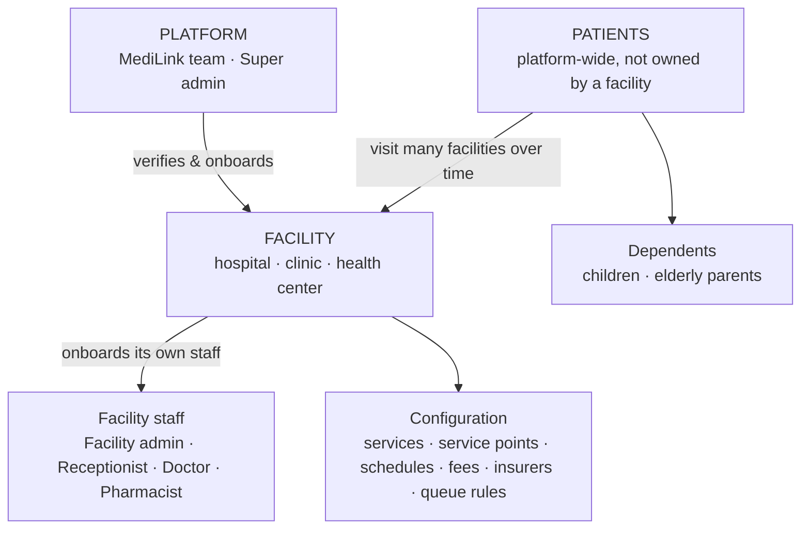

# 00 · System overview

Status: Draft v0.2 · Part of the [system analysis](../README.md)

## What MediLink is

MediLink Rwanda is a multi-facility healthcare access platform. Before leaving home, patients can know whether a facility offers the service they need, accepts their insurance, has a free slot, and how long the wait is. Facilities get one system for appointments, walk-ins, the live queue, consultations, prescriptions, dispensing and payments.

## The central concept: the visit

The system is built around the **visit**: one patient's journey through one facility on one day. It is *not* built around the appointment.

- A **booking** is one way a visit can start. A walk-in, a remote queue join, a referral and a follow-up are others.
- Every dashboard is a view of visits. Reception creates and checks them in, doctors consult, pharmacists dispense, receptionists bill, patients track them, and admins measure them.
- Because booked and walk-in patients are both visits, they share one queue and one set of rules. No patient is second-class.

If the system were modelled around appointments, walk-ins would be bolted on later and the queue would break. Rwanda's public facilities are walk-in heavy, so modelling around the visit is the most important design decision. See [ADR 0004](../decisions/0004-visit-centric-domain-model.md).

## Three levels

- **Patients are platform-wide.** One person visits many facilities in a lifetime, so each person has one identity, with records at each facility they visit.
- **Clinicians are platform-wide too.** Many doctors in Rwanda work at a public hospital and a private clinic. Each clinician has one identity and a membership at each facility, with its own roles and schedule.

## Phase-1 users

Patient · Super admin · Facility admin · Receptionist (also cashier) · Doctor/clinician · Pharmacist.
Details: [02 · Users, roles and permissions](02-users-roles-and-permissions.md).

## Modules

| Module | What it does | Document | Requirement prefix |
|---|---|---|---|
| Vision and scope | Problem, goals, scope, success metrics | [01](01-vision-scope-and-metrics.md) | — |
| Users and access | Roles, dashboards, permissions | [02](02-users-roles-and-permissions.md) | `FR-ACC` |
| Tenancy and onboarding | Facility registration, verification, setup, staff, master data | [03](03-tenancy-onboarding-and-master-data.md) | `FR-ONB` |
| Patients and history | Identity, dependents, walk-in registration, previous records, legacy import, sharing | [04](04-patient-identity-and-medical-history.md) | `FR-PAT` |
| Discovery, calendar and booking | Search, schedules, calendars, slots, booking, waitlist, follow-ups | [05](05-discovery-scheduling-and-booking.md) | `FR-SCH` |
| Visit and queue | Visit lifecycle, multi-stage queue, ordering, wait estimates, display | [06](06-visit-lifecycle-and-queue.md) | `FR-QUE` |
| Clinical record and pharmacy | Consultation, signing, amendments, prescriptions, dispensing, documents | [07](07-clinical-documentation-and-pharmacy.md) | `FR-CLN`, `FR-PHA`, `FR-DOC` |
| Billing and insurance | Tariffs, bills, payments, receipts, voids, cash-up, claims, subscriptions | [08](08-billing-payments-and-insurance.md) | `FR-BIL` |
| Notifications | Events, channels, preferences, reminders, announcements | [09](09-notifications-and-communication.md) | `FR-NOT` |
| Disputes and support | Disputes, complaints, support, ratings | [10](10-disputes-complaints-and-support.md) | `FR-DSP` |
| AI symptom checker | Rules-guarded ML triage and routing | [11](11-ai-symptom-checker.md) | `FR-AI` |
| Security and privacy | Law 058/2021, consent, access control, audit, retention | [12](12-security-privacy-and-compliance.md) | `FR-SEC` |
| Reporting | Facility, platform and impact reports | [13](13-reporting-and-analytics.md) | `FR-RPT` |
| Quality attributes | Performance, offline, accessibility, languages, operations | [14](14-non-functional-requirements.md) | `NFR-*` |
| Data model | Conceptual entities and relationships | [15](15-conceptual-data-model.md) | — |
| Roadmap | Phases and milestones | [16](16-roadmap-and-phasing.md) | — |
| Risks and open questions | Assumptions, risks, decisions pending | [17](17-assumptions-risks-and-open-questions.md) | — |

## Channels

| Channel | Phase | Notes |
|---|---|---|
| Patient web app (installable PWA, mobile-first) | 1 | Full patient feature set; web push for free alerts |
| Staff web app (reception, doctor, pharmacy, admin) | 1 | Works on low-end PCs and tablets |
| Waiting-room display | 1 | Browser in kiosk mode on a TV |
| Email | 1 | Confirmations, documents, staff invites |
| Mobile app (Android first) | 3 | Same API as the web |
| SMS | 3 | Alerts and phone OTP once funded |
| WhatsApp, USSD | 4 | Paid channels; same core logic behind adapters |

See [ADR 0002](../decisions/0002-web-first-paid-channels-later.md).

## How to read requirements

Each module document lists requirements as `FR-<MODULE>-<number>` with a phase tag (`P1`–`P4`). [requirements.md](../requirements.md) is the index of all modules and phases. When a requirement changes, edit it in its module document through a pull request.
