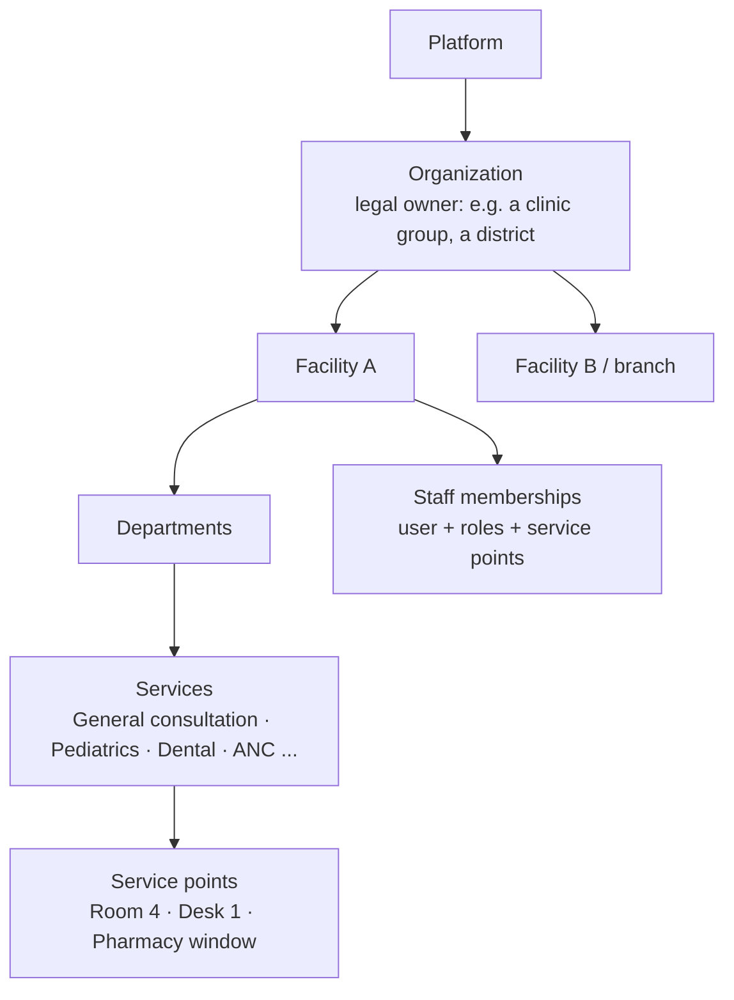
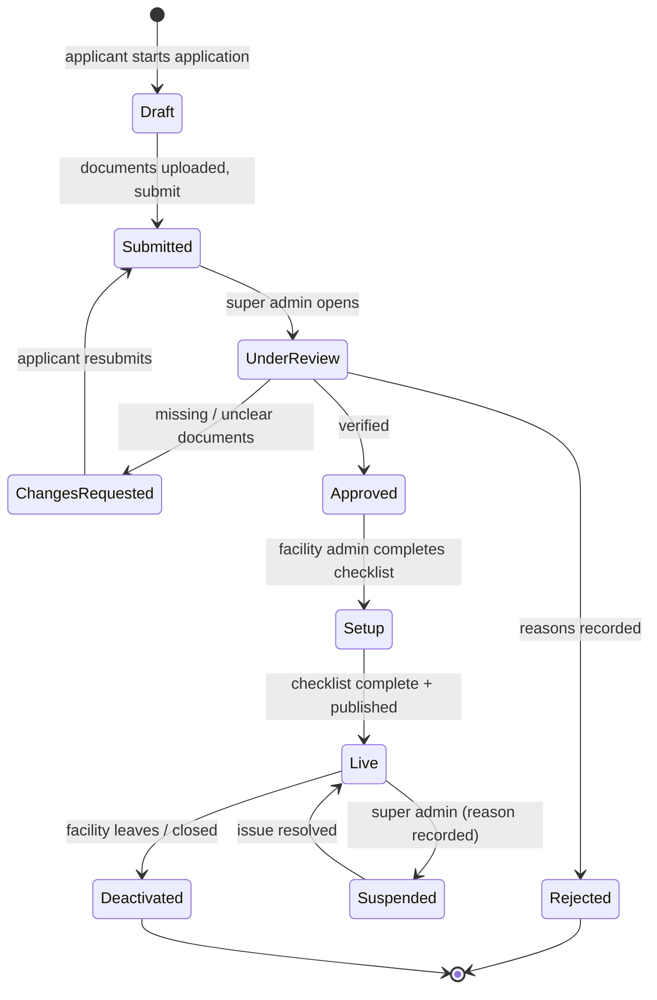

# 03 · Tenancy, facility onboarding and master data

Status: Draft v0.2

## 1. Tenancy model

- A **facility** is the tenant. All operational data belongs to exactly one facility: visits, queue, bills, clinical records and staff memberships.
- An **organization** groups facilities with the same owner. Examples are a private clinic chain, or a faith-based network. In P1 each organization has one facility. Multi-branch features (shared reports, staff across branches) come in P2. The model must support them from the start.
- **Tenant isolation:** every staff request runs inside one active facility. Data from other facilities is never visible unless the patient has given consent (see [04](04-patient-identity-and-medical-history.md)).

### Facility types (master data)

Health post · Health center · District hospital · Provincial hospital · Referral / teaching hospital · Private clinic · Polyclinic · Private hospital · Dental clinic · Eye clinic · Diagnostic center.

**Level of care** comes from the facility type: primary, secondary or tertiary. Routing and the symptom checker use it (see [11](11-ai-symptom-checker.md)).

**Ownership:** public · private · faith-based · NGO.

## 2. Onboarding flow

### 2.1 Application (by the facility)

Two ways to start:
- **Self-registration** on the MediLink website.
- **The super admin creates the application** on the facility's behalf and invites the applicant. This is useful for pilot and public facilities.

The application collects:

| Information | Detail |
|---|---|
| Facility identity | Name, type, ownership, organization |
| Location | Province → District → Sector → Cell → Village, street address, GPS pin on a map |
| Contacts | Phone, email, applicant name and position |
| Legal documents | Ministry of Health operating licence; Rwanda Development Board (RDB) registration (private); tax number (TIN); other accreditation |
| Insurers | Insurers the facility claims to have contracts with, with contract evidence where possible |
| Proposed facility admin | Name, email, phone |
| Agreements | Terms of service, data processing agreement (see [12](12-security-privacy-and-compliance.md)) |

### 2.2 Verification (by the super admin)

- Check the licence and registration documents, and confirm the facility type and location. A phone call or visit is recorded as a verification note.
- **Decisions:** approve, request changes (with a comment for each item), or reject (with reasons). The applicant is notified in every case.
- The verification history is permanent and visible to the super admin.
- **Licence expiry dates** are stored. The system reminds the facility 60 and 30 days before expiry. An expired licence triggers a review and can lead to suspension.

### 2.3 Setup checklist (by the facility admin)

A facility becomes **Live**, and searchable by patients, only when every required item is done.

| # | Step | Required |
|---|---|---|
| 1 | Profile: description, photos, opening hours, contacts | ✓ |
| 2 | Departments and services: name, description, consultation fee, ticket prefix | ✓ (at least one service) |
| 3 | Service points (rooms, desks, pharmacy window) | ✓ |
| 4 | Accepted insurers and co-pay rules per insurer (see [08](08-billing-payments-and-insurance.md)) | ✓ (can be "none / cash only") |
| 5 | Tariff: services, procedures, medicines with prices | ✓ for billed items |
| 6 | Staff invited and roles assigned: at least one receptionist role and one doctor | ✓ |
| 7 | Doctor schedules (weekly template) | ✓ for bookable services |
| 8 | Queue rules: stages, payment timing, priority rules, grace period, booking-to-walk-in ratio, walk-in reserve | ✓ (defaults offered) |
| 9 | Document branding: letterhead, logo, stamp image, footer | ✓ |
| 10 | Waiting-room display link | optional |
| 11 | Legacy data import: patient list, scanned records (see [04](04-patient-identity-and-medical-history.md)) | optional |
| 12 | Subscription plan chosen | ✓ (P2: payment) |

Sensible defaults let a small clinic finish setup in under an hour.

### 2.4 Suspension and deactivation

| Situation | Effect |
|---|---|
| **Suspended** (licence expired, serious disputes, unpaid subscription past grace) | The facility is hidden from search and new bookings are blocked. **Existing bookings for today and the active queue keep working.** The facility can still see and export its data. Affected patients with future bookings are notified. |
| **Deactivated** (facility leaves or closes) | The facility receives a full **data export**. Clinical records are retained according to law and the agreement (see [12](12-security-privacy-and-compliance.md)). Patients keep access to their own records and documents. |

## 3. Facility configuration reference

| Area | Settings |
|---|---|
| Hours | Opening hours per weekday; service-specific hours; break times |
| Calendar | Closures, public holidays (inherited from the platform, can be overridden), Umuganda morning (last Saturday) |
| Services | Name (three languages), department, fee, duration, bookable?, walk-in?, remote join?, ticket prefix, level of care, age or sex restrictions (e.g. pediatrics, ANC) |
| Queue | Stages enabled (reception, payment before or after, consultation, pharmacy); priority classes; grace window; no-response timeout; auto-close time; booking-to-walk-in ratio; remote-join cutoff |
| Booking | Booking window (how far ahead), slot length, max bookings per slot, walk-in reserve (%), cancellation cut-off, no-show policy |
| Billing | Payment timing, payment methods accepted, receipt numbering prefix, insurer rules |
| Documents | Letterhead, signature and stamp images, document templates, sick-note maximum days |
| Notifications | Facility-specific reminder timings, announcement sender name |

All configuration changes are logged with the old value, the new value, who changed it and when.

## 4. Staff onboarding

1. The facility admin invites a person by email and assigns roles and, optionally, service points.
2. If the email already has a MediLink account (for example a doctor working elsewhere), the system adds a **new membership** instead of creating a second account.
3. The invitee accepts, sets a password and two-factor login, and enters their licence number if they're a clinician.
4. The facility admin attests that the licence was checked. This is a mandatory tick, logged.
5. Clinicians get a schedule. The system warns if it **overlaps their schedule at another facility**, showing only that a conflict exists, not the other facility's details.

## 5. Master data (managed by the super admin)

Master data is shared by all facilities, versioned, and translated into Kinyarwanda, English and French where it is shown to patients.

| Master data | Used for | Source |
|---|---|---|
| Administrative locations (provinces, districts, sectors, cells, villages) | Addresses, search, reports | National administrative list |
| Facility types and levels of care | Routing | MediLink |
| Service catalogue | Standard service names for search ("Pediatrics" everywhere) | MediLink; facilities map their services to it |
| Insurers | Insurance acceptance and billing | RSSB (Mutuelle, RAMA), MMI, private insurers |
| Drug catalogue | Prescriptions | Based on Rwanda's National Essential Medicines List; generic name, strength, form |
| Diagnosis codes | Clinical records, reports, AI training labels | ICD-10 (ICD-11 ready) |
| Symptom list | Reason for visit, AI | MediLink, clinician-reviewed |
| Public holidays | Calendars | Updated yearly |
| Document templates (defaults) | Prescriptions, sick notes, receipts, referral letters | MediLink |
| Dispute categories, reasons for no-show / void / reorder | Consistent reporting | MediLink |

Changing master data never rewrites history. A record keeps the code and display text it was created with.

## 6. Requirements

| ID | Requirement | Phase |
|---|---|---|
| FR-ONB-01 | Facility self-registration with documents, and super admin-created applications | P1 |
| FR-ONB-02 | Verification workflow: approve, request changes, reject, with reasons and full history | P1 |
| FR-ONB-03 | Setup checklist; facility searchable only when Live | P1 |
| FR-ONB-04 | Facility configuration (hours, services, service points, queue, booking, billing, documents) with change log | P1 |
| FR-ONB-05 | Staff invitation adds a membership to an existing account when the person already exists | P1 |
| FR-ONB-06 | Schedule conflict warning across facilities without revealing the other facility's details | P1 |
| FR-ONB-07 | Suspension hides the facility and blocks new bookings but keeps today's operations running | P1 |
| FR-ONB-08 | Licence expiry tracking and reminders | P1 |
| FR-ONB-09 | Full facility data export on request and on deactivation | P1 |
| FR-ONB-10 | Master data management with versioning and translations | P1 |
| FR-ONB-11 | Organization with multiple facilities (shared reports, staff across branches) | P2 |
