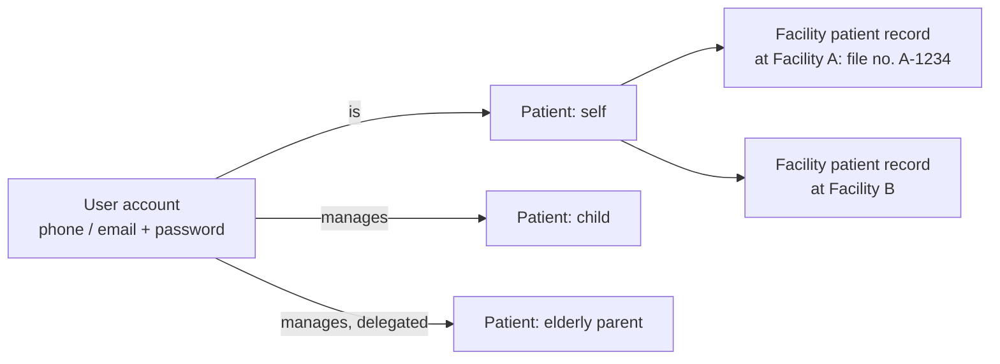

# 04 · Patient identity and medical history

Status: Draft v0.2

## 1. Accounts are not patients

A **user account** is a login. A **patient** is a person who receives care. They are different things:

- One phone or email often serves a whole household. A grandmother may have no phone of her own, and children never do.
- A walk-in can be a patient at a facility without having any account.

| Concept | Meaning |
|---|---|
| **User account** | Login credentials, preferences, notification settings |
| **Patient** | Platform-wide person: names, date of birth, sex, identifiers, contacts, allergies, chronic conditions |
| **Facility patient record** | The patient as known at one facility: that facility's file number, first-visit date, notes for reception. **Visits, clinical records and bills hang here.** |
| **Guardian / delegate link** | An account managing a patient: guardian of a minor, or a delegate of an adult who consented |

## 2. Identifiers

| Identifier | Who has it | Rule |
|---|---|---|
| National ID (16 digits, NIDA) | Rwandan adults | Unique; format-checked; strongest match key |
| Passport / refugee ID | Foreigners, refugees | Stored with type and issuing country |
| Insurance member number | Insured patients | Per insurer; not unique to a person (dependents share a principal) |
| Phone number | Most adults | **Not unique to a patient**; used for contact and login |
| Facility file number | Patients of facilities with existing paper or electronic files | Unique within one facility; links MediLink to the paper file |
| MediLink patient number | Every patient | Generated, never reused |

## 3. Registration paths

| Path | Who | Notes |
|---|---|---|
| Self sign-up | Patient on the web app | Email or password in P1, phone OTP in P3. Patient adds own details and insurance. |
| Add dependent | Patient (caregiver) | Child (no ID, birth certificate optional) or adult with consent |
| Walk-in registration | Receptionist | Minimum fields: names, sex, date of birth (or estimated age), phone if any, insurance. Done in under one minute. |
| Legacy import | Facility admin | Bulk import of the facility's existing patient register (see §6) |

### 3.1 Claiming a record

When someone registered as a walk-in later signs up with the same phone or national ID, the system offers to **link** the existing patient record to the new account.

- Linking requires proof: a code sent to the registered contact, or confirmation by a receptionist with the patient's ID.
- Once linked, the patient sees their full history.

### 3.2 Duplicates and merging

Duplicates will happen: spelling differences, or the same person registered at two facilities.

- **On registration**, the system suggests possible matches (same national ID, or similar name + date of birth + phone) before creating a new patient.
- **Merging** is a request:
  - Within one facility, it's requested by the receptionist and approved by the facility admin.
  - Across facilities, the super admin approves.
- A merge keeps every record, moves links to the surviving patient, is logged, and **can be undone**.

### 3.3 Dependents growing up

- At the legal age of majority (to be confirmed with legal review), the guardian is notified. The dependent can then claim their own account, and the guardian's access ends unless the dependent re-grants it.
- An adult can delegate access to a caregiver, and revoke it at any time.

## 4. Health profile (patient level)

These belong to the person, not to one visit, because they matter at every facility.

| Item | Source | Status |
|---|---|---|
| Allergies (drug, food, other; reaction; severity) | Clinician or patient | Patient-reported entries are shown as **"unverified"** until a clinician confirms |
| Chronic conditions (e.g. hypertension, diabetes, asthma) | Clinician or patient | Same |
| Current long-term medicines | Prescriptions or patient | Same |
| Blood group, pregnancy status (with due date) | Clinician | Pregnancy status expires after the due date |
| Emergency contact | Patient | — |

**Safety rule:** allergies are shown prominently on every consultation and prescription screen, and are checked when a medicine is prescribed.

## 5. Previous records: retrieving history

A doctor seeing a returning patient must get the full history quickly. A patient must be able to see everything about themselves.

### 5.1 What a clinician sees

| Source | Visible to a doctor at Facility A |
|---|---|
| Visits and clinical records at Facility A | ✓ always (treatment relationship) |
| Legacy records imported by Facility A | ✓ always |
| Patient's health profile (allergies, conditions) | ✓ always (safety) |
| Records from Facility B | Only with **patient consent** (§7) |
| Patient-uploaded documents | Only those the patient chooses to share with Facility A, or with consent |

### 5.2 History view

- **Timeline:** every visit, newest first, with date, facility, service, doctor, diagnoses, prescriptions and documents.
- **Filters:** by type (consultation, prescription, document, legacy), by diagnosis, by date range.
- **Problem summary:** active diagnoses, chronic conditions, allergies, current medicines.
- **Search:** find a patient by name, phone, national ID, facility file number, MediLink number, or ticket number for today.
- **Performance:** history opens in under 2 seconds for a patient with up to 200 visits (see [14](14-non-functional-requirements.md)).

### 5.3 What the patient sees

Everything about themselves and their dependents: visits, diagnoses in plain language, prescriptions and dispensing status, documents, receipts, and who accessed their record. The only exception is clinicians' **private notes** (see [07](07-clinical-documentation-and-pharmacy.md)).

## 6. Bringing in previous data (legacy records)

Facilities joining MediLink already have years of paper files or an old system. Without their history, MediLink is less useful on day one. There are three ways to bring it in.

| Method | What | Who | Phase |
|---|---|---|---|
| **A. Patient register import** | CSV/Excel of existing patients: names, date of birth, sex, phone, ID, insurance, facility file number | Facility admin | P1 |
| **B. Scanned paper records** | Photos or PDF scans of paper files, attached to the patient, with document date and type | Facility admin, receptionist, doctor | P1 |
| **C. Structured back-entry** | A doctor enters key history (past diagnoses, allergies, chronic conditions, long-term medicines) from the paper file | Doctor | P1 |
| D. Electronic import | Structured import from an existing electronic record system | MediLink team + facility | P4 |

### Rules

- **Import preview:** an upload shows column mapping, validation errors and **likely duplicates** before anything is saved. Nothing is imported until the facility admin confirms.
- **Batches:** every import is a batch with who, when, file and counts. A batch can be rolled back for 7 days if no visits have been attached to its records.
- **Marked as legacy:** imported and back-entered data is always labelled **"Historical, entered from paper by Dr X on date"**. It is never shown as if it were recorded at the original visit.
- **Scans** are documents like any other: encrypted, access-controlled, logged (see [07](07-clinical-documentation-and-pharmacy.md)).
- **No patient notification** is sent for imported records. When a patient later claims their record, the history becomes visible to them.

## 7. Consent and sharing between facilities

| Mechanism | How | Phase |
|---|---|---|
| **Share at the visit** | The patient shows a one-time code or QR from their app at Facility B. Facility B gets read access to their history for a set period (default 30 days, configurable by the patient). | P2 |
| **Standing consent** | The patient allows "any facility I visit" to see their history | P2 |
| **Share a single document** | The patient sends an expiring link to a document | P1 |
| **Emergency** | The doctor at Facility B declares an emergency with a reason → read access, logged, and the patient is notified | P2 |
| **Revoke** | The patient revokes access at any time; past views remain logged | P2 |

Every cross-facility view appears in the patient's **access history**.

## 8. Requirements

| ID | Requirement | Phase |
|---|---|---|
| FR-PAT-01 | Separate user account, patient, and facility patient record | P1 |
| FR-PAT-02 | Patient self sign-up with email/password; phone OTP added in P3 | P1 |
| FR-PAT-03 | Dependents and delegated access, with switching between profiles | P1 |
| FR-PAT-04 | Walk-in registration by receptionist with minimum fields in under one minute | P1 |
| FR-PAT-05 | Duplicate detection on registration; merge by request and approval, reversible | P1 |
| FR-PAT-06 | Claim an existing patient record with proof | P1 |
| FR-PAT-07 | Identifiers: national ID, passport/refugee ID, insurance numbers, facility file number, MediLink number | P1 |
| FR-PAT-08 | Patient health profile (allergies, conditions, long-term medicines) with verified / unverified status | P1 |
| FR-PAT-09 | Clinical history timeline with filters, problem summary and search | P1 |
| FR-PAT-10 | Legacy patient register import with preview, validation, duplicate detection and rollback | P1 |
| FR-PAT-11 | Scanned legacy records attached to patients | P1 |
| FR-PAT-12 | Structured back-entry of history, labelled as historical | P1 |
| FR-PAT-13 | Patient views all own and dependents' records except private notes | P1 |
| FR-PAT-14 | Patient access history (who viewed what, when) | P1 |
| FR-PAT-15 | Cross-facility sharing by one-time code, standing consent, emergency access, revocation | P2 |
| FR-PAT-16 | Dependent reaching majority: notification and handover | P2 |
| FR-PAT-17 | Electronic import from existing record systems | P4 |
