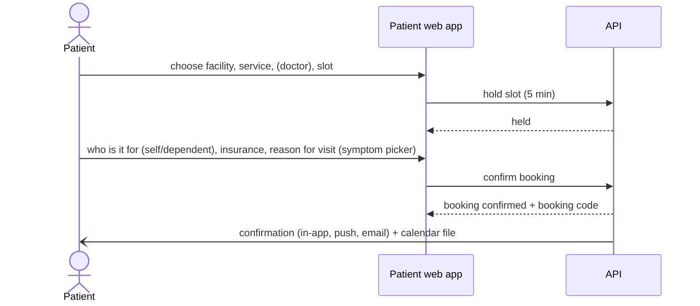

# 05 · Discovery, calendars, scheduling and booking

Status: Draft v0.2

## 1. Discovery (finding care)

### Search

| Filter | Notes |
|---|---|
| Location | Current location (with permission), or district / sector chosen from a list; distance shown |
| Service | Standard service catalogue ("Pediatrics", "Dental", "Antenatal care"…) |
| Insurance | Patient's saved insurance pre-selected |
| Open now / open today | From facility calendars |
| Level of care | Health center, hospital… (with a hint about the Mutuelle referral pathway) |
| Availability | Has a slot today / remote join open |
| Facility type and ownership | Public, private, faith-based |

Results appear as a **list and a map**. Each result shows:
- distance
- open or closed status
- accepts your insurance: yes / no / unknown
- consultation fee and **your estimated share**
- next available slot
- current queue load: low / medium / high, plus the estimated wait for walk-ins

### Facility profile

Shows:
- description, photos, address, map, directions link
- hours and upcoming closures
- services, with fees and insurers accepted per service
- doctors (name, specialty, days present)
- current queue load
- ratings (P2)
- contacts

**Referral pathway hint:** when a Mutuelle patient picks a referral hospital without a referral, show this notice:

> Mutuelle may not cover this visit without a transfer from a health center. Nearby health centers: …

The patient can continue anyway. The hint informs; it never blocks.

### Public pages

Facility profiles are public web pages that search engines can index. People find "clinic near Remera accepting RAMA" through Google, which is a free acquisition channel for the web-first launch.

## 2. Calendars

There are four calendars, all derived from the same data.

| Calendar | Owner | Contents |
|---|---|---|
| **Facility calendar** | Facility admin | Opening hours, service hours, closures, public holidays, Umuganda morning, special days (e.g. vaccination campaign) |
| **Doctor calendar** | Doctor and facility admin | Weekly schedule at each facility, leave and absence, booked load per day, conflicts across facilities |
| **Reception calendar** | Receptionist | Day and week view of bookings per service and doctor; expected arrivals |
| **Patient calendar** | Patient | Own and dependents' appointments, follow-ups, recurring plans, medicine schedule; **add to phone calendar** (`.ics` download and a private subscription link) |

### Calendar rules

- **Time zone:** Africa/Kigali (UTC+2, no daylight saving) everywhere. Times are stored in UTC and displayed in Kigali time.
- **Public holidays** come from platform master data, updated yearly. A facility can choose to open on a holiday.
- **Umuganda:** the last Saturday of each month, morning. Each facility configures its own behaviour (closed, or opening late).
- **Closures** (planned or unplanned) automatically find affected bookings and start the **disruption flow** (§6).

## 3. Schedules and slots

### Schedule templates

A doctor's **weekly template** per facility, for example:

> Mon–Fri 08:00–12:00 General consultation, Room 4 · Wed 14:00–17:00 Pediatrics, Room 2

Each template block defines:
- service
- service point
- slot length (e.g. 15 min)
- **capacity per slot**
- **bookable share** (e.g. 50%; the rest is reserved for walk-ins)

**Exceptions** override the template on specific dates: leave, training, extra sessions.

Services without named doctors (e.g. "General consultation, any available clinician") get a **service schedule** instead. Any doctor on duty serves it.

### Slot generation

```
available bookable slots = template blocks
                           − exceptions (leave, closures, holidays)
                           − already booked
                           − walk-in reserve
```

- Slots are generated for the **booking window** (e.g. the next 30 days, configurable).
- Changing a template affects future unbooked slots only. Existing bookings that no longer fit go to the disruption flow.

### Booking versus remote queue join

| | **Booking** | **Remote queue join** |
|---|---|---|
| When | Future date and time slot | Today only |
| Gives | Appointment at a time | A place in today's walk-in queue |
| Best for | Planned visits, specialists, follow-ups | Sick today, public facilities that work first-come-first-served |
| Rules | Grace window around slot time (see [06](06-visit-lifecycle-and-queue.md)) | Must check in before reaching the front, or the ticket is passed over |
| Available when | Service is bookable | Service allows remote join, and before the remote-join cutoff time |

## 4. Booking

### Flow



### Rules

| Rule | Default (configurable per facility) |
|---|---|
| Slot hold while booking | 5 minutes, then released |
| Active bookings per patient | Max 3 future bookings per patient (stops slot hoarding) |
| Same service same day | One booking per patient per service per day |
| Cancellation by patient | Allowed until 2 hours before slot; later counts as late cancellation |
| Reschedule | Same as cancel + book, keeps history |
| Booking for dependents | Allowed; the dependent is the patient, the account holder is the contact |
| Booking by reception (phone call) | Allowed, also for patients without an account (contact by phone call) |
| Reason for visit | Required: pick from symptom list + optional free text (**feeds the AI training data**, see [11](11-ai-symptom-checker.md)) |
| Insurance | Patient selects the insurance to use; the system warns if the facility doesn't accept it |
| Cost estimate | Fee and estimated patient share shown before confirming |

### No-show policy

- A booking not checked in by the end of its grace window is marked **no-show** automatically. The receptionist can reverse it with a reason (e.g. the patient was present but not checked in).
- **Strikes:** 3 no-shows in 90 days → warning; 4 → booking limited to 1 active booking for 30 days. The numbers are configurable at platform level. Patients can dispute a strike (see [10](10-disputes-complaints-and-support.md)).
- In P1 no-shows are never charged money. Deposits for booking come later with mobile money (P3), and only if facilities want them.

## 5. Waitlist, follow-ups and recurring visits

| Feature | Description | Phase |
|---|---|---|
| **Follow-up booking** | During the consultation, the doctor sets "follow-up in N days/weeks" → the patient gets a booking or a reminder to book | P1 |
| **Recurring plans** | A series of visits generated from a plan: antenatal care schedule, monthly chronic-care refills, child vaccination schedule (national immunization schedule from master data) | P2 |
| **Waitlist** | When no slot is free, the patient joins a waitlist. When a slot frees up, the first person is offered it for 15 minutes, then the next. | P2 |
| **Medicine schedule** | Patient calendar shows when to take each medicine (from prescription frequency and duration); reminders optional | P2 |

## 6. Disruption flow

Disruptions include a doctor absent, a facility closure, or a schedule change.

1. The facility admin or receptionist marks the disruption: who or what, from and to, and the reason.
2. The system lists affected bookings and remote-queue tickets.
3. Staff choose for each one, or for all:
   - move to another doctor on the same service
   - move to the next available slot
   - cancel
4. Patients are notified immediately, with the reason and options. The patient can accept the new slot, choose another, or cancel.
5. Rebooking caused by the facility **never counts as a patient cancellation or no-show**.

## 7. Edge cases

| Case | Handling |
|---|---|
| Two patients pick the same last slot | Slot hold is atomic; the second gets "just taken" and nearby alternatives |
| Patient books at two facilities for the same morning | Allowed but warned (they may genuinely want options); counts toward the booking cap |
| Doctor schedule overlaps another facility | Warning to the facility admin when saving (see [03](03-tenancy-onboarding-and-master-data.md)) |
| Booking for a child at an adult-only service | Blocked by the service's age rule |
| Facility suspended with future bookings | Patients notified; bookings stay valid unless the facility is deactivated |
| Patient arrives on the wrong day | Receptionist can check them in as a walk-in; the booking stays for its own date |

## 8. Requirements

| ID | Requirement | Phase |
|---|---|---|
| FR-SCH-01 | Search facilities by location, service, insurance, open status, level of care and availability; list and map | P1 |
| FR-SCH-02 | Facility profile with services, fees, estimated patient share, insurers, hours, doctors, queue load | P1 |
| FR-SCH-03 | Public facility pages that search engines can index | P1 |
| FR-SCH-04 | Referral pathway hint for Mutuelle patients choosing higher-level facilities | P1 |
| FR-SCH-05 | Facility calendar with hours, closures, holidays, Umuganda | P1 |
| FR-SCH-06 | Doctor weekly templates and exceptions per facility | P1 |
| FR-SCH-07 | Slot generation with capacity, bookable share and walk-in reserve | P1 |
| FR-SCH-08 | Booking, reschedule and cancel by patient and by receptionist, with atomic slot hold | P1 |
| FR-SCH-09 | Remote queue join for today, with cutoff | P1 |
| FR-SCH-10 | Reason for visit captured with the structured symptom picker | P1 |
| FR-SCH-11 | Patient calendar with dependents and `.ics` export / subscription | P1 |
| FR-SCH-12 | Reception and doctor calendars (day and week) | P1 |
| FR-SCH-13 | No-show detection, reversal with reason, strike policy | P1 |
| FR-SCH-14 | Disruption flow with bulk rebooking and notification | P1 |
| FR-SCH-15 | Follow-up booking from the consultation | P1 |
| FR-SCH-16 | Recurring care plans (ANC, chronic refills, immunization) | P2 |
| FR-SCH-17 | Waitlist with timed offers | P2 |
| FR-SCH-18 | Medicine schedule in the patient calendar | P2 |
