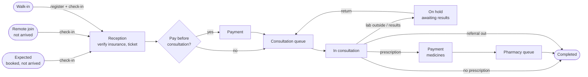
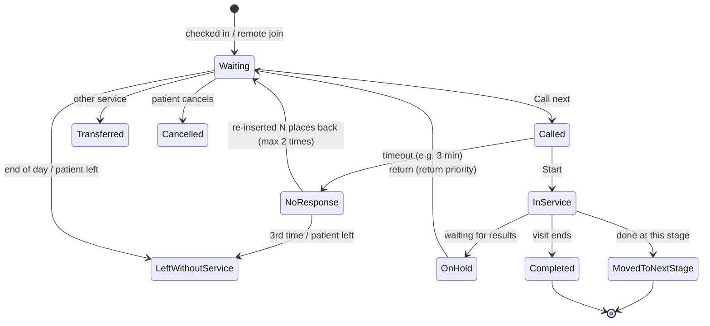

# 06 · Visit lifecycle and the live queue

Status: Draft v0.2 · This is the core of the product. If the queue is wrong, patients stop trusting MediLink.

## 1. Concepts

| Concept | Meaning |
|---|---|
| **Visit** | One patient's journey through one facility on one day. Holds the ticket, stages, clinical record, prescriptions, bill and documents. |
| **Visit source** | How the visit started: booking, remote join, walk-in, phone booking, follow-up, referral, emergency |
| **Stage** | A step of the visit at a service point type: Reception → Payment → Consultation → Payment → Pharmacy. Facilities choose which stages they use. |
| **Ticket** | The patient's place in the queue of the **current stage**. Has a number shown to the patient, e.g. `G-023`. |
| **Queue** | All waiting tickets for one service (or service point) at one stage today |

## 2. Visit sources

| Source | Starts as | Enters the live queue when |
|---|---|---|
| Online booking (patient) | **Expected** | Checked in (by reception, or by the patient at the facility in P2) |
| Phone booking (reception) | Expected | Checked in |
| Follow-up booked by doctor | Expected | Checked in |
| Remote queue join | **Remote, not arrived** (holds a place) | Already in the queue; must check in before reaching the front |
| Walk-in | — | Registered and checked in at reception |
| Referral in (P2) | Expected | Checked in |
| Emergency | — | Immediately, top priority; handled outside normal ordering |

**Booked patients are never in the live queue until they arrive.** Otherwise one no-show would make everyone's wait estimate wrong. The reception board shows them in a separate **Expected** list.

## 3. Stages and flow



Payment stages are configurable: before consultation, after, both, or none (e.g. bill at exit). For small clinics, reception and payment are the same desk and the same person.

## 4. Ticket states



Every transition stores: from-state, to-state, time, the user (or "system"), the device, and a reason where required. This history is the evidence for disputes ([10](10-disputes-complaints-and-support.md)) and the data for wait-time reports ([13](13-reporting-and-analytics.md)).

## 5. Ordering rules ("who is next?")

When a doctor presses **Call next**, the system picks the next ticket from the doctor's **own assigned tickets** (patients booked with this doctor) and the **service's shared pool**, using these rules in order:

1. **Emergency.** Flagged by reception or a doctor; always first. Usually handled outside the queue.
2. **Return from results.** Patients coming back from the lab, if the facility enables return priority.
3. **Priority patients.** Elderly (age from facility setting, default 65+), visibly pregnant, people with disabilities, very sick as judged by staff. Reception sets the priority flag **with a reason**.
4. **Booked patients within their grace window** and walk-ins, **interleaved by the facility's ratio**. For example, 1:2 means after one booked patient, two walk-ins are called, as long as both kinds are waiting.
5. Within each group: booked patients by **slot time**, walk-ins and remote joiners by **check-in or join time** (first come, first served).

**Booked patients' grace window** (default −30 min to +15 min around slot time):

| Arrival | Treatment |
|---|---|
| Early | Waits until the window opens, then is ordered by slot time |
| Within the window | Ordered by slot time |
| Late beyond the window | Becomes a walk-in (ordered by check-in time), or reception offers a new slot |

**Remote joiners:**
- They hold their place while not on site.
- When they come within **K places** of the front (default 5) and have not checked in, they are **passed over**: moved back K places, up to 2 times, then they lose the ticket.
- They get warnings before each step (see [09](09-notifications-and-communication.md)).

**Manual reorder** by the receptionist or facility admin is allowed for real-life situations, with these controls:
- it requires a reason from a list plus a note
- it is logged
- the facility admin reviews it
- it is counted in reports per staff member

This is the main guard against favouritism and bribery.

**Concurrency:**
- "Call next" is atomic. Two doctors pressing it at the same moment never get the same patient.
- Check-in is idempotent. Pressing twice, or two receptionists at once, creates one ticket.
- Every state change checks the ticket's current version, and stale screens are refreshed.

## 6. Wait-time estimate

### Formula (phase 1)

```
estimated wait ≈ (people ahead of you at this stage, after applying ordering rules)
                 × average service time at this stage
                 ÷ number of doctors currently serving this service
```

- **Average service time** comes from a rolling average of today's completed consultations at this service. If there is too little data today, it falls back to the historical average for the same weekday and hour, and then to the duration configured for the service.
- **Booked patients' slot times** are taken into account. A patient with a 10:00 slot is expected to enter at 10:00, and the estimate for walk-ins includes them.
- **Shown as a range, rounded to 5 minutes**, e.g. "30–45 min". Never a single exact number.
- **Status messages** replace the estimate when it can't be trusted: "Doctor on break, resumes 13:00", "Doctor attending an emergency", "Queue paused".
- **Accuracy is measured** (shown range versus actual call time) and reported. See [13](13-reporting-and-analytics.md).

### Time to leave

```
leave home at ≈ estimated call time − travel time − buffer (10 min)
```

- In P1, travel time is set by the patient per facility (e.g. "I live 30 minutes away").
- From P2, it is estimated from location if the patient allows it.

## 7. What each person sees

| Viewer | Sees |
|---|---|
| **Patient (tracker)** | Ticket number, current stage, people ahead, estimated wait range, time-to-leave, status messages, check-in button (P2: by QR at the facility), "I'm running late" / "Cancel" |
| **Receptionist (today board)** | Expected list (booked, not arrived, with slot time) · On-site list per service and stage · Remote joiners not yet arrived · Flags: priority, emergency, unpaid, insurance unverified · Actions |
| **Doctor (my queue)** | Waiting patients for their service (own + shared pool) in calling order, reason for visit, priority flags, age and sex; Call next / Recall / No response / Start / Transfer / Complete |
| **Pharmacist** | Prescriptions ready for dispensing (paid if required) |
| **Facility admin (operations board)** | All queues: length, longest wait, doctors on duty and their state, bottleneck stage, reorder count |
| **Waiting-room display** | "Now serving `G-023` → Room 4", next 5 tickets per service, scrolling announcements; chime when a number is called. **No names, ever.** |

## 8. Daily operations

- **Start of day:** ticket numbering restarts per service (e.g. `G-001`). Doctors mark themselves "on duty" at their service point.
- **Breaks:** a doctor sets "On break until 13:00", and waits update.
- **End of day** (configured closing time + buffer):
  - waiting tickets are closed as *left without service*
  - remote tickets expire
  - visits with unsigned clinical records stay open on the doctor's **Unsigned records** list
  - unpaid bills stay on the receptionist's list
- **Connectivity loss at reception:**
  - The staff app shows a clear offline banner.
  - Actions are queued and retried with their original times when the connection returns.
  - **Operational fallback:** a printed sheet of pre-numbered tickets so reception can keep working on paper, then enter the tickets into the system later with real times.
  - The pilot training covers this procedure.

## 9. Edge cases

| Case | Handling |
|---|---|
| Two receptionists check in the same patient | Idempotent; one ticket |
| Doctor calls a patient who has left | No response → re-insert → after the limit, left without service |
| Patient is booked with Dr A, but Dr A is absent | Disruption flow ([05](05-discovery-scheduling-and-booking.md)): moved to the shared pool, keeps slot-time priority |
| Emergency arrives mid-morning | Takes the next doctor; all estimates update; tracker shows "delays possible" |
| Patient must go to the lab and come back | On hold; returns with return priority |
| Patient needs a different service | Transfer: new ticket in the other service, keeping the original arrival time for fairness |
| Patient wants to leave and come back later | "Step out" up to 30 min: keeps place but is passed over if called while out |
| Child and parent both need consultation | Two visits, two tickets; can be linked as a family to be called together (P2) |
| Patient pays but the doctor leaves early | Disruption flow + refund or re-attend next day (billing rules in [08](08-billing-payments-and-insurance.md)) |
| Patient arrives at a remote-join facility without a smartphone | Normal walk-in at reception |
| Receptionist moves a friend to the front | Allowed only with a reason, logged, reported and reviewed |

## 10. Requirements

| ID | Requirement | Phase |
|---|---|---|
| FR-QUE-01 | Visit as the central record, with source, stages, ticket and timeline | P1 |
| FR-QUE-02 | Expected list (booked, not arrived) separate from the live queue | P1 |
| FR-QUE-03 | Check-in of booked patients and walk-in registration produce one ticket (idempotent) | P1 |
| FR-QUE-04 | Configurable stages including payment before or after consultation and pharmacy | P1 |
| FR-QUE-05 | Ordering rules: emergency, return, priority, booked/walk-in interleave ratio, FIFO | P1 |
| FR-QUE-06 | Grace window for booked patients; late arrivals become walk-ins | P1 |
| FR-QUE-07 | Remote joiners hold a place; pass-over rule when not checked in | P1 |
| FR-QUE-08 | Atomic Call next; versioned state changes; no double-calling | P1 |
| FR-QUE-09 | Ticket state machine with every transition recorded (who, when, reason) | P1 |
| FR-QUE-10 | Manual reorder only with reason; logged; reported per staff member | P1 |
| FR-QUE-11 | Wait estimate as a range with status messages; time-to-leave | P1 |
| FR-QUE-12 | Real-time updates to all boards, trackers and display (< 2 s) | P1 |
| FR-QUE-13 | Waiting-room display with ticket numbers only and chime | P1 |
| FR-QUE-14 | Doctor status: on duty, break, emergency, off | P1 |
| FR-QUE-15 | End-of-day auto-close rules | P1 |
| FR-QUE-16 | Offline banner, action retry, and paper fallback procedure | P1 |
| FR-QUE-17 | Transfer between services keeping original arrival time | P1 |
| FR-QUE-18 | Self check-in by QR at the facility | P2 |
| FR-QUE-19 | Travel time from location for time-to-leave | P2 |
| FR-QUE-20 | Family grouping of tickets | P2 |
