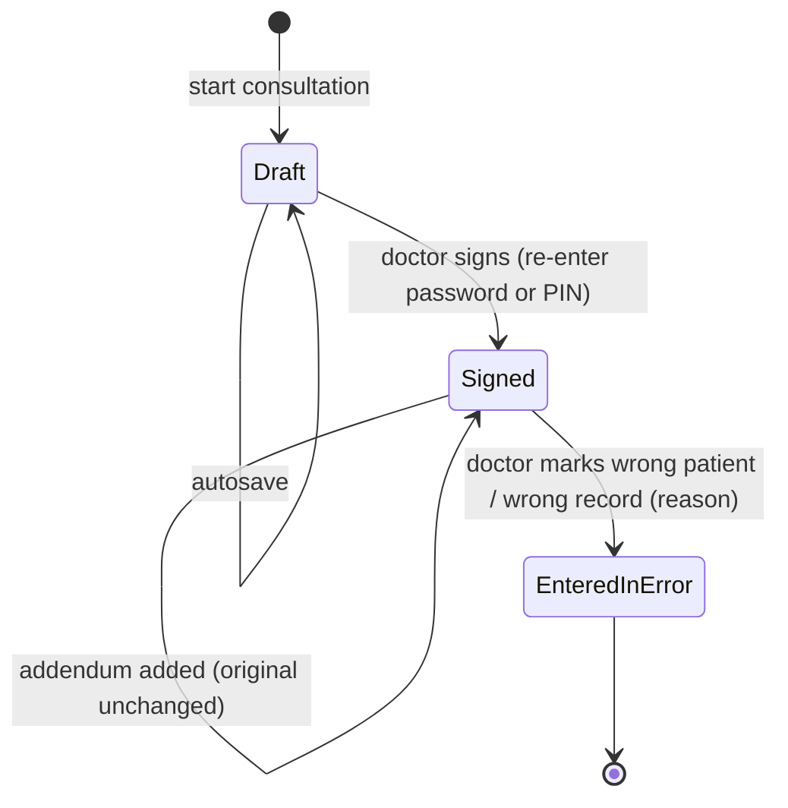
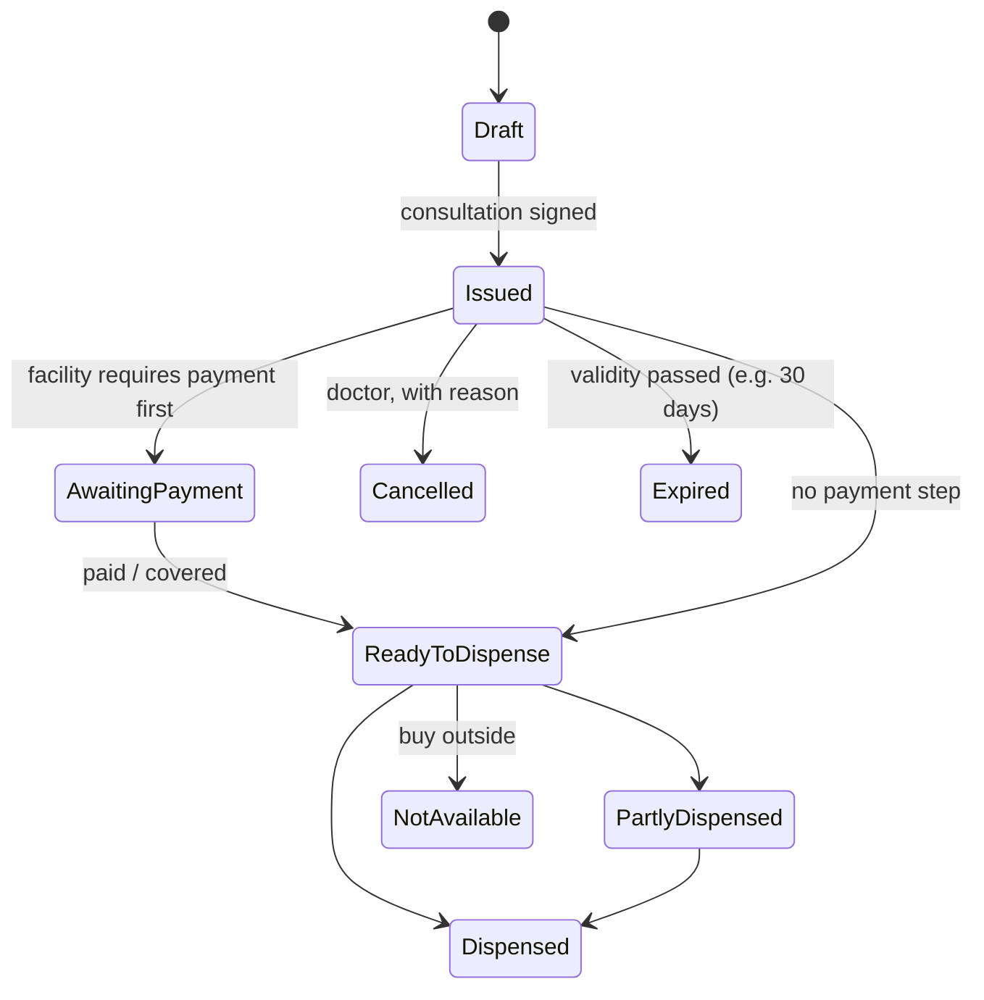

# 07 · Clinical documentation, prescriptions, pharmacy and documents

Status: Draft v0.2

The governing principle: **clinical data must be documented, attributable and permanent.** Every signed record has an author, a time and a fingerprint. Corrections are added; nothing is overwritten or deleted.

## 1. The consultation record

Created when the doctor starts a consultation. One visit has one consultation record, and more if the patient returns from the lab or is transferred.

| Section | Content | Visible to patient |
|---|---|---|
| Reason for visit | Structured symptoms from booking or check-in + free text | ✓ |
| Vitals | Temperature, blood pressure, pulse, respiratory rate, SpO₂, weight, height, MUAC for children; who recorded and when | ✓ |
| History | History of present illness, relevant past history | ✓ (summary) |
| Examination | Findings | — (clinician-only by default) |
| Diagnoses | ICD-10 codes with plain-language name; primary/secondary; **provisional or confirmed** | ✓ (plain language) |
| Private clinical notes | Reasoning, differential, sensitive observations | **✗ never** |
| Plan | Treatment plan | ✓ |
| Patient instructions | What to do, warning signs to return | ✓ |
| Prescriptions | See §3 | ✓ |
| Lab / imaging requests | Tests requested, reason | ✓ |
| Referral | To facility / specialty, reason, urgency | ✓ |
| Sick note / medical certificate | Days of rest, from–to | ✓ |
| Follow-up | Date or interval | ✓ |

**Templates per service** (P2) pre-fill sections for common visit types, such as antenatal care or a hypertension review.

### Sensitive conditions

Some diagnoses carry stigma or extra legal protection: HIV, mental health, sexual and reproductive health. For these:
- The doctor can mark the record **restricted**. It is hidden from the patient's delegates and caregivers unless the patient allows otherwise.
- Restricted records are always excluded from cross-facility sharing unless the patient explicitly includes them.
- The diagnosis is replaced by a generic label on any document the patient may show to others.

## 2. Record lifecycle: draft, signed, amended

| Rule | Detail |
|---|---|
| Autosave | Drafts save automatically every few seconds; nothing is lost if the browser closes |
| Signing | Requires the doctor to re-confirm identity (PIN or password). The record is then **locked**. The time of signing and a content fingerprint (hash) are stored. |
| No close without signature | A visit cannot be completed until its consultation is signed. Unsigned drafts at end of day go to the **Unsigned records** list for the doctor and the facility admin. |
| Amendment (addendum) | Adds text or changes as a new, signed entry linked to the original, with a reason. Readers see the original **and** every addendum in order. |
| Who can amend | The author doctor. Another doctor at the same facility may add an addendum, clearly attributed. Nobody can edit the original text. |
| Entered in error | For records on the wrong patient: marked, reason given, hidden from normal views, kept for audit, never deleted |
| Prescriptions after signing | Changing a prescription after signing = cancel item + new item, both visible with reasons |
| Late entry | Any record signed more than 24 hours after the consultation is labelled "late entry" |

### Safety checks at prescribing

- **Allergy alert:** the prescribed drug matches a recorded allergy (by drug or drug class). The doctor must confirm an override with a reason.
- **Duplicate alert:** the same drug is already active for this patient.
- **Pregnancy flag** shown when the patient's pregnancy status is active. Drug-specific pregnancy warnings come in P2, with a curated list.
- **Dose sanity:** quantity is out of the normal range for the form (e.g. 300 tablets). Shown as a warning, not a block.

## 3. Prescriptions

### Prescription item

| Field | Example |
|---|---|
| Drug (from catalogue) | Amoxicillin 500 mg capsule (generic name; brand optional) |
| Dose | 1 capsule |
| Frequency | 3 times a day |
| Route | Oral |
| Duration | 7 days |
| Quantity | 21 (calculated, editable) |
| Instructions | After meals |
| Substitution allowed | Generic substitution: yes (default) / no |

If a drug isn't in the catalogue, the doctor can use free text. It is flagged "not in catalogue" for the super admin to review and add.

### Prescription states

Each item has its own status. The prescription status sums up the items.

## 4. Pharmacy (dispensing)

### Flow

1. The prescription appears in the pharmacy queue when it's ready (signed, and paid if required).
2. The pharmacist **confirms identity**: ticket number + name + date of birth, or the prescription's verification code.
3. For each item, the pharmacist records one of:
   - dispensed in full
   - dispensed partly, with the quantity
   - **generic substitution**: the same active ingredient and strength, only if allowed, with a reason
   - **not available**: the patient is told to buy outside, and the prescription remains valid for outside pharmacies through its QR code
4. The pharmacist signs the dispensing record, with time and dispenser.
5. The patient sees the dispensing status on their visit and in **My medicines**.

### Pharmacy rules

- **No therapeutic substitution** (a different active ingredient) without the doctor. The pharmacist sends the prescription back with a query, and the doctor adds an addendum.
- **Availability:** in P1 the pharmacist toggles each catalogue drug available / unavailable at their facility. The doctor sees "not in stock here" when prescribing. Simple stock with quantities and expiry dates comes in P2.
- **Labels:** printable dosing labels per item, in Kinyarwanda by default.
- **Controlled medicines** (narcotics, psychotropics) follow national rules. They are flagged in the catalogue and need an extra confirmation and register entry. The details depend on regulatory review (see [17](17-assumptions-risks-and-open-questions.md)).

## 5. Documents

### 5.1 Generated documents

Every generated document is a PDF with:
- the facility letterhead (logo, name, address, contacts)
- the author's name, role and **licence number**
- the date and time issued
- a **unique document number**, e.g. `RX-2026-000123`
- a **verification QR code** and a short verification code
- for clinical documents, the signature and stamp images configured by the facility
- the language the patient chose (Kinyarwanda / English / French)

| Document | Generated when | Who can see it |
|---|---|---|
| Visit summary | Consultation signed | Patient, facility |
| Prescription | Consultation signed with prescriptions | Patient, facility pharmacist, outside pharmacy (via QR) |
| Sick note / medical certificate | Doctor issues it | Patient (to give to an employer) |
| Referral letter | Doctor issues a referral | Patient, receiving facility |
| Lab / imaging request | Doctor requests tests | Patient (to take to a lab) |
| Dispensing record | Pharmacist signs dispensing | Patient, facility |
| Receipt | Payment recorded | Patient, facility |
| Invoice / statement | On request | Patient, facility |
| Insurance claim summary | Monthly, per insurer | Facility admin |
| Ticket slip | Check-in (printed for patients without smartphones) | Patient |

A document is generated from the **signed** data and stored. If the record is amended, a **new version** of the document is generated. The old version stays available and is marked "superseded".

### 5.2 Uploaded documents

| Uploaded by | Examples | Linked to |
|---|---|---|
| Patient | National ID, insurance card (front/back), previous results, outside prescriptions | Patient (shared with a facility only by choice or consent) |
| Receptionist | Insurance card photo, ID photo, referral letter brought by patient | Patient + visit |
| Doctor | Outside lab or imaging results, legacy scans | Patient + visit (results go to the doctor's **Results inbox** for review and sign-off) |
| Facility admin | Licence, registration, insurance contracts, legacy scans | Facility or patient |
| Anyone in a dispute | Evidence | Dispute |

**Upload rules:**
- Allowed types: PDF, JPEG, PNG, HEIC (converted).
- Maximum size per file: 10 MB, configurable.
- Each file is virus-scanned and fingerprinted.
- Images are compressed for slow networks, and the original is kept.
- Every upload gets a type, date of the document (which can differ from the upload date), uploader and description.

### 5.3 Verification by QR

Anyone, such as an outside pharmacy or an employer, can scan the QR code or enter the code on the public verification page. The page shows **only**:

> ✅ Valid · Prescription · issued 12 Oct 2026 · Clinic X · Dr Y (licence 1234) · Status: active / dispensed / cancelled / superseded

It shows no diagnosis and no drug details unless the person also enters the patient's date of birth. Each verification is logged. This stops forged sick notes and prescriptions, which is a real problem.

### 5.4 Storage and access

- Files are stored in object storage **hosted in Rwanda**, encrypted at rest.
- Files are never reachable by a public link. Downloads go through short-lived signed links after a permission check.
- Every view and download is logged and appears in the patient's access history.
- Patients can download all their documents (single or as a ZIP), and share one with an expiring link.
- Receptionists can print any document marked "released to patient" for patients without smartphones.

### 5.5 Retention

- Clinical records and clinical documents are **never hard-deleted**. They are kept for the legally required retention period (to be confirmed with the Ministry of Health; see [17](17-assumptions-risks-and-open-questions.md)).
- If a patient deletes their account, the account closes, but facilities keep the clinical records they're legally required to keep. The patient is told this clearly before deleting.
- Uploaded non-clinical files (e.g. an expired insurance card photo) can be deleted by their owner.

## 6. Requirements

| ID | Requirement | Phase |
|---|---|---|
| FR-CLN-01 | Consultation record with the sections in §1; private notes never visible to patients | P1 |
| FR-CLN-02 | Autosaved drafts; signing with re-authentication; locked after signing; content hash stored | P1 |
| FR-CLN-03 | Addenda with reason; originals never edited; full history visible | P1 |
| FR-CLN-04 | Entered-in-error marking; no deletion of clinical records | P1 |
| FR-CLN-05 | Visit cannot complete without a signed record; Unsigned records list | P1 |
| FR-CLN-06 | ICD-10 coded diagnoses, provisional or confirmed | P1 |
| FR-CLN-07 | Allergy, duplicate and dose-sanity alerts when prescribing; override with reason | P1 |
| FR-CLN-08 | Restricted (sensitive) records | P1 |
| FR-CLN-09 | Results inbox for uploaded outside results with review sign-off | P1 |
| FR-CLN-10 | Consultation templates per service | P2 |
| FR-PHA-01 | Prescription items from the drug catalogue (free text flagged) with states | P1 |
| FR-PHA-02 | Pharmacy queue, identity confirmation, full / partial dispensing, generic substitution with reason, not available | P1 |
| FR-PHA-03 | Dispensing record signed by the pharmacist; status visible to the patient | P1 |
| FR-PHA-04 | Per-facility drug availability toggle visible to prescribers | P1 |
| FR-PHA-05 | Dosing labels | P1 |
| FR-PHA-06 | Simple stock (quantity, expiry) | P2 |
| FR-PHA-07 | Controlled medicines register | P2 |
| FR-DOC-01 | Generated PDF documents with letterhead, author licence, document number, QR verification, language choice | P1 |
| FR-DOC-02 | New document version on amendment; superseded versions kept | P1 |
| FR-DOC-03 | Uploads with type, document date, virus scan, fingerprint, compression | P1 |
| FR-DOC-04 | Public verification page showing minimal data; verifications logged | P1 |
| FR-DOC-05 | Encrypted storage in Rwanda; signed short-lived download links; access logged | P1 |
| FR-DOC-06 | Patient download (single / all) and expiring share link | P1 |
| FR-DOC-07 | Printing of released documents by reception | P1 |
