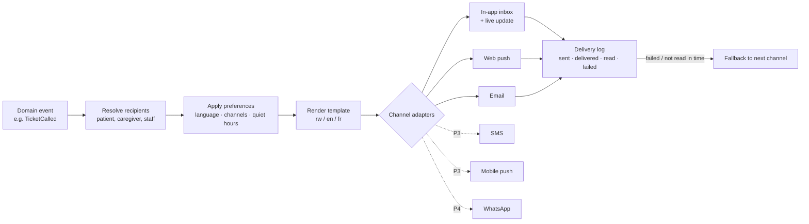

# 09 · Notifications and communication

Status: Draft v0.2

## 1. Design

Notifications are **one service with pluggable channels**. Features only publish **events** ("ticket called", "booking cancelled"). The notification service decides who gets what, on which channel, in which language.

Adding SMS or WhatsApp later means adding an adapter and templates. **No feature code changes** ([ADR 0002](../decisions/0002-web-first-paid-channels-later.md)).

## 2. Channels in phase 1 (free)

| Channel | Strengths | Limits |
|---|---|---|
| **In-app** (inbox + live tracker) | Instant, rich, free | Patient must open the app |
| **Web push** | Free; arrives when the browser is closed (Android) | Patient must allow notifications. On iPhone it works only after "Add to Home Screen" (iOS 16.4+). Not guaranteed to arrive instantly. |
| **Email** | Free, good for documents and receipts | Slow to be noticed; not for "you're called now" |
| **Waiting-room display + chime** | Works for everyone on site, no phone needed | Only on site |
| Staff in-app alerts + sound | Real-time for reception, doctors, pharmacy | Staff app must be open |

**Honest limit for P1:** without SMS, a patient who doesn't allow web push and isn't watching the app can miss a "you're next" alert. To reduce this:
- Ask for push permission at the right moment, right after booking, with a clear reason.
- Show an in-app banner when push is off.
- Make the live tracker page keep the phone awake, and play a sound and vibrate when the patient is called.
- Remote joiners who miss alerts are protected by the pass-over rule ([06](06-visit-lifecycle-and-queue.md)).

## 3. Priority levels

| Level | Examples | Quiet hours? | Fallback |
|---|---|---|---|
| **Critical** | You're called now; you're next; emergency guidance; booking cancelled by facility for today | Ignored | Next channel immediately |
| **Important** | Booking confirmed / changed; time to leave; prescription ready; dispute update; document available | Respected (sent at end of quiet hours unless for today) | After 15 min if unread (for today's events) |
| **Routine** | Reminders, follow-up due, rating request, reports ready | Respected | None |
| **Marketing** | Not used in P1. Later only with explicit opt-in. | — | — |

Default quiet hours for patients are 21:00–06:00, changeable.

## 4. Notification catalogue

### Patient / caregiver

| Event | When | Channels (P1) | Priority |
|---|---|---|---|
| Account created / email verify | Sign-up | Email | Important |
| Booking confirmed (with calendar file) | On booking | In-app, push, email | Important |
| Booking reminder | 24 h and 2 h before (configurable) | In-app, push, email (24 h) | Routine / Important |
| Booking changed / cancelled by facility | Disruption | In-app, push, email | Critical if today, else Important |
| Remote queue ticket issued | On join | In-app, push | Important |
| **Time to leave** | Estimated call − travel time − buffer | In-app, push | Important |
| **You are next (N ahead)** | When N = configurable (default 3) | In-app, push | Critical |
| **You are called — Room 4** | On call | In-app (sound), push, display | Critical |
| Pass-over warning / passed over | Remote joiner not checked in near the front | In-app, push | Critical |
| Wait-time jump | Estimate grows by > 30 min (e.g. emergency) | In-app, push | Important |
| Prescription ready / dispensing status | Ready, dispensed, not available | In-app, push | Important |
| Visit summary and documents available | Record signed | In-app, email | Important |
| Receipt | Payment recorded | In-app, email | Routine |
| Follow-up due | Before follow-up date | In-app, push, email | Routine |
| Rating request | After visit completion | In-app | Routine |
| Dispute updates | Any status change or message | In-app, push, email | Important |
| No-show strike / booking limit | On strike | In-app, email | Important |
| Record accessed by another facility | On cross-facility view (P2) | In-app | Important |
| Dependent's events | Same as above, sent to guardian(s) | Same | Same |

### Staff

| Recipient | Event | Channel |
|---|---|---|
| Receptionist | New booking for today; expected patient late; remote joiner checked in; bill awaiting payment; void approved/rejected | In-app (+ sound for queue events) |
| Doctor | New patient in my queue; results uploaded to inbox; unsigned records reminder (end of day); pharmacist query | In-app (+ sound) |
| Pharmacist | Prescription ready to dispense | In-app (+ sound) |
| Facility admin | Void / refund / waiver / merge awaiting approval; dispute opened or nearing deadline; licence expiry; subscription due; cash-up difference; unusual reorders | In-app, email |
| Super admin | New facility application; escalated dispute; break-glass access used; system alerts | In-app, email |
| Any staff | Invitation; role changed; password / 2FA changes | Email |

## 5. Preferences

- **Patient:** language; channels per level (critical can't be fully disabled while a ticket is active); quiet hours; reminder timing; which dependents' alerts to receive.
- **Staff:** sound on/off; email digest of approvals (immediate or daily).
- **Facility:** reminder timings, "you are next" threshold, announcement signature.

## 6. Announcements

| From | To | Example | Phase |
|---|---|---|---|
| Facility | Patients with bookings or tickets in a date range; or the facility's display screen | "Pediatrics closed Friday afternoon" | P1 |
| Platform | All facilities or selected ones | "Maintenance Sunday 02:00–03:00" | P1 |
| Facility | Its patients who opted in (health campaigns) | "Free vaccination day" | P2 (opt-in only) |

## 7. Templates and delivery

- Templates are versioned, in Kinyarwanda, English and French. They use short sentences and avoid medical jargon.
- **No sensitive clinical content in push or email bodies.** "Your visit summary is ready" is fine; a diagnosis is not. Details are shown only after login.
- **Rate limits and de-duplication:** max one "time to leave" per ticket; repeated identical events are merged.
- **Delivery log:** every notification records channel, status, timestamps and failure reason. It's visible to support and used as dispute evidence ("was the patient told?").
- **Retries:** failed sends are retried with backoff. After final failure, the fallback rules apply.

## 8. Requirements

| ID | Requirement | Phase |
|---|---|---|
| FR-NOT-01 | Event-driven notification service with channel adapters | P1 |
| FR-NOT-02 | In-app inbox and live updates | P1 |
| FR-NOT-03 | Web push with permission prompt at the right moment and push-off banner | P1 |
| FR-NOT-04 | Email notifications with documents and calendar files | P1 |
| FR-NOT-05 | Priority levels, quiet hours, fallback rules | P1 |
| FR-NOT-06 | Patient, staff and facility preferences | P1 |
| FR-NOT-07 | Notification catalogue in §4 | P1 |
| FR-NOT-08 | Guardians receive dependents' notifications | P1 |
| FR-NOT-09 | Trilingual versioned templates; no clinical details in message bodies | P1 |
| FR-NOT-10 | Delivery log with status and failures; retries | P1 |
| FR-NOT-11 | Facility and platform announcements | P1 |
| FR-NOT-12 | Tracker page keeps the screen awake, with sound and vibration on call | P1 |
| FR-NOT-13 | SMS and mobile push adapters | P3 |
| FR-NOT-14 | WhatsApp adapter (approved templates) | P4 |
