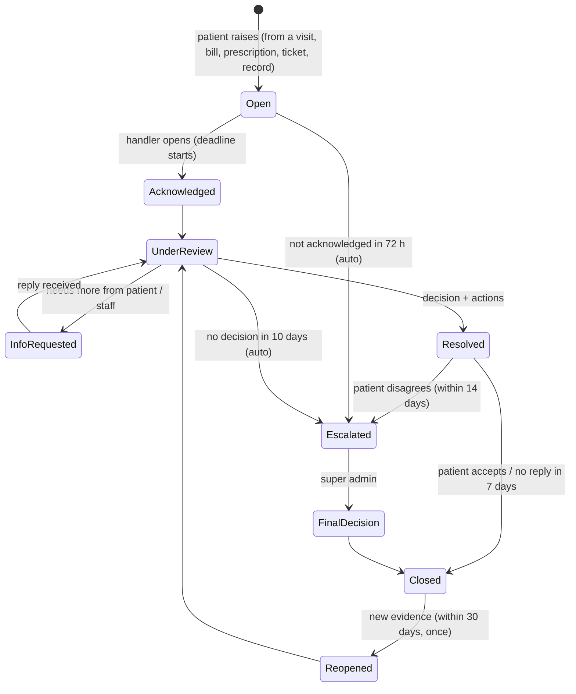

# 10 · Disputes, complaints, support and feedback

Status: Draft v0.2

## 1. Four different things

| Thing | Meaning | Example | Outcome |
|---|---|---|---|
| **Dispute** | A claim that something recorded or done was **wrong**, needing a decision | "I was charged twice", "Marked no-show but I was there" | Decision + corrective action |
| **Complaint** | Dissatisfaction with service, no record to correct | "The receptionist was rude", "I waited 5 hours" | Acknowledgement, facility response, quality data |
| **Support request** | Help using MediLink | "I can't log in", "How do I add my child?" | Help, answer |
| **Rating** | Short feedback after a visit | 4/5 "Fast service" | Facility quality score |

All four go through one "Help" entry point. The patient picks what they need, and the system routes it.

## 2. Dispute types and routing

| Type | Examples | First handler | Escalation |
|---|---|---|---|
| **Billing** | Double charge, insurer share wrong, paid but not recorded, refund refused | Facility admin | Super admin |
| **Insurance** | Coverage refused at the counter, claim rejected and patient asked to pay | Facility admin | Super admin |
| **Medication** | Marked dispensed but not received, wrong quantity, unexplained substitution | Facility admin (with pharmacist) | Super admin |
| **Queue / booking** | Wrong no-show, skipped, booking cancelled by facility, strike unfair | Facility admin | Super admin |
| **Record correction** | Wrong allergy, wrong diagnosis, wrong personal details (right to rectification, Law 058/2021) | Facility admin → author doctor | Super admin (process only) |
| **Privacy** | "Who viewed my record and why?", unwanted sharing | Super admin | Outside the system: the national data protection authority (NCSA) |
| **Facility ↔ platform** | Verification rejected, suspension, subscription charge | Super admin | Final decision with written reasons |
| **Clinical quality / negligence** | "Wrong treatment" | **Not judged by MediLink.** Recorded, evidence preserved, patient directed to the facility's management and the relevant professional council. | — |

## 3. Lifecycle

All time limits are configurable at platform level. Defaults: acknowledge within 72 h, decide within 10 days.

### Raising a dispute

- It's raised **from the thing itself**: "Report a problem" on a visit, bill, receipt, prescription, ticket, record entry or no-show strike.
- The system automatically attaches:
  - the context (IDs, amounts, times)
  - the **relevant audit events**, e.g. ticket history with times and staff, payment records, dispensing record, notification delivery log
- The patient adds a category, a description and optional evidence (photos, receipts).
- Disputes can be raised for dependents by their guardian.
- A receptionist can raise one on behalf of a patient without a smartphone, marked "raised at the counter".

### Handling

- **Conversation thread** with the patient, plus **internal notes** visible only to handlers.
- The handler can request comments from involved staff (receptionist, doctor, pharmacist). They respond in the dispute.
- **Evidence view:** the audit trail of the disputed item, shown in order, so the handler reads facts rather than recollections.
- **Conflict of interest:** a staff member involved in the dispute can comment but can't decide it. In a one-person facility, the dispute goes straight to the super admin.

### Outcomes (they trigger real actions)

| Outcome | Action created |
|---|---|
| Refund | Refund request → credit note ([08](08-billing-payments-and-insurance.md)) |
| Bill correction | Void + correct payment |
| Record corrected | Doctor adds an addendum ([07](07-clinical-documentation-and-pharmacy.md)); original stays visible with the addendum |
| Record correction refused | Reason recorded; **the patient's disagreement statement is attached to the record** (their right even when the correction is refused) |
| No-show reversed | Strike removed; booking limits recalculated |
| Rebooking | Priority slot offered |
| Facility warning | Warning recorded on the facility (super admin) |
| Facility suspension | Only the super admin; follows [03](03-tenancy-onboarding-and-master-data.md) |
| Rejected | Reasons given to the patient; escalation offered |

### What the super admin can and can't do

- **Can:** see the dispute and its attached evidence, ask the facility for information, decide escalated cases, instruct the facility, warn, suspend.
- **Can't:** edit the facility's clinical or billing records. Corrections are always made by the facility, which keeps responsibility and the audit trail clean.

### Abuse protection

- Max 5 open disputes per patient.
- Duplicate detection for the same item.
- Repeated groundless disputes are flagged for review, never auto-blocked.

## 4. Complaints and ratings

- **Rating:** after a completed visit, the patient can give 1–5 stars and an optional comment about the waiting time, staff and facility. One rating per visit.
- The **facility can reply publicly** once.
- **Moderation:**
  - comments with personal data, insults or clinical details are hidden pending super admin review
  - only patients with a completed visit can rate, which prevents fake reviews
- **Complaints** follow a simple flow: Open → Facility response → Closed. The patient can convert a complaint into a dispute if a record is involved.
- Ratings and complaints feed the facility **quality score** (P2), together with wait-time accuracy and dispute resolution times.

## 5. Support

- **P1:** help center (FAQ articles in three languages) + a support request form. Super admins handle requests.
- Support requests never require sharing clinical data. If the issue is clinical, it's redirected to the facility.
- **P2+:** a dedicated support agent role, with canned answers.

## 6. Reporting on disputes

- **Facility:** open disputes, overdue items, by type, average resolution time, outcomes.
- **Platform:** disputes per 1,000 visits per facility, escalation rate, auto-escalations. These are an input to facility reviews.

## 7. Requirements

| ID | Requirement | Phase |
|---|---|---|
| FR-DSP-01 | Raise a dispute from a visit, bill, receipt, prescription, ticket, record entry or strike, with context and audit events attached automatically | P1 |
| FR-DSP-02 | Dispute types, routing and escalation as in §2 | P1 |
| FR-DSP-03 | Lifecycle with deadlines and auto-escalation | P1 |
| FR-DSP-04 | Thread with patient + internal notes + staff comments | P1 |
| FR-DSP-05 | Evidence view of the audit trail of the disputed item | P1 |
| FR-DSP-06 | Outcomes create linked actions (refund, addendum, strike removal…) | P1 |
| FR-DSP-07 | Patient disagreement statement attached to a record when correction is refused | P1 |
| FR-DSP-08 | Conflict-of-interest rule; one-person facility goes to super admin | P1 |
| FR-DSP-09 | Disputes raised by guardians and at the counter | P1 |
| FR-DSP-10 | Abuse protection (limits, duplicates, flags) | P1 |
| FR-DSP-11 | Help center and support requests | P1 |
| FR-DSP-12 | Ratings with one facility reply, moderation, completed-visit rule | P2 |
| FR-DSP-13 | Complaints flow | P2 |
| FR-DSP-14 | Facility quality score | P2 |
