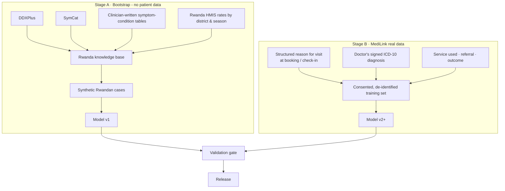
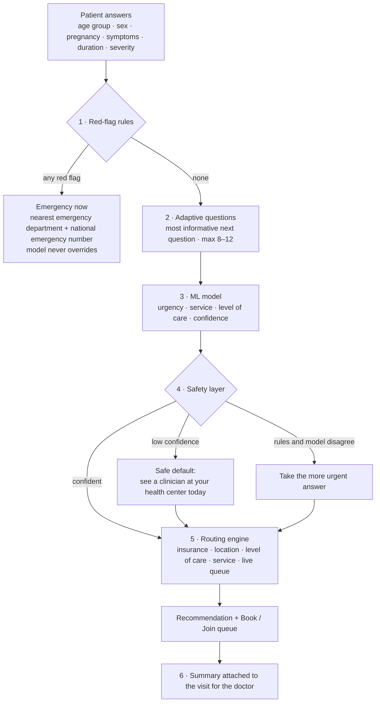

# 11 · AI symptom checker (machine learning)

Status: Draft v0.2 · Decision record: [ADR 0005](../decisions/0005-symptom-checker-ml-with-safety-rules.md)

## 1. What the model predicts

The checker **does not diagnose patients**. Predicting a disease name ("you have malaria") is risky for patients, very likely regulated as a medical device, and not what MediLink needs. MediLink needs to send the patient **to the right place at the right time**.

| Output | Values | Why |
|---|---|---|
| **1. Urgency** | Emergency now · See a clinician today · Book within a few days · Self-care with advice | Safety |
| **2. Service** | General consultation, pediatrics, maternity/ANC, dental, eye, ENT, dermatology, mental health… | Books the right queue |
| **3. Level of care** | Health center · District hospital · Referral hospital | Keeps Mutuelle coverage; protects referral hospitals such as CHUK |

A ranked list of likely conditions is computed internally because it helps produce the three outputs. It is shown **only to doctors**, and only after validation (stage 4).

## 2. Datasets: what exists and what it's worth

| Dataset | Content | Use for MediLink |
|---|---|---|
| Kaggle "Disease Symptom Prediction" (~41 diseases, ~130 symptoms, ~4,900 rows) | Generated, heavily duplicated | **Learning and pipeline testing only.** Models score close to 100% because the data is artificial; this means nothing clinically. |
| Symptom2Disease (Kaggle) | Short English texts, ~24 diseases | Text-classification practice only |
| **DDXPlus** (Mila, NeurIPS 2022) | ~1.3M synthetic patients, 49 conditions, symptoms and risk factors, differential diagnosis per case, severity information | **Best public starting point.** Includes relevant conditions (pneumonia, URTI, TB, HIV…). Synthetic and not based on Rwandan disease patterns. |
| SymCat | Symptom–disease probabilities from US clinic data | Prior knowledge (US disease patterns) |
| MIMIC-III / IV | Real US intensive-care records (credentialed access) | Wrong setting (ICU, not first contact) |
| Synthea | Synthetic US patient records | Software testing only |
| MedDialog and similar | Doctor–patient dialogues | Possibly for language understanding later |
| **Rwanda HMIS (DHIS2), DHS surveys** | Diagnosis counts by facility, district and month; national surveys | **Very valuable as priors**: real frequency of malaria, respiratory infections, diarrhoea, hypertension… by district and season. Not patient-level. Access through the Ministry / RBC. |

**Key problem: distribution shift.** No public patient-level dataset reflects Rwanda's disease burden:
- malaria, varying by district and season
- typhoid, TB, HIV, schistosomiasis
- pregnancy complications
- childhood illness as handled in IMCI (WHO's Integrated Management of Childhood Illness)

A model trained only on Western synthetic data will be confidently wrong in exactly the cases that matter.

## 3. Data strategy

- **Stage A:** Rwandan clinicians write symptom–condition tables (how often each symptom appears with each condition). These are adjusted to Rwanda's real disease frequency with HMIS data, by district and season, and synthetic cases are generated from them, as DDXPlus did. Because we control the condition list, it covers what Rwandans actually get.
- **Stage B (MediLink's lasting advantage):** each visit pairs *what the patient reported before the visit* with *what the doctor concluded*. That is labelled, Rwandan, first-contact data that nobody else has. **It only exists if phase 1 captures it:**
  - **Structured reason for visit** from a fixed symptom list at booking and check-in (FR-SCH-10), not only free text
  - **ICD-10 coded diagnoses**, provisional or confirmed (FR-CLN-06)
  - **Separate research consent** from patients (FR-SEC-05)
  - De-identification and approval from the Rwanda National Ethics Committee before any training on real data
- **Label noise:** many diagnoses at health centers are presumptive, made without a lab test. Confirmed diagnoses are weighted higher, and provisional ones are treated as soft labels.

## 4. System design: the model sits inside safety rules

1. **Red-flag rules.** Written and signed off by clinicians, based on recognised guidance:
   - WHO IMCI danger signs for children (unable to drink or breastfeed, vomits everything, convulsions, lethargic or unconscious)
   - danger signs in pregnancy
   - adult emergency signs (chest pain with breathlessness, heavy bleeding, sudden weakness on one side, unconsciousness…)

   They run first and the model can never override them.
2. **Adaptive questions.** The next question is the one that most reduces uncertainty (expected information gain), capped at 8–12. This keeps it short for elderly users. Children and pregnant women get their own question sets.
3. **ML model.** Start simple and explainable:
   - **v1:** Bayesian / logistic regression. Calibrated, handles unanswered questions, and can explain itself ("because you reported fever, chills and live in a high-malaria district").
   - **v2+:** gradient-boosted trees (LightGBM) once real data exists.
   - **Inputs:** symptoms, duration, severity, age group, sex, pregnancy, chronic conditions, district, month.
4. **Safety layer.** When unsure, it **sends the patient to a higher level of urgency**. Over-triage costs a visit; under-triage can cost a life.
5. **Routing.** Unlike a generic symptom checker, the result is a **bookable recommendation**: a facility at the right level of care, offering the service, accepting the patient's insurance, with a known wait.
6. **Doctor summary.** The answers are attached to the visit as the structured reason for visit. This saves consultation time even before the AI is trusted with patients.

### Role of large language models (LLMs)

- **Use LLMs for language only:** turning free text, including Kinyarwanda ("Mfite umuriro n'umutwe urandya kuva ejo"), into structured symptom codes, and writing plain-language explanations.
- **Don't use LLMs for the decision.** The rules and the calibrated model decide, and they can be tested and audited.
- **Constraints:**
  - Kinyarwanda quality must be evaluated before use.
  - Sending health data to a foreign AI service is a **cross-border transfer** under Law 058/2021 and needs authorisation. The alternative is self-hosting an open model in Rwanda.

## 5. Evaluation and safety gates

| Measure | Requirement |
|---|---|
| **Under-triage** (emergency or urgent classified lower) | **Release gate.** As close to zero as possible on the vignette set; every miss reviewed by clinicians. |
| Over-triage | Monitored; acceptable at moderate levels |
| Service accuracy (top-1 / top-3) | Tracked against doctors' actual decisions |
| Calibration | Confidence matches accuracy, so the "unsure → safe default" rule works |
| Subgroups | Children, elderly, pregnant women, men and women evaluated separately |

For comparison, a well-known BMJ study (Semigran et al., 2015) found that 23 commercial symptom checkers gave appropriate triage advice only about 57% of the time. This is a hard problem and needs strict testing.

### Validation steps

1. **Clinical vignette set:** a few hundred realistic Rwandan cases written by clinicians, each with the correct urgency, service and level of care. Kept separate from training.
2. **Shadow mode:** the model runs on real visits during the pilot, but **only doctors see the output**. Its suggestions are compared with doctors' decisions for months before any patient sees them.
3. **Release decision:** signed by a named clinical lead, recorded with the model version.
4. **Monitoring:** drift (e.g. malaria season), weekly under-triage review, user feedback.

### Accountability

- Every prediction is logged with the model version, the inputs and the output. If a patient disputes advice, we can show exactly what the model saw and said ([10](10-disputes-complaints-and-support.md)).
- Each model version has a **model card**: training data, performance, subgroup results, known weaknesses, approval.
- Content changes (rules, mappings, question sets) are versioned and need a recorded clinical sign-off. The super admin manages them; no extra role is needed in early phases.

## 6. Regulation and ethics

- **Positioning:** triage and care navigation, **not diagnosis**. Clear text: "This is guidance, not a diagnosis. If you feel very unwell, go to the nearest emergency department or call the national emergency number."
- **Rwanda FDA:** confirm medical device classification before patients use it.
- **Ethics:** Rwanda National Ethics Committee approval before training on patient data; separate research consent; de-identification; data stays in Rwanda.

## 7. Technology

The stack is Python/Django ([ADR 0003](../decisions/0003-stack-django-react-postgresql.md)), so the ML pieces fit naturally:

| Part | Tools |
|---|---|
| Training (offline) | Python, pandas, scikit-learn, LightGBM, MLflow (experiment tracking and model registry) |
| Serving | Model loaded inside the Django API (a dedicated module); move to a separate service only if load requires it |
| Knowledge base | Stored in PostgreSQL: symptoms, questions, conditions, red-flag rules, condition → service → level-of-care mapping; versioned with sign-off |
| Symptom list | ~150 symptoms in Kinyarwanda, English and French, mapped to ICD codes |
| Code location | `ml/symptom-checker/` for training notebooks and pipelines; `backend` (Django API) for serving |

## 8. Roadmap

| Stage | What ships | Who sees output | Phase |
|---|---|---|---|
| **0 · Data capture** | Structured reason for visit, ICD-10 diagnoses, research consent. **No AI yet.** | — | P1 |
| **1 · Rules triage** | Red flags + symptom → service mapping + routing | Patients (low risk) | P2 |
| **2 · First model** | Trained on DDXPlus + Rwanda-adjusted synthetic data; shadow mode | Doctors only | P3 |
| **3 · Real-data model** | Retrained on consented MediLink data; validated on vignettes and the shadow period | Patients (urgency + service + level) | P4 |
| **4 · Advanced** | Adaptive questioning refinements, Kinyarwanda free text, differential for doctors | Patients + doctors | P4+ |

## 9. Requirements

| ID | Requirement | Phase |
|---|---|---|
| FR-AI-01 | Structured symptom list (3 languages) used for reason for visit | P1 |
| FR-AI-02 | Research consent captured separately from care consent | P1 |
| FR-AI-03 | De-identified export of intake + diagnosis pairs for approved research | P2 |
| FR-AI-04 | Red-flag rules engine with clinician sign-off and versioning | P2 |
| FR-AI-05 | Symptom → service → level-of-care mapping and routing to bookable facilities | P2 |
| FR-AI-06 | Safety layer: low confidence → safe default; disagreement → more urgent | P2 |
| FR-AI-07 | Prediction log with model version, inputs, outputs | P2 |
| FR-AI-08 | ML model in shadow mode, visible to doctors only | P3 |
| FR-AI-09 | Vignette evaluation suite and release gate on under-triage | P3 |
| FR-AI-10 | Model cards and model registry | P3 |
| FR-AI-11 | Patient-facing ML triage after validation and regulatory confirmation | P4 |
| FR-AI-12 | Adaptive questioning by information gain | P4 |
| FR-AI-13 | Free-text (Kinyarwanda) understanding to symptom codes | P4 |
