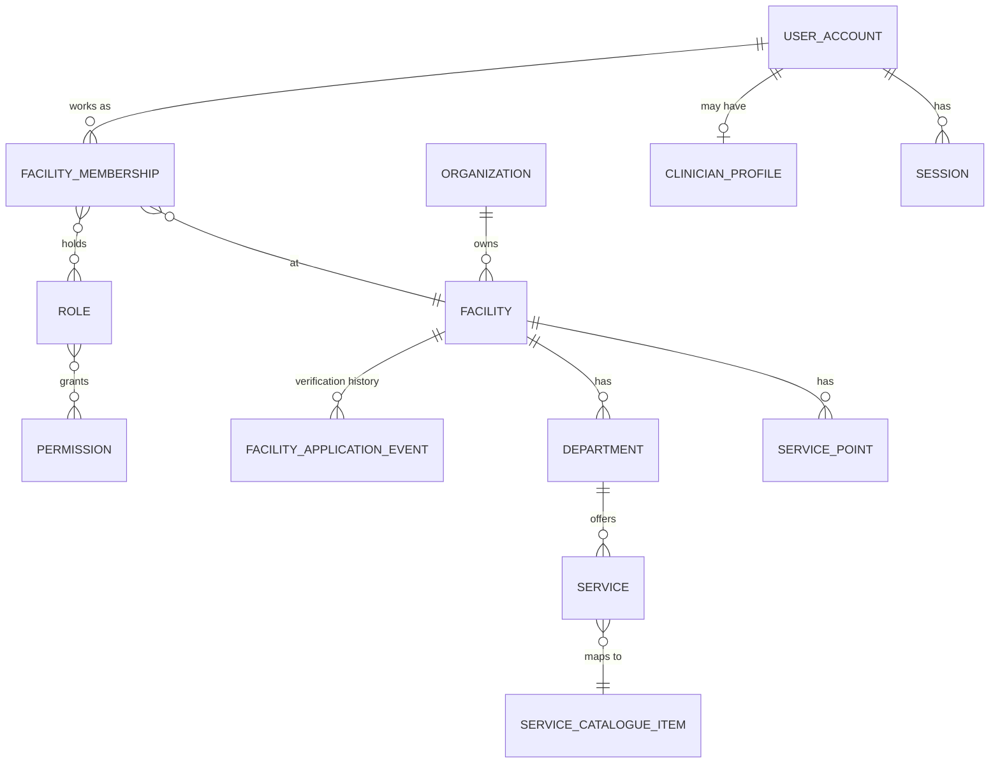
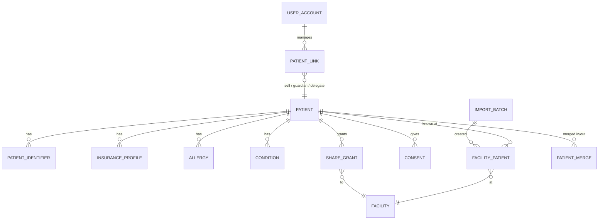
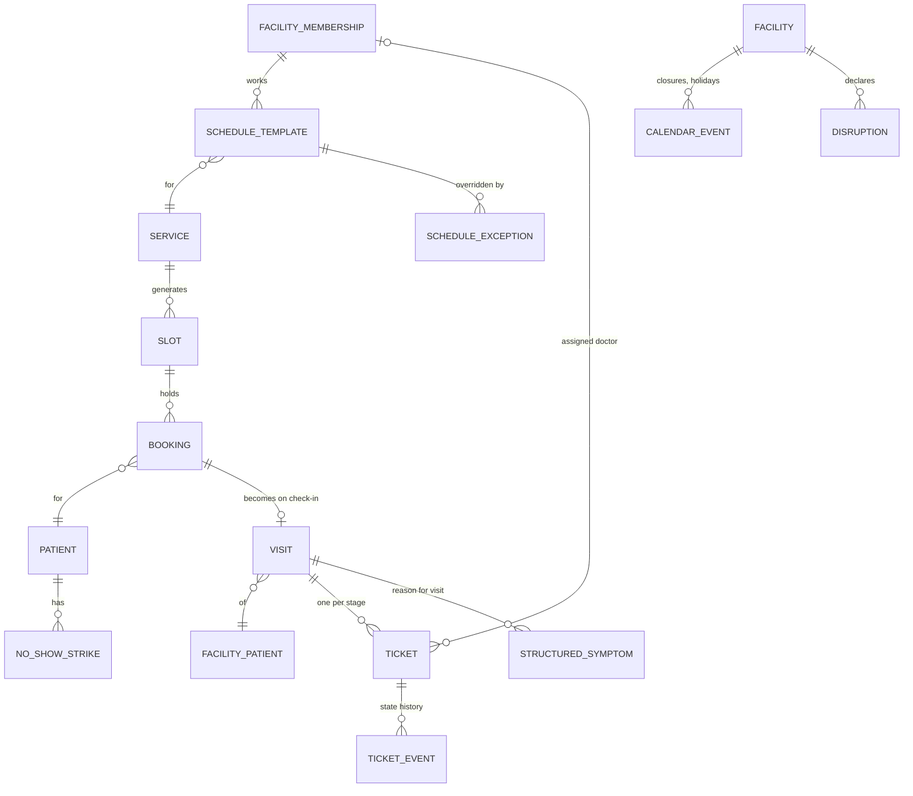
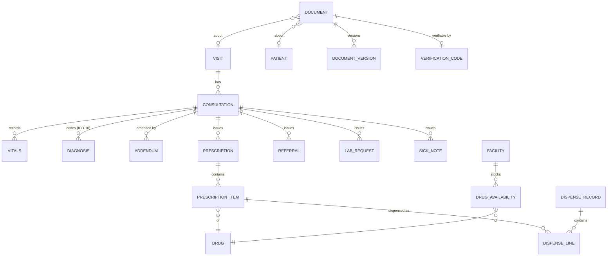
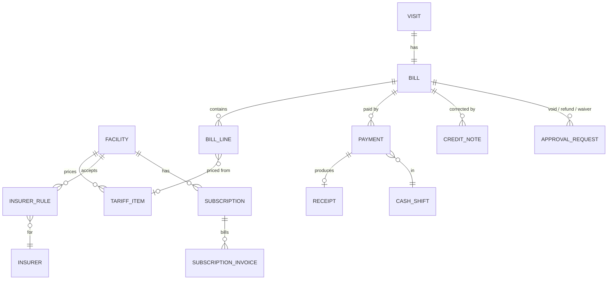
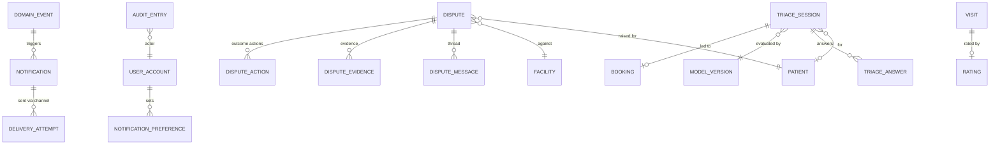

# 15 · Conceptual data model

Status: Draft v0.2 · Conceptual only. Tables, columns and indexes are decided in the design phase.

## 1. Identity, tenancy and access

## 2. Patients and history

## 3. Scheduling, visits and queue

## 4. Clinical, pharmacy and documents

## 5. Billing and subscriptions

## 6. Notifications, disputes, audit and AI

## 7. Modelling rules

| Rule | Why |
|---|---|
| Every facility-owned row carries `facility_id` | Tenant isolation and row-level security |
| Clinical, billing and audit rows are **append-only or versioned**; no hard deletes | Legal record-keeping and disputes |
| Records keep the **code and display text** of master data at the time of creation | Master data changes never rewrite history |
| All timestamps stored in UTC, shown in Africa/Kigali | Consistency |
| Money stored as integer RWF | No rounding errors |
| Every state change of tickets, bills, prescriptions, disputes is an event row | Reports, evidence, debugging |
| Patient-level vs facility-level data separated (`PATIENT` vs `FACILITY_PATIENT`) | One person across many facilities, with per-facility ownership of records |
| Identifiers stored with type and issuer; national ID encrypted | Privacy and multiple ID types |
