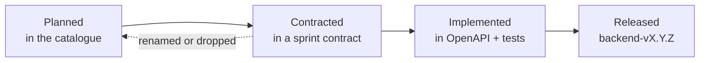

# API documentation

Status: v0.1 · Applies to the backend API (`api.medilink.rw`). Conventions: [architecture 02](../architecture/02-api-conventions.md) · Sprint 0 contract: [architecture 03](../architecture/03-sprint-0-contract.md)

## 1. What is the source of truth?

| Question | Source of truth |
|---|---|
| Which endpoints **exist now**, and their exact schemas | The **OpenAPI schema generated from the code**: `GET /api/v1/schema/` (non-production, or staff-only in production), Swagger/Redoc UI in development. The frontend generates its types from it. |
| Which endpoints a sprint **will deliver** | The sprint contract (`docs/architecture/0X-sprint-N-contract.md`), agreed before coding |
| Which endpoints are **planned** for phase 1, and why | [catalogue.md](catalogue.md): this catalogue |
| How every endpoint **must look** | [API conventions](../architecture/02-api-conventions.md) |

The catalogue is a plan, not a specification. Each sprint contract can rename, merge or split endpoints. When it does, update the catalogue in the same pull request. When the catalogue and the generated schema disagree about an implemented endpoint, **the schema wins** and the catalogue is corrected.

## 2. Endpoint lifecycle

| Status | Meaning |
|---|---|
| **Planned** | In this catalogue only. Paths, schemas and permissions may change. |
| **Contracted** | In an agreed sprint contract. The frontend may build against MSW mocks of it. |
| **Implemented** | In the generated OpenAPI schema, with tests (authorisation matrix, cross-tenant, business rules). Note the backend version. |
| **Dropped** | Removed from the plan. Keep the row with a reason until the next catalogue review. |

Definition of Done (every sprint, [roadmap](../roadmap/README.md)): "CHANGELOG updated; API catalogue updated". The backend pull request that implements an endpoint changes its row to **Implemented** and adds the version, for example `Implemented (backend-v0.2.0)`.

## 3. How to read the catalogue

- Paths are written in full (`/api/v1/...`). Every endpoint belongs to **one audience** (`/public`, `/patient`, `/staff`, `/platform`, plus `/auth` for audience-neutral account flows and `/ws/v1` for WebSockets).
- `{id}` is a UUID. `{slug}` is the public facility slug. `{token}` appears only where a link must work without a session (see §6).
- **Permission:** the permission code checked by the policy layer for staff endpoints, or the rule for patient, platform and public endpoints. Codes marked † are **proposed** and must be added to the permission catalogue (§4) by the sprint that introduces them.
- **Requirements:** the `FR-*` / `NFR-*` IDs the endpoint implements ([requirements index](../requirements.md), [traceability matrix](../qa/traceability-matrix.md)).
- **Notes** use these short forms:

| Short form | Meaning (from the API conventions) |
|---|---|
| Idem | Accepts an `Idempotency-Key` header (UUID). A repeat within 24 h returns the original result. |
| Ver | Optimistic concurrency: the request sends `version`; a mismatch returns `409 conflict` with the current resource. |
| Step-up | Needs recent re-authentication (≤ 5 minutes), otherwise `403 step_up_required` ([security 03](../security/03-identity-authentication-sessions.md) §4). |
| RL: class | Rate-limit class: `auth`, `search`, `verification`, `upload`, `export` ([security 03](../security/03-identity-authentication-sessions.md) §6). |
| Audit | The action writes an audit entry (event name given where known). Every read of patient data is audited anyway. |
| Async | Starts a background job; the response returns a job resource to poll. |

## 4. Permission catalogue

Seeded in Sprint 0 from the permission matrix ([analysis 02](../analysis/02-users-roles-and-permissions.md) §3), as listed in the [Sprint 0 contract](../architecture/03-sprint-0-contract.md) §1. Proposed codes (†) are added by the sprint that first needs them, in a data migration, and the authorisation test matrix is extended in the same pull request.

| Code | Facility admin | Receptionist | Doctor | Pharmacist | Status |
|---|---|---|---|---|---|
| `facility.configure` | ✓ | — | — | — | Seeded (S0) |
| `staff.manage` | ✓ | — | — | — | Seeded (S0) |
| `queue.operate` (check in, issue ticket, set priority, reorder with reason) | ✓ | ✓ | — | — | Seeded (S0) |
| `clinical.write` (consultation draft, vitals, diagnoses, prescriptions) | — | — | ✓ | — | Seeded (S0) |
| `clinical.sign` | — | — | ✓ | — | Seeded (S0) |
| `pharmacy.dispense` | — | — | — | ✓ | Seeded (S0) |
| `billing.record_payment` (bills, payments, receipts) | ✓ | ✓ | — | — | Seeded (S0) |
| `billing.approve` (voids, refunds, waivers) | ✓ | — | — | — | Seeded (S0) |
| `reports.view` (facility reports) | ✓ | — | — | — | Seeded (S0) |
| `audit.view` (facility audit log) | ✓ | — | — | — | Seeded (S0) |
| `schedule.manage` † | ✓ | view only | own leave requests | — | Proposed (S2) |
| `patients.register` † (walk-in registration, demographics) | ✓ | ✓ | ✓ | — | Proposed (S3) |
| `patients.merge_request` † | ✓ (per matrix) | ✓ (per analysis 04; see note) | — | — | Proposed (S3) |
| `patients.merge_approve` † | ✓ | — | — | — | Proposed (S3) |
| `queue.call` † (call next, start, complete a stage) | — | — | ✓ | — | Proposed (S4) |
| `vitals.record` † | — | ✓ | ✓ | — | Proposed (S6) |
| `documents.upload` † | ✓ | ✓ (ID, insurance card) | ✓ (results) | — | Proposed (S3) |
| `legacy.import` † | ✓ | — | ltd (back-entry uses `clinical.write`) | — | Proposed (S6) |
| `disputes.handle` † | ✓ | — | — | — | Proposed (S10) |
| `disputes.comment` † | — | ✓ | ✓ | ✓ | Proposed (S10) |
| `reports.view_own` † (own shift / own activity) | — | ✓ | ✓ | ✓ | Proposed (S10) |

Note on merges: the matrix in analysis 02 §3 gives "request" to the facility admin and nothing to the receptionist, while analysis 04 §3.2 and security 11 §6 say the receptionist requests and the facility admin approves. The S3 contract must settle this and update the analysis.

The super admin is the `is_platform_admin` flag, not a facility role. Platform endpoints check that flag, and sensitive platform actions also need step-up. Patient endpoints check that the account is linked to the patient (`self`, `guardian` or active `delegate`), and that restricted records are hidden from delegates ([security 04](../security/04-authorization-and-tenant-isolation.md) §3).

## 5. Patterns used across the catalogue

| Pattern | Rule |
|---|---|
| Active facility | Staff endpoints act on the facility chosen at `POST /api/v1/staff/auth/active-facility/`. Paths never carry a facility ID that the client could change ([security 04](../security/04-authorization-and-tenant-isolation.md) §2). The active facility's own settings are the singleton resource `/api/v1/staff/facility/`. |
| Current user | Singletons for the logged-in user follow the `me` pattern: `/api/v1/staff/auth/me/`, `/api/v1/staff/duty-status/`, `/api/v1/staff/clinician-profile/`. |
| Patient profiles | Data owned by one patient is nested under `/api/v1/patient/profiles/{patient_id}/` (identifiers, insurance, allergies). Activity lists that span the family (bookings, tickets, visits, documents, bills, disputes) are top-level with an optional `?patient_id=` filter. |
| Sensitive search | Searches that use names, phone numbers or national IDs are `POST .../search/` with a JSON body, because the conventions forbid personal data in URLs. |
| State changes | Every state machine action is a `POST` sub-resource (`/tickets/{id}/call/`). Plain field edits use `PATCH` with `version`. |
| Deletion | Clinical, billing and audit data are never deleted through the API. Configuration and master data are retired (`is_active=false`) or soft-deleted. Only non-clinical patient uploads can be deleted by their owner. |
| Files | Uploads are `multipart/form-data` and go through the upload pipeline ([security 06](../security/06-application-and-api-security.md) §4). Downloads are never streamed by the API: a `download-links` action returns a 5-minute signed URL on `files.medilink.rw`. |
| Offline replay | Staff actions queued offline are sent later to the normal endpoint with the same `Idempotency-Key` and an optional `occurred_at` hint, which the server validates (not in the future, within the shift) ([security 06](../security/06-application-and-api-security.md) §7). |
| Real time | WebSocket messages carry IDs and versions only; clients fetch details through REST (notify-then-fetch). |

## 6. Proposed additions to the API conventions

These come out of the catalogue and need agreement (in the sprint contract that first uses them, then in [architecture 02](../architecture/02-api-conventions.md)):

| # | Proposal | First needed |
|---|---|---|
| 1 | Singleton resources for the session context (`/staff/facility/`, `/staff/duty-status/`), as an exception to "plural nouns" | S2 |
| 2 | `POST .../search/` for searches with personal data in the criteria | S3 |
| 3 | New error code `403 access_reason_required`: a doctor opens a record outside the treatment relationship and must state a reason first ([security 04](../security/04-authorization-and-tenant-isolation.md) §3) | S6 |
| 4 | Facility applicants: how an applicant without a staff account resumes a draft (emailed one-time link exchanged for a short-lived applicant session, or an applicant account) | S1 |
| 5 | Display devices: REST access with the display token. The WebSocket path already carries it (`/ws/v1/display/{token}/`); the REST path below does the same, or the token moves to a header | S4 |
| 6 | Calendar subscription feed (`.ics`) and shared-document links carry a secret token in the URL, because calendar apps and recipients can't send headers. Tokens are random, hashed at rest, revocable and expire where possible | S5, S7 |
| 7 | `occurred_at` hint on queue, payment and dispensing actions for offline replay | S4 |

## 7. Open points (to settle in the sprint contracts)

- **Platform access to facility-owned rows** (escalated disputes, break-glass, facility data export) and **public reads of facility configuration** (search, profiles, slots) need explicit row-level security contexts. Options are in [architecture 04](../architecture/04-database-design.md) §3.
- **Cross-facility checks** (doctor schedule conflicts, booking cap of 3 per patient, no-show strikes) need narrow database functions that return only a yes/no or a count, so RLS stays intact ([architecture 04](../architecture/04-database-design.md) §3).
- **Session management, PIN unlock, passkeys and password change** are required by the security documents but not yet placed in a sprint (see the catalogue's "Not yet scheduled" section).

## 8. Documents

| Document | Contents |
|---|---|
| [catalogue.md](catalogue.md) | Planned phase-1 endpoints by sprint (S0–S11) and audience |
| [API conventions](../architecture/02-api-conventions.md) | URLs, formats, errors, security, WebSockets, versioning |
| [Sprint 0 contract](../architecture/03-sprint-0-contract.md) | The contracted Sprint 0 endpoints and schemas |
| [Database design](../architecture/04-database-design.md) | Tables behind the endpoints |
