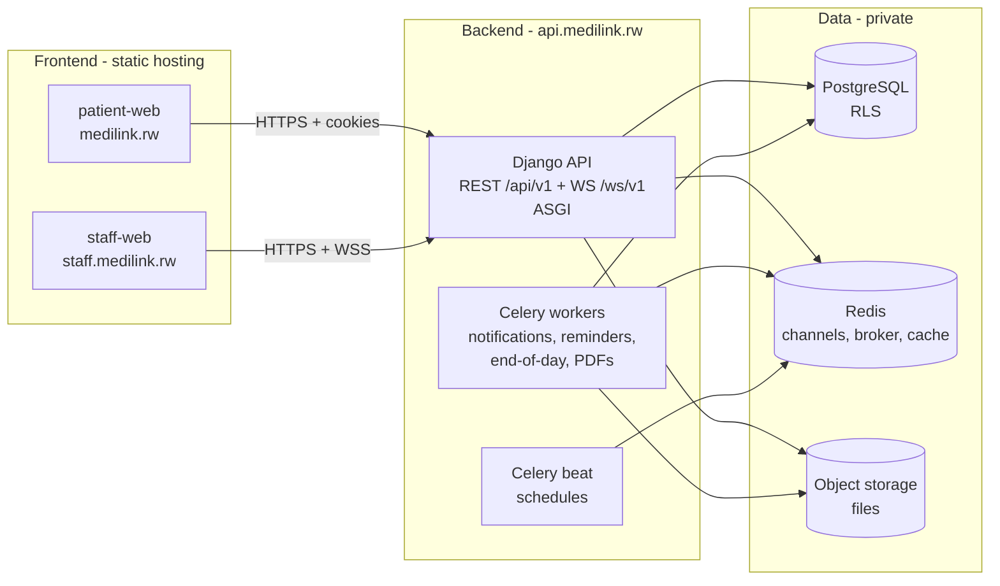

# 01 · System architecture

Status: v0.1 · Decisions: [ADR 0003](../decisions/0003-stack-django-react-postgresql.md), [0004](../decisions/0004-visit-centric-domain-model.md), [0006](../decisions/0006-separate-frontend-and-backend-hosting.md), [0007](../decisions/0007-frontend-toolchain.md) · Security: [docs/security](../security/README.md)

## 1. Components



## 2. Repository layout

```
backend/                     Django project (deployed to api.medilink.rw)
  config/                    settings (base, dev, test, prod), urls, asgi, wsgi, celery
  medilink/                  Django apps (one per domain module)
    core/                    base models (UUID, timestamps), errors, request ID, pagination
    accounts/                users, auth, MFA, sessions per audience
    tenancy/                 organisations, facilities, memberships, roles, permissions, RLS context
    authz/                   policy layer (deny by default) and permission catalogue
    audit/                   append-only hash-chained audit log
    patients/ …              added sprint by sprint (see roadmap)
  requirements/              *.in + hash-pinned *.txt (pip-tools)
  tests/                     pytest
  manage.py, pyproject.toml, Dockerfile, CHANGELOG.md, README.md, .env.example
frontend/                    pnpm workspace (deployed as static sites)
  apps/staff-web/            staff app (Vite + React)
  apps/patient-web/          patient app + public pages (Vite + React, PWA)
  apps/patient-mobile/       phase 3
  packages/ui/               design tokens + accessible components
  packages/api-client/       typed API client, generated OpenAPI types
  packages/config/           shared tsconfig / eslint / prettier
  package.json, pnpm-workspace.yaml, CHANGELOG.md, README.md
ml/symptom-checker/          ML pipelines (phase 2+)
brand/                       logos, icons, video sources
docs/                        analysis, design, security, architecture, api, roadmap, development
docker-compose.yml           local infrastructure (PostgreSQL, Redis, Mailpit)
.github/workflows/           ci-backend.yml, ci-frontend.yml, security.yml
```

## 3. Backend technology

| Concern | Choice |
|---|---|
| Runtime | Python 3.12+ (3.14 supported) |
| Framework | **Django 6.x** (built-in CSP; move to 6.2 LTS when released), Django REST Framework |
| API schema | drf-spectacular (OpenAPI 3) |
| Real-time | Django Channels + channels-redis (ASGI, Daphne/Uvicorn) |
| Jobs | Celery + Redis (JSON serializer only) |
| Database | PostgreSQL 17 via psycopg 3; row-level security |
| Config | django-environ (12-factor env vars) |
| Auth | Django auth (custom user, email login), Argon2id, django-otp (TOTP), recovery codes; passkeys later |
| CORS | django-cors-headers (explicit allowlist, credentials) |
| Tests / quality | pytest, pytest-django, factory-boy, ruff, mypy + django-stubs, pip-audit |
| Dependencies | pip-tools, hash-pinned `requirements/*.txt` |

## 4. Local development

| Service | How | Address |
|---|---|---|
| PostgreSQL 17 | `docker compose up -d` | `localhost:5433` (host port 5433 avoids clashing with a local Postgres) |
| Redis 7 | docker compose | `localhost:6379` |
| Mailpit (catches emails) | docker compose | SMTP `localhost:1025`, UI http://localhost:8025 |
| Django API | `backend/.venv`, `python manage.py runserver` (or `daphne`) | http://localhost:8000 |
| staff-web | `pnpm --filter @medilink/staff-web dev` | http://localhost:5173 |
| patient-web | `pnpm --filter @medilink/patient-web dev` | http://localhost:5174 |

The frontends call the API at `VITE_API_BASE_URL` (default `http://localhost:8000`) with real CORS, like production. `VITE_USE_MOCKS=true` runs them against MSW mocks without the backend.

**Dev seed:** `python manage.py seed_dev` creates a demo facility and one user per role, with dev-only passwords printed to the console. It refuses to run when `DEBUG` is false.

## 5. Environments

| Environment | Backend | Frontend | Data |
|---|---|---|---|
| Local | runserver / docker | Vite dev servers | synthetic seed |
| CI | pytest with a Postgres service | unit + e2e with mocks | fixtures |
| Staging | `api.staging.medilink.rw` | `staging.medilink.rw`, `staff.staging.medilink.rw` | synthetic only |
| Production | `api.medilink.rw` | `medilink.rw`, `staff.medilink.rw` | real (Rwanda) |
