# 04 · Database design (phase 1)

Status: v0.1 · Logical design for P1. Sources: [analysis 15 · conceptual data model](../analysis/15-conceptual-data-model.md), the module documents listed in the [documentation index](../README.md), [security 04 · authorisation and tenant isolation](../security/04-authorization-and-tenant-isolation.md) and [security 05 · data protection](../security/05-data-protection-and-cryptography.md).

This document decides tables, key columns, keys, indexes, row-level security (RLS), data classes and retention. Exact column lengths and secondary indexes are settled in each sprint's migrations. **Once a migration exists, the migration is the source of truth**; update this document in the same pull request when a design decision changes.

## Contents

1. [Conventions](#1-conventions)
2. [Classification, mutability and retention](#2-classification-mutability-and-retention)
3. [Row-level security](#3-row-level-security)
4. [Conceptual entity → table map](#4-conceptual-entity--table-map)
5. [Tables by module](#5-tables-by-module)
6. [Later phases](#6-later-phases-not-designed-yet)
7. [Open questions](#7-open-questions)

## 1. Conventions

| Topic | Rule |
|---|---|
| Database | PostgreSQL 17, one database, schema `public`. Extensions: `citext`, `pg_trgm`, `btree_gist`, `pgcrypto` (only for `gen_random_bytes` in tests; encryption happens in the application). |
| Table names | `<app>_<entity>` in snake case, set with `db_table` (e.g. `visits_ticket`, `clinical_consultation`). Apps are the backend modules: `core`, `accounts`, `authz`, `tenancy`, `masterdata`, `facilities`, `patients`, `scheduling`, `visits`, `clinical`, `pharmacy`, `documents`, `billing`, `notifications`, `disputes`, `audit`, `reports`. |
| Primary keys | `id uuid` (UUIDv7, generated in the application, time-ordered). Never relied on for security ([security 04](../security/04-authorization-and-tenant-isolation.md) §2). Exceptions: Django's session key, and `audit_entry.seq` as the chain order. |
| Foreign keys | `<entity>_id uuid`, `ON DELETE PROTECT` by default (nothing clinical, financial or audited cascades). `SET NULL` only for optional links to transient rows (e.g. a booking's slot). |
| Facility ownership | Every facility-owned table has `facility_id uuid NOT NULL` → `tenancy_facility`, RLS enabled and forced, and composite indexes that **start with `facility_id`**. Child tables repeat `facility_id` (no RLS by join). |
| Timestamps | `timestamptz`, stored in UTC. `created_at` on every table; `updated_at` on mutable tables. "Today" for queues and reports is a `date` column computed in Africa/Kigali (`service_date`). |
| Money | `bigint`, integer RWF, suffix `_rwf`, `CHECK (… >= 0)` unless a difference (cash-up). Percentages as basis points `integer` (`patient_share_bp`, 0–10000). Totals and splits are computed by the server. |
| Enums | `varchar` + `CHECK` constraint generated from Django `TextChoices`; values are lowercase snake case, as in the API. |
| Concurrency | Mutable resources have `version integer NOT NULL DEFAULT 1`, checked and incremented on every update (`409 conflict` on mismatch). |
| State machines | Tickets, bookings, bills, prescriptions, disputes, applications and facility status have a `status`/`state` column **and** an append-only `<entity>_event` table (from, to, actor, time, reason). Reports and dispute evidence read the events. |
| Deletion | No hard deletes of clinical, billing, queue or audit rows. Corrections are new rows (addendum, void, credit note, entered-in-error). **Soft delete (`deleted_at`) only for non-clinical data** (calendar events, owner-deleted non-clinical uploads); configuration is retired with `is_active = false` or an end date. |
| Master data snapshots | Rows that use master data store the **code and display text at creation** (`code`, `display`), plus the FK where useful. Master data changes never rewrite history. |
| Translations | Text shown to patients in several languages is `jsonb` keyed by language (`name_i18n = {"rw": …, "en": …, "fr": …}`), so adding a language needs no migration. |
| Encrypted fields | C4 fields and the national ID: `bytea` columns named `*_enc` (AES-256-GCM, `key_version‖nonce‖ciphertext‖tag`). Searchable values get a blind index `*_bidx bytea` (HMAC-SHA256 with a separate key) ([security 05](../security/05-data-protection-and-cryptography.md) §4). |
| Secrets and tokens | Stored only as hashes (`token_hash bytea`, SHA-256 of a random token); compared in constant time. |
| Field classes | Every model field declares its data class in code (field option or registry), so logging, exports and de-identification can read it ([security 05](../security/05-data-protection-and-cryptography.md) §1). |
| Migrations | Reviewed, reversible (NFR-OPS-08), run by the migrator role. A new facility table's migration includes the RLS helper operation (`ENABLE` + `FORCE` + policies). |

**Columns not repeated below:** every table has `id` and `created_at`; mutable tables have `updated_at` and `version`; facility-owned tables (RLS ✓) have `facility_id`. The column lists show the key business columns only.

## 2. Classification, mutability and retention

### Data classes ([security 05](../security/05-data-protection-and-cryptography.md) §1)

| Class | Examples | Handling in the database |
|---|---|---|
| C4 · Restricted clinical | Private notes, restricted diagnoses | Field-level encryption; never in exports or notifications by default |
| C3 · Clinical / sensitive identity | Consultations, prescriptions, results, national ID, insurance numbers, documents, credentials | Encrypted at rest; national ID field-encrypted; access audited |
| C2 · Personal | Names, contacts, bookings, bills | Encrypted at rest (volume); access controlled |
| C1 · Internal | Configuration, tariffs, aggregates | Access controlled |
| C0 · Public | Facility profiles, public master data | Integrity protected |

A table's class is the highest class of its columns.

### Mutability

| Flag | Meaning |
|---|---|
| Mutable | Normal updates with `version` |
| Versioned | Changes create a new row or version (`valid_from`/`valid_to`, or `version_no`); old versions kept |
| State machine | `status` column + append-only event table |
| Locked after signing | Content columns can't change once signed (enforced by a trigger as well as the code) |
| Append-only | `INSERT` only; the app role has no `UPDATE`/`DELETE` on the table (or a trigger rejects them) |

### Retention classes

| Class | Rule | Source |
|---|---|---|
| R-CLIN | Legal medical-records period (open question Q2); never hard-deleted before | [analysis 12](../analysis/12-security-privacy-and-compliance.md) §9 |
| R-FIN | Tax and accounting period (Q2) | analysis 12 §9 |
| R-AUD | At least as long as the records the entries cover | analysis 12 §9 |
| R-VISIT | Kept with the visit (same period as R-CLIN); aggregates kept indefinitely | analysis 12 §9 (queue events) |
| R-DSP | 5 years after closure (to be confirmed) | [security 12](../security/12-compliance-mapping.md) §4 |
| R-NOT | 2 years | analysis 12 §9 |
| R-ACCT | Life of the account; non-clinical data deleted 30 days after closure | analysis 12 §9 |
| R-APP | Rejected applications 2 years; approved ones kept with the facility | analysis 12 §9 |
| R-SEC | 1 year online, 3 years archived | [security 08](../security/08-logging-monitoring-and-detection.md) §1 |
| R-OPS | Life of the facility; included in the deactivation export; then per the data processing agreement | [analysis 03](../analysis/03-tenancy-onboarding-and-master-data.md) §2.4 |
| R-MD | Never deleted; retired and versioned | analysis 03 §5 |
| R-AGG | Aggregates without personal data: indefinitely | analysis 12 §9 |
| R-TMP | Transient: deleted after expiry (period given per table) | — |

Retention jobs run nightly (FR-SEC-13) and log what they delete.

## 3. Row-level security

RLS is the second wall behind the policy layer ([security 04](../security/04-authorization-and-tenant-isolation.md) §4). Sprint 0 delivers the helper and the per-request context; every later facility table uses them.

### 3.1 Roles

| Role | Rights |
|---|---|
| `medilink_app` | DML on application tables; `INSERT` only on append-only tables (incl. `audit_entry`); `SELECT` only on master data; no `BYPASSRLS`, not owner |
| `medilink_migrator` | Owner of all tables; runs migrations in CI/CD only |
| `medilink_reporting` | Read-only on de-identified views (`security_invoker = true`) |
| `medilink_maint` | `BYPASSRLS` for audited maintenance through the VPN, with a ticket reference |

### 3.2 Request contexts

Security 04 defines the staff context (`app.facility_id`) and the patient policy (`app.account_id`). Patients, the public site, display screens, platform admins and background jobs also touch facility-owned tables, so this design adds an **audience** setting. All values are set with `set_config(…, true)` (transaction-local) at the start of the request or task. A missing value means no rows (fail closed).

| Context | Settings | Rows visible |
|---|---|---|
| Staff request | `app.audience = 'staff'`, `app.facility_id` (active facility), `app.account_id` | Rows of the active facility |
| Patient request | `app.audience = 'patient'`, `app.account_id`; for a write to a facility table, also `app.facility_id` of the target facility | Own and dependents' rows (policy through `patients_patient_link`) |
| Public request | `app.audience = 'public'`; `app.facility_id` of a **live** facility resolved from its slug | The public read model, plus C0 configuration of that one facility through public serializers |
| Display device | `app.audience = 'display'`, `app.facility_id` from the display link | Ticket numbers and rooms of that facility |
| Platform request | `app.audience = 'platform'`, `app.facility_id` of the object being handled, set **after** the platform policy check | One facility at a time |
| Background job | `app.audience = 'system'`, `app.facility_id` passed with the task | That facility's rows; jobs loop over facilities |

### 3.3 Policies (pattern)

```sql
-- Staff, platform and system jobs: one facility, read and write
CREATE POLICY facility_isolation ON visits_ticket
  USING      (current_setting('app.audience', true) IN ('staff', 'platform', 'system')
              AND facility_id = NULLIF(current_setting('app.facility_id', true), '')::uuid)
  WITH CHECK (current_setting('app.audience', true) IN ('staff', 'platform', 'system')
              AND facility_id = NULLIF(current_setting('app.facility_id', true), '')::uuid);

-- Patients: own and dependents' rows, read only (writes get a narrower INSERT/UPDATE policy per table)
CREATE POLICY patient_own_rows ON visits_ticket FOR SELECT
  USING (current_setting('app.audience', true) = 'patient'
         AND patient_id IN (SELECT patient_id FROM patients_patient_link
                            WHERE account_id = NULLIF(current_setting('app.account_id', true), '')::uuid
                              AND revoked_at IS NULL));
```

- Tables that patients write (bookings, slot holds, reason-for-visit symptoms, dispute messages and evidence, patient uploads) get `FOR INSERT` / `FOR UPDATE` policies that check both `facility_id` and the patient link.
- C0 configuration tables (departments, services, service points, opening hours, calendar events, public tariff items, insurer rules, slots, duty status for queue load) get a `FOR SELECT` policy for `app.audience IN ('public', 'display')`.
- `tenancy_facility_membership` also has an `account_own_memberships` policy (`user_id = app.account_id`), so login can list a user's facilities before a facility is chosen.
- Views use `security_invoker = true`.

### 3.4 Cross-facility checks without breaking isolation

Some rules need facts from other facilities. They use narrow `SECURITY DEFINER` functions (owned by the migrator role, fixed `search_path`) that return only a yes/no, a count or an ID, never rows:

| Function | Returns | Rule |
|---|---|---|
| `scheduling_has_conflict(user_id, starts_at, ends_at, exclude_facility_id)` | boolean + time ranges | Doctor schedule conflict without the other facility's details (FR-ONB-06) |
| `scheduling_active_booking_count(patient_id)` | integer | Max 3 active future bookings (analysis 05 §4) |
| `scheduling_strike_count(patient_id, since)` | integer | No-show strike policy (FR-SCH-13) |
| `tenancy_find_invitation(token_hash)` | invitation summary | Invite acceptance before login (FR-ACC-05) |
| `facilities_find_display(token_hash)` | facility ID, service IDs | Display access (FR-QUE-13) |

### 3.5 Tables without facility RLS

Platform-wide tables (accounts, master data, patients and their health profile, consent records, notifications, support requests, verification records) have no `facility_id` policy. They are protected by the policy layer, scoped querysets, audit, and (for patient-linked rows) the patient policy. Where a row may belong to a facility or not (`documents_file`, `documents_document`, `notifications_announcement`, `reports_export`), RLS applies to rows with a `facility_id`, and `owner_kind`-specific policies cover the rest.

## 4. Conceptual entity → table map

| Conceptual entity ([analysis 15](../analysis/15-conceptual-data-model.md)) | Table |
|---|---|
| USER_ACCOUNT, SESSION, CLINICIAN_PROFILE | `accounts_user`, `accounts_session`, `accounts_clinician_profile` |
| ORGANIZATION, FACILITY, FACILITY_MEMBERSHIP, ROLE, PERMISSION | `tenancy_organization`, `tenancy_facility`, `tenancy_facility_membership`, `tenancy_role`, `tenancy_permission` |
| FACILITY_APPLICATION_EVENT | `facilities_application_event` (with `facilities_application`) |
| DEPARTMENT, SERVICE, SERVICE_POINT, CALENDAR_EVENT | `facilities_department`, `facilities_service`, `facilities_service_point`, `facilities_calendar_event` |
| SERVICE_CATALOGUE_ITEM, INSURER, DRUG | `masterdata_service_catalogue_item`, `masterdata_insurer`, `masterdata_drug` |
| PATIENT, PATIENT_LINK, PATIENT_IDENTIFIER, FACILITY_PATIENT | `patients_patient`, `patients_patient_link`, `patients_identifier`, `patients_facility_patient` |
| ALLERGY, CONDITION, INSURANCE_PROFILE, CONSENT | `patients_allergy`, `patients_condition`, `patients_insurance_profile`, `patients_consent_record` |
| IMPORT_BATCH, PATIENT_MERGE | `patients_import_batch`, `patients_merge` |
| SCHEDULE_TEMPLATE, SCHEDULE_EXCEPTION, SLOT, BOOKING, NO_SHOW_STRIKE, DISRUPTION | `scheduling_*` |
| VISIT, TICKET, TICKET_EVENT, STRUCTURED_SYMPTOM | `visits_visit`, `visits_ticket`, `visits_ticket_event`, `visits_reason_symptom` |
| CONSULTATION, VITALS, DIAGNOSIS, ADDENDUM, REFERRAL, LAB_REQUEST, SICK_NOTE | `clinical_*` |
| PRESCRIPTION, PRESCRIPTION_ITEM, DISPENSE_RECORD, DISPENSE_LINE, DRUG_AVAILABILITY | `pharmacy_*` |
| DOCUMENT, DOCUMENT_VERSION, VERIFICATION_CODE | `documents_document`, `documents_document_version`, `documents_verification_record` |
| TARIFF_ITEM, INSURER_RULE, BILL, BILL_LINE, PAYMENT, RECEIPT, CASH_SHIFT, CREDIT_NOTE, APPROVAL_REQUEST | `billing_*` |
| DOMAIN_EVENT | `core_outbox_event` |
| NOTIFICATION, DELIVERY_ATTEMPT, NOTIFICATION_PREFERENCE | `notifications_*` |
| DISPUTE, DISPUTE_MESSAGE, DISPUTE_EVIDENCE, DISPUTE_ACTION | `disputes_*` |
| AUDIT_ENTRY | `audit_entry` |
| SHARE_GRANT, SUBSCRIPTION, SUBSCRIPTION_INVOICE, RATING, TRIAGE_SESSION, TRIAGE_ANSWER, MODEL_VERSION | Later phases (§6) |

## 5. Tables by module

Legend for the summary tables: **RLS** ✓ = facility-owned with forced RLS · **Class** C0–C4 · **Mutability** as in §2 · **Retention** as in §2 · **Sprint** = first sprint that creates the table.

### 5.1 Core (cross-cutting)

| Table | Purpose | RLS | Class | Mutability | Retention | Sprint |
|---|---|---|---|---|---|---|
| `core_idempotency_key` | Results of `Idempotency-Key` requests | — | C1 | Append-only | R-TMP (24 h) | S0 |
| `core_outbox_event` | Domain events written in the same transaction (transactional outbox) for notifications, sockets, reports | — | C1 | Append-only | R-TMP (7 days after publishing) | S4 |
| `core_feature_flag` | Feature flags per facility (NFR-OPS-07) | — | C1 | Mutable | R-OPS | S0 |

| Table | Key columns |
|---|---|
| `core_idempotency_key` | `scope varchar(120)` (audience + account + facility), `key uuid`, `endpoint varchar(200)`, `request_hash bytea`, `status_code smallint`, `resource_type varchar(60)`, `resource_id uuid`, `expires_at timestamptz`. **Unique** (`scope`, `key`). Index (`expires_at`). Stores a reference to the result, never the response body. |
| `core_outbox_event` | `event_type varchar(80)`, `aggregate_type varchar(60)`, `aggregate_id uuid`, `facility_id uuid NULL`, `payload jsonb` (IDs and versions only), `occurred_at`, `published_at NULL`, `attempts smallint`. Index (`published_at`) where null. |
| `core_feature_flag` | `code varchar(80)`, `facility_id uuid NULL` (null = platform default), `is_enabled boolean`, `note text`. **Unique** (`code`, `facility_id`) `NULLS NOT DISTINCT`. |

### 5.2 Accounts and access

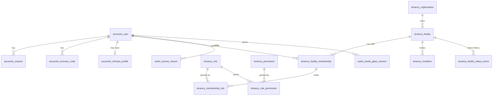

| Table | Purpose | RLS | Class | Mutability | Retention | Sprint |
|---|---|---|---|---|---|---|
| `accounts_user` | Login identity (staff and patients) | — | C2 | Mutable | R-ACCT; staff kept while they authored records | S0 |
| `accounts_session` | Server-side sessions per audience | — | C2 | Mutable | R-TMP (until expiry or logout) | S0 |
| `accounts_recovery_code` | MFA recovery codes (hashed) | — | C3 | Append-only (+ `used_at`) | R-ACCT | S0 |
| `otp_totp_totpdevice` | TOTP devices (django-otp) | — | C3 | Mutable | R-ACCT | S0 |
| `accounts_clinician_profile` | Licence council and number | — | C2 | Mutable | R-ACCT, kept while authored records exist | S2 |
| `tenancy_organization` | Legal owner of facilities | — | C1 | Mutable | R-OPS | S0 |
| `tenancy_facility` | The tenant | — (it is the tenant) | C1 (public fields C0) | State machine | R-OPS | S0 |
| `tenancy_facility_status_event` | Facility status history | — | C1 | Append-only | R-AUD | S1 |
| `tenancy_facility_warning` | Warnings from dispute decisions | — | C1 | Append-only | R-DSP | S10 |
| `tenancy_role` | Facility roles (seeded) | — | C1 | Versioned (seeded) | R-MD | S0 |
| `tenancy_permission` | Permission codes (seeded) | — | C1 | Versioned (seeded) | R-MD | S0 |
| `tenancy_role_permission` | Role → permission grants | — | C1 | Versioned (seeded) | R-MD | S0 |
| `tenancy_facility_membership` | User at a facility | ✓ | C2 | Mutable | R-AUD (kept for attribution) | S0 |
| `tenancy_membership_role` | Roles of a membership | ✓ | C1 | Mutable | R-AUD | S0 |
| `tenancy_membership_service_point` | Service points of a membership | ✓ | C1 | Mutable | R-OPS | S2 |
| `tenancy_invitation` | Staff invitations | ✓ | C2 | State machine (light) | R-TMP (90 days after expiry or acceptance) | S2 |
| `authz_access_reason` | Reasons given for opening a record outside the treatment relationship | ✓ | C2 | Append-only | R-AUD | S6 |
| `authz_break_glass_session` | Emergency access sessions and reviews | — (platform) | C2 | Append-only (+ review fields) | R-AUD | S6 |

| Table | Key columns |
|---|---|
| `accounts_user` | `email citext` **unique** (case-insensitive), `full_name varchar(200)`, `preferred_language varchar(2)` CHECK in (`rw`, `en`, `fr`) default `rw`, `password varchar(255)` (Argon2id), `is_platform_admin boolean`, `is_active boolean`, `email_verified_at`, `last_login`, `pin_hash varchar(255) NULL` (staff PIN unlock), `phone_e164 varchar(16) NULL` (P3), `closed_at NULL`. A closed patient account keeps a tombstone row; personal fields are erased after 30 days. |
| `accounts_session` | Django `session_key varchar(40)` PK, `session_data`, `expire_date`, plus `audience varchar(8)` (`staff`/`patient`), `user_id`, `active_facility_id NULL`, `ip inet`, `user_agent varchar(300)`, `is_shared_device boolean`, `last_seen_at`. Index (`user_id`, `audience`), (`expire_date`). Separate cookies per audience ([ADR 0006](../decisions/0006-separate-frontend-and-backend-hosting.md)). |
| `accounts_recovery_code` | `user_id`, `code_hash varchar(255)`, `used_at NULL`. Index (`user_id`). |
| `otp_totp_totpdevice` | django-otp columns. The TOTP `key` must be encrypted at rest with the application key ([security 03](../security/03-identity-authentication-sessions.md) §3); django-otp stores it in plain hex by default, so wrap or replace the field. |
| `accounts_clinician_profile` | `user_id` PK and FK (1:1), `council varchar(8)` (`rmdc`, `ncnm`, `npc`), `licence_number varchar(40)`, `specialty varchar(100) NULL`. **Unique** (`council`, `licence_number`). |
| `tenancy_organization` | `name varchar(200)`. |
| `tenancy_facility` | `organization_id`, `name varchar(200)`, `slug varchar(80)` **unique**, `facility_type varchar(40)` (code snapshot), `level_of_care varchar(12)`, `ownership varchar(16)`, `status varchar(20)` CHECK (`draft`, `submitted`, `under_review`, `changes_requested`, `approved`, `setup`, `live`, `suspended`, `deactivated`, `rejected`), `village_id` → `masterdata_location`, `address text`, `latitude numeric(9,6)`, `longitude numeric(9,6)`, `phone`, `email`, `description_i18n jsonb`. Index (`status`), (`latitude`, `longitude`). |
| `tenancy_facility_status_event` | `facility_id`, `from_status`, `to_status`, `actor_id`, `reason text`, `occurred_at`. |
| `tenancy_facility_warning` | `facility_id`, `dispute_id NULL`, `text`, `issued_by_id`. |
| `tenancy_role` | `code varchar(40)` **unique** (`facility_admin`, `receptionist`, `doctor`, `pharmacist`), `name_i18n jsonb`, `is_system boolean`. |
| `tenancy_permission` | `code varchar(60)` **unique**, `description text`. |
| `tenancy_role_permission` | `role_id`, `permission_id`. **Unique** pair. |
| `tenancy_facility_membership` | `user_id`, `is_active boolean`, `deactivated_at NULL`, `deactivated_by_id NULL`, `licence_attested_at NULL`, `licence_attested_by_id NULL`, `signature_file_id NULL`. **Unique** (`facility_id`, `user_id`). Index (`user_id`) for the account policy. |
| `tenancy_membership_role` | `membership_id`, `role_id`. **Unique** pair. |
| `tenancy_membership_service_point` | `membership_id`, `service_point_id`. **Unique** pair. |
| `tenancy_invitation` | `email citext`, `invited_by_id`, `role_codes text[]`, `service_point_ids uuid[]`, `token_hash bytea` **unique**, `expires_at`, `accepted_at NULL`, `accepted_user_id NULL`, `revoked_at NULL`. Index (`facility_id`, `email`) where pending. Looked up before login through `tenancy_find_invitation`. |
| `authz_access_reason` | `membership_id`, `patient_id`, `reason_code`, `reason_text`, `granted_until`. Index (`facility_id`, `patient_id`, `granted_until`). |
| `authz_break_glass_session` | `user_id`, `patient_id`, `facility_id NULL`, `reason_code`, `reason_text`, `starts_at`, `expires_at`, `ended_at NULL`, `reviewed_by_id NULL`, `reviewed_at NULL`, `review_outcome NULL`. CHECK `reviewed_by_id <> user_id`. |

### 5.3 Master data

Platform-wide, read-only for the app role, versioned, never deleted. Every change also writes `masterdata_change`. See §7 for how platform admins write it.

| Table | Purpose | RLS | Class | Mutability | Retention | Sprint |
|---|---|---|---|---|---|---|
| `masterdata_location` | Provinces → villages | — | C0 | Versioned | R-MD | S1 |
| `masterdata_facility_type` | Facility types, level of care | — | C0 | Versioned | R-MD | S1 |
| `masterdata_service_catalogue_item` | Standard service names | — | C0 | Versioned | R-MD | S1 |
| `masterdata_insurer` | Insurers and schemes | — | C0 | Versioned | R-MD | S1 |
| `masterdata_drug` | Drug catalogue | — | C0 | Versioned | R-MD | S1 |
| `masterdata_diagnosis_code` | ICD-10 subset | — | C0 | Versioned | R-MD | S1 |
| `masterdata_symptom` | Structured symptom list (FR-AI-01) | — | C0 | Versioned | R-MD | S1 |
| `masterdata_public_holiday` | Public holidays | — | C0 | Versioned | R-MD | S1 |
| `masterdata_reason_code` | Reason lists (dispute, no-show reversal, void, reorder, priority, exemption, access, break-glass) | — | C0 | Versioned | R-MD | S1 |
| `masterdata_document_template` | Default document templates | — | C1 | Versioned | R-MD | S1 |
| `masterdata_change` | Change log of master data | — | C1 | Append-only | R-AUD | S1 |
| `masterdata_import` | Bulk imports with preview | — | C1 | State machine (light) | R-OPS | S1 |

| Table | Key columns |
|---|---|
| `masterdata_location` | `level varchar(10)` (`province`…`village`), `code varchar(20)` **unique**, `parent_id` (self) NULL, `name varchar(120)`, `is_active`. Index (`parent_id`), (`level`, `name`). |
| `masterdata_facility_type` | `code` **unique**, `name_i18n`, `level_of_care`. |
| `masterdata_service_catalogue_item` | `code` **unique**, `name_i18n`, `synonyms_i18n jsonb`, `min_age_months NULL`, `max_age_months NULL`, `sex_restriction NULL`. |
| `masterdata_insurer` | `code` **unique** (`mutuelle`, `rama`, `mmi`, …), `name`, `scheme varchar(20)`, `follows_referral_pathway boolean`. |
| `masterdata_drug` | `code` **unique**, `generic_name varchar(200)`, `strength varchar(60)`, `form varchar(40)`, `default_route`, `drug_class varchar(60)` (allergy matching), `is_controlled boolean`, `is_essential_list boolean`, `max_usual_quantity integer NULL` (dose sanity). GIN trigram index on `generic_name`. |
| `masterdata_diagnosis_code` | `code_system varchar(8)` (`icd10`), `code varchar(10)`, `title_i18n`, `plain_language_i18n`, `is_sensitive boolean`. **Unique** (`code_system`, `code`). GIN trigram index on the English title. |
| `masterdata_symptom` | `code` **unique**, `name_i18n`, `body_system varchar(40)`, `icd_code NULL`. |
| `masterdata_public_holiday` | `holiday_date date` **unique**, `name_i18n`. |
| `masterdata_reason_code` | `kind varchar(30)`, `code varchar(40)`, `label_i18n`, `requires_text boolean`. **Unique** (`kind`, `code`). |
| `masterdata_document_template` | `kind`, `language`, `template_version integer`, `body text`, `is_default`. **Unique** (`kind`, `language`, `template_version`). |
| `masterdata_change` | `table_name`, `row_id`, `row_version`, `old jsonb`, `new jsonb`, `actor_id`, `changed_at`. |
| `masterdata_import` | `kind`, `file_id`, `status`, `summary jsonb`, `created_by_id`, `confirmed_at NULL`. |

### 5.4 Facilities: onboarding and configuration

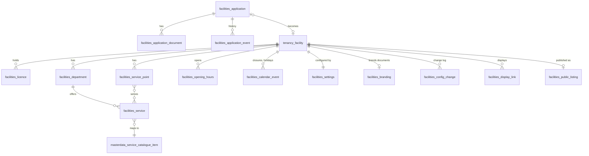

| Table | Purpose | RLS | Class | Mutability | Retention | Sprint |
|---|---|---|---|---|---|---|
| `facilities_application` | Facility application (before a tenant exists) | — | C2 | State machine | R-APP | S1 |
| `facilities_application_document` | Documents attached to an application | — | C2 | Mutable until submitted | R-APP | S1 |
| `facilities_application_event` | Status changes, verification notes, item comments | — | C2 | Append-only | R-APP | S1 |
| `facilities_licence` | Operating licences with expiry | ✓ | C1 | Versioned | R-OPS | S1 |
| `facilities_department` | Departments | ✓ | C0 | Mutable | R-OPS | S2 |
| `facilities_service` | Services offered | ✓ | C0 | Mutable | R-OPS | S2 |
| `facilities_service_point` | Rooms, desks, windows | ✓ | C0 | Mutable | R-OPS | S2 |
| `facilities_service_point_service` | Which services a point serves | ✓ | C0 | Mutable | R-OPS | S2 |
| `facilities_opening_hours` | Weekly hours | ✓ | C0 | Mutable | R-OPS | S2 |
| `facilities_calendar_event` | Closures, holiday overrides, Umuganda, special days | ✓ | C0 | Mutable, soft delete | R-OPS | S2 |
| `facilities_settings` | Queue, booking, billing, document, notification settings | ✓ | C1 | Mutable | R-OPS | S2 |
| `facilities_branding` | Letterhead, logo, stamp, footer | ✓ | C1 | Mutable | R-OPS | S2 |
| `facilities_config_change` | Configuration change log | ✓ | C1 | Append-only | R-AUD | S2 |
| `facilities_display_link` | Waiting-room display links | ✓ | C1 | Mutable | R-OPS | S4 |
| `facilities_public_listing` | Public read model for search (C0 only, live facilities only) | — | C0 | Rebuilt on change | R-OPS | S5 |

| Table | Key columns |
|---|---|
| `facilities_application` | `status` CHECK (`draft`, `submitted`, `under_review`, `changes_requested`, `approved`, `rejected`), `facility_name`, `facility_type`, `ownership`, `organization_name`, `village_id`, `address`, `latitude`, `longitude`, `phone`, `email`, `applicant_name`, `applicant_email citext`, `applicant_position`, `proposed_admin_name`, `proposed_admin_email citext`, `proposed_admin_phone`, `claimed_insurer_codes text[]`, `accepted_terms_version`, `accepted_dpa_version`, `ncsa_registration_confirmed boolean`, `resume_token_hash bytea` **unique** NULL, `created_by_platform_admin_id NULL`, `facility_id NULL` **unique** (set at approval), `submitted_at`, `decided_at`. Index (`status`, `submitted_at`). |
| `facilities_application_document` | `application_id`, `file_id`, `kind` (`moh_licence`, `rdb_registration`, `tin_certificate`, `accreditation`, `insurer_contract`, `other`), `expires_on date NULL`, `review_status`, `review_comment`. |
| `facilities_application_event` | `application_id`, `kind` (`status_change`, `note`, `item_comment`), `from_status`, `to_status`, `actor_id NULL` (null = applicant), `note text`, `item_comments jsonb`, `occurred_at`. |
| `facilities_licence` | `kind`, `number`, `issued_on`, `expires_on`, `file_id NULL`, `last_reminder_days smallint NULL`. Index (`expires_on`). |
| `facilities_department` | `name_i18n jsonb`, `is_active`. |
| `facilities_service` | `department_id`, `catalogue_item_id`, `name_i18n`, `duration_minutes smallint`, `is_bookable`, `allows_walk_in`, `allows_remote_join`, `ticket_prefix varchar(3)`, `level_of_care`, `min_age_months NULL`, `max_age_months NULL`, `sex_restriction NULL`, `is_active`. **Unique** (`facility_id`, `ticket_prefix`) where active. The fee lives in `billing_tariff_item`. |
| `facilities_service_point` | `name`, `kind` (`room`, `desk`, `pharmacy_window`, `cashier`), `is_active`. |
| `facilities_service_point_service` | `service_point_id`, `service_id`. **Unique** pair. |
| `facilities_opening_hours` | `service_id NULL` (null = whole facility), `weekday smallint` CHECK 0–6, `opens_at time`, `closes_at time`, `break_starts_at NULL`, `break_ends_at NULL`. **Unique** (`facility_id`, `service_id`, `weekday`) `NULLS NOT DISTINCT`. |
| `facilities_calendar_event` | `kind` (`closure`, `holiday_override`, `umuganda`, `special_day`), `service_id NULL`, `starts_at`, `ends_at`, `is_open boolean`, `reason text`, `deleted_at NULL`. Index (`facility_id`, `starts_at`). |
| `facilities_settings` | `facility_id` PK and FK, `queue jsonb`, `booking jsonb`, `billing jsonb`, `documents jsonb`, `notifications jsonb`, `schema_version smallint`. Each section is validated against a versioned schema in code. |
| `facilities_branding` | `facility_id` PK and FK, `letterhead_file_id`, `logo_file_id`, `stamp_file_id`, `footer_text`. |
| `facilities_config_change` | `entity varchar(60)`, `entity_id uuid`, `field varchar(60)`, `old_value jsonb`, `new_value jsonb`, `actor_id`, `changed_at`. Index (`facility_id`, `changed_at`). |
| `facilities_display_link` | `label`, `service_ids uuid[]`, `token_hash bytea` **unique**, `created_by_id`, `revoked_at NULL`, `last_seen_at NULL`. |
| `facilities_public_listing` | `facility_id` **unique**, `slug`, `name`, `facility_type`, `level_of_care`, `ownership`, `district_code`, `sector_code`, `latitude`, `longitude`, `services jsonb` (catalogue codes, names, fees), `insurers jsonb` (codes, patient share), `hours jsonb`, `next_slot_at NULL`, `queue_load varchar(8)`, `refreshed_at`. Rows exist only for `live` facilities. |

### 5.5 Patients

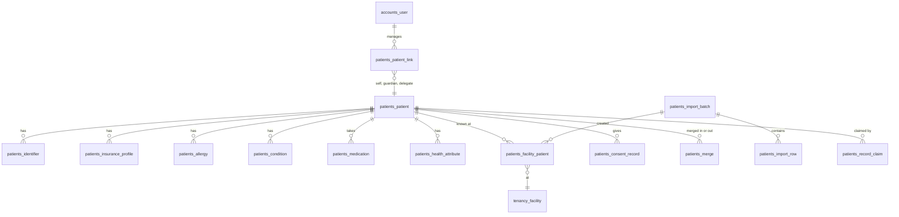

| Table | Purpose | RLS | Class | Mutability | Retention | Sprint |
|---|---|---|---|---|---|---|
| `patients_patient` | Platform-wide person | — (patient policy) | C2 | Mutable | R-CLIN if clinical records exist, else R-ACCT | S0 (minimal), S3 |
| `patients_identifier` | National ID, passport, refugee ID | — | C3 | Versioned | As the patient | S3 |
| `patients_patient_link` | Account ↔ patient (self, guardian, delegate) | — | C2 | Versioned (revoke, never delete) | R-AUD | S0 |
| `patients_consent_record` | Consents by kind and version | — | C2 | Append-only | R-AUD | S0 |
| `patients_facility_patient` | The patient as known at one facility | ✓ | C2 | Mutable | R-CLIN | S3 |
| `patients_allergy` | Allergies | — (patient-level safety data) | C3 | Versioned | R-CLIN | S3 |
| `patients_condition` | Chronic conditions | — | C3 (C4 when restricted) | Versioned | R-CLIN | S3 |
| `patients_medication` | Long-term medicines | — | C3 | Versioned | R-CLIN | S3 |
| `patients_health_attribute` | Blood group, pregnancy status | — | C3 | Append-only | R-CLIN | S3 |
| `patients_insurance_profile` | Insurance cards | — | C3 | Mutable | R-ACCT (snapshots on bills follow R-FIN) | S3 |
| `patients_merge` | Merge requests, execution and undo | ✓ (facility scope) | C2 | State machine | R-AUD | S3 |
| `patients_record_claim` | Claims of walk-in records | — | C2 | State machine (light) | R-AUD | S3 |
| `patients_import_batch` | Legacy register imports | ✓ | C2 | State machine | R-AUD | S6 |
| `patients_import_row` | Rows of an import | ✓ | C3 | Mutable until confirmed | Raw data purged after the rollback window; metadata R-AUD | S6 |

| Table | Key columns |
|---|---|
| `patients_patient` | `medilink_number varchar(12)` **unique** (generated, never reused), `full_name varchar(200)` (one "Names" field), `preferred_name NULL`, `date_of_birth date NULL`, `is_birth_date_estimated boolean`, `sex varchar(8) NULL`, `phone_e164 varchar(16) NULL` (not unique), `email citext NULL`, `village_id NULL`, `address text NULL`, `emergency_contact jsonb NULL`, `created_via` (`self_signup`, `dependent`, `walk_in`, `import`, `phone_booking`), `merged_into_id NULL`. Indexes: GIN trigram on `full_name`; (`date_of_birth`); (`phone_e164`). |
| `patients_identifier` | `patient_id`, `kind` (`national_id`, `passport`, `refugee_id`, `birth_certificate`), `issuing_country char(2)`, `value_enc bytea`, `value_bidx bytea`, `value_last4 varchar(4)` (masked display), `verified_at NULL`, `verified_by_id NULL`. **Unique** (`kind`, `issuing_country`, `value_bidx`). Insurance numbers and file numbers live in their own tables. |
| `patients_patient_link` | `account_id` → `accounts_user`, `patient_id`, `relationship` (`self`, `guardian`, `delegate`), `consent_record_id NULL`, `granted_at`, `revoked_at NULL`. **Unique** (`account_id`, `patient_id`) where not revoked; **unique** (`account_id`) where `relationship = 'self'` and not revoked. Index (`account_id`) where not revoked (used by every patient policy). |
| `patients_consent_record` | `user_id NULL`, `patient_id NULL`, `kind` (`terms`, `privacy`, `care`, `research`, `notifications`, `location`, `sharing`, `guardian`), `version varchar(20)`, `granted boolean`, `granted_at`, `channel` (`web`, `reception_spoken`, `email`), `recorded_by_id NULL`, `facility_id NULL`. CHECK `user_id` or `patient_id` set. Index (`user_id`, `kind`, `granted_at` desc). |
| `patients_facility_patient` | `patient_id`, `file_number varchar(40) NULL`, `first_visit_on date`, `reception_notes text NULL`, `is_staff_member boolean` (staff-as-patient flag, [security 04](../security/04-authorization-and-tenant-isolation.md) §3), `import_batch_id NULL`. **Unique** (`facility_id`, `patient_id`); **unique** (`facility_id`, `file_number`) where not null. |
| `patients_allergy` | `patient_id`, `category` (`drug`, `food`, `other`), `drug_id NULL`, `drug_class NULL`, `substance_text`, `reaction text`, `severity`, `source` (`patient`, `clinician`, `legacy`), `verification_status` (`unverified`, `verified`, `refuted`), `verified_by_membership_id NULL`, `verified_at NULL`, `recorded_facility_id NULL`, `entered_in_error_at NULL`. Index (`patient_id`) where not entered in error. |
| `patients_condition` | `patient_id`, `code_system`, `code`, `display` (snapshot), `status` (`active`, `resolved`), `onset_date NULL`, `source`, `verification_status`, `is_restricted boolean`, `restricted_details_enc bytea NULL`, `entered_in_error_at NULL`. |
| `patients_medication` | `patient_id`, `drug_id NULL`, `drug_display` (snapshot), `dose_text`, `source`, `verification_status`, `started_on NULL`, `stopped_on NULL`. |
| `patients_health_attribute` | `patient_id`, `kind` (`blood_group`, `pregnancy`), `value varchar(20)`, `due_date NULL`, `expires_at NULL` (pregnancy expires after the due date), `source`, `recorded_by_membership_id NULL`, `recorded_at`. Latest row per kind wins. |
| `patients_insurance_profile` | `patient_id`, `insurer_id`, `member_number varchar(40)`, `is_principal boolean`, `principal_name NULL`, `principal_member_number NULL`, `valid_until date NULL`, `status` (`unverified`, `verified`, `rejected`), `last_verified_facility_id NULL`, `last_verified_at NULL`, `card_front_file_id NULL`, `card_back_file_id NULL`, `is_active`. Index (`insurer_id`, `member_number`) to spot one number used by many patients. |
| `patients_merge` | `scope` (`facility`, `cross_facility`), `facility_id NULL`, `surviving_patient_id`, `merged_patient_id`, `status` (`requested`, `approved`, `rejected`, `executed`, `undone`), `requested_by_id`, `approved_by_id NULL`, `reason`, `moved_links jsonb` (for undo), `executed_at`, `undone_at`. CHECK `approved_by_id <> requested_by_id`. |
| `patients_record_claim` | `account_id`, `patient_id`, `method` (`contact_code`, `reception_check`), `code_hash bytea NULL`, `expires_at`, `attempts smallint`, `status`, `confirmed_by_membership_id NULL`, `facility_id NULL`. |
| `patients_import_batch` | `file_id`, `status` (`uploaded`, `previewed`, `confirmed`, `rolled_back`, `failed`), `column_mapping jsonb`, `row_count`, `valid_count`, `error_count`, `duplicate_count`, `created_count`, `created_by_id`, `confirmed_at NULL`, `rollback_until`, `rolled_back_at NULL`. |
| `patients_import_row` | `batch_id`, `row_number`, `raw_enc bytea` (may contain national IDs), `normalized jsonb` (no national ID; blind index only), `status`, `errors jsonb`, `matched_patient_id NULL`, `created_patient_id NULL`. |

### 5.6 Scheduling and booking

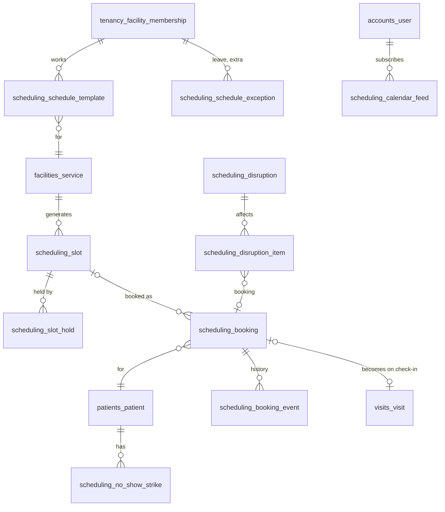

| Table | Purpose | RLS | Class | Mutability | Retention | Sprint |
|---|---|---|---|---|---|---|
| `scheduling_schedule_template` | Weekly blocks per doctor or service | ✓ | C1 | Versioned (`valid_from`/`valid_to`) | R-OPS | S2 |
| `scheduling_schedule_exception` | Leave, training, extra sessions | ✓ | C2 | State machine (light) | R-OPS | S2 |
| `scheduling_slot` | Generated slots for the booking window | ✓ | C1 | Mutable (counters) | R-TMP (past slots purged after 90 days) | S5 |
| `scheduling_slot_hold` | 5-minute holds | ✓ | C1 | Mutable | R-TMP (1 day) | S5 |
| `scheduling_booking` | Bookings (become visits at check-in) | ✓ + patient policy | C3 (reason for visit) | State machine | R-VISIT | S5 |
| `scheduling_booking_event` | Booking history | ✓ | C2 | Append-only | R-VISIT | S5 |
| `scheduling_no_show_strike` | No-show strikes | ✓ | C2 | Versioned (reversal fields) | R-VISIT | S5 |
| `scheduling_disruption` | Doctor absence, closure, schedule change | ✓ | C1 | State machine (light) | R-OPS | S5 |
| `scheduling_disruption_item` | Affected bookings and tickets, chosen action, patient response | ✓ | C2 | Mutable | R-VISIT | S5 |
| `scheduling_follow_up` | Follow-ups set during consultation | ✓ | C3 | Mutable | R-CLIN | S5 |
| `scheduling_calendar_feed` | Private `.ics` subscription links | — | C2 | Mutable | R-ACCT | S5 |
| `scheduling_travel_time` | Patient travel time per facility | — | C2 | Mutable | R-ACCT | S4 |

| Table | Key columns |
|---|---|
| `scheduling_schedule_template` | `membership_id NULL` (null = service schedule), `service_id`, `service_point_id NULL`, `weekday smallint`, `starts_at time`, `ends_at time`, `slot_minutes smallint`, `capacity_per_slot smallint`, `bookable_share_pct smallint` CHECK 0–100, `valid_from date`, `valid_to date NULL`, `is_active`. CHECK `starts_at < ends_at`. Index (`facility_id`, `membership_id`, `weekday`). |
| `scheduling_schedule_exception` | `membership_id NULL`, `service_id NULL`, `kind` (`leave`, `training`, `extra_session`, `closure`), `starts_at`, `ends_at`, `status` (`requested`, `approved`, `rejected`, `cancelled`), `reason text NULL`, `requested_by_id`, `approved_by_id NULL`. Index (`facility_id`, `starts_at`). |
| `scheduling_slot` | `service_id`, `membership_id NULL`, `service_point_id NULL`, `starts_at`, `ends_at`, `capacity smallint`, `bookable_capacity smallint`, `booked_count smallint`, `held_count smallint`, `status` (`open`, `closed`, `cancelled`), `source_template_id NULL`. **Unique** (`facility_id`, `service_id`, `membership_id`, `starts_at`) `NULLS NOT DISTINCT`. CHECK `booked_count + held_count <= bookable_capacity`. Index (`facility_id`, `service_id`, `starts_at`) where open. Holds and bookings update the counters under `SELECT … FOR UPDATE`. |
| `scheduling_slot_hold` | `slot_id`, `account_id NULL`, `membership_id NULL`, `expires_at`, `released_at NULL`, `booking_id NULL`. Index (`slot_id`) where not released; (`expires_at`). |
| `scheduling_booking` | `patient_id`, `facility_patient_id NULL`, `account_id NULL` (booked by), `booked_by_membership_id NULL`, `source` (`online`, `phone`, `follow_up`, `referral`, `rebooking`), `slot_id NULL` (SET NULL), `service_id`, `membership_id NULL` (doctor), `starts_at` (snapshot), `service_date date`, `status` (`confirmed`, `cancelled`, `late_cancelled`, `no_show`, `checked_in`, `superseded`), `booking_code varchar(10)`, `contact_phone_e164 NULL`, `insurance_profile_id NULL`, `insurer_code NULL` (snapshot), `estimated_fee_rwf`, `estimated_patient_share_rwf`, `reason_text text NULL`, `pending_change jsonb NULL` (disruption offer), `cancelled_at NULL`, `cancel_reason_code NULL`, `visit_id NULL`. **Unique** (`facility_id`, `booking_code`); **unique** (`patient_id`, `service_id`, `service_date`) where `status = 'confirmed'`. Index (`facility_id`, `service_date`, `status`); (`patient_id`, `starts_at`) where confirmed. |
| `scheduling_booking_event` | `booking_id`, `from_status`, `to_status`, `actor_id NULL`, `reason_code`, `reason_text`, `occurred_at`. |
| `scheduling_no_show_strike` | `patient_id`, `booking_id`, `occurred_at`, `reversed_at NULL`, `reversed_by_id NULL`, `reversal_reason NULL`, `dispute_id NULL`. Index (`patient_id`, `occurred_at`). Counted across facilities only through `scheduling_strike_count`. |
| `scheduling_disruption` | `kind` (`doctor_absent`, `closure`, `schedule_change`), `membership_id NULL`, `service_id NULL`, `starts_at`, `ends_at`, `reason text`, `status` (`open`, `resolved`), `created_by_id`. |
| `scheduling_disruption_item` | `disruption_id`, `booking_id NULL`, `ticket_id NULL`, `action NULL` (`move_doctor`, `next_slot`, `cancel`), `new_booking_id NULL`, `patient_response` (`pending`, `accepted`, `declined`, `rebooked_other`, `cancelled`), `resolved_at NULL`. |
| `scheduling_follow_up` | `visit_id`, `consultation_id NULL`, `patient_id`, `due_on date`, `mode` (`booking`, `reminder`), `booking_id NULL`, `status`. |
| `scheduling_calendar_feed` | `account_id`, `token_hash bytea` **unique**, `revoked_at NULL`, `last_accessed_at NULL`. |
| `scheduling_travel_time` | `account_id`, `facility_id` (reference, no RLS), `minutes smallint` CHECK 0–600. **Unique** (`account_id`, `facility_id`). |

### 5.7 Visits and the live queue

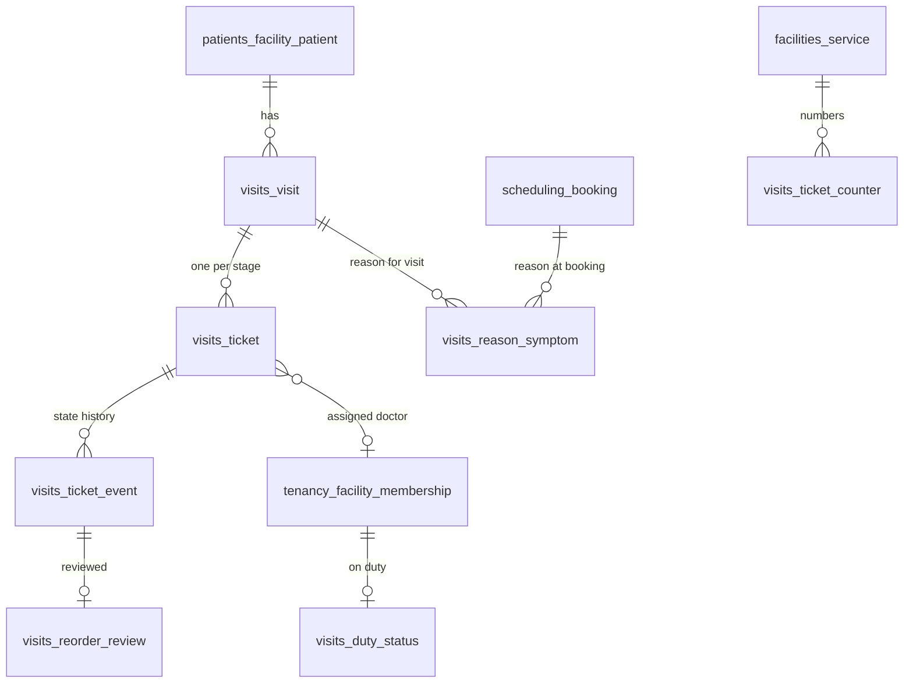

| Table | Purpose | RLS | Class | Mutability | Retention | Sprint |
|---|---|---|---|---|---|---|
| `visits_visit` | One patient, one facility, one day ([ADR 0004](../decisions/0004-visit-centric-domain-model.md)) | ✓ + patient policy | C3 (reason for visit) | State machine (status derived from tickets) | R-VISIT | S4 |
| `visits_reason_symptom` | Structured symptoms (AI stage 0 data) | ✓ | C3 | Append-only | R-CLIN | S5 |
| `visits_ticket` | Place in the queue of one stage | ✓ + patient policy | C2 | State machine | R-VISIT | S4 |
| `visits_ticket_event` | Every ticket transition | ✓ | C2 | Append-only | R-VISIT | S4 |
| `visits_ticket_counter` | Daily ticket numbering per service | ✓ | C1 | Mutable (row lock) | R-TMP (30 days) | S4 |
| `visits_duty_status` | Doctor on duty, break, emergency, off | ✓ | C1 | Mutable | R-OPS | S4 |
| `visits_duty_status_event` | Duty status history (throughput reports) | ✓ | C1 | Append-only | R-OPS | S4 |
| `visits_reorder_review` | Admin review of manual reorders | ✓ | C1 | Append-only | R-AUD | S4 |

| Table | Key columns |
|---|---|
| `visits_visit` | `facility_patient_id`, `patient_id` (denormalised for the patient policy), `service_date date`, `source` (`online_booking`, `phone_booking`, `follow_up`, `remote_join`, `walk_in`, `referral`, `emergency`), `booking_id NULL` **unique**, `status` (`remote_pending`, `on_site`, `completed`, `left_without_service`, `cancelled`), `first_service_id`, `reason_text text NULL`, `checked_in_at NULL`, `completed_at NULL`, `is_emergency boolean`, `priority_class NULL`, `priority_reason_code NULL`, `insurance_profile_id NULL`. Index (`facility_id`, `service_date`, `status`); (`patient_id`, `service_date` desc). |
| `visits_reason_symptom` | `booking_id NULL`, `visit_id NULL`, `patient_id`, `symptom_id`, `symptom_code` + `symptom_label` (snapshot), `duration_days smallint NULL`, `severity NULL`, `captured_at_stage` (`booking`, `check_in`). CHECK `booking_id` or `visit_id` set. |
| `visits_ticket` | `visit_id`, `service_id`, `stage` (`reception`, `payment`, `consultation`, `pharmacy`), `service_date`, `number varchar(8)` (`G-023`), `sequence integer`, `state` (`waiting`, `called`, `in_service`, `no_response`, `on_hold`, `moved_to_next_stage`, `transferred`, `cancelled`, `left_without_service`, `completed`), `assigned_membership_id NULL`, `service_point_id NULL`, `priority_rank smallint` (0 = emergency), `slot_starts_at NULL`, `arrival_at` (kept on transfer), `is_remote boolean`, `remote_checked_in_at NULL`, `no_response_count smallint`, `pass_over_count smallint`, `step_out_until NULL`, `called_at NULL`, `estimate_min_minutes NULL`, `estimate_max_minutes NULL`, `estimate_shown_at NULL` (for estimate accuracy). **Unique** (`facility_id`, `service_id`, `service_date`, `sequence`). Call-next index (`facility_id`, `service_id`, `stage`, `priority_rank`, `arrival_at`) where `state = 'waiting'`; call next uses `SELECT … FOR UPDATE SKIP LOCKED`. |
| `visits_ticket_event` | `ticket_id`, `from_state`, `to_state`, `action varchar(30)`, `actor_id NULL` (null = system), `actor_membership_id NULL`, `request_id varchar(40)`, `device_label NULL`, `reason_code NULL`, `reason_text NULL`, `occurred_at` (server time), `client_occurred_at NULL` (offline hint, validated), `metadata jsonb` (e.g. old and new position). Index (`ticket_id`, `occurred_at`); (`facility_id`, `occurred_at`); (`facility_id`, `action`, `actor_membership_id`). |
| `visits_ticket_counter` | `service_id`, `service_date`, `last_sequence integer`. **Unique** (`facility_id`, `service_id`, `service_date`). |
| `visits_duty_status` | `membership_id`, `service_point_id NULL`, `state` (`on_duty`, `break`, `emergency`, `off`), `until_at NULL`. **Unique** (`facility_id`, `membership_id`). |
| `visits_duty_status_event` | `membership_id`, `from_state`, `to_state`, `occurred_at`. |
| `visits_reorder_review` | `ticket_event_id` **unique**, `reviewed_by_id`, `reviewed_at`, `comment`. |

### 5.8 Clinical record

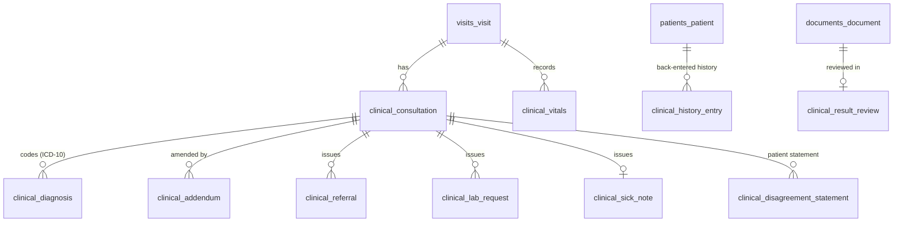

| Table | Purpose | RLS | Class | Mutability | Retention | Sprint |
|---|---|---|---|---|---|---|
| `clinical_consultation` | Consultation record | ✓ + patient policy | C4 | Locked after signing; status `draft` → `signed` → (`entered_in_error`) | R-CLIN | S6 |
| `clinical_vitals` | Vital signs | ✓ | C3 | Append-only | R-CLIN | S6 |
| `clinical_diagnosis` | ICD-10 diagnoses | ✓ | C3 (C4 if sensitive) | Locked after signing | R-CLIN | S6 |
| `clinical_addendum` | Signed additions | ✓ | C3 / C4 | Append-only | R-CLIN | S6 |
| `clinical_referral` | Referral out | ✓ | C3 | Locked after signing | R-CLIN | S6 |
| `clinical_lab_request` | Lab and imaging requests | ✓ | C3 | Locked after signing | R-CLIN | S6 |
| `clinical_sick_note` | Sick note / medical certificate | ✓ | C3 | Locked after signing | R-CLIN | S6 |
| `clinical_result_review` | Results inbox items | ✓ | C3 | State machine (light) | R-CLIN | S6 |
| `clinical_history_entry` | Structured back-entry from paper (labelled historical) | ✓ | C3 | Append-only | R-CLIN | S6 |
| `clinical_disagreement_statement` | Patient's statement when a correction is refused | ✓ | C3 | Append-only | R-CLIN | S10 |

| Table | Key columns |
|---|---|
| `clinical_consultation` | `visit_id`, `patient_id`, `author_membership_id`, `status` (`draft`, `signed`, `entered_in_error`), `started_at`, `signed_at NULL`, `content_hash bytea NULL` (SHA-256 of the canonical content), `is_late_entry boolean`, `is_restricted boolean`, `history_text`, `examination_text`, `plan_text`, `patient_instructions_text`, `private_notes_enc bytea NULL` (always encrypted, never in patient serializers), `restricted_payload_enc bytea NULL` (sensitive sections when restricted), `entered_in_error_reason NULL`, `entered_in_error_at NULL`. Index (`facility_id`, `visit_id`); (`patient_id`, `signed_at` desc); (`facility_id`, `author_membership_id`) where draft. A trigger rejects content updates once `status <> 'draft'`. |
| `clinical_vitals` | `visit_id`, `consultation_id NULL`, `recorded_by_membership_id`, `recorded_at`, `temperature_c numeric(4,1)`, `systolic_mmhg smallint`, `diastolic_mmhg smallint`, `pulse_bpm smallint`, `respiratory_rate smallint`, `spo2_pct smallint`, `weight_kg numeric(5,2)`, `height_cm numeric(5,1)`, `muac_mm smallint`, `entered_in_error_at NULL`. CHECK plausible ranges. |
| `clinical_diagnosis` | `consultation_id`, `code_system`, `code`, `display` + `plain_language` (snapshots), `rank` (`primary`, `secondary`), `certainty` (`provisional`, `confirmed`), `is_sensitive boolean`. Index (`facility_id`, `code`) for reports. |
| `clinical_addendum` | `consultation_id`, `author_membership_id`, `reason text`, `body_text text NULL`, `body_enc bytea NULL` (restricted records), `content_hash bytea`, `signed_at`. |
| `clinical_referral` | `consultation_id`, `to_facility_id NULL`, `to_facility_name`, `specialty`, `reason text`, `urgency` (`routine`, `urgent`, `emergency`). |
| `clinical_lab_request` | `consultation_id`, `tests jsonb` (codes and names), `reason text`. |
| `clinical_sick_note` | `consultation_id`, `rest_from date`, `rest_to date`, `show_diagnosis boolean` default false. CHECK `rest_to >= rest_from`. |
| `clinical_result_review` | `document_id` **unique**, `patient_id`, `assigned_membership_id NULL`, `status` (`pending`, `reviewed`), `reviewed_by_membership_id NULL`, `reviewed_at NULL`, `comment NULL`. |
| `clinical_history_entry` | `patient_id`, `kind` (`diagnosis`, `allergy`, `condition`, `medication`, `procedure`, `other`), `code_system NULL`, `code NULL`, `display`, `text`, `original_date date NULL`, `original_date_precision` (`day`, `month`, `year`, `unknown`), `source_document_id NULL`, `entered_by_membership_id`, `entered_at`. |
| `clinical_disagreement_statement` | `consultation_id`, `patient_id`, `dispute_id`, `text`, `recorded_at`. |

### 5.9 Pharmacy

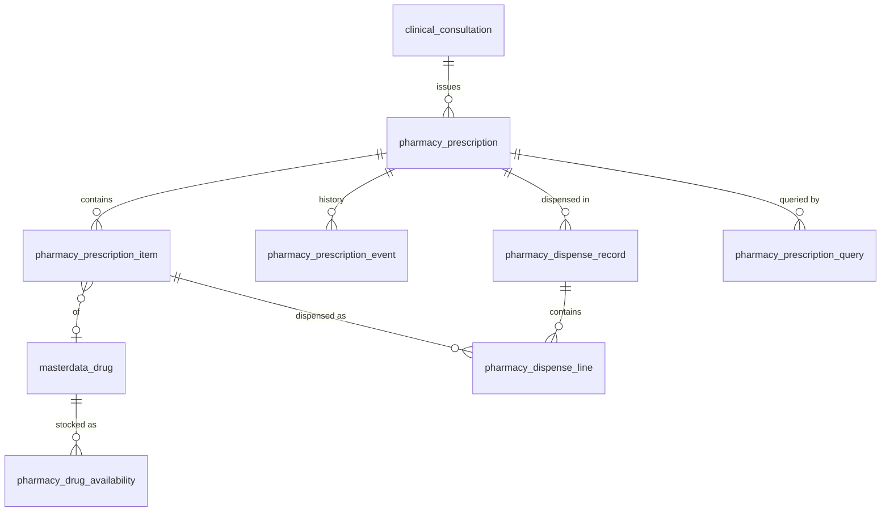

| Table | Purpose | RLS | Class | Mutability | Retention | Sprint |
|---|---|---|---|---|---|---|
| `pharmacy_prescription` | Prescription per consultation | ✓ + patient policy | C3 | State machine | R-CLIN | S6 (draft), S7 |
| `pharmacy_prescription_item` | Items | ✓ | C3 | Locked after issue (cancel + new) | R-CLIN | S6 |
| `pharmacy_prescription_event` | Prescription and item state history | ✓ | C2 | Append-only | R-CLIN | S7 |
| `pharmacy_dispense_record` | Signed dispensing | ✓ | C3 | Append-only | R-CLIN | S7 |
| `pharmacy_dispense_line` | Per-item outcome | ✓ | C3 | Append-only | R-CLIN | S7 |
| `pharmacy_drug_availability` | Available / not available here | ✓ | C1 | Mutable | R-OPS | S7 |
| `pharmacy_prescription_query` | Pharmacist question to the doctor | ✓ | C3 | State machine (light) | R-CLIN | S7 |

| Table | Key columns |
|---|---|
| `pharmacy_prescription` | `visit_id`, `consultation_id`, `patient_id`, `prescriber_membership_id`, `status` (`draft`, `issued`, `awaiting_payment`, `ready_to_dispense`, `partly_dispensed`, `dispensed`, `not_available`, `cancelled`, `expired`), `number varchar(20)` (`RX-2026-000123`), `issued_at NULL`, `expires_at NULL`, `cancelled_reason NULL`. **Unique** (`facility_id`, `number`). Index (`facility_id`, `status`) where ready or partly dispensed. |
| `pharmacy_prescription_item` | `prescription_id`, `drug_id NULL`, `drug_code` + `drug_display` (snapshot), `free_text_drug NULL`, `is_off_catalogue boolean`, `dose varchar(60)`, `frequency_code varchar(20)`, `route varchar(20)`, `duration_days smallint`, `quantity integer` CHECK > 0, `instructions text`, `substitution_allowed boolean` default true, `status`, `alert_overrides jsonb` (kind + reason), `replaces_item_id NULL`, `cancelled_reason NULL`. |
| `pharmacy_prescription_event` | `prescription_id`, `item_id NULL`, `from_status`, `to_status`, `actor_id NULL`, `reason`, `occurred_at`. |
| `pharmacy_dispense_record` | `prescription_id`, `pharmacist_membership_id`, `identity_check_method` (`ticket_name_dob`, `verification_code`), `signed_at`, `document_id NULL`. |
| `pharmacy_dispense_line` | `dispense_record_id`, `prescription_item_id`, `outcome` (`full`, `partial`, `substituted`, `not_available`), `quantity integer` CHECK ≥ 0, `substitute_drug_id NULL` + snapshot, `substitution_reason NULL`. CHECK a substitution has a reason. Total dispensed ≤ prescribed (service + trigger). |
| `pharmacy_drug_availability` | `drug_id`, `is_available boolean`, `updated_by_membership_id`. **Unique** (`facility_id`, `drug_id`). |
| `pharmacy_prescription_query` | `prescription_id`, `raised_by_membership_id`, `message text`, `status` (`open`, `answered`, `closed`), `answered_by_addendum_id NULL`. |

### 5.10 Documents and files

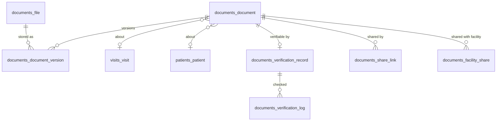

| Table | Purpose | RLS | Class | Mutability | Retention | Sprint |
|---|---|---|---|---|---|---|
| `documents_file` | Every stored file (object storage metadata) | ✓ for facility rows; `owner_kind` policies for the rest | C3 | Append-only (+ scan status) | Follows the referencing document | S1 |
| `documents_document` | Generated and uploaded documents | ✓ for facility rows + patient policy | C3 | Versioned | R-CLIN (clinical), R-FIN (receipts), R-ACCT (patient non-clinical uploads, owner may delete), R-APP (applications) | S7 (S1 for application files) |
| `documents_document_version` | Versions; superseded kept | ✓ for facility rows | C3 | Append-only | As the document | S7 |
| `documents_verification_record` | Public verification projection | — | C1 (C3 in `details_enc`) | Mutable (status) | As the document | S7 |
| `documents_verification_log` | Every verification attempt | — | C1 | Append-only | R-SEC | S7 |
| `documents_share_link` | Expiring share links | — | C2 | Mutable | R-TMP (30 days after expiry) | S7 |
| `documents_facility_share` | Patient upload shared with a facility | ✓ | C2 | Mutable (revoke) | R-ACCT | S7 |
| `documents_number_counter` | Document numbers per facility, prefix and year | ✓ | C1 | Mutable (row lock) | R-OPS | S7 |

| Table | Key columns |
|---|---|
| `documents_file` | `owner_kind` (`facility`, `patient`, `application`, `dispute`, `platform`), `facility_id NULL`, `patient_id NULL`, `application_id NULL`, `storage_bucket` (`quarantine`, `documents`), `storage_key uuid` **unique**, `sha256 bytea`, `size_bytes bigint`, `content_type varchar(80)` (sniffed), `original_filename varchar(200)` (sanitised metadata), `scan_status` (`pending`, `clean`, `infected`, `failed`), `scanned_at NULL`, `variant_key uuid NULL` (compressed image), `uploaded_by_id NULL`, `uploaded_at`. Index (`sha256`). |
| `documents_document` | `facility_id NULL`, `patient_id NULL`, `visit_id NULL`, `kind` (`visit_summary`, `prescription`, `sick_note`, `referral_letter`, `lab_request`, `dispensing_record`, `receipt`, `invoice`, `ticket_slip`, `dosing_label`, `id_document`, `insurance_card`, `result`, `legacy_scan`, `outside_prescription`, `licence`, `evidence`, `export`), `source` (`generated`, `uploaded`), `number varchar(24) NULL`, `title`, `document_date date`, `language varchar(2)`, `status` (`active`, `superseded`, `cancelled`, `entered_in_error`, `deleted_by_owner`), `is_released_to_patient boolean`, `is_restricted boolean`, `author_membership_id NULL`, `current_version_id NULL`, `source_object_type NULL`, `source_object_id NULL`, `deleted_at NULL` (owner-deleted non-clinical uploads only). **Unique** (`facility_id`, `number`) where not null. Index (`patient_id`, `document_date` desc); (`facility_id`, `visit_id`). |
| `documents_document_version` | `document_id`, `facility_id NULL`, `version_no smallint`, `file_id`, `sha256 bytea`, `source_content_hash bytea NULL`, `superseded_at NULL`. **Unique** (`document_id`, `version_no`). |
| `documents_verification_record` | `code varchar(12)` **unique** (random, ≥ 10 characters, unambiguous alphabet), `document_id` **unique**, `kind`, `issued_at`, `facility_name`, `author_name`, `author_licence`, `status` (`active`, `dispensed`, `cancelled`, `superseded`), `patient_dob_hmac bytea NULL`, `details_enc bytea NULL` (shown only after a date-of-birth match), `revoked_at NULL`. |
| `documents_verification_log` | `verification_record_id NULL` (null = code not found), `occurred_at`, `client_hash bytea` (hashed IP), `result` (`valid`, `not_found`, `rate_limited`), `detailed boolean`. |
| `documents_share_link` | `document_id`, `created_by_account_id`, `token_hash bytea` **unique**, `expires_at`, `revoked_at NULL`, `access_count integer`, `last_accessed_at NULL`. |
| `documents_facility_share` | `document_id`, `shared_by_account_id`, `revoked_at NULL`. **Unique** (`document_id`, `facility_id`) where not revoked. |
| `documents_number_counter` | `prefix varchar(4)`, `year smallint`, `last_value bigint`. **Unique** (`facility_id`, `prefix`, `year`). |

### 5.11 Billing

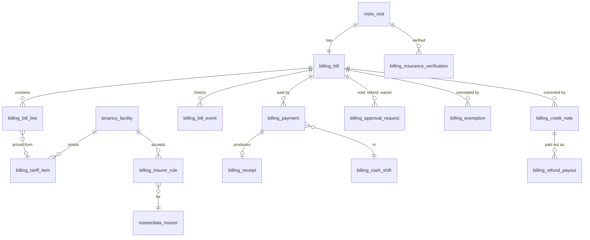

| Table | Purpose | RLS | Class | Mutability | Retention | Sprint |
|---|---|---|---|---|---|---|
| `billing_tariff_item` | Price list | ✓ | C1 (fees C0 via the public listing) | Versioned (`valid_from`/`valid_to`) | R-FIN | S2 |
| `billing_insurer_rule` | Insurer acceptance and co-pay rules | ✓ | C1 | Versioned | R-FIN | S2 |
| `billing_bill` | One bill per visit | ✓ + patient policy | C2 | State machine | R-FIN | S8 |
| `billing_bill_line` | Bill lines with split | ✓ | C3 (medicine lines) | Locked once paid; removal before payment only | R-FIN | S8 |
| `billing_bill_event` | Bill state history | ✓ | C2 | Append-only | R-FIN | S8 |
| `billing_insurance_verification` | Insurance check per visit | ✓ | C3 | Append-only | R-FIN | S8 |
| `billing_cash_shift` | Shift with float, expected and counted totals | ✓ | C1 | State machine (light) | R-FIN | S8 |
| `billing_payment` | Payments | ✓ | C2 | Append-only (void via approval) | R-FIN | S8 |
| `billing_receipt` | Gapless receipts | ✓ | C2 | Append-only (void keeps the number) | R-FIN | S8 |
| `billing_receipt_counter` | Gapless sequence per facility and year | ✓ | C1 | Mutable (row lock) | R-FIN | S8 |
| `billing_approval_request` | Voids, refunds, waivers awaiting approval | ✓ | C2 | State machine | R-FIN | S8 |
| `billing_exemption` | Exemptions and waivers | ✓ | C2 | Append-only | R-FIN | S8 |
| `billing_credit_note` | Credit notes | ✓ | C2 | Append-only | R-FIN | S8 |
| `billing_refund_payout` | Refund payouts | ✓ | C2 | Append-only | R-FIN | S8 |

| Table | Key columns |
|---|---|
| `billing_tariff_item` | `kind` (`service`, `procedure`, `medicine`, `other`), `code varchar(40)`, `name_i18n`, `service_id NULL`, `drug_id NULL`, `unit_price_rwf bigint` CHECK ≥ 0, `valid_from date`, `valid_to date NULL`, `is_public boolean`, `created_by_id`. `EXCLUDE USING gist (facility_id WITH =, code WITH =, daterange(valid_from, valid_to) WITH &&)`. |
| `billing_insurer_rule` | `insurer_id`, `applies_to_all_services boolean`, `service_ids uuid[]`, `patient_share_bp integer` CHECK 0–10000, `requires_referral boolean`, `excluded_tariff_codes text[]`, `ceiling_per_visit_rwf bigint NULL`, `valid_from`, `valid_to NULL`. Exclusion constraint on overlapping validity per (`facility_id`, `insurer_id`). |
| `billing_bill` | `visit_id` **unique**, `patient_id`, `insurance_profile_id NULL`, `insurer_id NULL`, `insurer_code NULL` + `patient_share_bp` (snapshots), `status` (`open`, `partly_paid`, `paid`, `voided`, `credited`), `total_rwf`, `insurer_share_rwf`, `patient_share_rwf`, `exempted_rwf`, `paid_rwf`, `balance_rwf` (all CHECK ≥ 0, server-computed). Index (`facility_id`, `status`) where `balance_rwf > 0`; (`patient_id`). |
| `billing_bill_line` | `bill_id`, `tariff_item_id`, `code` + `name` (snapshots), `unit_price_rwf`, `quantity integer` CHECK > 0, `total_rwf`, `insurer_share_rwf`, `patient_share_rwf`, `prescription_item_id NULL`, `related_membership_id NULL`, `removed_at NULL`, `removed_by_id NULL`, `removed_reason NULL`. |
| `billing_bill_event` | `bill_id`, `from_status`, `to_status`, `actor_id`, `reason`, `occurred_at`. |
| `billing_insurance_verification` | `visit_id`, `insurance_profile_id`, `result` (`verified`, `rejected`), `reason_code NULL`, `reason_text NULL`, `referral_letter_seen boolean NULL`, `verified_by_membership_id`, `verified_at`. |
| `billing_cash_shift` | `membership_id`, `status` (`open`, `closed`, `reviewed`), `opened_at`, `opening_float_rwf`, `closed_at NULL`, `expected_totals jsonb` (per method), `counted_totals jsonb`, `difference_rwf bigint` (may be negative), `note`, `reviewed_by_id NULL`, `reviewed_at NULL`. **Unique** (`facility_id`, `membership_id`) where open. |
| `billing_payment` | `bill_id`, `shift_id`, `method` (`cash`, `mtn_momo`, `airtel_money`, `card`, `insurance`), `amount_rwf` CHECK > 0, `reference varchar(60) NULL`, `ebm_receipt_number varchar(40) NULL`, `received_by_membership_id`, `received_at`, `status` (`recorded`, `voided`), `void_approval_id NULL`. Index (`facility_id`, `received_at`); (`shift_id`). |
| `billing_receipt` | `payment_id` **unique**, `year smallint`, `sequence bigint`, `number varchar(24)` (`RC-2026-000123`), `status` (`issued`, `voided`), `issued_at`, `voided_at NULL`, `document_id NULL`. **Unique** (`facility_id`, `year`, `sequence`) and (`facility_id`, `number`). The sequence comes from `billing_receipt_counter`, locked in the payment transaction, so numbers are gapless. |
| `billing_receipt_counter` | `year smallint`, `last_sequence bigint`. **Unique** (`facility_id`, `year`). |
| `billing_approval_request` | `kind` (`void_payment`, `void_receipt`, `refund`, `waiver`), `bill_id`, `payment_id NULL`, `receipt_id NULL`, `amount_rwf NULL`, `reason_code`, `reason_text`, `requested_by_membership_id`, `status` (`pending`, `approved`, `rejected`, `cancelled`), `decided_by_membership_id NULL`, `decided_at NULL`, `is_self_approved boolean` (one-person clinic, flagged in reports). CHECK decider ≠ requester unless `is_self_approved`. Index (`facility_id`, `status`). |
| `billing_exemption` | `bill_id`, `reason_code`, `amount_rwf`, `applied_by_membership_id`, `approval_request_id NULL`. |
| `billing_credit_note` | `bill_id`, `approval_request_id`, `number varchar(24)`, `amount_rwf` CHECK > 0, `reason`, `issued_at`, `document_id NULL`. **Unique** (`facility_id`, `number`). |
| `billing_refund_payout` | `credit_note_id`, `method`, `reference NULL`, `amount_rwf`, `paid_by_membership_id`, `paid_at`, `shift_id NULL`. |

### 5.12 Notifications

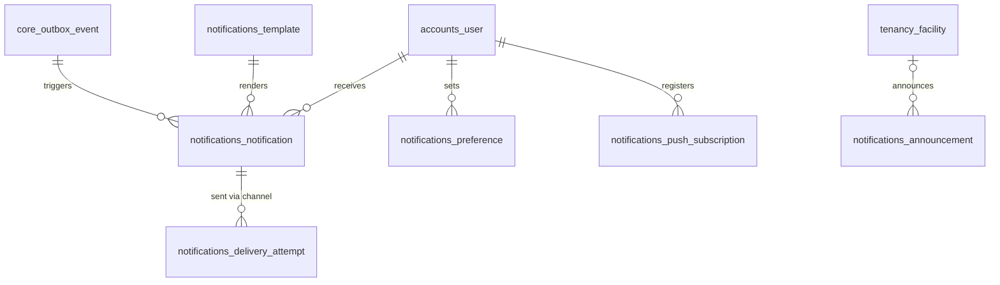

| Table | Purpose | RLS | Class | Mutability | Retention | Sprint |
|---|---|---|---|---|---|---|
| `notifications_notification` | Rendered notification per recipient | — (recipient-scoped) | C2 | Mutable (`read_at`) | R-NOT | S9 |
| `notifications_delivery_attempt` | Per channel and attempt | — | C2 | Mutable (status) | R-NOT | S9 |
| `notifications_preference` | Channels per level, quiet hours, reminders | — | C1 | Mutable | R-ACCT | S9 |
| `notifications_push_subscription` | Web push subscriptions | — | C2 | Mutable | R-ACCT | S9 |
| `notifications_template` | Versioned templates rw/en/fr | — | C1 | Versioned | R-MD | S9 |
| `notifications_announcement` | Facility and platform announcements | ✓ for facility rows | C1 | State machine (light) | R-OPS | S9 |

| Table | Key columns |
|---|---|
| `notifications_notification` | `recipient_user_id`, `patient_id NULL` (who it is about), `facility_id NULL`, `event_type varchar(60)`, `priority` (`critical`, `important`, `routine`), `template_code`, `template_version`, `language`, `title varchar(200)`, `body text` (neutral; no clinical content), `data jsonb` (IDs only), `dedupe_key varchar(120)`, `read_at NULL`. **Unique** (`recipient_user_id`, `dedupe_key`). Index (`recipient_user_id`, `created_at` desc); unread partial index. |
| `notifications_delivery_attempt` | `notification_id`, `channel` (`in_app`, `web_push`, `email`), `attempt_no smallint`, `status` (`queued`, `sent`, `delivered`, `read`, `failed`), `provider_message_id NULL`, `failure_reason varchar(200) NULL`, `queued_at`, `sent_at NULL`. Index (`notification_id`); (`status`, `queued_at`). |
| `notifications_preference` | `user_id`, `patient_id NULL` (dependent), `priority`, `channels text[]`, `quiet_hours_start time NULL`, `quiet_hours_end time NULL`, `reminder_offsets_minutes integer[] NULL`, `sound_enabled boolean NULL`, `approvals_digest NULL`. **Unique** (`user_id`, `patient_id`, `priority`) `NULLS NOT DISTINCT`. |
| `notifications_push_subscription` | `user_id`, `endpoint text` **unique** (host on the push-service allowlist), `p256dh`, `auth_secret`, `user_agent`, `last_success_at NULL`, `revoked_at NULL`. |
| `notifications_template` | `code`, `channel`, `language`, `template_version`, `subject`, `body`, `is_active`, `approved_by_id`. **Unique** (`code`, `channel`, `language`, `template_version`). |
| `notifications_announcement` | `facility_id NULL` (null = platform), `audience` (`patients_in_range`, `display`, `all_facilities`, `selected_facilities`), `target_facility_ids uuid[] NULL`, `range_starts_on NULL`, `range_ends_on NULL`, `body_i18n jsonb`, `status` (`draft`, `published`, `withdrawn`), `starts_at`, `ends_at`, `created_by_id`, `published_at NULL`. |

### 5.13 Disputes and support

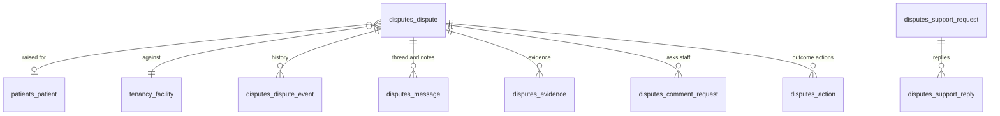

| Table | Purpose | RLS | Class | Mutability | Retention | Sprint |
|---|---|---|---|---|---|---|
| `disputes_dispute` | Disputes | ✓ + patient policy; platform context for escalated cases | C3 | State machine | R-DSP | S10 |
| `disputes_dispute_event` | Lifecycle history incl. auto-escalation | ✓ | C2 | Append-only | R-DSP | S10 |
| `disputes_message` | Thread, internal notes, staff comments | ✓ | C3 | Append-only | R-DSP | S10 |
| `disputes_evidence` | Frozen audit extracts and uploads | ✓ | C3 | Append-only | R-DSP | S10 |
| `disputes_comment_request` | Requests for staff comments | ✓ | C2 | Mutable (response link) | R-DSP | S10 |
| `disputes_action` | Actions created by the outcome | ✓ | C2 | Append-only (+ `done_at`) | R-DSP | S10 |
| `disputes_support_request` | Support requests (no clinical data) | — (platform) | C2 | State machine (light) | R-DSP | S10 |
| `disputes_support_reply` | Support replies | — | C2 | Append-only | R-DSP | S10 |
| `disputes_help_article` | Help center content | — | C0 | Versioned | R-MD | S10 |

| Table | Key columns |
|---|---|
| `disputes_dispute` | `patient_id NULL`, `raised_by_account_id NULL`, `raised_by_membership_id NULL`, `channel` (`app`, `counter`, `facility`), `type` (`billing`, `insurance`, `medication`, `queue_booking`, `record_correction`, `privacy`, `facility_platform`, `clinical_quality`), `category_code`, `subject_type`, `subject_id uuid`, `subject_snapshot jsonb` (amounts, times), `description text`, `status` (`open`, `acknowledged`, `under_review`, `info_requested`, `resolved`, `escalated`, `final_decision`, `closed`, `reopened`), `handler_level` (`facility`, `platform`), `acknowledge_by`, `decide_by`, `acknowledged_at NULL`, `resolved_at NULL`, `escalated_at NULL`, `closed_at NULL`, `reopen_count smallint` CHECK ≤ 1, `is_flagged boolean`. **Unique** (`patient_id`, `subject_type`, `subject_id`) where not closed (duplicate protection). Index (`facility_id`, `status`, `decide_by`); (`patient_id`, `status`). |
| `disputes_dispute_event` | `dispute_id`, `from_status`, `to_status`, `actor_id NULL` (null = system), `reason`, `occurred_at`. |
| `disputes_message` | `dispute_id`, `author_user_id`, `author_role`, `visibility` (`thread`, `internal`, `staff_comment`), `body text`. |
| `disputes_evidence` | `dispute_id`, `kind` (`audit_extract`, `upload`, `notification_log`, `record_snapshot`), `file_id NULL`, `snapshot jsonb NULL`, `snapshot_sha256 bytea`, `added_by_id NULL`. |
| `disputes_comment_request` | `dispute_id`, `requested_membership_id`, `requested_by_id`, `responded_message_id NULL`, `responded_at NULL`. |
| `disputes_action` | `dispute_id`, `outcome` (`refund`, `bill_correction`, `record_corrected`, `correction_refused`, `no_show_reversed`, `rebooking`, `facility_warning`, `facility_suspension`, `rejected`), `linked_object_type NULL`, `linked_object_id NULL`, `status` (`pending`, `done`), `created_by_id`, `done_at NULL`. |
| `disputes_support_request` | `account_id NULL`, `contact_email citext NULL`, `category`, `subject`, `message text`, `status` (`open`, `answered`, `closed`), `handled_by_id NULL`, `closed_at NULL`. |
| `disputes_support_reply` | `support_request_id`, `author_user_id`, `body text`. |
| `disputes_help_article` | `slug` **unique**, `title_i18n`, `body_i18n`, `status` (`draft`, `published`). |

### 5.14 Audit and reports

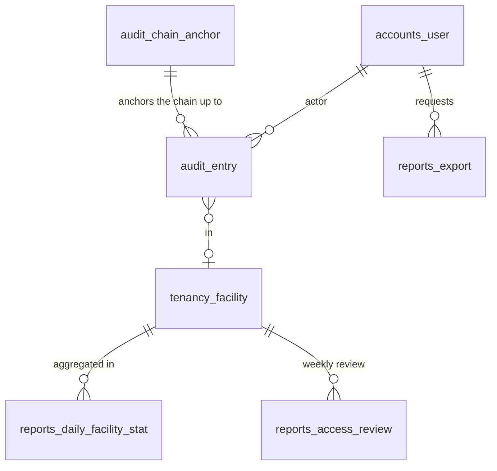

| Table | Purpose | RLS | Class | Mutability | Retention | Sprint |
|---|---|---|---|---|---|---|
| `audit_entry` | Hash-chained audit log | ✓ for `SELECT` (facility rows; patient access history through a view); `INSERT` always allowed | C3 | Append-only (`REVOKE UPDATE, DELETE`) | R-AUD | S0 |
| `audit_chain_anchor` | Daily chain head exported off-site | — | C1 | Append-only | R-AUD | S0 |
| `reports_daily_facility_stat` | Daily aggregates per facility and service | ✓ | C1 | Rebuilt | R-AGG | S10 |
| `reports_access_review` | Weekly unusual-access report and sign-off | ✓ | C2 | Mutable (sign-off) | R-AUD | S10 |
| `reports_export` | Export jobs (reports, data subject exports, facility export) | ✓ for facility rows | C1 (the file keeps the data's class) | State machine (light) | Metadata R-AUD; file R-TMP (24 h) | S10 |

| Table | Key columns |
|---|---|
| `audit_entry` | As in the [Sprint 0 contract](03-sprint-0-contract.md) §1: `id`, `seq bigint GENERATED ALWAYS AS IDENTITY` **unique** (chain order), `occurred_at`, `actor_id NULL` (null = system), `actor_role`, `facility_id NULL`, `action varchar(60)`, `object_type varchar(60)`, `object_id uuid NULL`, `reason varchar(300) NULL`, `ip inet NULL`, `user_agent varchar(300) NULL`, `request_id varchar(40)`, `metadata jsonb` (no personal data), `prev_hash bytea`, `hash bytea`. Proposed for S3: `patient_id uuid NULL`, so a patient's access history (FR-PAT-14) is one indexed query. Index (`facility_id`, `occurred_at`); (`object_type`, `object_id`); (`actor_id`, `occurred_at`); (`patient_id`, `occurred_at`). |
| `audit_chain_anchor` | `anchor_date date` **unique**, `last_seq bigint`, `head_hash bytea`, `exported_at`, `export_target varchar(60)`. |
| `reports_daily_facility_stat` | `stat_date date`, `service_id NULL`, `metrics jsonb` (visits by source, wait median and p90, no-shows, left without service, throughput, estimate accuracy, revenue), `computed_at`. **Unique** (`facility_id`, `stat_date`, `service_id`) `NULLS NOT DISTINCT`. Metric definitions: [analysis 13](../analysis/13-reporting-and-analytics.md) §1. |
| `reports_access_review` | `week_starts_on date`, `findings jsonb` (rule codes and audit entry IDs), `signed_off_by_id NULL`, `signed_off_at NULL`. **Unique** (`facility_id`, `week_starts_on`). |
| `reports_export` | `facility_id NULL`, `requested_by_id`, `report_code`, `params jsonb`, `format` (`xlsx`, `pdf`, `csv`, `zip`), `status` (`queued`, `running`, `ready`, `expired`, `failed`), `row_count integer NULL`, `file_id NULL`, `watermark varchar(200)`, `approved_by_id NULL` (bulk exports), `expires_at`. |

## 6. Later phases (not designed yet)

Designed when their phase is planned, following the same conventions: cross-facility share grants and emergency access for doctors (FR-PAT-15), referrals in, waitlist and recurring care plans (FR-SCH-16, 17), ratings, complaints and quality score (FR-DSP-12..14), insurance claims (FR-BIL-14), platform subscriptions and invoices (FR-BIL-15), simple stock and controlled-medicine register (FR-PHA-06, 07), consultation templates (FR-CLN-10), triage sessions, answers, model versions and the prediction log (FR-AI-04..13), de-identification exports (FR-SEC-17), multi-branch organisations (FR-ONB-11).

## 7. Open questions

| # | Question | Decide in |
|---|---|---|
| D1 | **Master data writes:** security 04 makes master data read-only for the app role, but super admins edit it through the platform API. Options: a separate database role used only by platform endpoints, or `SECURITY DEFINER` write functions. | S1 contract |
| D2 | **Audience setting for RLS** (§3.2) extends security 04 §4. Agree it and update security 04 before the first patient-written facility table (S5). | S3 / S5 |
| D3 | **Public reads:** search uses the `facilities_public_listing` read model; per-facility pages read C0 tables with the facility's context. Confirm, or move all public reads to read models. | S5 contract |
| D4 | **Platform access to facility rows** (escalated disputes, break-glass, exports) sets the object's facility context after the platform check. Confirm, including how platform lists across facilities are built (projection tables or one query per facility). | S6 / S10 |
| D5 | **Session storage** per audience: one `accounts_session` table with an `audience` column, or two session engines. | S0 implementation |
| D6 | Retention periods R-CLIN, R-FIN and R-DSP depend on open question Q2 (legal retention). | Before go-live |
| D7 | Distance search: plain latitude/longitude with a bounding box is enough for launch (50 facilities); PostGIS only if needed. | S5 |
