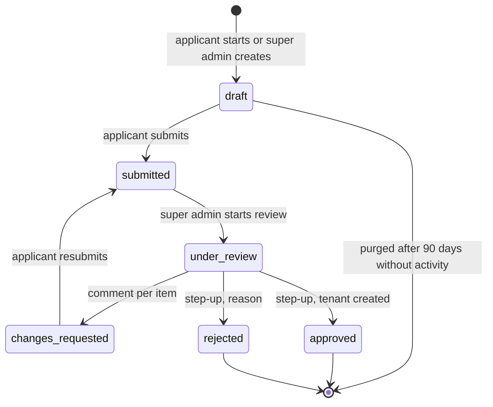
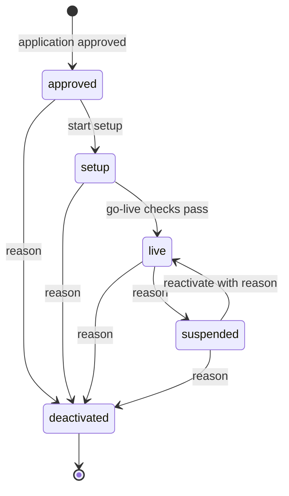
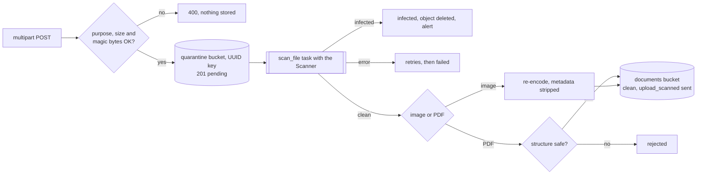

# Sprint 1 contract: Platform and onboarding

Status: v0.1 (2026-10-18) · **Implemented** (backend #47, frontend #49 + #55, integration #56; I4 waits for staging) · Wave 1, built in parallel with S3 and S9 · Template and shared-file protocol: [contracts README](README.md) · Format model: [Sprint 0 contract](../03-sprint-0-contract.md) · Conventions: [API conventions](../02-api-conventions.md) · Tables: [database design](../04-database-design.md) · Plan rows: [API catalogue](../../api/catalogue.md) S1 · Roadmaps: [backend](../../roadmap/backend.md), [frontend](../../roadmap/frontend.md)

**Sprint goal:** facilities apply online and super admins verify, approve and run them through their lifecycle; the platform has versioned, translated master data; every file enters through one safe upload pipeline that later sprints reuse; idle staff sessions lock and unlock with a PIN; sensitive actions need recent re-authentication; features can be switched per facility.


> **Orchestrator reconciliation (2026-10-18, before build):** the anchors this contract asked for are merged ([#20](https://github.com/B-Pine/medilink-rwanda/pull/20), [#21](https://github.com/B-Pine/medilink-rwanda/pull/21)): `extend_actions()` + `[SN]` blocks in `audit/actions.py`; blocks in `.env.example`, `requirements/base.in`, `DEFAULT_THROTTLE_RATES`, `core/realtime.py` and `seed_dev.DEV_SEED_COMMANDS`; `[SN imports]` blocks in the frontend registries; shell slots `headerItems`/`shellOverlays` (staff-web) and `headerItems`/`homeCards` (patient-web); PWA `importScripts`; frontend `PermissionCodes` (declaration merging, all 31 Sprint 0 codes) and `extendMockRoleGrants()`. Use them instead of the workarounds described below. Wave 1 ownership rules: [contracts README](README.md#wave-1-ownership-of-sprint-0-files).

## 1. Scope

| Area | Requirements | In scope |
|---|---|---|
| Facility applications | FR-ONB-01, FR-ONB-02 | Public 5-step wizard with autosave and an emailed resume link; super-admin-created applications; review with verification notes, per-document verdicts and per-item comments; approve, request changes, reject; full history with reasons |
| Facility lifecycle | FR-ONB-03 (status part), FR-ONB-07 (status part) | `approved → setup → live → suspended / deactivated` with reasons, events and a go-live check registry. The setup checklist (S2) and the search and booking effects (S5) plug into it |
| Licences | FR-ONB-08 | Licence numbers and expiry dates; reminders 60 and 30 days before expiry; expired licences flagged for review |
| Upload pipeline v1 | FR-DOC-03; FR-DOC-05 (signed links) | Magic-byte allowlist, size limit, quarantine, scanner interface (ClamAV), image re-encoding without EXIF, PDF checks, storage interface (local in dev, S3-compatible), 5-minute signed downloads. Reusable by S3 and later sprints (§3.6) |
| Master data | FR-ONB-10 | Locations, facility types and levels of care, service catalogue, insurers, ICD-10 subset, drugs, symptoms, public holidays, reason lists; rw/en/fr; versions and change history; CSV imports (CLI and API) |
| Staff lock and step-up | FR-SEC-06 (remainder) | Idle lock (server-enforced), PIN set/change/remove, PIN or password unlock with limits, step-up endpoint and a reusable "requires recent auth" permission used by S1's sensitive actions |
| Feature flags | NFR-OPS-07 | Flag catalogue, per-facility overrides, enabled flags in `/staff/auth/me/`, managed by super admins |

**Out of scope:** facility setup, staff invitations and inviting the proposed facility admin (S2, through the `application_approved` signal, §8); subscriptions (P2); document generation and `masterdata_document_template` (S7); the map-pin picker (S5 builds the map; S1 offers "use my location" and coordinates); session lists, password change and passkeys for super admins (catalogue "not yet scheduled", required before go-live); deactivation export (FR-ONB-09, S11); the notification engine (S9: S1 sends emails through a stub, §8). **FR-ACC-10 is not delivered:** adding a role needs `RoleCode` choices removed from `Role.code` and an `extend_roles()` in `authz/catalogue.py`, both S0 edits outside markers; it is P2 and needs its own anchor pull request.

## 2. Domain model

### 2.1 Apps

| App (reserved) | Owns |
|---|---|
| `medilink.masterdata` | Master data tables, change log, imports, `import_*` commands, public/staff/platform master data endpoints |
| `medilink.uploads` | `uploads_file`, purpose registry, scanner and storage interfaces, scan and purge jobs, upload and download endpoints |
| `medilink.onboarding` | Applications, documents, events, facility status events and transitions, licences, feature flags, platform console endpoints, notification stub |
| `medilink.accounts` (S0, new files + listed edits, §7.2) | PIN, lock state, step-up (`accounts/stepup.py`, `accounts/lock.py`, `accounts/security_urls.py`); `authz/platform.py` and `authz/stepup.py` are new files in `authz` |

### 2.2 Tables

Not repeated: every table has `id` (UUIDv7) and `created_at`; mutable tables have `updated_at` and `version`. Master data tables also share `code` (unique unless noted), `is_active`, `sort_order`. Translations are `*_i18n jsonb {"rw","en","fr"}`.

| Table | Key columns | RLS | Class | Mutability | Retention |
|---|---|---|---|---|---|
| `masterdata_location` | `level` (`province`, `district`, `sector`, `cell`, `village`), `code` (NISR code), `parent_id` (self), `name` (proper noun, one language) | — | C0 | Versioned | R-MD |
| `masterdata_facility_type` | `code` = the `tenancy.FacilityType` values, `name_i18n`, `level_of_care` (`primary`, `secondary`, `tertiary`) | — | C0 | Versioned | R-MD |
| `masterdata_service_catalogue_item` | `name_i18n`, `synonyms_i18n`, `min_age_months`, `max_age_months`, `sex_restriction` | — | C0 | Versioned | R-MD |
| `masterdata_insurer` | `name`, `scheme` (`community`, `social`, `military`, `private`), `follows_referral_pathway` | — | C0 | Versioned | R-MD |
| `masterdata_drug` | `generic_name`, `strength`, `form`, `default_route`, `drug_class`, `is_controlled`, `is_essential_list`, `max_usual_quantity`; trigram index on `generic_name` | — | C0 | Versioned | R-MD |
| `masterdata_diagnosis_code` | `code_system` (`icd10`), `code` (unique with system), `title_i18n`, `plain_language_i18n`, `is_sensitive`; trigram index on the English title | — | C0 | Versioned | R-MD |
| `masterdata_symptom` | `name_i18n`, `body_system`, `icd_code` | — | C0 | Versioned | R-MD |
| `masterdata_public_holiday` | `holiday_date` (unique, no `code`), `name_i18n`, `is_provisional` (Eid dates until announced) | — | C0 | Versioned | R-MD |
| `masterdata_reason_code` | `kind`, `code` (unique per kind), `label_i18n`, `requires_text` | — | C0 | Versioned | R-MD |
| `masterdata_change` | `kind`, `row_id`, `row_version`, `action` (`create`, `update`, `retire`, `restore`, `import`), `old jsonb`, `new jsonb`, `actor_id`, `import_id`, `changed_at` | — | C1 | Append-only | R-AUD |
| `masterdata_import` | `kind`, `file_id` → `uploads_file`, `mode`, `status` (`validating`, `previewed`, `invalid`, `applying`, `applied`, `failed`, `expired`), `summary jsonb`, `created_by_id`, `confirmed_by_id`, `confirmed_at`, `applied_at`, `expires_at` | — | C1 | State machine (light) | R-OPS |
| `onboarding_application` | `status` (`draft`, `submitted`, `under_review`, `changes_requested`, `approved`, `rejected`), `facility_name`, `facility_type`, `ownership`, `organization_name`, `phone`, `email`, `village_id` → location, `district_code` (denormalised filter), `address`, `latitude`, `longitude`, `applicant_name`, `applicant_email` (citext), `applicant_phone`, `applicant_position`, `preferred_language`, `proposed_admin_name`, `proposed_admin_email`, `proposed_admin_phone`, `claimed_insurer_codes text[]`, `accepted_terms_version`, `accepted_dpa_version`, `ncsa_registration_confirmed`, `resume_token_hash` (unique), `resume_token_expires_at`, `session_token_hash` (unique), `session_expires_at`, `last_activity_at`, `created_by_platform_admin_id`, `reviewer_id`, `facility_id` (unique, set at approval), `submitted_at`, `decided_at`. Index (`status`, `submitted_at`) | — | C2 | State machine | R-APP |
| `onboarding_application_document` | `application_id`, `file_id` (unique), `kind` (`moh_licence`, `rdb_registration`, `tin_certificate`, `accreditation`, `insurer_contract`, `other`), `insurer_code`, `number`, `issued_on`, `expires_on`, `review_status` (`pending`, `accepted`, `needs_change`), `review_comment`, `deleted_at` | — | C2 | Mutable until submitted | R-APP |
| `onboarding_application_event` | `application_id`, `kind` (`status_change`, `note`, `item_comments`, `document_review`, `link_sent`, `platform_edit`), `from_status`, `to_status`, `actor_kind` (`applicant`, `platform_admin`, `system`), `actor_id`, `note_kind` (`call`, `visit`, `document_check`, `other`), `note`, `reason_code`, `item_comments jsonb`, `is_visible_to_applicant`, `idempotency_key`, `occurred_at` | — | C2 | Append-only | R-APP |
| `onboarding_facility_status_event` | `facility_id`, `from_status`, `to_status`, `actor_id`, `reason_code`, `reason_text`, `idempotency_key`, `occurred_at` | — | C1 | Append-only | R-AUD |
| `onboarding_facility_licence` | `facility_id`, `kind` (`moh_operating`, `pharmacy`, `rdb_registration`, `accreditation`, `other`), `number`, `issued_on`, `expires_on`, `file_id`, `source_document_id`, `verified_by_id`, `verified_at`, `last_reminder_days`, `superseded_by_id`, `superseded_at`. Index (`expires_on`) where not superseded | — | C1 | Versioned (renewal = new row) | R-OPS |
| `onboarding_feature_flag` | `code` (`<area>.<name>`), `description`, `default_enabled`, `is_active` | — | C1 | Mutable | R-OPS |
| `onboarding_facility_feature_flag` | `flag_id`, `facility_id`, `is_enabled`, `note`, `set_by_id`. Unique (`flag_id`, `facility_id`) | — | C1 | Mutable (delete = back to default) | R-OPS |
| `uploads_file` | `purpose`, `owner_kind` (`application`, `platform`, `patient`, `facility`), `owner_id` (set by `attach()`), `facility_id`, `patient_id`, `data_class`, `storage_bucket` (`quarantine`, `documents`), `storage_key uuid` (unique), `original_sha256`, `sha256` (stored bytes), `size_bytes`, `content_type` (sniffed), `original_filename` (sanitised), `scan_status` (`pending`, `clean`, `infected`, `rejected`, `failed`), `rejection_reason`, `scanned_at`, `scanner_version`, `uploaded_by_id` (null = applicant), `uploaded_via` (`public`, `staff`, `patient`, `platform`), `idempotency_scope` (`user:<id>` or `application:<id>`), `idempotency_key`, `attached_at`, `deleted_at`. Index (`sha256`); unique (`idempotency_scope`, `idempotency_key`) | ✓ (§2.6) | Purpose's class (≤ C3) | Append-only content (+ status, attach, delete) | R-TMP (unattached: 24 h), then the owner's |
| `accounts_user` (S0) | + `pin_hash` (Argon2id, nullable), `pin_set_at` | — | C3 (PIN hash) | Mutable | R-ACCT |

`tenancy_facility.status` (S0) is used as is: S1 creates facilities in `approved` and moves them along §2.3; the values `draft`…`rejected` stay unused on facilities. The facility profile columns of the database design (`village_id`, address, coordinates, contacts, `level_of_care`, `description_i18n`) are **not** added in S1: they stay on the approved application, which the platform endpoints join; S2 adds them to `tenancy_facility` and copies them at setup.

### 2.3 State machines





| Rule | Detail |
|---|---|
| Who edits | Applicant and super admin edit fields and documents only in `draft` and `changes_requested` (else `422`). Only the applicant submits, because submission records the applicant's acceptance of the terms, the data processing agreement and the NCSA controller registration |
| Submit gate | Required: facility identity, contacts, village, address, applicant, proposed admin, `moh_licence` with number and expiry; `rdb_registration` and `tin_certificate` unless `ownership = public`. Every document `clean` (pending → `422`, infected or rejected → `400` on that document) |
| Approve gate | Status `under_review`; every document `accepted`; at least one licence of kind `moh_operating` in the request. Creates `Organization` and `Facility` (`approved`), licences, a status event (`null → approved`), sets `facility_id`, sends signal `application_approved(application_id, facility_id)` |
| Reasons | Reject, suspend, reactivate, deactivate need a `reason_code` from `masterdata_reason_code` (kinds `application_rejection`, `facility_suspension`, `facility_reactivation`, `facility_deactivation`) and a text when the code `requires_text` |
| Go-live checks | Registry `onboarding.golive.register(check)`; a check returns problems `{code, message}`. S1 registers `licence.moh_operating_valid` (a current MoH licence that hasn't expired). S2 registers the setup checklist |
| Status effects | Helpers `is_publicly_listed(facility)` (`live` only) and `accepts_new_bookings(facility)` (`live` only). Suspended facilities keep today's operations; S5 hides them from search and blocks new bookings; deactivated facilities become read-only with an export (S11) |
| Concurrency | Every transition sends `version`; `409 conflict` with the current resource on mismatch. Repeating a transition with the same `Idempotency-Key` returns the original result (key stored on the event row) |
| Duplicates | Platform reads show `duplicate_hints`: same licence number, same applicant email with another open application, same facility name in the same district. Hints never block |

### 2.4 Upload pipeline



| Control | Rule ([security 06](../../security/06-application-and-api-security.md) §4) |
|---|---|
| Types | Sniffed from magic bytes by our own sniffer (no libmagic): `application/pdf`, `image/jpeg`, `image/png`, `image/heic`/`heif` (converted to JPEG). `text/csv` only for purpose `masterdata_import` (UTF-8, no NUL bytes, ≤ 5 MB). Extension and browser `Content-Type` are ignored; SVG, HTML, archives and Office files are refused |
| Size | `UPLOADS_MAX_BYTES` 10 MB (a purpose may lower it); the proxy also limits to 10 MB. Per application: ≤ 20 documents, ≤ 100 MB |
| Images | `Image.MAX_IMAGE_PIXELS` 40 MP; longest side ≤ 3,000 px; re-encoded (JPEG q85, PNG optimised); EXIF, XMP and GPS removed; animated images refused |
| PDFs | Parsed with pypdf; refused if encrypted or containing `/JavaScript`, `/JS`, `/EmbeddedFiles`, `/Launch`, `/XFA` or `/RichMedia`, or over 100 pages |
| Scanner | `Scanner.scan(stream) -> ScanVerdict(clean / infected / error, signature, engine_version)`. `ClamdScanner` (INSTREAM over TCP, small own client) and `FakeScanner` (EICAR string = infected; tests and dev). `check --deploy` refuses the fake scanner |
| Storage | `ObjectStorage`: `put`, `open`, `move`, `delete`, `signed_download_url(bucket, key, filename, content_type, disposition, ttl)`. `LocalFileSystemStorage` (dev and tests; URLs served by `GET /api/v1/files/{token}/`, signed with `TimestampSigner`) and `S3CompatibleStorage` (boto3, server-side encryption, presigned GET on `UPLOADS_DOWNLOAD_BASE_URL` = `https://files.medilink.rw`; unit-tested with botocore's Stubber). `check --deploy` refuses local storage |
| Download | Only `clean` files; 5-minute URL; response headers `Content-Disposition` (`inline` or `attachment`, sanitised filename), `X-Content-Type-Options: nosniff`, `Content-Security-Policy: sandbox; default-src 'none'`, `Cache-Control: private, no-store`, `Cross-Origin-Resource-Policy: same-site`; CORS for the two app origins without credentials (the PDF viewer fetches the bytes). The apps' CSP adds the files origin to `img-src` and `connect-src` |
| Settings | Read by `medilink/uploads/conf.py` from `UPLOADS_*` and `CLAMD_*` environment variables, overridable with `override_settings(UPLOADS={...})` in tests, so `base.py` is not edited outside the S1 block |

### 2.5 Idle lock, PIN and step-up

| Topic | Rule ([security 03](../../security/03-identity-authentication-sessions.md) §4–5) |
|---|---|
| Lock | A staff session is **locked** (not ended) after `STAFF_SESSION_LOCK_AFTER` of inactivity (default 900 s; a system check enforces 300–1,800 s), or at once through `POST /staff/auth/lock/` (idle timer in the browser, or "Lock" in the user menu). Lock state lives in the session (`_ml_locked_at`); `PrincipalState.LOCKED` is added. Open staff sockets of that session are closed (`close_sockets(session_key=…)`) |
| While locked | Every staff and platform endpoint answers `401 session_locked`, except `GET /staff/auth/lock/`, `POST /staff/auth/unlock/` and `POST /staff/auth/logout/` |
| Session end | Locked or not, a staff session ends after `STAFF_SESSION_IDLE_TIMEOUT` (default changes from 15 min to **4 h**) or the 12 h absolute lifetime. Patient sessions are unchanged |
| PIN | 4–6 digits; refused if all digits equal, a straight sequence (`1234`, `987654`) or in a short blocklist of common PINs; Argon2id hash in `accounts_user.pin_hash`; setting it needs step-up; removing it doesn't |
| Unlock | Same user, same session, by PIN or password. 5 failed attempts in one lock end the session (full login). 10 failed PIN attempts for a user within 1 h (all sessions) disable PIN unlock for 1 h (password still works) and email the user. Facility flag `security.pin_unlock` off → password only. Unlock is audited; the session is not rotated (no privilege change) |
| Step-up | `POST /staff/auth/step-up/` with password **and** TOTP code sets `_ml_step_up_at`. `RecentAuthRequired(max_age=300)` (DRF permission) and `@requires_recent_auth()` (service decorator) accept `_ml_step_up_at` or the login's MFA time (`_ml_mfa_at`) within 5 minutes, else `403 step_up_required`. 5 failures end the session. The request body has a `method` field (`password_totp` in S1) so S6 can add `pin` for signing |
| Platform access | `PlatformAdmin` permission = staff session + `is_platform_admin` + client IP in `PLATFORM_ALLOWED_NETWORKS` (CIDRs; empty allows all, and `check --deploy` warns) |

### 2.6 Row-level security, data classes and master data writes

- **Platform-level tables, no facility RLS:** master data is shared reference data that no facility owns and every audience reads (C0). Applications, their documents and events exist **before** the tenant does and are handled only by super admins and the applicant; a facility context would be meaningless for a draft. Status events, licences and flag overrides are the platform's verification and operations data about a facility, listed across facilities (expiry dashboards), like `tenancy_facility` itself. All are protected by the policy layer (`PlatformAdmin`, the applicant session), explicit serializers, audit, and append-only events ([security 04](../../security/04-authorization-and-tenant-isolation.md) §4, [database design](../04-database-design.md) §3.5).
- **`uploads_file` has RLS:** the S0 `EnableFacilityRLS` operation plus a `CreatePolicy` named `unowned_rows` with `USING` and `WITH CHECK` `facility_id IS NULL`. Facility rows (S2 onwards) are isolated from day one; rows without a facility (applications, platform, patients) are governed by the purpose's policy functions. Patient-level database policies wait for the `app.account_id` decision (D2, S3/S5).
- **Data classes:** every new model field declares its class in code. `uploads_file.data_class` comes from the purpose (application documents C2; S3 insurance cards C3) and drives logging and export rules.
- **Master data writes (database design D1, decided):** the runtime role keeps `INSERT`/`UPDATE` on master data tables, and only `medilink.masterdata.services` writes them (one function per action, writing the row, `masterdata_change` and the audit entry in one transaction). `DELETE`/`TRUNCATE` are revoked on master data tables (retire instead), `UPDATE`/`DELETE` on `masterdata_change`, `onboarding_application_event` and `onboarding_facility_status_event`. The revokes run in a `post_migrate` receiver of the `masterdata` app, which runs after core's grant receiver. A test fails if code outside `masterdata.services`, its migrations and its commands saves a master data model. A separate database role or `SECURITY DEFINER` functions were rejected for now: a second runtime connection per request, or ten write functions, cost more than they protect while the policy layer is the only writer.

### 2.7 Audit events

Registered through the `[S1]` block of `audit/actions.py` (§7.3). Metadata carries IDs and codes only, under keys that S0's metadata check allows (`code` is forbidden there: use `flag_code`, `reason_code`); free-text reasons go in the entry's `reason` field.

- Applications: `facility_application.started`, `.created_by_platform`, `.resumed`, `.link_sent`, `.submitted`, `.review_started`, `.document_reviewed`, `.document_viewed`, `.changes_requested`, `.approved`, `.rejected`, `.note_added`, `.purged` (stale draft deleted)
- Facilities: `facility.status_changed` (`from`, `to`, `reason_code`), `facility.licence.recorded`, `facility.licence.updated`, `facility.licence.renewed`, `facility.feature_flag.changed`, `feature_flag.default_changed`
- Master data: `masterdata.created`, `masterdata.updated`, `masterdata.retired`, `masterdata.restored`, `masterdata.import.previewed`, `masterdata.import.applied`
- Uploads: `upload.created`, `upload.rejected` (`reason`: `infected`, `unsafe_pdf`, …), `upload.download_link_issued`
- Sessions: `auth.session.locked` (`trigger`: `idle`, `manual`, `server`), `auth.session.unlocked` (`method`), `auth.unlock.failure`, `auth.unlock.exhausted` (session ended), `auth.pin.set`, `auth.pin.removed`, `auth.step_up.success`, `auth.step_up.failure`

Security log ([security 08](../../security/08-logging-monitoring-and-detection.md)): infected uploads (high alert), step-up and unlock failures, exhausted unlocks, platform requests refused by the network allowlist.

### 2.8 Decisions and deviations

| # | Decision | Instead of |
|---|---|---|
| S1-D1 | Application tables are `onboarding_*` (reserved app `medilink.onboarding`) | `facilities_application*` ([database design](../04-database-design.md) §5.4) |
| S1-D2 | Status history is `onboarding_facility_status_event`, so S1 adds no `tenancy` migration while S3 and S9 build in parallel | `tenancy_facility_status_event` |
| S1-D3 | Licences are `onboarding_facility_licence` without RLS (platform verification data, listed across facilities) | `facilities_licence` with RLS |
| S1-D4 | Feature flags are a catalogue table plus per-facility overrides in `onboarding` (S0 never built `core_feature_flag`) | `core_feature_flag` with nullable `facility_id` |
| S1-D5 | Files are `uploads_file` with `purpose`, generic `owner_kind`/`owner_id` (no foreign key to applications, which would make the two apps' migrations circular), `data_class`, `rejected` scan status, attach and soft delete | `documents_file` with typed `application_id` |
| S1-D6 | Idempotency is stored on the created row (event, file, import), unique per actor; the generic `core_idempotency_key` store is left to the first sprint that needs it (S4) | `core_idempotency_key` (S0, not built) |
| S1-D7 | Master data writes per §2.6 (D1 of the database design) | "`SELECT` only on master data" for the app role |
| S1-D8 | Applicant access: an emailed single-use resume link (7 days) exchanged for an HttpOnly applicant cookie bound to one application (8 h sliding) ([API README](../../api/README.md) §6 item 4) | Applicant accounts |
| S1-D9 | `masterdata_document_template` moves to S7 with document generation; `masterdata_public_holiday` gains `is_provisional` | Created in S1 |
| S1-D10 | Suspend, reactivate and deactivate are built in S1, as the sprint scope asks | Catalogue rows in S2 |
| S1-D11 | Paths grouped under `/public/master-data/{kind}/`, `/staff/master-data/{kind}/`, `/platform/master-data/{kind}/`: one include per audience and no clash with other platform resources | Catalogue `/public/locations/`…, `/platform/{kind}/` |
| S1-D12 | Licence renewal is `POST …/licences/` with `renews_licence_id` (new row, old one superseded); `PATCH` only corrects | Catalogue "`PATCH` records a renewal" |
| S1-D13 | Staff `IDLE_TIMEOUT` default becomes 4 h and a separate 15-minute lock applies, so PIN unlock is usable | One 15-minute timeout that ends the session |

## 3. Endpoints

All paths are under `/api/v1`, follow the [API conventions](../02-api-conventions.md) and appear in the OpenAPI schema (except the dev-only file route). Every unsafe request needs CSRF; `401`, `403 permission_denied`, `403 csrf_failed` and `429 rate_limited` apply everywhere and are not repeated. "Step-up" = `403 step_up_required` without recent authentication (§2.5).

### 3.1 Schemas

```jsonc
// ApplicantApplication — the applicant's view. The platform view adds the fields after "P:".
{
  "id": "uuid", "status": "draft", "version": 4,
  "facility": { "name": "Clinique Ubuzima", "facility_type": "private_clinic", "level_of_care": "primary",
                "ownership": "private", "organization_name": "Ubuzima Ltd", "phone": "+250788123456", "email": "info@ubuzima.rw" },
  "location": { "village_code": "12030401", "address": "KG 11 Ave 5", "latitude": -1.9441, "longitude": 30.0619,
                "path": [ { "level": "province", "code": "1", "name": "Umujyi wa Kigali" } /* … down to the village */ ] },
  "applicant": { "name": "Mukamana Jeanne", "email": "jeanne@ubuzima.rw", "phone": "+250788000111", "position": "Director" },
  "proposed_admin": { "name": "Habimana Eric", "email": "eric@ubuzima.rw", "phone": "+250788000222" },
  "claimed_insurer_codes": ["mutuelle", "rama"],
  "documents": [ /* ApplicationDocument */ ],
  "agreements": { "accepted_terms_version": null, "accepted_dpa_version": null, "ncsa_registration_confirmed": false },
  "feedback": { "general_comment": "", "items": [ { "target": "documents.moh_licence", "comment": "The scan is unreadable." } ],
                "rejection": null /* or { "reason_code", "reason_label", "reason_text" } */ },
  "missing_for_submit": ["location.village_code", "documents.moh_licence"],
  "preferred_language": "rw", "submitted_at": null, "updated_at": "2026-10-18T07:42:00Z"
  // P: "created_by_platform", "reviewer" {id, full_name} | null, "facility_id", "suggested_slug", "last_activity_at",
  //    "duplicate_hints": [ { "kind": "same_licence_number", "application_id": "uuid", "facility_id": null } ]
}
// ApplicationDocument
{ "id": "uuid", "kind": "moh_licence", "insurer_code": null, "number": "MOH/FL/2024/0312", "issued_on": "2024-03-01",
  "expires_on": "2027-02-28", "review_status": "pending", "review_comment": "", "upload": { /* Upload */ } }
// Upload: the same in every audience (§3.6). DownloadLink after it.
{ "id": "uuid", "purpose": "facility_application_document", "status": "pending", "rejection_reason": null, "content_type": "application/pdf",
  "size_bytes": 482113, "original_filename": "moh-licence.pdf", "sha256": "9f2c…", "created_at": "…", "scanned_at": null, "is_attached": true }
{ "url": "https://files.medilink.rw/documents/…?X-Amz-Expires=300&…", "expires_at": "2026-10-18T07:47:00Z", "disposition": "inline" }
// PlatformFacility, then Licence. StatusEvent = {id, from_status, to_status, reason_code, reason_label, reason_text, actor, occurred_at}
{ "id": "uuid", "name": "Clinique Ubuzima", "slug": "clinique-ubuzima", "facility_type": "private_clinic", "level_of_care": "primary",
  "ownership": "private", "status": "setup", "district": { "code": "12", "name": "Gasabo" }, "application_id": "uuid",
  "licence_state": "valid" /* expiring | expired | missing */, "next_licence_expiry": "2027-02-28", "created_at": "…", "version": 3 }
{ "id": "uuid", "kind": "moh_operating", "number": "MOH/FL/2024/0312", "issued_on": "2024-03-01", "expires_on": "2027-02-28", "state": "valid",
  "upload_id": "uuid", "verified_by": { "id": "uuid", "full_name": "…" }, "verified_at": "…", "superseded_at": null, "version": 1 }
// MasterDataItem = common keys + the kind's columns (§2.2). Public and staff views return a localised "name" (requested language,
// then en, then any); the platform view returns "name_i18n" and "missing_languages". Location (public, staff) after it.
{ "id": "uuid", "code": "rama", "name": "RAMA", "scheme": "social", "follows_referral_pathway": true, "is_active": true, "version": 2 }
{ "code": "1203", "level": "sector", "name": "Kimironko", "parent_code": "12", "has_children": true }
// MasterDataImport
{ "id": "uuid", "kind": "drugs", "mode": "upsert", "status": "previewed", "upload": { /* Upload */ }, "expires_at": "…", "confirmed_at": null,
  "summary": { "rows": 512, "create": 40, "update": 12, "retire": 0, "unchanged": 460, "errors": 2 },
  "errors": [ { "line": 17, "field": "strength", "message": "Required." } ],
  "sample_changes": [ { "code": "AMOX500C", "action": "update", "changes": { "form": ["capsule", "tablet"] } } ] }
// FeatureFlag, then FacilityFeatureFlag
{ "code": "security.pin_unlock", "description": "Unlock an idle-locked session with a PIN", "default_enabled": true, "is_active": true,
  "override_count": 2, "version": 1 }
{ "code": "security.pin_unlock", "is_enabled": false, "source": "override" /* or default */, "note": "Shared PCs: password only",
  "set_by": { "id": "uuid", "full_name": "…" }, "updated_at": "…" }
// StaffMe (Sprint 0) gains two fields; then LockState and StepUpResult
{ /* …StaffMe… */ "feature_flags": ["security.pin_unlock"], "security": { "pin_set": true, "lock_after_seconds": 900, "step_up_valid_until": null } }
{ "is_locked": true, "locked_at": "…", "full_name": "Uwase Aline", "unlock_methods": ["pin", "password"], "attempts_remaining": 5 }
{ "step_up_valid_until": "2026-10-18T07:47:00Z" }
// PlatformOverview
{ "applications": { "submitted": 3, "under_review": 1, "changes_requested": 2 }, "licences": { "expiring_60": 2, "expiring_30": 1, "expired": 1 },
  "facilities": { "approved": 1, "setup": 2, "live": 14, "suspended": 1, "deactivated": 0 }, "oldest_waiting_application": { "id": "uuid", "submitted_at": "…" } }
```

### 3.2 Public (`/public/`)

"Applicant" = the applicant cookie matches this application, otherwise `404`. Cookie: `__Secure-ml_applicant` in production (`ml_applicant` on plain-http dev), HttpOnly, Secure, `SameSite=Lax`, `Path=/api/v1/public/facility-applications/`, 8 h sliding.

| Method and path | Auth | Request → response | Errors | Notes |
|---|---|---|---|---|
| `POST /public/facility-applications/` | Public; honeypot field `website` must be empty | `{applicant: {name, email, phone, position}, facility_name, preferred_language}` → `201 ApplicantApplication` + applicant cookie; resume link emailed | `400` | RL `application`; Audit; FR-ONB-01 |
| `POST /public/facility-applications/resume-links/` | Public | `{email}` → `202` always; one link per open (`draft`, `changes_requested`) application of that email | — | RL `resume`; no enumeration |
| `POST /public/facility-applications/resume/` | Resume token in body | `{token}` → `200 ApplicantApplication` + new cookie; token single use; the earlier applicant session ends | `400` (invalid or expired, one generic message) | RL `resume`; Audit |
| `GET /public/facility-applications/{id}/` | Applicant | → `200 ApplicantApplication` | `404` | |
| `PATCH /public/facility-applications/{id}/` | Applicant | partial `{version, facility, location, applicant, proposed_admin, claimed_insurer_codes}` → `200` | `400`, `409`, `422` not editable | Ver; autosave; unknown fields refused |
| `POST /public/facility-applications/{id}/documents/` | Applicant | multipart `file`, `kind`, `insurer_code`, `number`, `issued_on`, `expires_on` → `201 ApplicationDocument` (upload `pending`) | `400` type, size, kind; `422` status or limits | Idem; RL `upload` |
| `PATCH /public/facility-applications/{id}/documents/{document_id}/` | Applicant | `{number, issued_on, expires_on}` → `200` | `422` not editable | |
| `DELETE /public/facility-applications/{id}/documents/{document_id}/` | Applicant | → `204` (soft delete; the purge job removes the file) | `422` not editable | |
| `POST /public/facility-applications/{id}/submit/` | Applicant | `{version, accepted_terms_version, accepted_dpa_version, ncsa_registration_confirmed}` → `200` (`submitted`) | `400` with dotted `fields` (`location.village_code`, `documents.moh_licence`), `409`, `422` uploads not yet `clean` | Idem; applicant and super admins notified; Audit |
| `POST /public/facility-applications/{id}/end-session/` | Applicant | → `204`; cookie cleared, session token revoked | — | "Continue later" on shared computers |
| `GET /public/master-data/{kind}/` | Public | kinds `locations` (`level`, `parent`), `facility-types`, `insurers`, `service-catalogue-items` (`q`), `public-holidays` (`year`) → paginated, active, localised | `404` other kinds | `Cache-Control: public, max-age=3600` + ETag; FR-ONB-10 |

### 3.3 Staff (`/staff/`)

| Method and path | Auth | Request → response | Errors | Notes |
|---|---|---|---|---|
| `GET /staff/auth/me/` (S0, extended) | Staff | → `StaffMe` + `feature_flags`, `security` | `401 session_locked` | NFR-OPS-07 |
| `POST /staff/auth/lock/` | Staff (also when locked) | → `204` | — | Audit; FR-SEC-06 |
| `GET /staff/auth/lock/` | Staff session, locked or not | → `200 LockState` | `401 not_authenticated` | |
| `POST /staff/auth/unlock/` | Locked staff session | `{pin}` or `{password}` → `200 StaffMe` | `400` wrong (`fields.pin`); `401 not_authenticated` after the 5th failure (session ended); `422` PIN not set or PIN unlock off | RL `unlock`; Audit |
| `PUT /staff/auth/pin/` | Staff + **Step-up** | `{pin}` → `204` | `400` format or too simple | Audit; security email to the user |
| `DELETE /staff/auth/pin/` | Staff | → `204` | — | Audit |
| `POST /staff/auth/step-up/` | Staff | `{method: "password_totp", password, code}` → `200 StepUpResult` | `400` (generic); `401` after 5 failures (session ended) | RL `mfa` + per-account lockout; Audit |
| `GET /staff/master-data/{kind}/` | Staff | all nine kinds; `q` (trigram for drugs and diagnosis codes), kind filters → paginated, active, localised | `404` unknown kind | Read-only |
| `POST /staff/uploads/` | Staff + purpose's `can_upload` | multipart `file`, `purpose` → `201 Upload` | `400` unknown purpose, wrong audience, type, size | Idem; RL `upload`; Audit; §3.6 |
| `GET /staff/uploads/{id}/` | Uploader (unattached) or purpose's `can_read` | → `200 Upload` | `404` | Polled for the scan result |
| `POST /staff/uploads/{id}/download-links/` | As above | `{disposition: "inline" or "attachment"}` → `200 DownloadLink` | `404`; `422` not `clean` | Audit; FR-DOC-05 |

### 3.4 Patient (`/patient/`)

`POST /patient/uploads/`, `GET /patient/uploads/{id}/` and `POST /patient/uploads/{id}/download-links/` behave exactly like the staff versions, with the patient session. S1 registers no patient purpose: tests use a test-only purpose, and S3 registers `insurance_card`. The patient app gets no other S1 endpoint.

### 3.5 Platform (`/platform/`)

Auth on every row: `PlatformAdmin` (§2.5). Applications:

| Method and path | Request → response | Errors | Notes |
|---|---|---|---|
| `GET /platform/overview/` | → `200 PlatformOverview` | — | Design 04 §3.5 |
| `GET /platform/facility-applications/` | filters `status` (repeatable; drafts only when asked for), `district`, `facility_type`, `created_by_platform`, `q`; ordering `submitted_at`, `last_activity_at` → paginated summaries | — | FR-ONB-02 |
| `POST /platform/facility-applications/` | `{applicant, facility, location, send_link}` → `201` (`draft`, created by the platform); link emailed when `send_link` | `400` | Audit; FR-ONB-01 |
| `GET /platform/facility-applications/{id}/` | → platform `ApplicantApplication` | `404` | |
| `PATCH /platform/facility-applications/{id}/` | As the public `PATCH` | `400`, `409`, `422` | Ver; event `platform_edit` (field names only) |
| `POST /platform/facility-applications/{id}/documents/` | As the public upload, on the facility's behalf | As public | Idem; RL `upload` |
| `POST /platform/facility-applications/{id}/send-resume-link/` | → `202` | `422` not `draft`/`changes_requested` | Event `link_sent` |
| `POST /platform/facility-applications/{id}/start-review/` | `{version}` → `200`; reviewer = caller | `409`, `422` | Audit |
| `POST /platform/facility-applications/{id}/documents/{document_id}/review/` | `{review_status: "accepted" or "needs_change", comment}` → `200 ApplicationDocument` | `422` not `under_review` | Event `document_review` |
| `POST /platform/facility-applications/{id}/documents/{document_id}/download-links/` | `{disposition}` → `200 DownloadLink` | `404`; `422` not `clean` | Audit |
| `POST /platform/facility-applications/{id}/request-changes/` | `{version, general_comment, items: [{target, comment}]}` (≥ 1 item; target = field path or `documents.<id>`) → `200` | `400`, `409`, `422` | Idem; applicant notified; Audit |
| `POST /platform/facility-applications/{id}/approve/` | `{version, slug, organization_name, facility_type, ownership, licences: [{document_id, kind, number, issued_on, expires_on}]}` → `200 {application, facility: PlatformFacility}` | `400` (`fields.slug` taken), `409`, `422` gate (§2.3) | **Step-up**; Idem; applicant notified; Audit; FR-ONB-02, 08 |
| `POST /platform/facility-applications/{id}/reject/` | `{version, reason_code, reason_text}` → `200` | `400`, `409`, `422` | **Step-up**; Idem; applicant notified with the reason |
| `GET`, `POST /platform/facility-applications/{id}/notes/` | `{note_kind, text (≤ 2,000), occurred_on}` → `201` | `400` | Append-only; never shown to the applicant |
| `GET /platform/facility-applications/{id}/events/` | → full history | — | FR-ONB-02 |

Facilities, licences and flags:

| Method and path | Request → response | Errors | Notes |
|---|---|---|---|
| `GET /platform/facilities/` | filters `status`, `facility_type`, `district`, `licence_state`, `q`; ordering `name`, `created_at`, `next_licence_expiry` → paginated `PlatformFacility` | — | Replaces the S0 nav placeholder |
| `GET /platform/facilities/{id}/` | → `PlatformFacility` + application summary + current licences | `404` | |
| `GET /platform/facilities/{id}/status-events/` | → `StatusEvent` list | — | |
| `POST /platform/facilities/{id}/start-setup/` | `{version}` → `200 PlatformFacility` | `409`, `422` | Audit |
| `POST /platform/facilities/{id}/go-live/` | `{version}` → `200` | `409`; `422` with failing checks in `fields` (`checks.licence.moh_operating_valid`) | **Step-up**; Idem; FR-ONB-03 |
| `POST /platform/facilities/{id}/suspend/` | `{version, reason_code, reason_text}` → `200` | `400`, `409`, `422` not `live` | **Step-up**; Idem; facility contacts notified |
| `POST /platform/facilities/{id}/reactivate/` | `{version, reason_code, reason_text}` → `200` | `400`, `409`, `422` not `suspended` | **Step-up**; Idem |
| `POST /platform/facilities/{id}/deactivate/` | `{version, reason_code, reason_text, confirm_slug}` → `200` | `400` (slug mismatch), `409`, `422` | **Step-up**; Idem; final in P1 |
| `GET`, `POST /platform/facilities/{id}/licences/` | `{kind, number, issued_on, expires_on, upload_id, renews_licence_id}` → `201 Licence` | `400`; `422` renewing a superseded licence | **Step-up** (POST); Audit; FR-ONB-08 |
| `PATCH /platform/facilities/{id}/licences/{licence_id}/` | `{version, number, issued_on, expires_on}` → `200` (moving `expires_on` resets the reminder state) | `409`; `422` superseded | **Step-up**; corrections only |
| `GET /platform/facilities/{id}/feature-flags/` | → `FacilityFeatureFlag` for every active flag | — | NFR-OPS-07 |
| `PUT`, `DELETE /platform/facilities/{id}/feature-flags/{code}/` | `{is_enabled, note}` → `200`; `DELETE` → `204` (back to the default) | `404` unknown flag | **Step-up**; Audit |
| `GET /platform/feature-flags/`; `PATCH /platform/feature-flags/{code}/` | `{version, default_enabled, description}` → `200 FeatureFlag` | `409` | **Step-up** (PATCH); Audit |

Master data (`{kind}` = `locations`, `facility-types`, `service-catalogue-items`, `insurers`, `drugs`, `diagnosis-codes`, `symptoms`, `public-holidays`, `reason-codes`):

| Method and path | Request → response | Errors | Notes |
|---|---|---|---|
| `GET`, `POST /platform/master-data/{kind}/` | List: `q`, `is_active`, `missing_language`, kind filters (retired rows included). Create: the kind's fields → `201` | `400` (`fields.code` duplicate; rw, en and fr required for kinds shown to patients) | **Step-up** (POST); change row + Audit; FR-ONB-10 |
| `GET`, `PATCH /platform/master-data/{kind}/{id}/` | `{version, …}`; `is_active: false` retires, `true` restores; `code` is immutable → `200` | `400`, `409` | **Step-up** (PATCH); no `DELETE` (`405`) |
| `GET /platform/master-data/{kind}/{id}/changes/` | → change history (old, new, actor, time) | — | |
| `POST /platform/master-data/{kind}/imports/` | Multipart CSV + `mode` (`upsert`, `upsert_and_retire_missing`) → `202 MasterDataImport` (`validating`) | `400` type, size, headers; kinds `locations`, `drugs`, `diagnosis-codes`, `symptoms` | Async; RL `upload` |
| `GET /platform/master-data/{kind}/imports/{import_id}/` | → `MasterDataImport` (poll) | `404` | |
| `POST /platform/master-data/{kind}/imports/{import_id}/confirm/` | → `202` (`applying`) | `422` not `previewed`, has errors or expired (24 h) | **Step-up**; Idem; Async; Audit |

Dev and test only: `GET /api/v1/files/{token}/` serves local-storage downloads with the §2.4 headers. It isn't mounted with S3-compatible storage and is excluded from the schema.

### 3.6 Reusable upload interface (for S3 and later sprints)

Frozen for `/api/v1` (additions only). A sprint that needs uploads registers a purpose in its own app and never edits `medilink.uploads`.

```python
# In the owning app's AppConfig.ready(), e.g. S3:
from medilink.uploads.purposes import UploadPurpose, register
register(UploadPurpose(
    code="insurance_card", audiences=frozenset({"patient", "staff"}), owner_kind="patient", data_class="C3",
    content_types=frozenset({"image/jpeg", "image/png", "image/heic", "application/pdf"}), max_bytes=10 * 2**20,
    can_upload=lambda principal, fields: ...,  # e.g. staff need documents.upload in the active facility
    can_read=lambda principal, file: ...,      # the owner's policy once attached
    unattached_ttl_hours=24,
))
# medilink.uploads.services
receive(*, actor, audience, purpose, django_file, idempotency_key=None) -> UploadedFile    # checks, quarantine, enqueue scan
attach(file, *, purpose, owner_id, facility_id=None, patient_id=None, actor) -> UploadedFile  # once; clean; same uploader
download_link(file, *, principal, disposition="inline") -> DownloadLink                      # clean only; audited
soft_delete(file, *, actor) -> None                                                           # owner-deleted non-clinical files
upload_scanned  # Django Signal(file_id, status), sent after every scan result
```

Flow: the client posts the file to `/{staff|patient}/uploads/` (the `FileUpload` component shows progress), polls `GET …/{id}/` until a final status, then sends `upload_id` to the owner's own endpoint (S3: the insurance profile), which calls `attach()`. Owner endpoints accept an `upload_id` only if it is `clean`, unattached, of the same purpose and uploaded by the caller; otherwise `400` on that field. After attachment, reads and downloads go through the purpose's `can_read`.

### 3.7 Errors, rate limits, idempotency

- **New error code `401 session_locked`:** an `APIException` subclass in S1 code with that `default_code`, so `core/exceptions.py` needs no edit. The orchestrator adds it to the [API conventions](../02-api-conventions.md) §4 table.
- **Rate-limit classes:** throttle classes in S1 code with their own default rates, overridable by environment variables, so `DEFAULT_THROTTLE_RATES` is not edited. `application` 10/h per IP and 3/day per applicant email; `resume` 10/h per IP and 3/h per email; `upload` 60/h per account or application; `unlock` 10/min per session. Step-up reuses `mfa` (30/min) plus a per-account lockout.
- **`Idempotency-Key`** on uploads, submit, request-changes, approve, reject, every facility status action and import confirm (S1-D6).

## 4. Permissions

- **No new permission codes.** The `[S1]` block of `authz/catalogue.py` stays empty. Any authenticated staff member may lock, unlock, manage their own PIN, step up and read master data. Staff uploads are allowed by each purpose's `can_upload` (S3's insurance card will check the existing `documents.upload`).
- **Super admin:** `PlatformAdmin` (§2.5) on every `/platform/` endpoint, plus step-up where §3.5 says so. This covers the matrix rows ([analysis 02](../../analysis/02-users-roles-and-permissions.md) §3) "Apply to register a facility (create on behalf)", "Verify / approve / suspend facility", "Manage master data", "Upload documents (facility verification)" and "Configure facility: view". The super admin sees no clinical data in S1.
- **Applicant:** not a user and not yet a facility admin (the matrix's "facility admin (applicant)"); rights come only from the applicant session bound to one application.
- **Test matrix:** every S1 endpoint × anonymous, patient, each facility role, platform admin, platform admin outside the allowlist, applicant of another application (S1-B2).

## 5. Background jobs

Celery, JSON, IDs only, time limits ([security 06](../../security/06-application-and-api-security.md) §8). Periodic entries are added to the beat schedule by the S1 apps themselves (no shared settings edit); a test asserts them.

| Task | Trigger | Does | Re-run safety |
|---|---|---|---|
| `uploads.scan_file(file_id)` | `on_commit` after each upload | Re-sniffs, scans, processes, moves to `documents`, sets the status, sends `upload_scanned`; 120 s limit | Checks the status first; 5 retries with backoff (10 s to 5 min), then `failed` + alert |
| `uploads.purge_files` | Hourly | Deletes objects and rows of unattached files past their TTL, and of `infected`/`rejected`/`failed` files after 7 days; soft-deleted files after 30 days; logs counts | Idempotent |
| `onboarding.send_licence_reminders` | Daily 05:00 UTC (07:00 Kigali) | Current licences: 60- and 30-day reminders, `expired` from the day after expiry (overview, facility filter); to the facility contacts of the application (S2: facility admins) and super admins | `last_reminder_days` (60 → 30 → 0) |
| `onboarding.expire_stale_drafts` | Daily 01:00 UTC | Reminder at 83 days without activity; at 90 days deletes the draft and its files; Audit `facility_application.purged` | Idempotent |
| `masterdata.validate_import` / `masterdata.apply_import` | On demand | Validates rows and stores the diff (preview); applies it in one transaction with one change row per changed item | Status machine; apply only from `previewed` |
| `onboarding.send_notification(event, ids)` | Enqueued by `dispatch()` on commit | Email stub (§8) | Idempotent per event and object |

## 6. Frontend

### 6.1 Routes and screens

**patient-web, feature `facilityApplication`** (public routes; patient sizes: 18 px body, 48 px targets):

| Route | Screen |
|---|---|
| `/for-facilities` | "For facilities" page ([design 06](../../design/research/06-homepage-and-public-pages.md) §4): problem, features per role, how onboarding works (apply, verification, setup, live), FAQ, "Register your facility". Replaces S0's placeholder (§7.2) |
| `/for-facilities/apply` | Start: applicant and facility name; explains the resume email |
| `/for-facilities/apply/:id/:step` | Wizard ([design 05](../../design/research/05-authentication.md) §3), steps `facility` (identity, type, ownership, contacts) → `location` (Province → District → Sector → Cell → Village pickers, address, "Use my location" with a Rwanda bounds check) → `documents` (required list per ownership, FileUpload with the phone camera, numbers and dates, insurers claimed with optional contracts) → `admin` (proposed facility admin, applicant's position) → `review` (summary with edit links, agreements, submit). Stepper; autosave status ("Saved 10:42", "Not saved, retrying"); changes-requested feedback on the affected fields; "Continue later" |
| `/for-facilities/apply/resume` | Exchanges `?token=`, removes it from the address bar (`history.replaceState`), opens the first incomplete step; expired link → "Send me a new link" |
| `/for-facilities/apply/:id/submitted` | Confirmation, status and what happens next |

**staff-web, feature `platform`** (shell routes; `NotFound` for users who aren't platform admins):

| Route | Screen |
|---|---|
| `/platform` | Overview: tiles (applications waiting, facilities by status, licences expiring and expired) and attention lists ([design 04](../../design/research/04-dashboards.md) §3.5) |
| `/platform/applications`, `/platform/applications/new` | Pipeline: DataTable with status tabs and counts, filter chips (district, type, created by platform), server sorting and pagination, side-panel preview. Create on behalf with "send link" |
| `/platform/applications/:id` | Review: sections with per-field comment buttons; documents with DocumentViewer and accept / needs change; notes Timeline; duplicate hints; actions Start review, Request changes (collects item comments), Approve (slug, type, ownership, licence numbers and expiry), Reject (reason list + text) |
| `/platform/facilities`, `/platform/facilities/:id` | List with status badges, type, district, licence state, next expiry (replaces the S0 placeholder). Detail tabs: Overview (status actions with reason dialogs), Licences (add, renew, correct), History (Timeline), Feature flags (Switch + note) |
| `/platform/master-data`, `/platform/master-data/:kind`, `/platform/master-data/:kind/imports/:importId` | Kind cards with counts and missing translations; DataTable per kind (search, active/retired, missing language); side-panel editor with rw/en/fr fields and change history; retire and restore; import preview (counts, errors by line, sample changes) and confirm |
| `/platform/feature-flags` | Flag catalogue and defaults |

**staff-web, feature `lock`:**

| Route or part | Behaviour |
|---|---|
| `/account/security` (shell) | Set, change or remove the PIN (step-up first); "Lock now" |
| `IdleLock` (mounted by the shell, §7.2) | Idle timer from `me.security.lock_after_seconds`, reset by user input only (not by background requests); warning dialog 60 s before with "Stay signed in"; then `POST /staff/auth/lock/` and the lock screen: shell content `inert`, `aria-hidden` and visually hidden while React state (unsaved forms) is kept; shows who is locked; PIN field (numeric, paste allowed) or "Use password instead"; "Not you? Switch user" logs out; lock and unlock sync across tabs (BroadcastChannel); a reload while locked renders only the lock screen |
| `StepUpProvider`, `useStepUp()` | Any `403 step_up_required` opens a dialog (password + code), then retries the original request once with the same `Idempotency-Key`; cancel leaves the action undone |

### 6.2 `packages/ui` components (one file each)

| Component | Spec |
|---|---|
| `DataTable` | TanStack Table (headless), [design 08](../../design/research/08-tables.md) §2–4: search and removable filter chips with "Clear all", result count, sticky header with `aria-sort`, server-side sorting and pagination (25/50/100, default 50), densities 32/40/48 px remembered per user, always-visible row actions, row click opens a side panel, skeleton rows, empty / no-results / error states, card list under 640 px |
| `SidePanel` | Row detail drawer; full-screen dialog on small screens; focus returns to the row |
| `Dialog` | Focus-trapped modal; `ConfirmDialog` variant with consequences and an optional reason field. Built in S1 (the roadmap lists it under S2), as are `Tabs` and `Switch` |
| `Tabs`, `Switch`, `TextareaField` | Accessible primitives with visible labels and errors like the S0 fields |
| `Stepper` | Wizard progress with step states and `aria-current="step"`; works at 320 px |
| `FileUpload` | Drop zone, browse, `capture` on phones; client pre-checks (type, size) only for fast feedback; per-file progress; scan status badge (icon + label); retry and remove; polite announcements |
| `DocumentViewer` | Images and PDFs (pdf.js lazy-loaded, `isEvalSupported: false`); zoom, rotate, pages, keyboard; requests a fresh signed link per view and never caches it; download button |
| `Timeline` | Ordered events with actor, Kigali time, status badge and text |

### 6.3 api-client and mocks

- Modules `src/features/{masterdata,onboarding,uploads,security}.ts` with paths, types and `create<Feature>Api(client)`. `uploads.upload({path, purpose, file, fields, onProgress, signal, idempotencyKey})` uses XMLHttpRequest for progress, with the client's CSRF, credentials, `Accept-Language` and `ApiError` parsing. `security` wraps lock, unlock, PIN and step-up.
- Mocks `src/mocks/features/{…}.ts` use `MockContext` (CSRF, sessions, error envelope, latency): in-memory applications and applicant session; resume token `mock-resume-token`; uploads turn `clean` after two polls, a filename containing `eicar` turns `infected`, files over 10 MB get `400`; step-up actions need a step-up within 5 mock minutes (the S0 mock TOTP code works); mock PIN `4826`; locked staff sessions answer `401 session_locked` (needs the `MockContext` addition of §7.2).

### 6.4 Translations and design

Namespaces: staff-web `platform` and `lock`; patient-web `facilityApplication` (`locales/{rw,en,fr}.json`, Kinyarwanda flagged for native review). Design: [04](../../design/research/04-dashboards.md) §2 and §3.5, [05](../../design/research/05-authentication.md) §3, [06](../../design/research/06-homepage-and-public-pages.md) §4, [08](../../design/research/08-tables.md), [10](../../design/research/10-accessibility-and-localization.md) (forms, time limits, addresses), [02](../../design/research/02-color-system.md) §4 (status colours).

## 7. Integration points

### 7.1 Marked `[S1]` blocks

| File | Lines added between `[S1]` and `[/S1]` |
|---|---|
| `backend/config/settings/base.py` | `"medilink.masterdata"`, `"medilink.uploads"`, `"medilink.onboarding"` |
| `backend/config/urls.py` | `staff/auth/` → `medilink.accounts.security_urls` (resolved after S0's `staff/auth/` include); `public/master-data/`, `staff/master-data/`, `platform/master-data/` → masterdata; `public/facility-applications/`, `platform/overview/`, `platform/facility-applications/`, `platform/facilities/`, `platform/feature-flags/` → onboarding; `staff/uploads/`, `patient/uploads/`, `files/` → uploads |
| `backend/medilink/authz/catalogue.py` | Nothing (no new codes) |
| `backend/CHANGELOG.md`, `frontend/CHANGELOG.md` | S1 bullets |
| staff-web `src/app/features.ts`, patient-web `src/app/features.ts` | `platform` and `lock` routes; `facilityApplication` public routes |
| staff-web `src/layout/navigation.ts` | `platformOverview` (`/platform`), `platformApplications`, `platformMasterData`, `platformFeatureFlags`: group `platform`, `visible: (me) => me.is_platform_admin`, `labelKey: "platform.nav.<key>"`. S0's `platformFacilities` entry stays; the S1 route takes its path |
| staff-web and patient-web `src/i18n/features.ts` | `platform`, `lock`; `facilityApplication` |
| api-client `src/index.ts`, `src/endpoints.ts`, `src/mocks/features.ts` | The four modules, their API objects and their mock factories |
| ui `src/index.ts` | The components of §6.2 |

### 7.2 Sprint 0 files that S1 edits outside blocks

The lock, step-up and flags hook into Sprint 0's auth core, so these edits are unavoidable. They are **owned by S1 in Wave 1**: S3 and S9 must not edit these files.

| File | Edit |
|---|---|
| `backend/medilink/accounts/models.py` + `migrations/0002_*` | `pin_hash`, `pin_set_at` |
| `backend/medilink/accounts/sessions.py`, `principal.py`; `authz/permissions.py` | Lock instead of flush between lock and idle timeout; `PrincipalState.LOCKED`; locked principals → `401 session_locked` |
| `backend/medilink/accounts/services.py`, `serializers.py` | `StaffMe.feature_flags`, `StaffMe.security` |
| `backend/config/settings/base.py` (`session_audiences`) | Staff `LOCK_AFTER`; `IDLE_TIMEOUT` default 4 h |
| `backend/tests/test_b04_audience_sessions.py` | The hard-coded staff timeouts |
| `backend/.env.example`, `docker-compose.yml` | S1 variables; optional `clamav` service under the compose profile `scan` |
| `backend/requirements/*`, `frontend/**/package.json`, `pnpm-lock.yaml` | Pillow, pillow-heif, pypdf, boto3; `@tanstack/react-table`, `pdfjs-dist`. Lock files are regenerated after rebasing, like the OpenAPI schema |
| staff-web `layout/AppShell.tsx`, `auth/RequireStaff.tsx`, `app/services.tsx`, `layout/UserMenu.tsx` | Mount `IdleLock` and `StepUpProvider`; `401 session_locked` → lock screen, not login; "Lock" and "Security" menu items |
| api-client `src/types.ts`, `src/mocks/handlers.ts`, `src/mocks/data.ts` | `StaffMe` fields; `locked` on the mock staff session; `MockContext.lockStaffSession()` and `unlockStaffSession()` |
| patient-web `src/app/routes.tsx` | Remove the `/for-facilities` placeholder line |

### 7.3 Anchor needed before the builders start

`backend/medilink/audit/actions.py` has no sprint blocks, and `audit.record()` refuses unknown actions, so S1, S3 and S9 all need it. Proposed anchor (orchestrator, one small pull request): `ACTIONS` becomes a `set`, plus `extend_actions(actions)` (refuses duplicates) and `[S1]`, `[S3]`, `[S9]` blocks, as in `authz/catalogue.py`. S1 then adds `from medilink.onboarding import audit_actions as _s1` and `extend_actions(_s1.ACTIONS)`; that module lists all §2.7 actions. If the anchor isn't merged, the S1 builder stops and asks.

## 8. Dependencies

| On | Why | Until it merges |
|---|---|---|
| S9 notifications (Wave 1) | Applicant, platform, licence and security notices | `onboarding.notifications.dispatch(event, **ids)` sends plain emails through a Celery task (Mailpit in dev). Events: `facility_application.started`, `.resume_link`, `.submitted` (applicant and super admins), `.changes_requested`, `.approved`, `.rejected`, `.draft_expiring`; `facility.licence_expiring` (60/30), `.licence_expired`, `.suspended`, `.reactivated`, `.deactivated`; `security.pin_changed`, `.unlock_exhausted`. After S9 merges, `dispatch()` calls S9 (S1-I6); resume links stay direct transactional emails |
| S3 patients (Wave 1) | S3 consumes §3.6 | S1 doesn't depend on S3; S3 mocks the upload interface until S1 merges |
| S2 (Wave 2) | Receives `application_approved` (invites the proposed admin, moves to `setup`); registers the setup checklist as a go-live check; adds the profile columns; calls `change_facility_status()` for its own go-live | — |
| S4, S5, S6 | S4 sockets respect the lock; S5 applies `is_publicly_listed` and `accepts_new_bookings`; S6 adds `method: "pin"` to step-up for signing | — |

## 9. Acceptance checks

### Backend

| # | Check | Source |
|---|---|---|
| S1-B1 | Every §3 endpoint exists with these schemas and is in `/api/v1/schema/` (except `/files/`); `spectacular --validate --fail-on-warn` passes | architecture 02 |
| S1-B2 | Authorisation matrix (§4): platform endpoints → anonymous `401`, patient `401`, each facility role `403`, platform admin outside the allowlist `403`, platform admin `2xx`; applicant endpoints without the cookie or for another application → `404`; someone else's upload → `404` | security 04 §5 |
| S1-B3 | Application state machine: a test over every (status, action) pair allows only §2.3; each transition writes an event with actor and reason; edits outside `draft`/`changes_requested` → `422`; stale `version` → `409`; a repeated `Idempotency-Key` returns the original result | FR-ONB-01, FR-ONB-02 |
| S1-B4 | Applicant access: cookie flags as in §3.2; resume link emailed, stored hashed, single use, 7-day expiry; resuming replaces the session token; `resume-links` always `202`; rate limits → `429` | FR-ONB-01; API README §6 |
| S1-B5 | Gates: missing items as dotted `fields`; unscanned uploads `422`; request-changes needs an item; reject needs a reason code; approve creates organisation, facility (`approved`), licences, status event and `facility_id` and sends the signal; approve and reject without step-up → `403 step_up_required` | FR-ONB-01, 02, 08 |
| S1-B6 | Facility status machine: only §2.3 transitions; reasons required; go-live `422` lists failing checks without a valid MoH licence and passes with one; a check registered by a test app is honoured; history complete | FR-ONB-03, FR-ONB-07 |
| S1-B7 | Licence job with a frozen clock: exactly one 60-day and one 30-day reminder per licence over repeated runs; expiry flagged the next day; renewal supersedes and restarts reminders | FR-ONB-08 |
| S1-B8 | Upload controls (§2.4): PDF, JPEG, PNG, HEIC accepted by content; SVG, HTML, ZIP, DOCX and HTML renamed `.pdf` refused; > 10 MB refused; UUID key in quarantine; EICAR → `infected`, object deleted, audit and security log; no GPS EXIF in stored images; decompression bomb refused; PDF with JavaScript, embedded file or encryption → `rejected`; no download before `clean` | FR-DOC-03; security 06 §4 |
| S1-B9 | Interfaces: tests use `FakeScanner` and local storage; `ClamdScanner` tested against a fake socket; `S3CompatibleStorage` with botocore's Stubber; `check --deploy` errors with the fake scanner or local storage | security 06 §4 |
| S1-B10 | Signed links valid for 5 minutes; expired or tampered → `404`; §2.4 headers present; each issuance audited | FR-DOC-05 |
| S1-B11 | Reusable interface: a test-only purpose works end to end on `/staff/uploads/` and `/patient/uploads/` (upload, poll, attach, `can_read`, link); unknown purpose or wrong audience → `400`; `attach()` refuses unclean, foreign or attached files; unattached files purged after the TTL | §3.6 |
| S1-B12 | Master data: create, update, retire, restore bump `version` and write a change row and an audit entry in one transaction; `DELETE` → `405` and the app role has no `DELETE` privilege; rw, en, fr required where shown to patients; localised reads with fallback; public responses cacheable; retired rows hidden outside the platform | FR-ONB-10; S1-D7 |
| S1-B13 | Seeds and imports: 5 provinces and 30 districts (NISR codes), sectors, cells and villages of Kimironko and Nyarugenge sectors, 11 facility types equal to `tenancy.FacilityType`, insurers (RSSB CBHI "mutuelle", RAMA, MMI, private), about 25 services, an ICD-10 subset, symptoms, holidays 2026–2027, reason codes for every kind in the database design; `import_locations`, `import_drugs`, `import_diagnosis_codes` are dry runs unless `--apply`, idempotent, report errors by line; the API import applies the same diff | FR-ONB-10 |
| S1-B14 | Idle lock: locked (not ended) after `LOCK_AFTER`; every staff and platform endpoint → `401 session_locked` except lock state, unlock, logout; ended at the idle timeout or 12 h; the range check refuses 60 s; patient sessions unchanged | FR-SEC-06; security 03 §5 |
| S1-B15 | PIN: format and simple-PIN rules; Argon2id; setting needs step-up; PIN or password unlock restores the same session for the same user; 5 failures end it; 10 PIN failures in an hour disable PIN unlock and email the user; flag off → password only | FR-SEC-06; security 03 §5 |
| S1-B16 | Step-up: password + TOTP opens a 5-minute window bound to the session; the login's MFA counts for 5 minutes; otherwise `403 step_up_required` on every action marked **Step-up**; 5 failures end the session | FR-SEC-06; security 03 §4 |
| S1-B17 | Feature flags: catalogue seeded by data migration; overrides per facility; `StaffMe.feature_flags` for the active facility (defaults without one); `RequiresFeatureFlag` → `404` when off; changes audited | NFR-OPS-07 |
| S1-B18 | Every §2.7 event is written without personal data; `UPDATE`/`DELETE` refused for the app role on the append-only tables; `uploads_file` RLS forced (context A never sees B's rows) | security 04 §4, 05 §6 |
| S1-B19 | Each §8 notification event sends one email (locmem in tests) through `dispatch()`, with no clinical data | FR-ONB-02 |
| S1-B20 | Tests in `backend/tests/{masterdata,onboarding,uploads,accounts}/`; coverage ≥ 90 % for the new apps and the new `accounts`/`authz` modules; ruff, mypy, `check --deploy` clean; the S0 suite stays green | security 09 |

### Frontend

| # | Check | Source |
|---|---|---|
| S1-F1 | `/for-facilities` follows design 06 §4 and leads to the start form | design 06 |
| S1-F2 | Wizard: five steps with Stepper; debounced autosave with visible status, `409` handled with a reload notice, retry when offline; resume token exchanged and removed from the URL; "Continue later" ends the session; changes-requested feedback on the fields | FR-ONB-01; design 05 §3 |
| S1-F3 | Location pickers cascade from master data; "Use my location" refuses points outside Rwanda | design 10 §3 |
| S1-F4 | FileUpload: drag and drop, browse, phone camera, progress, scan status with icon and label, per-file server errors, keyboard operable | FR-DOC-03 |
| S1-F5 | Submit: summary with edit links; server `fields` mapped to steps with a focused ErrorSummary; agreements required | design 05, 10 |
| S1-F6 | Console overview and pipeline (tabs, chips, server sorting and pagination); DataTable v1 meets design 08 (semantics, `aria-sort`, densities, visible row actions, states, card list under 640 px) | design 04 §3.5, 08 |
| S1-F7 | Review screen: DocumentViewer (image and PDF, zoom, rotate, pages, download); per-document verdicts; notes Timeline; request-changes, approve and reject dialogs with required fields | FR-ONB-02 |
| S1-F8 | Facilities list and detail: status actions with reasons, history, licences (add, renew, correct), flag switches | FR-ONB-03, 08; NFR-OPS-07 |
| S1-F9 | Master data: kinds, tables with search and filters, side-panel editor with rw/en/fr, change history, import preview and confirm | FR-ONB-10 |
| S1-F10 | Lock: warning 60 s before; content hidden at once with unsaved state kept; PIN and password unlock; switch user; manual lock; cross-tab sync; a reload while locked shows only the lock screen | FR-SEC-06; design 04 §2, 05 §3; security 06 §6 |
| S1-F11 | Step-up: `403 step_up_required` opens the dialog and retries once with the same `Idempotency-Key`; PIN settings work | FR-SEC-06 |
| S1-F12 | MSW mocks cover every §3 endpoint through `MockContext`; all S1 flows run with `VITE_USE_MOCKS=true` | ADR 0007 |
| S1-F13 | Namespaces complete in rw/en/fr (parity test); vitest-axe clean on wizard steps, review, facilities, master data and lock screens; both themes; patient-web sizes | NFR-UX-01, 03; design 10 |
| S1-F14 | No token in browser storage; signed links fetched on demand and never cached; pdf.js without eval; CI green | security 06 §6 |

### Integration (after merge)

| # | Check | Source |
|---|---|---|
| S1-I1 | Against the real API: start → resume email → wizard → uploads scanned → submit → request changes → resubmit → approve → facility `approved` → start setup → go-live | FR-ONB-01..03 |
| S1-I2 | Types generated from the merged OpenAPI schema match the api-client modules; one mock response per endpoint matches the real one | architecture 02 §7 |
| S1-I3 | Lock with `STAFF_SESSION_LOCK_AFTER=300`: idle → `session_locked` → lock screen → PIN unlock; five wrong PINs → login | FR-SEC-06 |
| S1-I4 | Staging: ClamAV detects EICAR; S3-compatible storage; DocumentViewer loads a PDF from the files origin (CORS, CORP and CSP sandbox right); an expired link fails; `check --deploy` clean | security 06 §4 |
| S1-I5 | After S3 merges: the `insurance_card` purpose works from patient-web and reception; EXIF stripped; S3's `can_read` enforced | §3.6 |
| S1-I6 | After S9 merges: `dispatch()` goes through S9; applicant emails and licence reminders still arrive | §8 |
