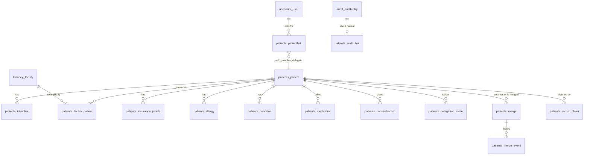
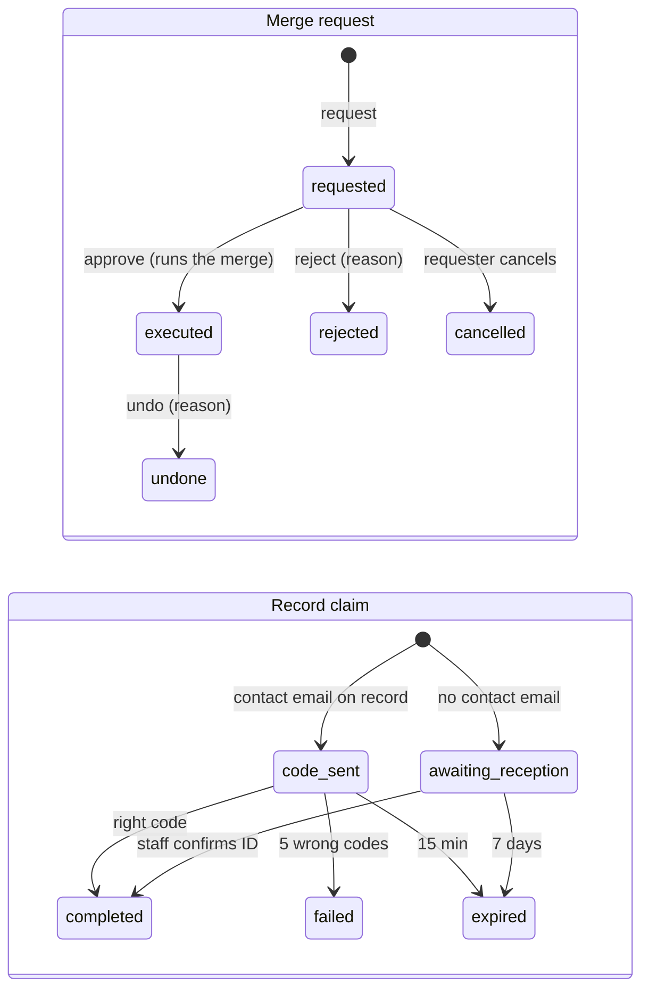

# Sprint 3 contract: Patients and identity

Status: v0.1 · 2026-10-18 · **Implemented: backend #57, frontend #59** · Wave 1 (built in parallel with S1 and S9) · Template and shared-file protocol: [contracts README](README.md) · Conventions: [API conventions](../02-api-conventions.md) · Model: [Sprint 0 contract](../03-sprint-0-contract.md)

**Sprint goal:** every person who receives care has one platform-wide patient record with safe identifiers. Reception can find or register a walk-in in under a minute without creating duplicates. Patients manage their own profile, family, insurance, health profile and privacy, and can see who accessed their record.


> **Orchestrator reconciliation (2026-10-18, before build):** the anchors this contract asked for are merged ([#20](https://github.com/B-Pine/medilink-rwanda/pull/20), [#21](https://github.com/B-Pine/medilink-rwanda/pull/21)): `extend_actions()` + `[SN]` blocks in `audit/actions.py`; blocks in `.env.example`, `requirements/base.in`, `DEFAULT_THROTTLE_RATES`, `core/realtime.py` and `seed_dev.DEV_SEED_COMMANDS`; `[SN imports]` blocks in the frontend registries; shell slots `headerItems`/`shellOverlays` (staff-web) and `headerItems`/`homeCards` (patient-web); PWA `importScripts`; frontend `PermissionCodes` (declaration merging, all 31 Sprint 0 codes) and `extendMockRoleGrants()`. Use them instead of the workarounds described below. Wave 1 ownership rules: [contracts README](README.md#wave-1-ownership-of-sprint-0-files).

## 1. Scope

| In scope (Part A, built now) | Requirements |
|---|---|
| Patient (platform-level person), MediLink patient number, identifiers (national ID field-encrypted + blind index, passport, refugee ID, birth certificate), facility patient record with file number (RLS) | FR-PAT-01, FR-PAT-07, FR-SEC-10 |
| Profile completion after sign-up (details, identifier, emergency contact, care consent, insurance, allergies reviewed) | FR-PAT-02 (completion; sign-up itself is S0) |
| Dependents (guardian), delegated access by one-time code, revocation, profile switching | FR-PAT-03 |
| Walk-in registration by reception (minimum fields, estimated age, spoken consent), add an already-registered patient to this facility | FR-PAT-04, NFR-UX-04 |
| Duplicate detection (exact identifier via blind index; fuzzy name + date of birth + phone) and merge requests: request, approve, reject, escalate, undo | FR-PAT-05 |
| Claim of a walk-in record (code to the registered email, or ID check at reception) | FR-PAT-06 |
| Health profile: allergies, chronic conditions, long-term medicines, verified / unverified / refuted, "no known allergies" | FR-PAT-08 |
| Patient views own and dependents' profile data | FR-PAT-13 (S3 part) |
| Access history from the audit log, consents (versioned) | FR-PAT-14, FR-SEC-08, FR-SEC-04 |
| Insurance profiles (insurer, member number, principal/dependent, validity, verification status) | FR-BIL-01 |
| Staff patient search (name, phone, national ID, file number, MediLink number) with masked values and logged reveal | FR-PAT-09 (search part), FR-SEC-10 |

**Part B (integration step, after S1 merges):** insurer foreign key to S1 master data, insurance card photos through the S1 upload pipeline, staff step-up through S1. See §8.

**Out of scope:** legacy register import and scanned records (S6), history timeline and problem summary (S6), blood group and pregnancy status (`patients_health_attribute`, S6), drug and ICD-10 codes on health items (S6), ID document photos (S7), cross-facility sharing and emergency access (P2), dependents reaching majority (FR-PAT-16, P2), visits and queue (S4), email verification, magic link and a general patient step-up endpoint (catalogue rows stay Planned, see §10), notifications to patients about these events (wired by S9 in wave 6), village/location pickers (address is free text in S3).

## 2. Domain model

### 2.1 Tables



All tables live in `medilink.patients`. S0 tables keep their Django default names (`patients_patientlink`, `patients_consentrecord`); new tables set `db_table` as in [database design](../04-database-design.md) §5.5. Every table has `id` (UUIDv7) and `created_at`; mutable ones `updated_at` and `version`.

| Table | Change | RLS | Class | Mutability |
|---|---|---|---|---|
| `patients_patient` | Altered (S0) | — (policy layer) | C2 | Mutable |
| `patients_identifier` | New | — | C3 | Versioned (supersede) |
| `patients_patientlink` | Altered (S0) | — | C2 | Revoke, never delete |
| `patients_consentrecord` | Altered (S0) | — | C2 | Append-only |
| `patients_facility_patient` | New | ✓ `EnableFacilityRLS` | C2 | Mutable |
| `patients_delegation_invite` | New (not in DB design) | — | C2 | Light state machine |
| `patients_insurance_profile` | New | — | C3 | Mutable (status resets on edit) |
| `patients_allergy`, `patients_condition`, `patients_medication` | New | — | C3 | Rows immutable except review and entered-in-error |
| `patients_merge` + `patients_merge_event` | New | — (see §2.3) | C2 | State machine + append-only events |
| `patients_record_claim` | New | — | C2 | Light state machine |
| `patients_audit_link` | New (replaces the proposed `audit_entry.patient_id`) | — | C2 | Append-only (trigger, as audit 0002) |

| Table | Key columns (business columns only) |
|---|---|
| `patients_patient` | Add: `medilink_number varchar(12)` **unique**; `preferred_name varchar(100) NULL`; `is_birth_date_estimated bool`; `phone_e164 varchar(16) NULL` (not unique); `email varchar(254) NULL` (lowercased contact email, not the login); `address varchar(300) NULL`; `emergency_contact jsonb NULL` (`{name, phone_e164, relationship}`); `created_via` (`self_signup`, `dependent`, `walk_in`; later `import`, `phone_booking`); `name_normalized varchar(200)` (lowercase, accents stripped, tokens sorted); `no_known_allergies bool NULL` (null = not asked); `merged_into_id NULL`, `merged_at NULL`; `version`. Widen `full_name` to 200. Indexes: GIN `gin_trgm_ops` on `name_normalized`; (`date_of_birth`); (`phone_e164`). Data migration: existing rows get a MediLink number and `created_via = self_signup`. |
| `patients_identifier` | `patient_id`, `kind` (`national_id`, `passport`, `refugee_id`, `birth_certificate`), `issuing_country char(2)`, `value_enc bytea`, `value_bidx bytea`, `bidx_key_id smallint`, `value_last4 varchar(4)`, `verified_at NULL`, `verified_by_id NULL`, `verified_facility_id NULL`, `superseded_at NULL`, `created_by_id NULL`. **Unique** (`kind`, `issuing_country`, `bidx_key_id`, `value_bidx`) and **unique** (`patient_id`, `kind`, `issuing_country`), both where `superseded_at IS NULL`. |
| `patients_patientlink` | Add: `granted_at` (backfill `created_at`), `granted_by_id NULL`, `consent_record_id NULL`, `revoked_by_id NULL`, `revoke_reason` (`revoked_by_grantor`, `left_by_holder`, `merged`, `claimed`) NULL. Existing unique constraints stay. |
| `patients_consentrecord` | `user_id` becomes NULL-able; add `patient_id NULL`, `recorded_by_id NULL`, `facility_id NULL`; kinds add `notifications`, `location`, `sharing`, `guardian`, `delegation`; channels stay `web`, `mobile`, `staff_assisted`. CHECK `user_id IS NOT NULL OR patient_id IS NOT NULL`. Index (`patient_id`, `kind`, `-granted_at`). |
| `patients_facility_patient` | `facility_id`, `patient_id`, `file_number varchar(40) NULL` (trimmed, uppercased), `first_visit_on date` (registration day, Africa/Kigali), `reception_notes varchar(500) NULL`, `is_staff_member bool` ([security 04](../../security/04-authorization-and-tenant-isolation.md) §3), `is_active bool`, `merged_into_id NULL` (self), `registered_by_id`, `registration_key uuid NULL` (idempotency), `version`. **Unique** (`facility_id`, `patient_id`); (`facility_id`, `file_number`) where not null; (`facility_id`, `registration_key`) where not null. |
| `patients_delegation_invite` | `patient_id`, `relationship` (`delegate`, `guardian`), `created_by_id`, `code_hash bytea` **unique** (SHA-256), `expires_at` (7 days), `accepted_at NULL`, `accepted_by_id NULL`, `link_id NULL`, `revoked_at NULL`, `consent_record_id`. |
| `patients_insurance_profile` | `patient_id`, `insurer_code varchar(40)`, `insurer_display varchar(120)` (snapshot), `member_number varchar(40)` (uppercased, spaces removed), `is_principal bool`, `principal_name NULL`, `principal_member_number NULL`, `relationship_to_principal` (`spouse`, `child`, `parent`, `other`) NULL, `valid_until date NULL`, `status` (`unverified`, `verified`, `rejected`), `status_reason varchar(200) NULL`, `last_verified_facility_id NULL`, `last_verified_at NULL`, `last_verified_by_id NULL`, `card_front_file_id uuid NULL`, `card_back_file_id uuid NULL` (no FK until Part B), `is_active bool`, `created_by_id`, `version`. Index (`insurer_code`, `member_number`); **unique** (`patient_id`, `insurer_code`, `member_number`) where active. Part B adds `insurer_id`. |
| `patients_allergy` | `patient_id`, `category` (`drug`, `food`, `other`), `substance_text varchar(120)`, `reaction varchar(200) NULL`, `severity` (`mild`, `moderate`, `severe`, `unknown`), plus the **provenance columns** below. Index (`patient_id`) where not entered in error. |
| `patients_condition` | `patient_id`, `display varchar(120)`, `status` (`active`, `resolved`), `onset_date NULL`, provenance columns |
| `patients_medication` | `patient_id`, `drug_display varchar(120)`, `dose_text varchar(120) NULL`, `started_on NULL`, `stopped_on NULL`, provenance columns |
| Provenance columns (the three health tables) | `source` (`patient`, `clinician`), `verification_status` (`unverified`, `verified`, `refuted`), `recorded_by_id`, `recorded_facility_id NULL`, `reviewed_by_membership_id NULL`, `reviewed_at NULL`, `review_note varchar(200) NULL`, `entered_in_error_at NULL`, `entered_in_error_by_id NULL`. Clinician entries are `verified` on creation. |
| `patients_merge` | `scope` (`facility`, `cross_facility`, `claim`), `facility_id NULL` (requesting facility; null for claims), `surviving_patient_id`, `merged_patient_id`, `surviving_facility_patient_id NULL`, `merged_facility_patient_id NULL`, `status` (`requested`, `rejected`, `cancelled`, `executed`, `undone`), `is_escalated bool`, `requested_by_id`, `reason varchar(300)`, `decided_by_id NULL`, `decided_at NULL`, `decision_reason NULL`, `moved_rows jsonb` (for undo), `executed_at NULL`, `undone_by_id NULL`, `undone_at NULL`, `undo_reason NULL`, `version`. CHECK `surviving_patient_id <> merged_patient_id`; CHECK `decided_by_id IS NULL OR decided_by_id <> requested_by_id`. **Unique** open request per patient (partial on `status = 'requested'`, for each of the two patient columns). |
| `patients_merge_event` | `merge_id`, `from_status NULL`, `to_status`, `actor_id NULL`, `occurred_at`, `reason NULL` |
| `patients_record_claim` | `account_id`, `patient_id`, `method` (`contact_code`, `reception_check`), `code_hash bytea NULL`, `reference varchar(8)` (shown to the patient, unambiguous alphabet), `expires_at`, `attempts smallint`, `status` (`code_sent`, `awaiting_reception`, `completed`, `failed`, `expired`, `cancelled`), `confirmed_by_id NULL`, `facility_id NULL`, `merge_id NULL`, `completed_at NULL` |
| `patients_audit_link` | `audit_entry_id` **unique** → `audit_auditentry`, `patient_id`, `occurred_at`, `actor_kind` (`staff`, `self`, `linked_account`, `platform`, `system`). Index (`patient_id`, `-occurred_at`). |

**Database functions** (pattern of [database design](../04-database-design.md) §3.4: `SECURITY DEFINER`, owner role, fixed `search_path`, return IDs or counts only):

| Function | Returns | Used by |
|---|---|---|
| `patients_known_elsewhere(patient_id uuid, facility_id uuid)` | integer: active facility records of the patient at other facilities | Merge scope, add-existing, claim checks |
| `patients_facilities_of(patient_id uuid)` | `SETOF uuid`: facility IDs with an active record | Platform merge execution and undo only |

The S3 migration also runs `TrigramExtension()` (`pg_trgm` is a trusted extension on PostgreSQL 13+, so the owner role can create it).

### 2.2 Formats and rules

| Item | Rule |
|---|---|
| MediLink number | `ML-XXXX-XXXX`: 7 random Crockford base32 characters (no I, L, O, U) + 1 Luhn mod 32 check character; generated with `secrets`, retried on collision, never reused (a merged patient's number resolves to the survivor). Input is normalised: uppercase, hyphens and spaces removed, `I`/`L` → `1`, `O` → `0`. |
| National ID | Exactly 16 digits after removing spaces, hyphens and dots; `issuing_country` is always `RW` |
| Passport, refugee ID, birth certificate | NFKC, uppercase, spaces and hyphens removed, `[A-Z0-9]{5,20}`; `issuing_country` ISO 3166-1 alpha-2, required |
| Phone | Stored E.164; input accepts `07xxxxxxxx`, `7xxxxxxxx`, `+2507xxxxxxxx`, `2507…` |
| Estimated age | `estimated_age_years` (0–120) or `estimated_age_months` (0–23) → `date_of_birth` = 1 January of (this year − years), or the 1st of the month for months; `is_birth_date_estimated = true` |
| Dependent | A `guardian` dependent is under 18 (`PATIENTS_DEPENDENT_MAX_AGE`, legal review pending); adults are added as `delegate` with their attested consent |
| Staff-as-patient | On registration, add-existing and merge, `is_staff_member = true` when an account linked to the patient has an active membership at the facility |

**Duplicate detection** (`medilink.patients.matching`, thresholds are constants tuned in the pilot):

1. **Exact identifier:** blind-index match on an active identifier, or an exact MediLink number → `exact_identifier`.
2. **Fuzzy candidates:** `similarity(name_normalized, :name) ≥ 0.45` (pg_trgm, sorted tokens so "Jeanne Mukamana" = "Mukamana Jeanne"), plus phone-exact candidates. Score: `strong` when name ≥ 0.6 and (same date of birth or same phone), or same phone and same date of birth; `possible` when name ≥ 0.45 and (birth year within ±2 or same phone). Opposite sex lowers `strong` to `possible`.
3. **Disclosure:** matches already known at the active facility are returned in full (§3.1 `PatientSummary`). Patients **not** known here are returned only for `exact_identifier` matches (`ExternalMatch`: name, birth year, sex, MediLink number); fuzzy matches elsewhere return only `other_facility_possible_count`, so staff ask for an ID or MediLink number instead of browsing the national register.

### 2.3 Row-level security and who reads what

| Data | Staff | Patient | Platform admin |
|---|---|---|---|
| `patients_facility_patient` | Forced RLS on `facility_id` (S0 `EnableFacilityRLS`, `app.facility_id`); every staff endpoint loads it with `get_scoped_object_or_404(principal, FacilityPatient.objects, pk=…)`, then reads its `patient` | Not read in S3 (no patient policy needed; [database design](../04-database-design.md) D2 stays open for S5) | Merge execution only: `rls_context(facility_id=f)` for each facility returned by `patients_facilities_of` |
| Platform tables (`patients_patient`, identifiers, insurance, health items, consents) | Only through a facility record of the active facility; exceptions: duplicate checks, add-existing and search with an exact identifier, which return the minimal `ExternalMatch` | Only through an active `PatientLink` of the session account (`PatientLink.objects.for_account(user).active()`); anything else → 404 | Merge request detail: names, dates of birth, sex, MediLink numbers, counts. Never health items. |
| `patients_merge` | `facility_id` = active facility (policy layer) | — | `scope` `cross_facility` or `claim`, or `is_escalated` |

`patients_merge` has **no** facility RLS although the database design marks it ✓: cross-facility requests must be listed across facilities by the platform, and the row holds IDs, a reason and a status, no clinical content. It is protected by scoped querysets and the cross-tenant tests in S3-B4 (decision D-6, §10).

### 2.4 Encryption and blind index (builder specification)

Code lives in `medilink/patients/crypto/` (moved to `medilink.core` by a separate agreed pull request when S6 needs it). Implements [security 05](../../security/05-data-protection-and-cryptography.md) §4.

| Topic | Rule |
|---|---|
| Algorithm | AES-256-GCM (`cryptography.hazmat.primitives.ciphers.aead.AESGCM`), 96-bit random nonce per value. Adds `cryptography` to `requirements/base.in`. |
| Stored format (`*_enc bytea`) | `0x01` (format) ‖ key id (uint16, big-endian) ‖ nonce (12 bytes) ‖ ciphertext ‖ tag (16 bytes) |
| Associated data | `b"medilink:v1:" + table + b":" + column + b":" + row_id.bytes`, so a ciphertext copied to another row or column fails to decrypt |
| Blind index (`*_bidx bytea`) | `HMAC-SHA256(index_key[bidx_key_id], f"{kind}\|{issuing_country}\|{normalized}")`, 32 bytes, with a key separate from the encryption keys. Lookups compute the HMAC under every configured index key and match (`bidx_key_id`, `value_bidx`); during an index-key rotation the service applies the same all-keys lookup before inserting, so uniqueness holds across key ids. |
| Masked display | `value_last4` stored in clear; shown as `••••5678`. The full value is decrypted only by the reveal endpoints. |
| Key store interface | `KeyStore` protocol: `active_data_key_id()`, `data_key(key_id) -> bytes`, `active_index_key_id()`, `index_key(key_id) -> bytes`. `get_keystore()` picks the backend from `MEDILINK_KEYSTORE` (`env`, the only S3 backend; an OpenBao backend that unwraps DEKs with the KEK plugs in later without changing callers). |
| Configuration (`env` backend) | `MEDILINK_FIELD_KEYS` (`1:<base64url 32 bytes>,2:…`), `MEDILINK_FIELD_ACTIVE_KEY_ID`, `MEDILINK_BLIND_INDEX_KEYS`, `MEDILINK_BLIND_INDEX_ACTIVE_KEY_ID`. Keys must decode to 32 bytes; an index key may not equal a data key. Read with django-environ inside the module (no `base.py` block exists for settings). |
| Missing keys | System check `patients.E001` (error) when not `DEBUG`. In `DEBUG` only, keys are derived from `SECRET_KEY` with HKDF-SHA256 (`info = b"medilink-dev-field-key"` / `b"medilink-dev-index-key"`) and `patients.W001` warns. Tests set fixed test keys in `tests/patients/conftest.py`. |
| Rotation | New writes use the active key; `manage.py patients_rotate_keys --data` re-encrypts rows on older key ids, `--index` recomputes blind indexes, in batches of 500, audited (`patients.keys.rotated`, counts only). |
| Never | Plaintext identifiers in logs, audit metadata, error messages, query strings, task arguments or caches |

### 2.5 State machines and business rules



Every merge transition writes a `patients_merge_event` row and an audit entry. The database design's `approved` status is not persisted: approval runs the merge in the same transaction (§10, D-9).

| Rule | Detail |
|---|---|
| Merge request | Staff name two **active facility records of the active facility** (`surviving_facility_patient_id`, `merged_facility_patient_id`) and a reason. Scope is computed: `facility` when neither patient is known elsewhere (`patients_known_elsewhere = 0`) and neither has an active account link; otherwise `cross_facility` (it touches another facility's records or an account holder's data). |
| Blocking conflicts (`422`, checked at request and again at execution) | Same patient; either already merged; an open request exists for either (`409`); both have an active `self` link (two accounts); both have active identifiers of the same kind and country with different values |
| Approval | `facility` scope: a member with `patients.merge_approve` who is not the requester, with step-up. `cross_facility` or escalated: platform admin, with step-up. **Escalate:** the requester escalates a `facility` request when no other active member of the facility holds `patients.merge_approve` (the single-owner clinic) |
| Execution (one transaction) | Re-points to the survivor and records each change in `moved_rows` as `{table, id, column, from, to}`: identifiers (an identical identifier is superseded), insurance profiles (an identical active one is deactivated), allergies, conditions, medications, patient-level consents, patient links (merged patient's link revoked with `merged`, an equivalent link created unless it exists), pending delegation invites (revoked). Facility records: re-pointed when the survivor has none at that facility; otherwise the merged one becomes `is_active = false`, `merged_into_id` = survivor's record (its file number still finds the survivor). Survivor's demographics win; its empty fields are filled from the merged patient. Merged patient gets `merged_into_id`, `merged_at`. |
| Undo | Same approver rule as approval, step-up and reason. Restores every moved row whose current value still equals `to`; rows created after the merge stay with the survivor; skipped rows are counted in the response and the audit metadata |
| Later sprints | A new table that references `patient_id` or `facility_patient_id` registers a mover with `medilink.patients.merge.register_mover(model, column)`, so merges and undos include it (S4 visits, S6 clinical records) |
| Claim request | Patient (own `self` profile) sends a lookup: identifier + date of birth, or MediLink number + date of birth, or phone + date of birth + names (similarity ≥ 0.6). The target has no active `self` link. If the account's own sign-up patient already has facility records → `422` ("ask reception to request a merge"). No match → `422` with a generic message. |
| Claim methods | Target has a contact email → 6-digit code, hashed, 15 minutes, 5 attempts, emailed on commit (Django email, as S0 password reset); the response shows a masked hint (`m•••@g•••.com`). Otherwise `reception_check`: the 8-character `reference` is shown to the patient for 7 days; a member with `patient.register` at a facility where the target is known confirms after seeing an ID document. |
| Claim completion | One transaction: a `claim`-scope merge (survivor = claimed record, merged = the account's sign-up patient) is created and executed, which moves the account's `self` link. Undo of a claim: platform admin only. |
| Delegation invite | `self` creates one for their own profile (`delegate`); a `guardian` creates one for a dependent (`guardian`, co-guardian). Needs `current_password` in the body (step-up, [security 03](../../security/03-identity-authentication-sessions.md) §4). Code `XXXX-XXXX` (Crockford), shown once, SHA-256 stored, 7 days, single use; records a `delegation` or `guardian` consent by the grantor. |
| Delegation accept and revoke | Another patient account enters the code → active link. The `self` account revokes any link to its profile; a guardian revokes links it granted; any holder can leave. Access ends at the next request. |

**What each link may do** (patient API; a forbidden action → `403 permission_denied`, another account's profile → `404`):

| Action | `self` | `guardian` | `delegate` |
|---|---|---|---|
| View profile, identifiers (masked), insurance, health profile | ✓ | ✓ | ✓ |
| Edit names, date of birth, sex | ✓ | ✓ | — |
| Edit contacts, emergency contact, address; insurance; add health items | ✓ | ✓ | ✓ |
| Add identifiers, reveal own identifier | ✓ | ✓ | — |
| Access history | ✓ | ✓ | — |
| Create delegation invite | ✓ (`delegate`) | ✓ (`guardian`) | — |

### 2.6 Audit events

All go through `medilink.patients.audit.record_patient_event(action, *, request, patient, object_type, object_id, reason="", metadata=None)`, which calls S0 `audit.record()` and writes `patients_audit_link` in the same transaction. Metadata holds IDs, codes and counts only (S0 metadata guard). Later sprints use the same helper for events about a patient.

| Action | When | In access history |
|---|---|---|
| `patients.walk_in.registered`, `patients.existing.added` | Staff create or attach a facility record | ✓ |
| `patients.search.performed` (metadata `by`, `result_count`), `patients.duplicate_check.performed` | Staff search and duplicate check (no patient link) | — |
| `patients.duplicates.dismissed` | Create with `confirm_not_duplicate` (metadata: match count) | — |
| `patients.record.viewed`, `patients.record.updated` (metadata: changed field names) | Staff open or edit a facility record | ✓ |
| `patients.identifier.added`, `.superseded`, `.verified` | Identifier changes | ✓ (by staff) |
| `patients.identifier.revealed`, `patients.phone.revealed` (reason code in `reason`) | Full value shown | ✓ |
| `patients.profile.updated`, `patients.dependent.added` | Patient self-service | — |
| `patients.delegation.created`, `.accepted`, `.revoked` | Delegations | ✓ (by other accounts) |
| `patients.insurance.added`, `.updated`, `.verified`, `.rejected`, `.deactivated` | Insurance | ✓ (by staff) |
| `patients.health_profile.viewed`, `patients.health_item.added`, `patients.health_item.reviewed` | Staff read or change the health profile | ✓ |
| `patients.consent.recorded` | Any consent record | ✓ (by staff) |
| `patients.claim.requested`, `.code_failed`, `.completed`, `.expired` | Claims | ✓ (completed) |
| `patients.merge.requested`, `.cancelled`, `.escalated`, `.rejected`, `.executed`, `.undone` | Merges (reason in `reason`) | ✓ (executed, undone) |
| `patients.keys.rotated` | Rotation command (system) | — |

## 3. Endpoints

All paths start with `/api/v1`. Staff endpoints act in the active facility; `{fp_id}` is a **facility patient record** ID (visits hang there from S4). `{kind}` is `allergies`, `conditions` or `medications`. Rate-limit classes are S3 throttle classes in `medilink/patients/throttling.py` (default rates in code, overridable by setting): `search` 60/min per user, `verification` 10/hour per account, `reveal` 30/hour per user. **Idem** = `Idempotency-Key` header; **Ver** = `version` in the body, `409 conflict` with the current resource on mismatch; **Step-up** = `403 step_up_required` without recent authentication (§8).

### 3.1 Schemas

```jsonc
// ProfileSummary: GET /patient/profiles/ results
{ "patient_id": "uuid", "display_name": "Keza Uwase", "relationship": "guardian",
  "medilink_number": "ML-7K3Q-9XW2", "date_of_birth": "2019-04-02", "completion_percent": 60 }
// PatientProfile: patient audience
{ "patient_id": "uuid", "relationship": "self", "medilink_number": "ML-7K3Q-9XW2",
  "full_name": "Mukamana Jeanne", "preferred_name": null, "date_of_birth": "1984-01-01",
  "is_birth_date_estimated": true, "sex": "female", "phone_e164": "+250788123456", "email": null,
  "address": "Kimironko, Gasabo",
  "emergency_contact": { "name": "Habimana Eric", "phone_e164": "+250788000111", "relationship": "spouse" },
  "no_known_allergies": null, "has_care_consent": true,
  "completion": { "details": true, "identifier": false, "emergency_contact": true, "care_consent": true,
                  "insurance": false, "allergies_reviewed": false },
  "version": 3 }
// Identifier: masked everywhere except the reveal endpoints
{ "id": "uuid", "kind": "national_id", "issuing_country": "RW", "masked_value": "••••5678",
  "is_verified": true, "verified_at": "2026-10-12T08:14:00Z" }
// InsuranceProfile
{ "id": "uuid", "insurer_code": "mutuelle", "insurer_display": "Mutuelle de Santé", "member_number": "1234567/01",
  "is_principal": false, "principal_name": "Habimana Eric", "principal_member_number": "1234567",
  "relationship_to_principal": "spouse", "valid_until": "2027-06-30", "is_expired": false,
  "status": "verified", "status_reason": null,
  "last_verified": { "facility_name": "Kigali Clinic", "at": "2026-10-12T08:20:00Z" },
  "card_images": { "front": null, "back": null, "can_upload": false },  // can_upload becomes true in Part B
  "is_active": true, "version": 2 }
// HealthItem: allergy shown; conditions add status, onset_date; medicines drug_display, dose_text, started_on, stopped_on.
// HealthProfile = { "no_known_allergies": false, "allergies": [HealthItem], "conditions": [...], "medications": [...] }
{ "id": "uuid", "kind": "allergy", "category": "drug", "substance_text": "Penicillin", "reaction": "Rash",
  "severity": "moderate", "source": "patient", "verification_status": "unverified",
  "recorded_at": "2026-10-18T09:00:00Z", "reviewed_at": null, "review_note": null }
// PatientSummary: staff lists and search. FacilityPatientDetail adds address, email, emergency_contact,
// reception_notes, identifiers [Identifier], has_care_consent, open_claim_reference, version, patient_version
{ "facility_patient_id": "uuid", "patient_id": "uuid", "medilink_number": "ML-7K3Q-9XW2", "file_number": "A-1234",
  "full_name": "Mukamana Jeanne", "preferred_name": null, "sex": "female", "date_of_birth": "1984-01-01",
  "is_birth_date_estimated": true, "age_years": 42, "phone_masked": "+250 7•• ••• 456",
  "national_id_masked": "••••5678",
  "insurance": [{ "insurer_code": "mutuelle", "status": "verified", "is_expired": false }],
  "has_account": true, "is_staff_member": false, "match": "name" }
// ExternalMatch: on MediLink but not at this facility (exact identifier or MediLink number only)
{ "patient_ref": "uuid", "full_name": "Mukamana Jeanne", "birth_year": 1984, "sex": "female",
  "medilink_number": "ML-7K3Q-9XW2", "matched_on": "national_id" }
// DuplicateCheckResult
{ "matches": [{ "level": "exact_identifier", "patient": PatientSummary }],
  "external_match": null, "other_facility_possible_count": 2 }
// MergeRequest (staff and platform)
{ "id": "uuid", "scope": "facility", "status": "requested", "is_escalated": false,
  "facility": { "id": "uuid", "name": "Kigali Clinic" },
  "surviving": { "patient_id": "uuid", "medilink_number": "ML-…", "full_name": "…", "date_of_birth": "…", "sex": "female", "file_number": "A-1234" },
  "merged": { /* same shape */ },
  "preview": { "identifiers": 1, "insurance_profiles": 1, "health_items": 3, "account_links": 0,
               "facility_records_here": 2, "other_facilities": 0, "conflicts": [] },
  "reason": "Registered twice, spelling", "requested_by": "Uwase Aline", "requested_at": "…",
  "decided_by": null, "decided_at": null, "decision_reason": null, "executed_at": null, "undone_at": null,
  "version": 1 }
// RecordClaim
{ "id": "uuid", "status": "code_sent", "method": "contact_code", "contact_hint": "m•••@g•••.com",
  "reference": "K7Q4PX2M", "expires_at": "…" }
// AccessHistoryItem: the client renders the plain-language sentence from these codes (rw/en/fr)
{ "id": "uuid", "occurred_at": "2026-10-12T08:14:00Z", "action": "patients.record.viewed",
  "actor_kind": "staff", "actor_role": "receptionist", "facility": { "id": "uuid", "name": "Kigali Clinic" } }
// ConsentState: GET /patient/consents/
{ "current_versions": { "terms": "2026-10", "privacy": "2026-10", "care": "2026-10", "research": "2026-10" },
  "consents": [{ "kind": "research", "patient_id": null, "granted": false, "version": "2026-10",
                 "granted_at": "…", "channel": "web" }],
  "history": [] }
```

### 3.2 Patient (`/patient/…`, patient session, profile access through an active link of the account)

| # | Method and path | Request → success | Rules, errors, notes | Requirements |
|---|---|---|---|---|
| PA1 | `GET /patient/profiles/` | → `200 {results: [ProfileSummary]}` | Self first, then dependents and delegated profiles | FR-PAT-03 |
| PA2 | `GET /patient/profiles/{patient_id}/` | → `200 PatientProfile` | `404` without an active link | FR-PAT-01, 13 |
| PA3 | `PATCH /patient/profiles/{patient_id}/` | Writable `PatientProfile` fields + `version` → `200` | Field rights per §2.5 table (`403`); Ver; `400` phone/date rules | FR-PAT-02, FR-SEC-12 |
| PA4 | `GET /patient/profiles/{patient_id}/identifiers/` | → `200 {results: [Identifier]}` | Masked | FR-PAT-07 |
| PA5 | `POST /patient/profiles/{patient_id}/identifiers/` | `{kind, issuing_country, value}` → `201 Identifier` | Supersedes an unverified one of the same kind; verified → `422` (change at reception); used by another patient → `409 conflict`, `fields.value` (the client offers the claim flow); RL `verification` | FR-PAT-07, FR-SEC-10 |
| PA6 | `POST /patient/profiles/{patient_id}/identifiers/{identifier_id}/reveal/` | → `200 {value}` | `self`/`guardian`; `Cache-Control: no-store`; RL `reveal`; Audit | FR-SEC-10 |
| PA7 | `POST /patient/dependents/` | `{relationship: "guardian"\|"delegate", full_name, sex, date_of_birth \| estimated_age_years, consent_version, consent_attested}` → `201 ProfileSummary` | Guardian: under 18; delegate: adult who agreed (`consent_attested: true`); records `guardian`/`delegation` consent; max 10 per account; Idem | FR-PAT-03, FR-SEC-04 |
| PA8 | `GET /patient/delegations/` | → `200 {granted: […], received: […], pending_invites: […]}` | Holder names shortened ("Mukamana J.") | FR-PAT-03 |
| PA9 | `POST /patient/delegations/` | `{patient_id, current_password, consent_version}` → `201 {id, code, relationship, expires_at}` | `self` → `delegate`, `guardian` → co-`guardian`; wrong password → `400` `fields.current_password`; code shown once; RL `verification`; Audit | FR-PAT-03 |
| PA10 | `POST /patient/delegations/accept/` | `{code}` → `201 ProfileSummary` | Invalid, used or expired → `400` (one generic message); own profile → `422`; already linked → `409`; RL `verification` | FR-PAT-03 |
| PA11 | `POST /patient/delegations/{id}/revoke/` | → `204` | `{id}` = link or pending invite; rules in §2.5 | FR-PAT-03 |
| PA12 | `GET /patient/profiles/{patient_id}/insurance-profiles/` | → `200 {results: [InsuranceProfile]}` | Active first | FR-BIL-01 |
| PA13 | `POST /patient/profiles/{patient_id}/insurance-profiles/` | `{insurer_code, member_number, is_principal, principal_name, principal_member_number, relationship_to_principal, valid_until}` → `201` | Status `unverified`; unknown insurer → `400` (stub list in Part A, §8); same active card → `409` | FR-BIL-01 |
| PA14 | `PATCH /patient/insurance-profiles/{id}/` | Fields + `version` → `200` | Ver; changing insurer, number, principal data or validity resets status to `unverified` | FR-BIL-01 |
| PA15 | `POST /patient/insurance-profiles/{id}/deactivate/` | → `200` | Kept for history | FR-BIL-01 |
| PA16 | `GET /patient/profiles/{patient_id}/health-profile/` | → `200 HealthProfile` | Entered-in-error items excluded | FR-PAT-08, 13 |
| PA17 | `POST /patient/profiles/{patient_id}/{kind}/` | Item fields → `201 HealthItem` | `source = patient`, `unverified`; an allergy sets `no_known_allergies = false` | FR-PAT-08 |
| PA18 | `POST /patient/profiles/{patient_id}/{kind}/{item_id}/entered-in-error/` | → `200` | Own unverified items only; verified → `422` (ask a clinician) | FR-PAT-08 |
| PA19 | `POST /patient/record-claims/` | `{lookup: {identifier: {kind, issuing_country, value}} \| {medilink_number} \| {phone_e164, full_name}, date_of_birth}` → `201 RecordClaim` | Rules in §2.5; no match or not allowed → `422` (generic); RL `verification`; Audit | FR-PAT-06 |
| PA20 | `GET /patient/record-claims/{id}/` | → `200 RecordClaim` | Own claims only (polled while awaiting reception) | FR-PAT-06 |
| PA21 | `POST /patient/record-claims/{id}/verify/` | `{code}` → `200 {claim, profile: ProfileSummary}` | Wrong code → `400`; 5th wrong → `422`, status `failed`; expired → `422`; RL `verification` | FR-PAT-06 |
| PA22 | `GET /patient/consents/` | → `200 ConsentState` | Account consents + `care`/`research` of guardian profiles | FR-SEC-04, 05 |
| PA23 | `POST /patient/consents/` | `{kind, version, granted, patient_id}` → `201` | `terms`/`privacy` only `granted: true` at the current version (withdrawal = account closure, S10 → `422`); `patient_id` only for `care`/`research` of `self` or `guardian` profiles; append-only | FR-SEC-04, 05 |
| PA24 | `GET /patient/profiles/{patient_id}/access-history/` | `?page=` → `200` paginated `AccessHistoryItem` | `self`/`guardian`; newest first; excludes the caller's own actions; includes patients merged into this one | FR-PAT-14, FR-SEC-08 |
| PA25 | `POST /patient/insurance-profiles/{id}/card-images/` | **Part B.** `multipart {side, file}` → `201 InsuranceProfile` | S1 pipeline; resets status; RL `upload` (S1) | FR-BIL-01 |
| PA26 | `POST /patient/insurance-profiles/{id}/card-images/{side}/download-links/` | **Part B.** → `200 {url, expires_at}` | 5-minute signed URL (S1) | FR-BIL-01 |

### 3.3 Staff (`/staff/…`, staff session with an active facility)

| # | Method and path | Request → success | Permission | Rules, errors, notes | Requirements |
|---|---|---|---|---|---|
| ST1 | `POST /staff/patients/search/` | `{query, by: auto\|name\|phone\|national_id\|identifier\|file_number\|medilink_number, kind, issuing_country}` → `200 {results: [PatientSummary], external_match}` | `patients.view` | Criteria in the body (no personal data in URLs); this facility's records only, ≤ 20; `external_match` only for an exact identifier or MediLink number; merged records resolve to the survivor; RL `search`; Audit | FR-PAT-09, 04 |
| ST2 | `POST /staff/patients/duplicate-checks/` | `{full_name, sex, date_of_birth \| estimated_age_years \| estimated_age_months, phone_e164, identifier, medilink_number}` → `200 DuplicateCheckResult` | `patient.register` | §2.2; RL `search`; Audit | FR-PAT-05 |
| ST3 | `POST /staff/patients/` | `{full_name, sex, date_of_birth \| estimated_age_*, phone_e164, identifier, file_number, insurance, care_consent: {version, granted: true}, confirm_not_duplicate}` → `201 FacilityPatientDetail` | `patient.register` | Creates patient + facility record (+ identifier, insurance, `staff_assisted` consent); exact identifier exists → `409`, `fields.identifier` (use ST4); unconfirmed `strong` matches → `409`, `fields.non_field_errors`; file number taken → `409`, `fields.file_number`; Idem (`registration_key`) | FR-PAT-04, 01, 05, 07, FR-SEC-04 |
| ST4 | `POST /staff/patients/add-existing/` | `{patient_ref, proof: {medilink_number} \| {identifier}, file_number, care_consent}` → `201` (or `200` if already here) | `patient.register` | Proof must match `patient_ref` exactly (`422`); Idem; Audit | FR-PAT-01, 05 |
| ST5 | `GET /staff/patients/{fp_id}/` | → `200 FacilityPatientDetail` | `patients.view` | Merged record → `200` with `is_active: false` and `merged_into_facility_patient_id`; Audit every read | FR-PAT-01, 07 |
| ST6 | `PATCH /staff/patients/{fp_id}/` | Demographics, contacts, `file_number`, `reception_notes` + `version`, `patient_version` → `200` | `patient.register` | Ver on both rows; Audit (field names only) | FR-PAT-01, 07 |
| ST7 | `POST /staff/patients/{fp_id}/identifiers/` | `{kind, issuing_country, value, seen_document}` → `201 Identifier` | `patient.register` | `seen_document: true` marks it verified; supersedes the same kind; used by another patient → `409` (request a merge) | FR-PAT-07, FR-SEC-10 |
| ST8 | `POST /staff/patients/{fp_id}/reveal/` | `{field: identifier\|phone, identifier_id, reason_code: identity_check\|insurance_claim\|patient_request\|other, reason_text}` → `200 {value}` | Identifier: `patients.identifier_reveal`; phone: `patients.view` | `reason_text` required for `other`; `Cache-Control: no-store`; RL `reveal`; Audit | FR-SEC-10, design 08 |
| ST9 | `GET /staff/patients/{fp_id}/insurance-profiles/` | → `200 {results}` | `patients.view` | | FR-BIL-01 |
| ST10 | `POST /staff/patients/{fp_id}/insurance-profiles/` | As PA13 → `201` | `patient.register` | | FR-BIL-01 |
| ST11 | `PATCH /staff/patients/{fp_id}/insurance-profiles/{profile_id}/` | As PA14 → `200` | `patient.register` | Ver; resets status as PA14 | FR-BIL-01 |
| ST12 | `POST /staff/patients/{fp_id}/insurance-profiles/{profile_id}/verify/` | `{outcome: verified\|rejected, valid_until, reason}` → `200` | `patients.insurance_verify` | `reason` required for `rejected`; sets `last_verified_*`; Audit | FR-BIL-01 |
| ST13 | `GET /staff/patients/{fp_id}/health-profile/` | → `200 HealthProfile` | `clinical.view` (all) or `prescription.view` (allergies only; other sections `null`) | Treatment relationship = known at this facility until S4/S6 add visits and the reason prompt; Audit | FR-PAT-08 |
| ST14 | `POST /staff/patients/{fp_id}/{kind}/` | Item fields → `201 HealthItem` | `clinical.write` | `source = clinician`, `verified` | FR-PAT-08 |
| ST15 | `POST /staff/patients/{fp_id}/{kind}/{item_id}/review/` | `{outcome: verified\|refuted\|entered_in_error, note}` → `200` | `clinical.write` | `note` required for `refuted` and `entered_in_error`; Audit | FR-PAT-08 |
| ST16 | `POST /staff/patients/{fp_id}/consents/` | `{kind: care\|research, version, granted, script_read: true}` → `201` | `patient.register` | Channel `staff_assisted`, `recorded_by`, `facility` | FR-SEC-04 |
| ST17 | `POST /staff/patients/{fp_id}/claim-confirmations/` | `{claim_reference, document_kind, document_matches: true}` → `200 RecordClaim` | `patient.register` | Reference not open for this patient → `404`; Idem; Audit | FR-PAT-06 |
| ST18 | `GET /staff/merge-requests/` | `?status=&page=` → `200` paginated `MergeRequest` | `patients.merge_request` or `patients.merge_approve` | This facility's requests | FR-PAT-05 |
| ST19 | `POST /staff/merge-requests/` | `{surviving_facility_patient_id, merged_facility_patient_id, reason}` → `201 MergeRequest` | `patients.merge_request` | §2.5 conflicts (`409`/`422`); Idem; Audit | FR-PAT-05 |
| ST20 | `GET /staff/merge-requests/{id}/` | → `200 MergeRequest` (with preview) | As ST18 | | FR-PAT-05 |
| ST21 | `POST /staff/merge-requests/{id}/approve/` | `{version, decision_reason}` → `200` (`executed`) | `patients.merge_approve` | Requester → `422`; `cross_facility` or escalated → `422`; Step-up; Ver; Idem; Audit | FR-PAT-05 |
| ST22 | `POST /staff/merge-requests/{id}/reject/` | `{version, decision_reason}` → `200` | `patients.merge_approve` | Reason required; not the requester | FR-PAT-05 |
| ST23 | `POST /staff/merge-requests/{id}/cancel/` | → `200` | Requester | Only `requested` | FR-PAT-05 |
| ST24 | `POST /staff/merge-requests/{id}/escalate/` | → `200` (`is_escalated: true`) | Requester | Only when no other active approver exists (`422`) | FR-PAT-05 |
| ST25 | `POST /staff/merge-requests/{id}/undo/` | `{version, reason}` → `200 {merge, skipped_rows}` | `patients.merge_approve` | `facility` scope only; Step-up; Audit | FR-PAT-05 |
| ST26 | `POST /staff/patients/{fp_id}/insurance-profiles/{profile_id}/card-images/` | **Part B.** As PA25 | `patient.register` | Desk capture (camera or file) | FR-BIL-01 |
| ST27 | `POST /staff/patients/{fp_id}/insurance-profiles/{profile_id}/card-images/{side}/download-links/` | **Part B.** As PA26 | `patients.view` | | FR-BIL-01 |

### 3.4 Platform (`/platform/…`, platform admin)

| # | Method and path | Request → success | Rules | Requirements |
|---|---|---|---|---|
| PL1 | `GET /platform/merge-requests/` | `?status=&scope=&page=` → `200` paginated `MergeRequest` | `cross_facility`, escalated and `claim` merges, all facilities; never health items | FR-PAT-05 |
| PL2 | `GET /platform/merge-requests/{id}/` | → `200 MergeRequest` | Preview counts per facility, no clinical data | FR-PAT-05 |
| PL3 | `POST /platform/merge-requests/{id}/approve/` | `{version, decision_reason}` → `200` | Step-up; Ver; Idem; executes per facility with `rls_context`; Audit | FR-PAT-05 |
| PL4 | `POST /platform/merge-requests/{id}/reject/` | `{version, decision_reason}` → `200` | Reason required; Audit | FR-PAT-05 |
| PL5 | `POST /platform/merge-requests/{id}/undo/` | `{version, reason}` → `200 {merge, skipped_rows}` | Any scope incl. `claim`; Step-up; Audit | FR-PAT-05 |

**Common errors:** `401 not_authenticated` (no session for the audience), `403 permission_denied` (missing permission or link right), `403 step_up_required`, `403 csrf_failed`, `404 not_found` (other facility, unlinked profile, malformed ID), `429 rate_limited` with `Retry-After`. Validation messages are localised; codes stay stable ([API conventions](../02-api-conventions.md) §4).

## 4. Permissions

Defined in `medilink/patients/permissions.py` (`PERMISSIONS`, `ROLE_GRANTS`), registered through `catalogue.extend()` in the `[S3]` block, and seeded by a data migration in `medilink.patients` (depends on `tenancy.0003_seed_roles_permissions`; reversible). `tests/test_roles_seed.py` must stay green.

| Code | Status | Facility admin | Receptionist | Doctor | Pharmacist |
|---|---|---|---|---|---|
| `patient.register` (create and edit demographics, identifiers, insurance, consents, claim confirmation) | Existing (S0) | ✓ | ✓ | ✓ | — |
| `patients.view` (search and view facility records; reveal phone) | **New** | ✓ | ✓ | ✓ | — |
| `patients.identifier_reveal` (unmask identifiers with a reason) | **New** | ✓ | ✓ | — | — |
| `patients.insurance_verify` (mark a card verified or rejected) | **New** | ✓ | ✓ | — | — |
| `patients.merge_request` | Existing (S0: facility admin only) | ✓ | ✓ **granted by S3** | — | — |
| `patients.merge_approve` (approve, reject, undo within the facility) | **New** | ✓ | — | — | — |
| `clinical.view`, `clinical.write`, `prescription.view` | Existing | Used for the health profile as in ST13–ST15 | | | |

`ROLE_GRANTS` therefore adds `receptionist: {patients.view, patients.identifier_reveal, patients.insurance_verify, patients.merge_request}`, `facility_admin: {patients.view, patients.identifier_reveal, patients.insurance_verify, patients.merge_approve}`, `doctor: {patients.view}`; the data migration seeds the four new codes and these grants, including the receptionist grant of the existing `patients.merge_request` (`extend()` accepts grants of existing codes). Platform endpoints use `IsPlatformAdmin` (super admin is a flag, not a facility role); the platform never reads health items. This settles the merge question in the [API catalogue README](../../api/README.md) §4 in favour of the corrected matrix ([analysis 02](../../analysis/02-users-roles-and-permissions.md) §3).

## 5. Background jobs and commands

| Job / command | Schedule | What |
|---|---|---|
| `patients.expire_claims` (Celery beat) | Every 15 min | `code_sent` older than 15 min and `awaiting_reception` older than 7 days → `expired`; audit `patients.claim.expired` |
| `patients.expire_delegation_invites` | Daily 02:00 | Marks expired invites (codes are useless anyway after `expires_at`) |
| `manage.py patients_rotate_keys --data \| --index` | Manual, on rotation | §2.4; batches of 500; audited counts |
| `manage.py patients_backfill_numbers` | Once (also run by the data migration) | MediLink numbers for S0 patients |

The claim code email is sent with `transaction.on_commit` in the request (a code never travels through the broker). Tasks take IDs only and the facility context ([security 04](../../security/04-authorization-and-tenant-isolation.md) §2). Dev data comes from a new S3-owned `manage.py seed_patients_dev`, registered in `seed_dev.DEV_SEED_COMMANDS` (`[S3]` block); it refuses to run when `DEBUG` is false.

## 6. Frontend

### 6.1 staff-web, feature `patients` (`src/features/patients/`)

| Route (shell) | Screen | Shown to | Design |
|---|---|---|---|
| `/patients` (replaces the S0 nav placeholder) | `PersonSearch` with type auto-detection; results table (masked phone and ID, card list below 640 px); `ExternalMatch` card with "Add to this facility" (ST4, asks for the proof); "Register walk-in" button | `patients.view` | [design 04](../../design/research/04-dashboards.md) §3.1, [08](../../design/research/08-tables.md) |
| `/patients/register` | `WalkInForm`: Names · Sex (segmented) · Date of birth **or** Age · Phone (`PhoneField`) · Insurance (insurer, member number, principal) · "More" (national ID or passport, file number) · consent script + checkbox. Duplicate suggestions appear beside the form (debounced 400 ms once names + date/age or phone are filled). Success shows the MediLink number. The component is exported for S4's Today side panel. | `patient.register` | design 04 §3.1 (under 60 s) |
| `/patients/:fpId` | Record header (names, age, sex, MediLink and file numbers, flags: staff member, has account, insurance status) and tabs: Details · Identifiers (`MaskedValue`, reveal dialog with reason list) · Insurance (verify / reject) · Health profile (clinical roles; pharmacist allergies only) · Consents and claim confirmation · "Report duplicate" (ST19) | `patients.view` | design 08 §2 privacy |
| `/patients/merge-requests` | List with status filter chips; side panel with side-by-side comparison, preview counts and conflicts; approve, reject, cancel, escalate, undo with reason fields | merge codes | design 08 destructive actions |
| `/platform/merge-requests` | Same list and panel for platform merges | platform admin | design 04 §3.5 |

Shortcuts (NFR-UX-05): `/` focuses search, `N` opens a new walk-in (ignored while typing), `Esc` closes the side panel. `403 step_up_required` in Part A shows "Sign in again to confirm" with a return path; Part B uses S1's step-up dialog. New permission codes are added to the frontend `PermissionCodes` interface by declaration merging in `features/patients.ts`, and to the mocks with `extendMockRoleGrants()`.

### 6.2 patient-web, feature `profile` (`src/features/profile/`)

All routes are `patient` routes inside an S3 `ProfileLayout` whose header carries `ProfileSwitcher`. Body 18 px, targets ≥ 48 px, one task per screen, all states of [design 07](../../design/research/07-patient-app-pages.md) §4.

| Route | Screen |
|---|---|
| `/profile` | Redirects to the self profile (or the last profile chosen in this tab, kept in memory only) |
| `/profile/:patientId` | Profile hub: completion checklist with the next action (FR-PAT-02), MediLink number, section cards |
| `/profile/:patientId/details`, `/identifiers` | Edit details; add an ID (masked, reveal for self/guardian); a `409` offers "Claim this record" |
| `/profile/:patientId/insurance` | Cards with status badges ("Used at Kigali Clinic on 12 Oct, verified ✓"), add / edit / deactivate; card photo slot only when `can_upload` |
| `/profile/:patientId/health` | Allergies, conditions, medicines; "Unverified" badge on self-reported items; "No known allergies" choice |
| `/profile/:patientId/access-history` | Plain language: "Kigali Clinic · Receptionist · viewed your details · 12 Oct 2026 10:14" |
| `/family` | Dependents, add a child or an adult (one question per screen), delegations given and received, invite code shown once, accept a code, revoke |
| `/privacy` | Consent toggles (research unticked by default, notifications, location), care consent per profile, links to access history; download and delete arrive in S10 |
| `/claim` | Claim wizard: lookup → code entry, or the reception reference shown large → done |

### 6.3 Shared packages

| Package | Deliverable |
|---|---|
| `packages/ui` (one file each) | `PersonSearch` (combobox with type chip, listbox keyboard navigation, `aria-live` result count), `MaskedValue` (`••••5678`, Reveal button calling an async `onReveal`, re-masks after 30 s and on unmount), `ProfileSwitcher` (menu of profiles with relationship badges), `CameraCapture` (`getUserMedia` with preview and retake; falls back to `<input type="file" accept="image/*" capture="environment">`; returns a `Blob`, no upload logic), `PhoneField` (+250 mask, accepts `07…`). Generic tabs and side panels stay inside the features to avoid name clashes with S1/S9. |
| `packages/api-client` | `src/features/patients.ts` (`createPatientsApi`: ST1–ST27, PL1–PL5) and `src/features/profile.ts` (`createProfileApi`: PA1–PA26), types from §3.1, `STUB_INSURERS` (Part A only), `hasPermission(me, code: string)` |
| MSW mocks | `src/mocks/features/patients.ts`, `profile.ts` and a shared synthetic store `patients-store.ts` (25+ patients, a duplicate pair "Mukamana Jeanne" / "Jeanne Mukamana", a staff member as patient, an open reception claim; a mock patient account with a child and a delegated parent). Factories use `MockContext` (CSRF, sessions, error envelope, latency), compute staff permissions from the mock roles with S3's grant table, and implement the §3 errors; a store flag makes approve/undo answer `step_up_required` for tests. |
| Translations | staff-web namespace `patients`, patient-web namespace `profile` (`locales/{rw,en,fr}.json`); access-history sentences under `profile.accessHistory.actions.<action>` with ICU plurals and dates; Kinyarwanda flagged for native review |

## 7. Integration points

**Marked blocks used** (nothing else in shared files changes):

| File | `[S3]` block content |
|---|---|
| `backend/config/settings/base.py` | Nothing: `medilink.patients` is already installed |
| `backend/config/urls.py` | Nine string includes: `patient/profiles/`, `patient/dependents/`, `patient/delegations/`, `patient/insurance-profiles/`, `patient/record-claims/`, `patient/consents/`, `staff/patients/`, `staff/merge-requests/`, `platform/merge-requests/` → `medilink.patients.urls.<area>` |
| `backend/medilink/authz/catalogue.py` | `from medilink.patients import permissions as _s3  # noqa: E402` and `extend(_s3.PERMISSIONS, _s3.ROLE_GRANTS)` |
| `backend/CHANGELOG.md`, `frontend/CHANGELOG.md` | Bullets under the S3 heading |
| `frontend/apps/staff-web/src/app/features.ts`, `src/i18n/features.ts` | `patients` routes; `patients: { rw, en, fr }` |
| `frontend/apps/staff-web/src/layout/navigation.ts` | `patientMerges` (`/patients/merge-requests`, facility group, `labelKey: "patients.nav.merges"`, visible with either merge code) and `platformMerges` (`/platform/merge-requests`, platform group, `labelKey: "patients.nav.platformMerges"`, platform admins). `/patients` keeps the core `patients` item. |
| `frontend/apps/patient-web/src/app/features.ts`, `src/i18n/features.ts` | `profile` patient routes; `profile: { rw, en, fr }` |
| `frontend/packages/api-client/src/index.ts`, `endpoints.ts`, `mocks/features.ts` | `export * from "./features/patients"` and `"./features/profile"`; `patients: createPatientsApi(client), profile: createProfileApi(client),`; the two mock factories |
| `frontend/packages/ui/src/index.ts` | The five component exports |

`requirements/base.in` gains `cryptography` and `base.txt` is regenerated with pip-compile after rebasing (lock files are regenerated, never hand-merged, like `openapi.yaml`).

**Anchor requests for the orchestrator** — all three are now merged (see the note at the top); A3 is the patient-web `homeCards` and `headerItems` slots:

| # | Request | Needed for | Until it lands |
|---|---|---|---|
| A1 | `backend/medilink/audit/actions.py`: a validated `extend_actions(names)` (like `catalogue.extend()`, mutating the set `record()` reads) and `[S1]`/`[S3]`/`[S9]` blocks. S3 adds `from medilink.patients import audit_actions as _s3` + `extend_actions(_s3.ACTIONS)`. | **Blocking** for every audited S3 endpoint; S1 and S9 have the same need | — |
| A2 | `backend/.env.example` sprint blocks | Documenting the §2.4 key variables | Dev fallback keys (§2.4) |
| A3 | patient-web home: a feature entry-point registry (quick links and header slot) with sprint blocks | "My profile" and "Family" links and `ProfileSwitcher` on `/home` | `/profile` reachable by URL; check S3-I6 waits |

**Docs updated in the builder pull requests:** API catalogue S3 rows (paths and codes of this contract, status), database design §5.5 (deviations in §10), API README §4 merge note (resolved), traceability matrix statuses.

## 8. Dependencies and the Part A / Part B split

| Sprint | Relationship |
|---|---|
| S0 (merged) | Principal, policy layer, `EnableFacilityRLS`, `rls_context`, `audit.record()`, session keys |
| S1 (parallel) | Insurers master data, upload pipeline, staff step-up: **Part B** below |
| S9 (parallel) | None. Patient notifications about merges, claims, delegations and staff edits are wired in wave 6; S3 only writes audit events. |
| S4 (next) | Consumes `FacilityPatient`, `WalkInForm`, `record_patient_event()`, `register_mover()` |

| Need | Part A (now) | Part B (after S1 merges; one small PR per side) |
|---|---|---|
| Insurer | `medilink.patients.insurers.resolve_insurer(code)` → `InsurerRef(code, display, id=None)` from `STUB_INSURERS = {mutuelle: "Mutuelle de Santé", rama: "RAMA", mmi: "MMI"}` (the schemes of [analysis 08](../../analysis/08-billing-payments-and-insurance.md) §1.1); `insurer_code` + `insurer_display` snapshot stored | Migration adds `insurer_id` → `masterdata_insurer` (`PROTECT`, nullable) and backfills by code (unmatched rows keep their snapshot and are reported); `resolve_insurer` reads active master data; pickers load `GET /api/v1/public/master-data/insurers/` (S1-D11) |
| Card photos | `card_front_file_id` / `card_back_file_id` as plain UUIDs, `can_upload: false`; `CameraCapture` and the card slot built against mocks | FKs → `uploads_file` (`PROTECT`, S1-D5); PA25, PA26, ST26, ST27 through S1's upload service: S3 registers an `UploadPurpose` `insurance_card` (owner kind `patient`, C3) in `PatientsConfig.ready()` and calls `attach()` / `download_link()` (S1 §3.6); `can_upload: true`; a new photo resets the status |
| Staff step-up | `medilink.patients.stepup.require_recent_auth(request)`: second factor verified ≤ 5 minutes ago (session `MFA_AT_KEY`) | Uses S1's `RecentAuthRequired(max_age=300)` / `@requires_recent_auth()` (`POST /staff/auth/step-up/`); the frontend opens S1's step-up dialog and retries |

## 9. Acceptance checks

### Backend

| # | Check | Source |
|---|---|---|
| S3-B1 | Every Part A endpoint (PA1–PA24, ST1–ST25, PL1–PL5) exists, matches §3, and is in the schema (`spectacular --validate --fail-on-warn`) | this contract, architecture 02 |
| S3-B2 | Authorisation matrix tests: each staff endpoint × facility admin / receptionist / doctor / pharmacist / no active facility; each patient endpoint × `self` / `guardian` / `delegate` / unlinked; platform endpoints refuse non-platform staff | security 04 §5, FR-SEC-01 |
| S3-B3 | `extend()` registered; seed migration reversible; `test_roles_seed.py` green; receptionist holds `patients.merge_request`, pharmacist none of the S3 codes | analysis 02 §3, FR-ACC-03 |
| S3-B4 | Cross-tenant: every `{fp_id}` and staff merge `{id}` of another facility → `404`; search returns other facilities' patients only as `ExternalMatch` on an exact identifier; as the app role, `patients_facility_patient` with no context → 0 rows, A never sees B, `WITH CHECK` blocks writes into B | security 04 §4, FR-SEC-02 |
| S3-B5 | National ID stored only as ciphertext (the digits never appear in the row, logs or audit); v1 format parsed; swapping a ciphertext to another row fails (AAD); a changed tag fails; `patients_rotate_keys` moves all rows to the new key and reads still work; blind index equal for spacing variants, different across kinds | security 05 §4, FR-SEC-10 |
| S3-B6 | `check --deploy` with prod settings fails (`patients.E001`) without keys; `W001` and the derived keys exist only with `DEBUG`; a key that is not 32 bytes is refused | security 05 §5 |
| S3-B7 | Identifier rules: 16-digit national ID, passport/refugee normalisation, one active identifier per value (`409`), superseded rows kept; serializer snapshot tests prove masking outside the reveal endpoints | FR-PAT-07, security 04 §2 |
| S3-B8 | MediLink numbers: format and check character, unique, lowercase/hyphen-free lookup works, S0 patients backfilled | FR-PAT-07 |
| S3-B9 | Walk-in with only names, sex, estimated age and care consent creates patient + facility record + `staff_assisted` consent (with `recorded_by`, facility) in one transaction; the same `Idempotency-Key` returns the same record; ST1–ST3 p95 < 500 ms with 50 000 synthetic patients | FR-PAT-04, NFR-UX-04, NFR-PERF-03 |
| S3-B10 | Duplicate fixtures: same national ID → `exact_identifier`; reordered names + same date of birth → `strong`; household phone with another date of birth → not `strong`; fuzzy match elsewhere → count only; create without `confirm_not_duplicate` → `409`; dismissal audited | FR-PAT-05 |
| S3-B11 | Search modes and auto-detection; ≤ 20 results; merged records resolve to the survivor; search values never in logs or audit metadata; `429` above the `search` rate | FR-PAT-09, security 06 §3 |
| S3-B12 | Reveal needs the permission and a reason, answers `Cache-Control: no-store`, is rate limited, and is audited with the reason | FR-SEC-10, design 08 |
| S3-B13 | Facility merge: scope computation, every §2.5 conflict, requester ≠ approver (API and DB CHECK), step-up, all listed rows moved and recorded, undo restores them, rows created after the merge stay with the survivor, events and audit written, escalation only without another approver | FR-PAT-05 |
| S3-B14 | Cross-facility merge: staff approval refused; platform approval re-points facility records at two facilities under per-facility RLS context; platform responses contain no health items | FR-PAT-05, analysis 02 §2.2 |
| S3-B15 | Claim: code path (email in Mailpit, hashed code, 5 attempts, 15 minutes), reception path (only at a facility where the patient is known), completion moves the `self` link through a `claim` merge; no-match answers are generic and rate limited | FR-PAT-06 |
| S3-B16 | Dependents and delegation: guardian under 18 only; invite needs the current password; code single use, 7 days, hashed; after revoke the former holder gets `404`; link rights of §2.5 enforced | FR-PAT-03, security 03 §4 |
| S3-B17 | Insurance: create, edit (status reset), deactivate, staff verify/reject with reason, stub insurer validation, `is_expired` from `valid_until` in Africa/Kigali | FR-BIL-01 |
| S3-B18 | Health profile: patient entries `unverified`, clinician entries `verified`, review outcomes, pharmacist allergies only, receptionist `403`, entered-in-error hidden, "no known allergies" stored | FR-PAT-08, analysis 02 §2.4–2.6 |
| S3-B19 | Consents append-only; current state = latest per kind; walk-in consent `staff_assisted`; withdrawing terms refused | FR-SEC-04, FR-SEC-05 |
| S3-B20 | Access history lists staff views, reveals, verifications and merges (also of merged-in patients), not the caller's own actions; delegates `403`; each audited patient event has exactly one `patients_audit_link`; `verify_audit_chain` passes after the suite | FR-PAT-14, FR-SEC-07, FR-SEC-08 |
| S3-B21 | `is_staff_member` set when a linked account is a member of the facility | security 04 §3 |
| S3-B22 | Migrations reversible on seeded data; all S0 tests still pass; `medilink.patients` coverage ≥ 90 %; `seed_patients_dev` refuses without `DEBUG` | NFR-OPS-08, security 09 |

### Frontend

| # | Check | Source |
|---|---|---|
| S3-F1 | With `VITE_USE_MOCKS=true` every §6 screen works; handler tests prove CSRF, sessions, permissions, link rights and the §3 errors | ADR 0007 |
| S3-F2 | Walk-in: keyboard only, required fields only, ≤ 15 interactions in the e2e; live duplicate suggestions; both `409` cases lead to add-existing or confirmation | NFR-UX-04, design 04 §3.1 |
| S3-F3 | `PersonSearch`: type detection (16 digits, `ML-`, phone, text), `/` shortcut, listbox keyboard use; results table per design 08 incl. card list, empty, no-results, loading, error | design 08, NFR-UX-05 |
| S3-F4 | `MaskedValue`: masked by default; staff reveal asks for a reason; re-masks after 30 s and on unmount; revealed values are not kept in the query cache | design 08, security 06 §6 |
| S3-F5 | Role gating: no health tab for receptionists, allergies only for pharmacists, verify and merge actions only with their codes | analysis 02 §2 |
| S3-F6 | Merge screens: comparison, preview and conflicts, reasons required, requester cannot approve, `step_up_required` handled | FR-PAT-05, design 08 |
| S3-F7 | `ProfileSwitcher`: relationship shown, switching updates every profile page, keyboard and screen reader operable, 48 px targets | FR-PAT-03, design 07 §2 |
| S3-F8 | Completion checklist follows `completion`; one task per screen; values kept after errors | FR-PAT-02, design 07 §1 |
| S3-F9 | Family: add child or adult, invite code shown once with copy, accept, revoke with confirmation | FR-PAT-03 |
| S3-F10 | Insurance: status badges with icon + label, last verification line, photo slot only when `can_upload` | FR-BIL-01, design 07 §3.5 |
| S3-F11 | Health profile: "Unverified" badges, no-known-allergies choice, own unverified items can be removed | FR-PAT-08 |
| S3-F12 | Privacy: consent toggles (research off by default); access history sentence for every patient-visible action code in rw/en/fr with Kigali time | FR-SEC-08, FR-SEC-05, design 10 |
| S3-F13 | Claim wizard: both methods, generic no-match message, large copyable reference | FR-PAT-06 |
| S3-F14 | All text in the `patients` / `profile` namespaces; parity test green; base locale files untouched | NFR-UX-01, contracts README |
| S3-F15 | vitest-axe without violations on every new page and the five components, light and dark | design 10, NFR-UX-03 |
| S3-F16 | `CameraCapture`: preview and retake; denied or missing camera falls back to the file input | design 07, NFR-NET-04 |

### Integration

| # | Check | Source |
|---|---|---|
| S3-I1 | Rebased on `main`, OpenAPI regenerated, both suites green; shared files differ only inside `[S3]` blocks | contracts README |
| S3-I2 | Staging, mocks off: search → walk-in → duplicate suggestion → record → reveal ID with reason → merge request → approval by the facility admin → undo | FR-PAT-04, FR-PAT-05 |
| S3-I3 | Staging: sign-up → profile completion → add a child → delegation invite accepted by a second account → revoke → access history shows the receptionist's view | FR-PAT-02, 03, 14 |
| S3-I4 | Staging: walk-in with email claimed by code (Mailpit), and a walk-in without email claimed at reception | FR-PAT-06 |
| S3-I5 | api-client types match the generated schema; MSW handlers and the API pass the same contract examples | architecture 02 §7 |
| S3-I6 | Anchors: A1 merged and S3 actions registered; with A3, "My profile" and "Family" reachable from `/home` | §7 |
| S3-I7 | **Part B:** insurer FK migration backfills; unknown codes refused; pickers use the public insurers list; S3-B17 still green | FR-BIL-01 |
| S3-I8 | **Part B:** front and back card photos go through the S1 pipeline (quarantine → clean); patient and staff open them by signed URL; other facility or unlinked → `404`; a new photo resets the status | FR-BIL-01, security 06 §4 |
| S3-I9 | **Part B:** staff and platform merge approve/undo require S1 step-up; the dialog retries the action | security 03 §4 |

## 10. Decisions and deviations from the docs

| # | Conflict | Decision |
|---|---|---|
| D-1 | Catalogue uses `patients.register` †; S0 seeded `patient.register` | Use the seeded `patient.register`; catalogue rows corrected |
| D-2 | S0 grants `patients.merge_request` to the facility admin only; the corrected matrix (analysis 02 §3, 04 §3.2) has the receptionist request and the facility admin approve | S3 grants `patients.merge_request` to receptionists and adds `patients.merge_approve` (facility admin); super admin approves cross-facility |
| D-3 | Database design §5.14 proposes `audit_entry.patient_id` | Not done: it would change the S0 hash payload and module during a parallel wave. `patients_audit_link` gives the same indexed query |
| D-4 | Audit actions, `.env.example`, throttle rates, `seed_dev` and patient-web home have no sprint blocks | Anchor requests A1–A3; throttles and dev seeding live in S3's own module |
| D-5 | Database design names `patients_patient_link`, `patients_consent_record`; S0 created Django defaults | S0 tables keep their names (RLS SQL must use `patients_patientlink`); new tables follow the design |
| D-6 | `patients_merge` marked RLS ✓ | Policy layer only (§2.3); facility patient records keep forced RLS |
| D-7 | RLS settings in the design (`app.account_id`, `app.audience`) differ from S0 (`app.user_id`, no audience) | S3 needs only the S0 facility policy; D2 of the database design stays open for S5 |
| D-8 | Consent channels `reception_spoken`, `email` (design) vs `web`, `mobile`, `staff_assisted` (S0 code) | Keep the S0 values (the migration is the source of truth); add kind `delegation` |
| D-9 | Merge status `approved`; CHECK `approved_by_id <> requested_by_id` | Approval executes in the same transaction (`requested → executed`); `cancelled` added; scope `claim` added; CHECK kept as `decided_by_id <> requested_by_id` |
| D-10 | Identifier uniqueness (`kind`, `issuing_country`, `value_bidx`) | Partial on active rows, plus `bidx_key_id` for index-key rotation; ciphertext gains a format byte |
| D-11 | `core_idempotency_key` (S0 in the design) does not exist | Walk-in idempotency via `registration_key` on the facility record; a generic store is left to S4 |
| D-12 | Catalogue lists email verification, magic link and `/patient/auth/step-up/` under S3 | Not in this contract (catalogue rows stay Planned); adding a delegate re-checks the password inline |
| D-13 | `patients_health_attribute`, drug and ICD-10 links on health items planned for S3 | Moved to S6 with the clinical record; S3 stores text with provenance |
| D-14 | Staff insurance endpoints under `queue.operate`; staff ID photo upload under `documents.upload` | `patient.register` + new `patients.insurance_verify`; ID photos move to S7, card photos are Part B |
| D-15 | `patients_delegation_invite` and the platform functions are not in the design | Added (§2.1); database design updated in the builder pull request |
| D-16 | §2.3 relies on the SECURITY DEFINER functions seeing other facilities, but FORCE RLS also applies to their owner | Migration `patients.0004` adds a SELECT-only policy for the owner (migrating) role on `patients_facility_patient`; skipped when migrations run as the runtime role ([database design](../04-database-design.md) §5.5) |
| D-17 | §8 split Part A and Part B | S1 was merged before S3 was built, so Part B (insurer FK, card photos, step-up) was built directly in #57 |
| D-18 | §3.1 `card_images: {front: null, back: null, can_upload}` | `front`/`back` are `{upload_id, scan_status}` or `null`; `can_upload` is true for active cards |
| D-19 | Consent current versions are not defined anywhere | `medilink.patients.consents.DEFAULT_VERSIONS` (all `2026-10`), overridable with the `PATIENT_CONSENT_VERSIONS` setting |
| D-20 | Rate-limit classes in `throttling.py` | Scopes `patients_search`, `patients_verification`, `patients_reveal`; env overrides `THROTTLE_RATE_PATIENTS_SEARCH`, `…_VERIFICATION`, `…_REVEAL` |
| D-21 | §6.2 puts consent settings at `/privacy` | `/privacy` is already the public privacy notice (S0 info page), so consent settings live at `/privacy/settings` |
