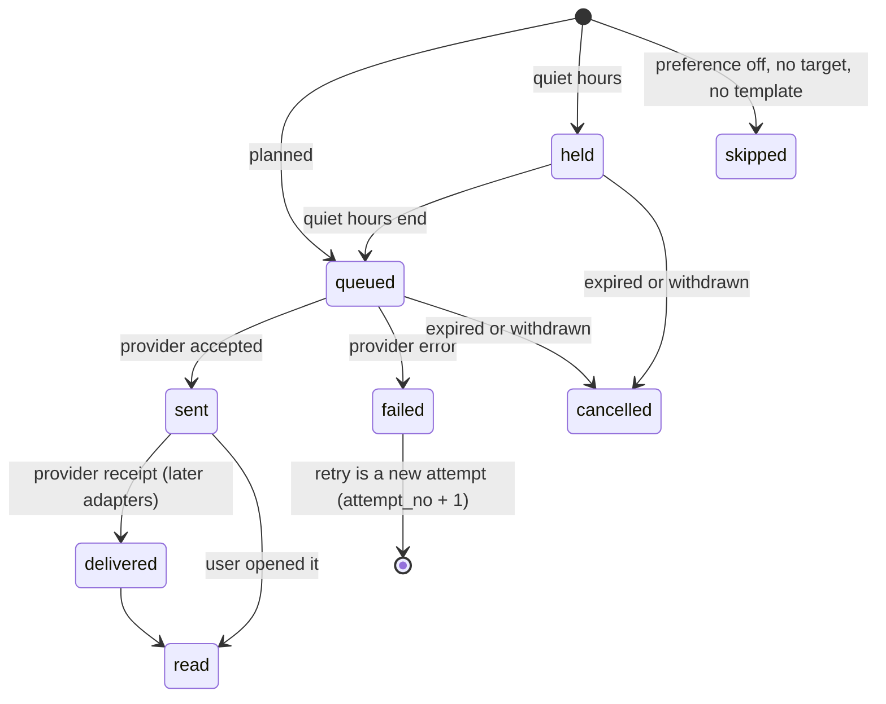

# Sprint 9 contract: Notification engine (core)

Status: v0.1 · Wave 1 · Agreed before code ([contracts README](README.md)) · Conventions: [API conventions](../02-api-conventions.md) · Data: [database design §5.12](../04-database-design.md#512-notifications) · Requirements: [analysis 09](../../analysis/09-notifications-and-communication.md) · Format: [Sprint 0 contract](../03-sprint-0-contract.md)

**Sprint goal:** one notification service that every later sprint calls with `notify(event, recipients, context)`. It resolves recipients (including guardians), applies preferences, priority and quiet hours, renders versioned rw/en/fr templates that cannot carry clinical content, and delivers through channel adapters (in-app with live updates, web push, email) with a delivery log, retries and fallbacks. Plus facility and platform announcements, and the bell, inbox, preferences and push opt-in in both apps. Only the security notifications that exist after Sprint 0 are wired now; the rest of the catalogue is wired in Wave 6 ([roadmap](../../roadmap/README.md#waves-sprints-built-in-parallel)).

Reserved names: backend app `medilink.notifications`; staff-web feature `notifications`; patient-web feature `notifications`; api-client module `notifications`; translation namespace `notifications` in both apps.


> **Orchestrator reconciliation (2026-10-18, before build):** the anchors this contract asked for are merged ([#20](https://github.com/B-Pine/medilink-rwanda/pull/20), [#21](https://github.com/B-Pine/medilink-rwanda/pull/21)): `extend_actions()` + `[SN]` blocks in `audit/actions.py`; blocks in `.env.example`, `requirements/base.in`, `DEFAULT_THROTTLE_RATES`, `core/realtime.py` and `seed_dev.DEV_SEED_COMMANDS`; `[SN imports]` blocks in the frontend registries; shell slots `headerItems`/`shellOverlays` (staff-web) and `headerItems`/`homeCards` (patient-web); PWA `importScripts`; frontend `PermissionCodes` (declaration merging, all 31 Sprint 0 codes) and `extendMockRoleGrants()`. Use them instead of the workarounds described below. Wave 1 ownership rules: [contracts README](README.md#wave-1-ownership-of-sprint-0-files).

## 1. Goal, scope, requirements

### 1.1 In scope

- **Backend:** `notify()`, recipient resolution, event registry, delivery rules (§2.5), templates and content policy (§3.1); adapters for in-app (+ WebSockets), web push and email (§3.2); delivery log, retries, fallbacks, quiet-hours release, cleanup (§5); preferences, push subscriptions, announcements, template versions, delivery log views (§3.3).
- **Security notifications** ([security 03](../../security/03-identity-authentication-sessions.md) §5): login from a new device, MFA enrolled, password changed; role changed and MFA reset are registered, their triggers arrive in S2.
- **Frontend:** staff bell, inbox, preferences, facility and platform announcement composers; patient bell, inbox, preferences, push opt-in, push-off banner, service-worker push handling (§6).

### 1.2 Deferred (and the stub S9 ships instead)

| Deferred item | Where and when | Stub in S9 |
|---|---|---|
| Catalogue events for onboarding, bookings, queue, clinical, pharmacy, documents, billing, disputes ([analysis 09](../../analysis/09-notifications-and-communication.md#4-notification-catalogue) §4) | Wave 6: each module adds its `notification_events.py` (§3.1) | Registry, test event `system.test`, security events |
| Reminders and "time to leave" jobs | S5 + Wave 6 | `reminder_offsets_minutes` stored in preferences |
| Facility notification settings (reminder timings, "you are next" threshold, announcement signature) | S2 (`/staff/facility/settings/` notifications section) | Code defaults; signature = facility name |
| Announcement audience `patients_in_range` (bookings, tickets) | S5 (bookings) and S4 (tickets) register a resolver hook | Resolver returns no one; tests use a fake resolver |
| Announcements on the waiting-room display | S4 display endpoint reads published `display` announcements | Stored, listed, withdrawable |
| "Critical can't be disabled while a ticket is active" | S4 registers the `active_ticket_check` hook | Hook returns false |
| Role changed, MFA reset triggers | S2 staff management calls `notify()` | Events and templates registered |
| Email attachments (calendar files) and document links (FR-NOT-04) | S5 (`.ics`), S7 (documents) | Email without attachments |
| Staff sounds for queue events; approvals digest job | S4, S8 + Wave 6 | Preferences stored; `playNotificationSound()` |
| Tracker wake lock, sound and vibration on call (FR-NOT-12) | S4 tracker | `useWakeLock` hook in `packages/ui` |
| Push permission prompt right after booking | S5 mounts the exported `PushOptIn` | Opt-in from banner, inbox and settings |
| Template editor and delivery dashboard screens; dispute evidence (`notification_log`) and delivery-log access for `disputes.handle` | Wave 6, S10 | Platform endpoints; staff log under `audit.view` |
| S0's password-changed email moved into a template | Wave 6, separate agreed PR (touches `accounts`) | S0 email unchanged; S9 adds the in-app notice |
| Lockout notices to the owner and facility admin ([security 03](../../security/03-identity-authentication-sessions.md) §6) | Wave 6 (needs an S0 lockout audit event) | — |
| `notifications` consent records ([analysis 12](../../analysis/12-security-privacy-and-compliance.md) §3) | Wave 6, after S3 adds the consent kind | Preference changes audited |
| Outbox-driven events | S4 adds `core_outbox_event`; Wave 6 dispatcher calls `notify()` | `notify()` uses `transaction.on_commit` |
| SMS and mobile push (FR-NOT-13, P3), WhatsApp (FR-NOT-14, P4) | Later phases | Adapter interface and channel policy (§3.2) |

### 1.3 Requirement coverage

**Fully delivered:** FR-NOT-01 (service, registry, adapters), FR-NOT-02 (inboxes, counts, live socket, cross-tab read sync), FR-NOT-05 (priorities, quiet hours, retries, fallback), FR-NOT-08 (guardians and delegates, per-dependent toggle), FR-NOT-09 (versioned rw/en/fr templates, content policy). **Partly:**

| ID | S9 delivers | Deferred part |
|---|---|---|
| FR-NOT-03 | Web push, opt-in on user action, push-off banner | Post-booking prompt (S5) |
| FR-NOT-04 | Email adapter, trilingual, neutral | Calendar files, documents |
| FR-NOT-06 | Patient and staff preferences | Facility preferences (S2) |
| FR-NOT-07 | Security notices; registry for the rest | Catalogue wiring (Wave 6) |
| FR-NOT-10 | Delivery log, retries, failure reasons | Dispute evidence (S10) |
| FR-NOT-11 | Facility and platform announcements | Patient audience (S5), display (S4) |
| FR-NOT-12 | `useWakeLock` hook only | Tracker (S4) |

Also: [security 06](../../security/06-application-and-api-security.md#8-notifications-real-time-and-background-jobs) §8, [security 02](../../security/02-security-architecture.md#4-data-residency-decisions) §4, NFR-REL-05, NFR-OPS-04, NFR-UX-01/03.

## 2. Domain model (`medilink.notifications`)

### 2.1 Tables

Common columns (`id` UUIDv7, `created_at`, `updated_at` + `version` on mutable tables) are not repeated. Changes to [database design §5.12](../04-database-design.md#512-notifications) made here (attempt statuses, preference shape, template `variant`, `notifications_known_device`) are written back to that section in the S9 pull request.

| Table | Key columns | RLS | Class | Mutability | Retention |
|---|---|---|---|---|---|
| `notifications_notification` | `recipient_user_id`, `audience` (`patient`, `staff`), `facility_id NULL`, `patient_id NULL` (who it is about), `announcement_id NULL`, `event_type varchar(60)`, `priority` (`critical`, `important`, `routine`), `template_code`, `template_version`, `variant` (`self`, `dependent`), `language`, `title varchar(120)`, `body varchar(1000)` (neutral), `action_path varchar(200) NULL` (in-app path), `data jsonb` (IDs only), `dedupe_key varchar(120)`, `is_for_today boolean`, `expires_at NULL`, `fallback_done_at NULL`, `read_at NULL`. **Unique** (`recipient_user_id`, `dedupe_key`). Index (`recipient_user_id`, `audience`, `created_at` desc); unread partial index; (`facility_id`, `created_at`); (`patient_id`, `created_at`); (`recipient_user_id`, `event_type`, `created_at`) for rate limits. | — (recipient-scoped) | C2 | Mutable (`read_at`) | R-NOT (2 years) |
| `notifications_delivery_attempt` | `notification_id`, `channel` (`in_app`, `web_push`, `email`; later `sms`, `mobile_push`, `whatsapp`), `attempt_no smallint`, `is_fallback boolean`, `push_subscription_id NULL`, `status` (§2.2), `scheduled_for`, `queued_at`, `sent_at NULL`, `finished_at NULL`, `provider_message_id NULL`, `failure_reason varchar(40) NULL` (a code: `preference_off`, `no_target`, `no_template`, `push_gone`, `provider_error`, `timeout`, `content_policy`, `expired`, `withdrawn`). Index (`notification_id`); (`status`, `scheduled_for`) where `held` or `queued`. | — | C2 | Mutable (status) | R-NOT |
| `notifications_preference` | `user_id`, `audience`, `patient_id NULL` (row for one dependent), `channels jsonb` (`{"critical": [...], "important": [...], "routine": [...]}`, values from the adapter registry), `quiet_hours_start time NULL`, `quiet_hours_end time NULL` (Africa/Kigali), `receive_alerts boolean` (dependent rows), `reminder_offsets_minutes integer[] NULL`, `sound_enabled boolean NULL`, `approvals_digest` (`immediate`, `daily`) `NULL`. **Unique** (`user_id`, `audience`, `patient_id`) `NULLS NOT DISTINCT`. Rows are created on the first change; defaults live in code. | — | C1 | Mutable | R-ACCT |
| `notifications_push_subscription` | `user_id`, `endpoint text` **unique** (https, host on the allowlist), `endpoint_host varchar(255)`, `p256dh varchar(100)`, `auth_secret varchar(40)`, `label varchar(60)` ("Chrome on Android"; no full user agent), `session_key_hash bytea NULL`, `last_success_at NULL`, `failure_count smallint`, `revoked_at NULL`, `revoked_reason` (`user`, `logout`, `gone`, `password_reset`, `replaced`, `limit`). Index (`user_id`) where not revoked. At most 10 active per user. | — | C2 | Mutable | R-ACCT; revoked rows deleted after 30 days |
| `notifications_template` | `code varchar(60)` (= event type), `channel`, `language`, `variant` (`self`, `dependent`), `template_version integer`, `subject varchar(120)` (title or email subject), `body text`, `placeholders text[]`, `is_active boolean`, `source` (`seed`, `platform`), `created_by_id NULL` (null = seed). **Unique** (`code`, `channel`, `language`, `variant`, `template_version`); **unique** (`code`, `channel`, `language`, `variant`) where `is_active`. | — | C1 | Versioned | R-MD |
| `notifications_announcement` | `facility_id NULL` (null = platform), `audience` (`patients_in_range`, `display`, `all_facilities`, `selected_facilities`), `target_facility_ids uuid[] NULL`, `range_starts_on date NULL`, `range_ends_on date NULL`, `priority` (`routine`, `important`), `title_i18n jsonb`, `body_i18n jsonb`, `status` (`draft`, `published`, `withdrawn`), `starts_at NULL`, `ends_at NULL`, `created_by_id`, `published_by_id NULL`, `published_at NULL`, `withdrawn_at NULL`, `recipient_count integer NULL`. CHECK facility rows use `patients_in_range`/`display`, platform rows `all_facilities`/`selected_facilities`; CHECK range order. Index (`facility_id`, `status`, `created_at`). | ✓ facility rows (§2.3) | C1 | State machine (light; transitions audited) | R-OPS |
| `notifications_known_device` (new) | `user_id`, `device_hash bytea` (HMAC-SHA256 of user ID + user agent with version numbers stripped), `label varchar(60)`, `last_seen_at`. **Unique** (`user_id`, `device_hash`). Used only for "login from a new device". | — | C2 | Mutable | R-TMP: deleted 180 days after `last_seen_at` |

### 2.2 States



- `in_app` attempts start as `sent` (the inbox row exists and the socket message is published on commit) and become `read` with the notification.
- `web_push` and `email` have no `delivered` in P1 (no tracking pixels; no push receipts). `delivered` is for adapters with provider receipts (SMS later).
- Announcements: `draft` → `published` (fan-out) → `withdrawn` (unsent attempts `cancelled`, inbox items flagged `is_withdrawn`). Only drafts can be edited; withdrawing a draft is refused.

### 2.3 Row-level security, access and data rules

| Table | Decision |
|---|---|
| `notifications_announcement` | `EnableFacilityRLS("announcement")` for facility rows, plus a permissive `platform_rows` policy (`USING (facility_id IS NULL) WITH CHECK (facility_id IS NULL)`) through `CreatePolicy`. Platform rows are C1 and meant for every facility; writes to them are limited by the policy layer to platform admins. Fan-out tasks run inside `rls_context(facility_id=…)`. |
| Notification, attempt, preference, push subscription, known device | User-owned, platform-wide: no facility RLS ([database design §3.5](../04-database-design.md#35-tables-without-facility-rls)), because fan-out and retry jobs work across accounts. Protected by scoped querysets only: `for_inbox(principal)` (recipient = user, audience = session audience; staff: `facility_id` null or the active facility), `for_facility_log(principal)` (`facility_id` = active facility). Cross-account and cross-facility tests are mandatory (S9-B2). |
| Template | Platform C1; written only by platform endpoints and the seed sync. |

- `title`, `body` and push/email text come only from templates and placeholder kinds (§3.1); there is no placeholder kind for diagnoses, medicines, results or service names ([security 06](../../security/06-application-and-api-security.md#8-notifications-real-time-and-background-jobs) §8).
- `data` holds IDs only (same key and value rules as audit metadata). `action_path` is built from the event definition and data IDs, starts with `/`, and never contains names or tokens.
- Celery tasks receive IDs and C0/C1 values only; logs carry notification and attempt IDs, channel, status and failure code, never titles, bodies, emails or endpoints ([security 08](../../security/08-logging-monitoring-and-detection.md) §1).

### 2.4 Audit events

| Action | When | Metadata (IDs and codes only) |
|---|---|---|
| `notifications.preferences.updated` | Patient or staff preference change | `audience`, `fields` |
| `notifications.push.subscribed` / `notifications.push.unsubscribed` | Subscription added, removed or revoked | `subscription_id`, `endpoint_host`, `reason` |
| `announcement.created` / `announcement.updated` | Draft saved | `announcement_id`, `audience` |
| `announcement.published` / `announcement.withdrawn` | State change | `announcement_id`, `audience`, `priority`, `recipient_count` |
| `notifications.template.revised` / `notifications.template.activated` | New version, rollback | `template_code`, `channel`, `language`, `template_version` |
| `notifications.deliveries.viewed` | Delivery log read filtered by patient or recipient | `filters`; `object_id` = patient or user |

(`code` is a forbidden metadata key in `audit.record()`, hence `template_code`.) Security notifications add no audit entries: their triggers are already audited by Sprint 0.

### 2.5 Delivery rules

| Rule | Behaviour |
|---|---|
| In-app | Every notification gets an inbox row and a `notification.created` socket message on commit. Never held, never disabled. |
| Channels | Primary = the event's channels ∩ the recipient's channels for that priority. Mandatory events (security notices) ignore channel preferences. A wanted channel that can't be used creates a `skipped` attempt with its reason, kept as evidence ("was the patient told?"). |
| Priority | The event's default; `notify(priority=…)` may override (e.g. "booking cancelled": critical if today). There is no marketing level. |
| Quiet hours | Patient default 21:00–06:00 Africa/Kigali, changeable or off. `web_push` and `email` attempts of `routine`, and of `important` unless `is_for_today`, are `held` until the window ends. **`critical` and mandatory events are never held.** Staff have no quiet hours. |
| De-duplication | Unique (`recipient`, `dedupe_key`). Default key from the definition (`"{type}:{id}"`); a repeat returns the existing notification and sends nothing ("max one time-to-leave per ticket"). |
| Rate limit | Per definition and recipient (default 10 per hour), counted in the database. Extra notifications are dropped and counted in logs. |
| Expiry | `expires_at` from the definition's TTL; `held`/`queued` attempts past it become `cancelled` (`expired`). |
| Retries | Retryable failures (timeout, 5xx, 429, SMTP 4xx) create attempt n+1 with backoff: critical 10 s, 30 s, 90 s; others 1, 5, 15 minutes (±20% jitter); at most 4 attempts. Not retried: push 404/410 (subscription revoked), other 4xx, `content_policy`. |
| Fallback | **critical:** when no primary interrupting attempt ends `sent` (all failed or skipped), fallback channels are queued at once. **important + `is_for_today`:** still unread 15 minutes after creation → fallback once. **routine:** none. Fallback channels = the definition's `fallback` + `CHANNEL_POLICY.extra_fallback[priority]` (S9-owned; e.g. `sms` in P3), filtered by preferences; attempts have `is_fallback = true`. |
| Guardians (FR-NOT-08) | `Recipients.patient(p)` reaches every account with an active link (`self`, `guardian`, `delegate`) to `p`; for a dependent only if that account's dependent row has `receive_alerts` (default true). Guardians get the `dependent` template variant (falls back to `self`). |
| Language | Recipient's `preferred_language`; missing template language falls back to `rw`, then `en`. |
| Delivery semantics | At least once: a crash after the provider accepted may repeat a send; the push `Topic` header limits duplicates on the device. |

## 3. Interfaces

### 3.1 Internal service API (what later sprints call)

```python
# medilink/notifications/service.py
def notify(
    event: str,                                  # registered event type, e.g. "account.login.new_device"
    recipients: RecipientSpec | Sequence[RecipientSpec],
    context: Mapping[str, object],               # placeholder values + data IDs, checked against the definition
    *,
    facility_id: UUID | None = None,             # owning facility: staff inbox scope, facility delivery log
    patient_id: UUID | None = None,              # who it is about: guardians, `dependent` variant
    priority: Priority | None = None,            # override the definition's default
    is_for_today: bool = False,                  # important: bypasses quiet hours, enables unread fallback
    channels: Sequence[str] | None = None,       # narrow the definition's channels for this call
    dedupe_key: str | None = None,               # override the definition's key format
) -> NotifyResult: ...                           # NotifyResult(created: list[UUID], duplicates: int, rate_limited: int)

notify_async(...)                                # same signature; Celery fan-out in batches of 200 (context: IDs, C0/C1 only)

class Recipients:                                # RecipientSpec factories
    users(*user_ids, audience: Literal["patient", "staff"] | None = None)   # None = the event's audience
    patient(patient_id)                          # self + guardians + delegates (§2.5)
    facility_staff(facility_id, *, permission: str | None = None, roles: Iterable[str] = ())
    platform_admins()
```

- Call it **inside the caller's transaction**; it raises `NotifyError` outside an atomic block. It writes the notification and attempt rows; socket messages and sends happen on commit, so a rolled-back business action notifies no one.
- It never raises for delivery problems. It raises `NotifyError` for programming errors only: unknown event, undeclared context key, non-ID value in data, placeholder kind not allowed for a channel. Use `notify_async` above 200 recipients.

**Event registry.** Each app declares its events in `medilink/<app>/notification_events.py` (`EVENTS: list[EventDefinition]`), autodiscovered in `NotificationsConfig.ready()`. Later sprints add events and default templates **without editing S9 files**. S9's own events (security, announcements, `system.test`) live in `medilink/notifications/notification_events.py`.

```python
@dataclass(frozen=True)
class EventDefinition:
    type: str                                    # "<domain>.<subject>.<fact>", lowercase snake segments, ≤ 60 chars
    audience: Literal["patient", "staff", "account"]   # account = staff inbox if the user is staff, else patient
    priority: Priority                           # default level (analysis 09 §3)
    channels: tuple[str, ...]                    # primary channels from analysis 09 §4; in_app is implied
    fallback: tuple[str, ...] = ()
    placeholders: Mapping[str, Placeholder] = {} # name -> kind
    data_keys: frozenset[str] = frozenset()      # IDs copied into `data`
    action_path: str = "/notifications/{id}"     # in-app path; "{…}" only from data keys
    dedupe: str = "{type}:{id}"
    rate_limit: tuple[int, timedelta] = (10, timedelta(hours=1))
    ttl: timedelta | None = None
    mandatory: bool = False                      # security notices: ignore channel preferences and quiet hours
    templates: Mapping[tuple[str, str, str], Text] = {}   # (channel, language, variant) -> default subject/body
```

- **Naming:** the first segment is the owning domain (`account`, `announcement`, `booking`, `ticket`, `prescription`, `document`, `bill`, `dispute`, `facility_application`, `system`); the rest states the fact: `account.password.changed`, `booking.reminder.due`, `ticket.call.made`. The template `code` equals the event type.
- **Placeholder kinds** (data class C0–C2 only): `FACILITY_NAME`, `DATE`, `TIME` (formatted in Africa/Kigali per language), `COUNT`, `TICKET_NUMBER`, `ROOM`, `DEVICE_LABEL`, `PERSON_NAME` (never in `web_push`: lock screens on shared phones), `ANNOUNCEMENT_TITLE`, `ANNOUNCEMENT_TEXT` (checked at publish). No kind exists for diagnoses, medicines, results or service names.
- **Templates:** `string.Template` syntax (`$facility_name`), no attribute access, no HTML. Defaults are synced on `post_migrate` as version 1 for every missing (code, channel, language, variant); rows edited by platform admins are never overwritten. Kinyarwanda defaults are marked for native-speaker review in the PR. Length limits come from the adapter (in-app title 120 / body 500; push title 60 / body 160; email subject 120 / body 4,000).
- **Content policy** (`content_policy.py`): a word-boundary, case- and accent-insensitive denylist of clinical terms per language (e.g. en `diagnosis`, `HIV`, `tuberculosis`, `pregnancy`, `mental health`; fr `diagnostic`, `VIH`, `SIDA`, `grossesse`; rw `SIDA`, `igituntu`, `kanseri`; list reviewed by a clinician and a native speaker), plus "no URLs" for announcements (phishing). Checked at seed sync (system check), template revision, announcement save and publish, and again on every render: a hit fails the attempt with `content_policy` and logs the event without the text.
- **System checks:** `notifications.E001` event without an active template for each channel × language; `E002` placeholder kind not allowed for a channel; `E003` duplicate event type; `E004` denylisted term in a template.
- **Hooks for later sprints** (`hooks.py`): `register_audience_resolver("patients_in_range", fn)` (S5, S4) and `register_active_ticket_check(fn)` (S4).

**Events wired in S9** (observers in `observers.py`; no Sprint 0 file changes):

| Event | Trigger (Sprint 0 code) | Priority · channels | Notes |
|---|---|---|---|
| `account.login.new_device` | Django `user_logged_in` signal (staff after MFA, patient login) → known-device check | important · in_app, email · mandatory | First-ever device (sign-up) does not notify; same device again does not notify; rate 5 per hour |
| `account.mfa.enrolled` | `AuditEntry` saved with `auth.mfa.enrolled` | important · in_app, email · mandatory | |
| `account.password.changed` | `AuditEntry` saved with `auth.password_reset.completed` | important · in_app · mandatory | S0 already emails; also revokes all push subscriptions of the user |
| `account.mfa.reset`, `account.role.changed` | Called by S2 | important · in_app, email · mandatory | Registered and tested via `notify()` |
| `announcement.facility.published` | Facility publish (§3.3) | announcement's priority · in_app, web_push, email | Recipients from the audience resolver |
| `announcement.platform.published` | Platform publish | announcement's priority · in_app for all active members; in_app + email for facility admins | One notification per person (the fan-out partitions recipients, so the dedupe key never swallows the admins' email) |
| `system.test` | `manage.py send_test_notification` (refused unless `DEBUG` or `NOTIFICATIONS_ALLOW_TEST_SEND`) | routine · in_app, web_push, email | For integration checks |

A `user_logged_out` receiver revokes the push subscriptions bound to that patient session (`logout`, shared phones). Observers only register `transaction.on_commit` → Celery task with IDs; they never raise into the login, logout or audit flow.

### 3.2 Channel adapters

```python
class ChannelAdapter(Protocol):
    channel: ClassVar[str]                 # "in_app" | "web_push" | "email"; later "sms", "mobile_push", "whatsapp"
    interrupts: ClassVar[bool]             # True = subject to quiet hours (False for in_app)
    limits: ClassVar[TextLimits]           # checked when a template is saved

    def targets(self, notification: Notification) -> list[Target]: ...      # [] -> attempt skipped (no_target)
    def render(self, notification: Notification, template: Template) -> Message: ...  # substitution + content policy
    def send(self, message: Message, target: Target) -> SendResult: ...      # never raises for provider errors; ≤ 10 s

# SendResult(status: "sent" | "delivered" | "failed", retryable=False, failure_reason=None (a code, never provider text),
#            provider_message_id=None, revoke_target=False (e.g. push 404/410))
```

Adapters register in `medilink/notifications/channels/`. **Adding SMS or WhatsApp later = one adapter module + templates for that channel + a `CHANNEL_POLICY` entry; no feature code changes** ([ADR 0002](../../decisions/0002-web-first-paid-channels-later.md)). Provider receipts (SMS) will update `delivered` through a signed webhook ([security 06](../../security/06-application-and-api-security.md) §3).

| Adapter | Targets | Sending |
|---|---|---|
| `in_app` | The recipient | Row + `group_send` of `notification.created` to `notifications.<audience>.<user_id>` on commit |
| `web_push` | Each active push subscription | `pywebpush`: payload encrypted (aes128gcm, RFC 8291), VAPID JWT (RFC 8292) from settings; `TTL` = time to expiry (max 24 h); `Urgency` high / normal / low by priority; `Topic` = hash of the dedupe key. Payload ≤ 3 KB: `{"v": 1, "id", "title", "body", "url": "/notifications/<id>", "tag", "priority"}`. Endpoint host re-checked against the allowlist before every send; through `WEB_PUSH_PROXY_URL` when set; redirects not followed. 404/410 → subscription revoked (`gone`). |
| `email` | The account's email | Django `MAILERS` (Mailpit in dev): plain text + HTML from our own Django template (autoescape), in the recipient's language; link to `PATIENT_APP_URL` or `STAFF_APP_URL` + `/notifications/<id>`; no attachments, no tracking pixels ([security 02](../../security/02-security-architecture.md#4-data-residency-decisions) §4) |

**Push endpoint allowlist (SSRF control):** accepted only if the URL is `https`, has no user info, port 443 or none, a DNS host (no IP literal) that equals an allowlisted host or ends with `.` + a `*.` entry, and ≤ 2,048 characters. Default `WEB_PUSH_ALLOWED_HOSTS`: `fcm.googleapis.com`, `updates.push.services.mozilla.com`, `*.push.apple.com`, `*.notify.windows.com`.

**Configuration** (read in `medilink/notifications/conf.py` from the environment, overridable in tests): `WEB_PUSH_VAPID_PUBLIC_KEY`, `WEB_PUSH_VAPID_PRIVATE_KEY` (key store in production, yearly rotation, [security 05](../../security/05-data-protection-and-cryptography.md) §5), `WEB_PUSH_VAPID_SUBJECT` (`mailto:`), `WEB_PUSH_ALLOWED_HOSTS`, `WEB_PUSH_PROXY_URL`, `NOTIFICATIONS_DEFAULT_QUIET_HOURS` (`21:00-06:00`), `NOTIFICATIONS_ALLOW_TEST_SEND`. `manage.py generate_vapid_keys` prints a key pair for `.env`. Without keys, push is disabled (`is_enabled: false`) with warning `notifications.W001`; `check --deploy` fails (`notifications.E010`) without keys or with an IP or bare `*` in the allowlist.

### 3.3 REST endpoints

All follow [API conventions](../02-api-conventions.md): error envelope, pagination (25, max 100), `snake_case`, UTC timestamps. Rate-limit class is the S0 `burst` unless noted. `Idempotency-Key` is not used: Sprint 0 has no idempotency store, and every S9 action is idempotent by state (publish twice → `409`, read twice → same result, same push endpoint → same row).

```jsonc
// Notification (both inboxes); `data` holds IDs only
{ "id": "uuid", "event_type": "account.login.new_device", "priority": "important", "language": "en",
  "title": "New sign-in to your MediLink account", "body": "We noticed a sign-in from Chrome on Android on 18/10/2026 at 09:12. …",
  "action_path": "/notifications/uuid", "patient_id": null, "facility": { "id": "uuid", "name": "Kigali Clinic" } | null,
  "data": { "announcement_id": "uuid" }, "is_read": false, "read_at": null, "is_withdrawn": false, "created_at": "2026-10-18T07:12:00Z" }
// UnreadCount: { "unread": 3 }; staff adds "other_facilities": [{ "facility_id": "uuid", "unread": 1 }]
// PatientNotificationPreferences (version 0 = defaults, nothing saved yet)
{ "language": "rw", "available_channels": ["web_push", "email"],          // from the adapter registry; in_app is always on
  "channels": { "critical": ["web_push", "email"], "important": ["web_push", "email"], "routine": ["web_push", "email"] },
  "quiet_hours": { "is_enabled": true, "start": "21:00", "end": "06:00" }, // Africa/Kigali
  "reminder_offsets_minutes": [1440, 120],                                  // stored; used from S5
  "dependents": [ { "patient_id": "uuid", "display_name": "Keza", "relationship": "guardian", "receive_alerts": true } ],
  "is_critical_locked": false, "version": 0 }                              // locked while a ticket is active (S4 hook)
// StaffNotificationPreferences
{ "language": "en", "sound_enabled": false, "approvals_digest": "immediate", "version": 0 }
// PushSubscriptionRequest (PushSubscription.toJSON() in snake_case) → PushSubscription
{ "endpoint": "https://fcm.googleapis.com/fcm/send/…", "expiration_time": null, "keys": { "p256dh": "base64url", "auth": "base64url" } }
{ "id": "uuid", "label": "Chrome on Android", "endpoint_host": "fcm.googleapis.com", "created_at": "…", "last_success_at": null }
// Announcement: facility audiences patients_in_range | display; platform audiences all_facilities | selected_facilities
{ "id": "uuid", "facility_id": "uuid" | null, "audience": "patients_in_range", "target_facility_ids": null,
  "range_starts_on": "2026-10-23", "range_ends_on": "2026-10-23", "priority": "important",       // routine | important
  "title_i18n": { "rw": "…", "en": "Pediatrics closed Friday afternoon", "fr": "…" },             // ≤ 120 chars each
  "body_i18n": { "rw": "…", "en": "…", "fr": "…" },  // ≤ 1,000 chars; at least one language; no URLs, no clinical terms
  "starts_at": "2026-10-23T10:00:00Z", "ends_at": "2026-10-23T16:00:00Z", "status": "draft", "recipient_count": null,
  "created_by": { "id": "uuid", "full_name": "Uwase Aline" }, "published_at": null, "withdrawn_at": null, "version": 1, "created_at": "…" }
// DeliveryLogEntry
{ "notification_id": "uuid", "event_type": "announcement.facility.published", "priority": "important", "recipient_user_id": "uuid",
  "patient_id": "uuid" | null, "template": { "code": "…", "version": 1, "language": "rw" }, "title": "…", "created_at": "…", "read_at": null,
  "attempts": [ { "channel": "web_push", "attempt_no": 1, "is_fallback": false, "status": "failed", "failure_reason": "push_gone", "queued_at": "…", "sent_at": null } ] }
// NotificationTemplate
{ "id": "uuid", "code": "account.login.new_device", "channel": "email", "language": "fr", "variant": "self", "template_version": 2,
  "subject": "…", "body": "… $device_label …", "placeholders": ["device_label", "time"], "allowed_placeholders": ["device_label", "date", "time"],
  "limits": { "subject": 120, "body": 4000 }, "is_active": true, "source": "platform", "created_by": { "id": "uuid", "full_name": "…" } | null, "created_at": "…" }
// DeliveryStats
{ "since": "…", "by_channel": [ { "channel": "web_push", "sent": 812, "failed": 23, "skipped": 140, "held": 4, "cancelled": 0 } ],
  "failure_reasons": [ { "reason": "push_gone", "count": 19 } ], "push_opt_in": { "patient_accounts": 1200, "with_active_subscription": 310 } }
```

**Public**

| Method & path | Request → success | Permission | Errors | Notes |
|---|---|---|---|---|
| `GET /api/v1/public/web-push-key/` | → `200 {"public_key": "base64url" \| null, "is_enabled": true}` | Public | — | FR-NOT-03 |

**Patient** (`IsPatientAuthenticated`; paths under `/api/v1/patient/`)

| Method & path | Request → success | Errors | Notes |
|---|---|---|---|
| `GET notifications/` | `?is_read=`, `?patient_id=` (a linked profile) → page of `Notification`, newest first | 401, 404 (`patient_id` not linked) | FR-NOT-02, 08 |
| `GET notifications/{id}/` | → `Notification` | 404 (not own) | Push click target |
| `GET notifications/unread-count/` | → `UnreadCount` | 401 | Bell |
| `POST notifications/{id}/read/` | → `200 Notification`; attempts → `read`; socket `notification.read` | 404 | Idempotent |
| `POST notifications/read-all/` | `{"before": "…"}` (optional) → `200 {"marked": 5}` | 400 | Idempotent |
| `GET notification-preferences/` | → `PatientNotificationPreferences` | 401 | FR-NOT-05, 06 |
| `PATCH notification-preferences/` | Partial + `version` → `200` | 400, 409, 422 (`business_rule_violation`: critical locked) | Ver; Audit; `language` updates `User.preferred_language` |
| `GET push-subscriptions/` | → active `PushSubscription` list (own) | 401 | |
| `POST push-subscriptions/` | `PushSubscriptionRequest` → `201` (`200` if already yours). An endpoint held by another account moves to you (old row `replaced`, shared phones); an 11th active subscription revokes the oldest (`limit`). | 400 (host not allowlisted, not https, invalid keys), 429 | RL: 20 per hour per account; Audit; FR-NOT-03 |
| `DELETE push-subscriptions/{id}/` | → `204` | 404 | Audit |

**Staff** (`IsStaffAuthenticated`, MFA complete; paths under `/api/v1/staff/`)

| Method & path | Request → success | Permission | Errors | Notes |
|---|---|---|---|---|
| `GET notifications/`, `GET notifications/{id}/`, `GET notifications/unread-count/`, `POST notifications/{id}/read/`, `POST notifications/read-all/` | As for patients; scope: `audience = staff` and `facility_id` null or the active facility; count adds `other_facilities` | Staff session | 401, 404 | FR-NOT-02 |
| `GET`, `PATCH notification-preferences/` | `StaffNotificationPreferences` (Ver) | Staff session | 400, 409 | FR-NOT-06; Audit |
| `GET announcements/` | `?status=` → page of `Announcement` (active facility) | `announcements.manage` | 403 | FR-NOT-11 |
| `POST announcements/` | Facility audiences → `201` draft | `announcements.manage` | 400 | Audit |
| `GET announcements/{id}/` | → `Announcement` | `announcements.manage` | 404 | |
| `PATCH announcements/{id}/` | Draft only + `version` → `200` | `announcements.manage` | 400, 409, 422 (not a draft) | Ver; Audit |
| `POST announcements/{id}/publish/` | → `200` (`published`); fan-out runs async, `recipient_count` filled when done | `announcements.manage` | 400 (content), 409 (not a draft), 429 (10 per facility per day) | Audit |
| `POST announcements/{id}/withdraw/` | → `200` (`withdrawn`); unsent attempts cancelled; `notification.updated` | `announcements.manage` | 422 (not published) | Audit |
| `GET notification-deliveries/` | `?patient_id`, `?announcement_id`, `?event_type`, `?status`, `?since` → page of `DeliveryLogEntry` for the active facility | `audit.view` (S10 adds `disputes.handle`) | 403 | FR-NOT-10; read-only; Audit when filtered by patient |

**Platform** (`IsPlatformAdmin`; paths under `/api/v1/platform/`)

| Method & path | Request → success | Errors | Notes |
|---|---|---|---|
| `GET`, `POST announcements/`; `GET`, `PATCH announcements/{id}/`; `POST announcements/{id}/publish/`; `POST announcements/{id}/withdraw/` | As for facility announcements, with platform audiences; `selected_facilities` needs 1–200 `target_facility_ids` | 400, 404 (unknown facility), 409, 422 | FR-NOT-11; Audit |
| `GET notification-templates/` | `?code`, `?channel`, `?language`, `?is_active` (default true) → page of `NotificationTemplate` | — | FR-NOT-09 |
| `GET notification-templates/{id}/` | Any version → `NotificationTemplate` | 404 | |
| `POST notification-templates/{id}/revise/` | `{"subject", "body", "based_on_version"}` → `201` new active version | 400 (unknown placeholder, kind not allowed for the channel, clinical term, too long), 409 (not the latest version) | Replaces the catalogue's `PATCH`; Audit |
| `POST notification-templates/{id}/activate/` | → `200` (rollback to this version) | 404, 409 | Audit |
| `GET notification-deliveries/` | `?recipient_user_id`, `?event_type`, `?channel`, `?status`, `?since` → page of `DeliveryLogEntry` | — | FR-NOT-10; Audit when filtered by recipient |
| `GET notification-deliveries/stats/` | `?since` (default 24 h) → `DeliveryStats` | — | NFR-OPS-04 |

**Totals:** 37 endpoints (public 1, patient 10, staff 14, platform 12) and 2 WebSocket routes. Compared with the [catalogue](../../api/catalogue.md#s9--notifications), S9 adds the two detail `GET`s, `GET push-subscriptions/`, announcement detail and edit, `stats/`, and turns template `PATCH` into `revise/` + `activate/`; the builder updates the catalogue's S9 section in the same pull request.

### 3.4 WebSockets

| Path | Server → client (`{type, data, sent_at}`) | Client → server | Close codes |
|---|---|---|---|
| `/ws/v1/patient/notifications/` | `notification.created` `{id, priority, patient_id}` · `notification.read` `{ids}` or `{all: true}` · `notification.updated` `{id}` | `ping` → `pong` | `4401` not authenticated or session revoked; `4429` more than 30 client messages per minute |
| `/ws/v1/staff/notifications/` | Same, with `facility_id` in `notification.created` | `ping` → `pong` | Same |

Origin-validated and cookie-authenticated by the existing Sprint 0 stack (`core/realtime.py`). Consumers join `notifications.<audience>.<user_id>`, the session group and `user.<user_id>` (so S0 logout and password reset close them). Messages carry IDs only (notify-then-fetch); the client fetches through REST.

## 4. Permissions

| Code | Meaning | Granted to | Used by |
|---|---|---|---|
| `announcements.manage` (new) | Write, publish and withdraw facility announcements | `facility_admin` | `/staff/announcements/…`, staff nav item |
| `audit.view` (existing) | Facility delivery log ("was the patient told?") | `facility_admin` | `/staff/notification-deliveries/` |
| Platform admin flag (existing) | Platform announcements, templates, platform delivery log | Super admins | `IsPlatformAdmin` |
| Audience session only | Own inbox, preferences, push subscriptions | Every patient / every staff member | `IsPatientAuthenticated`, `IsStaffAuthenticated` |

`medilink/notifications/permissions.py` exports `PERMISSIONS = {"announcements.manage": "Write, publish and withdraw facility announcements"}` and `ROLE_GRANTS = {"facility_admin": frozenset({"announcements.manage"})}`; a data migration in `notifications` seeds both, and `extend()` registers them in the `[S9]` block of `authz/catalogue.py` (`tests/test_roles_seed.py` checks they agree). A separate code (rather than `facility.configure`, as the catalogue proposed) lets a facility later let reception post closures without settings rights. The authorisation test matrix covers every endpoint in §3.3.

## 5. Background jobs

All tasks: JSON arguments (IDs only), time limits, `acks_late`, no result backend ([security 06](../../security/06-application-and-api-security.md#8-notifications-real-time-and-background-jobs) §8). The periodic schedule is added to `celery_app.conf.beat_schedule` from `NotificationsConfig.ready()`, so `config/celery.py` is untouched; run `celery -A config beat` next to the worker. In dev tasks run inline (`CELERY_TASK_ALWAYS_EAGER`), and `manage.py notifications_tick` runs every periodic task once (dev, tests, end-to-end).

| Task | Trigger | Does | Limits |
|---|---|---|---|
| `notifications.send_attempt(attempt_id)` | On commit of `notify()`; `dispatch_due` | Locks the attempt (`SELECT … FOR UPDATE SKIP LOCKED`, status must be `queued`), sends through the adapter, records the result, schedules the retry or the critical fallback | 30 s |
| `notifications.dispatch_due()` | Beat, every 10 s | `held` → `queued` when quiet hours end; enqueues `queued` attempts whose `scheduled_for` passed (retries, releases, tasks lost for over 2 minutes); cancels expired ones | Batches of 500 |
| `notifications.unread_fallback()` | Beat, every 60 s | `important` + `is_for_today`, unread 15 minutes after creation → fallback channels once (`fallback_done_at`) | Batches of 500 |
| `notifications.fan_out(…)` | `notify_async()`; announcement publish | Resolves the audience in batches of 200 and calls `notify()` per batch, each in its own transaction (re-runnable: the dedupe key makes repeats no-ops); sets `recipient_count` | 120 s per batch |
| `notifications.observe_login(user_id, audience, device_hash, label)` | `user_logged_in`, on commit | Known-device upsert; a new device of an account that already had one → `account.login.new_device` | 30 s |
| `notifications.observe_audit_entry(entry_id)` | `AuditEntry` `post_save`, on commit | `auth.mfa.enrolled` → `account.mfa.enrolled`; `auth.password_reset.completed` → `account.password.changed` + revoke push subscriptions (`password_reset`) | 30 s |
| `notifications.cleanup()` | Beat, daily 02:30 Africa/Kigali | Deletes notifications and attempts older than 2 years (R-NOT), revoked subscriptions after 30 days, known devices unseen for 180 days; logs counts only | 10 min |

Structured log line `notifications.attempt` (event type, channel, status, failure code; no personal data) feeds delivery monitoring (NFR-OPS-04); alert rules come with S11.

## 6. Frontend

Design references: [design 04](../../design/research/04-dashboards.md) §2 (bell with count, links straight to the item) and §5 (sounds off by default at reception), [design 07](../../design/research/07-patient-app-pages.md) §2 (header bell), §3.1 (push-off banner), §4 (states), [design 03](../../design/research/03-typography-icons-layout.md) §5 (motion, reduced motion), [design 10](../../design/research/10-accessibility-and-localization.md) (live regions, targets, plurals). Every screen has empty, loading (skeleton), error-with-retry and offline states.

### 6.1 staff-web (`src/features/notifications/`)

| Route / mount | Screen | Rules |
|---|---|---|
| Header (new `[S9]` block in `AppShell`) | `NotificationBell`: the existing `Menu` with a bell trigger and `CountBadge` ("99+"); latest 10 (unread marked), "Mark all as read", "See all", "Other facilities: N unread" | Accessible name "Notifications, N unread" (ICU plural); polite live region for new items; live via socket, polling the count every 60 s while disconnected; optional sound: a short Web Audio tone (no asset), only when `sound_enabled` and after a user gesture unlocked audio (`playNotificationSound()`, reused by S4) |
| `/notifications` | Inbox: All / Unread, pages of 25, mark read, open `action_path` | Active facility + facility-less items |
| `/notifications/settings` | Sound on/off with "Play test sound", approvals digest (shown with `billing.approve`), language | `409` → reload message, values kept |
| `/announcements`, `/announcements/new`, `/announcements/:id` | List with status badges; composer: audience (patients with visits in a date range / display screen), date range, priority, rw/en/fr tabs with character counters and a missing-language warning, preview; Save draft, Publish (inline confirm), Withdraw | Nav item `announcements` (facility group, `announcements.manage`); server field errors (clinical words, URLs) shown inline |
| `/platform/announcements` (+ `/new`, `/:id`) | Same composer with "All facilities"; "Selected facilities" picker after S1 merges (S9-I3) | Nav item `platformAnnouncements` (platform group, super admins) |

### 6.2 patient-web (`src/features/notifications/`)

| Route / mount | Screen | Rules |
|---|---|---|
| Header of logged-in pages (new `[S9]` block) | Bell link to `/notifications` with `CountBadge` | 48 px target; label with count |
| Home (new `[S9]` block) | `PushOffBanner`: "Turn on alerts so we can tell you when to leave" | Shown when push is supported but off; dismissible for 7 days (UI flag in `localStorage`, no personal data) |
| `/notifications` | Inbox cards (title, body, local time, "About Keza" chip for dependents), Mark all as read, push-off banner, empty state with "Turn on alerts" | 18 px body, 48 px targets |
| `/notifications/:id` | Detail; marks read; action button to `action_path` | Push click target |
| `/notifications/settings` | Language; channels per level as a checkbox grid (in-app shown as always on); quiet hours (`Switch` + two time fields, default 21:00–06:00); dependents' alerts (`Switch` each); push on this browser (status, Turn on / Turn off, iOS hint); other browsers (remove) | Explains a locked critical level |
| Exported `PushOptIn` | Explains why, then calls `Notification.requestPermission()` **only on a button press**; subscribes with the key from `/public/web-push-key/`; posts the subscription | Hidden when `is_enabled` is false; iOS Safari not installed → "Add to Home Screen" steps (iOS 16.4+); S5 mounts it after booking |

Push client (`pushClient.ts`): on app start, if permission is granted, re-posts the current subscription (idempotent) and re-subscribes when the VAPID key changed; "Turn off" unsubscribes the browser and deletes the row. With `VITE_USE_MOCKS=true` a fake client returns an allowlisted mock endpoint (MSW owns the service worker in mock mode).

Service worker: `public/push-sw.js` (S9-owned), loaded by the generated Workbox worker through `importScripts` (new `[S9]` block in `pwa.config.ts`). `push`: parse the JSON payload and `showNotification(title, {body, tag, lang, data: {url}, icon, badge})`, with `requireInteraction` and `renotify` for `critical`. `notificationclick`: focus an open window or open `url` only if it is a same-origin path under `/notifications/`. `pushsubscriptionchange`: nothing to fetch; the app re-syncs on next start. The worker makes no requests and caches nothing; the existing `/api/` NetworkOnly rule and `pwa.test.ts` stay green ([security 06](../../security/06-application-and-api-security.md) §6).

### 6.3 Shared packages

- **`packages/ui`** (one file each, exported in the `[S9]` block): `CountBadge` (numeric pill, hidden at 0, `aria-hidden` because the control's label carries the count), `Switch` (`role="switch"`, label and description; S2 reuses it), `useWakeLock` (FR-NOT-12 groundwork: feature-detects `navigator.wakeLock`, re-acquires on `visibilitychange`, releases on unmount; S4's tracker uses it).
- **api-client** `src/features/notifications.ts`: paths, types for every schema in §3.3, `createNotificationsApi(client)` → `{ public, patient, staff, platform }` groups, and `connectNotificationSocket({ baseUrl, audience, onMessage, onStatus })` (http→ws URL, `ping` every 25 s, reconnect with backoff 1 s → 30 s and jitter, refetch the count after reconnect, returns `close()`). S4 may later promote the socket helper to a shared module in an agreed PR.
- **MSW** `src/mocks/features/notifications.ts` (factory receiving `MockContext`): in-memory inboxes seeded per mock user (a new-device notice, a platform announcement for staff, a facility announcement for the patient), preferences, subscriptions, announcements and templates; every §3.3 endpoint with the same rules (CSRF via `csrfFailure`, sessions via `authenticatedStaff`/`authenticatedPatient`, `announcements.manage`, `401/403/404/409/422/400` envelopes, the push host allowlist); an MSW `ws.link` handler for both socket paths that emits `notification.created` when the mock creates an item, plus `emitMockNotification()` for tests; `reset()` between tests.
- **i18n:** namespace `notifications` in both apps (`locales/{rw,en,fr}.json`), ICU plurals for counts, nav labels at `notifications.nav.announcements` and `notifications.nav.platformAnnouncements`; Kinyarwanda strings marked for native review.

## 7. Integration points

**Existing `[S9]` blocks** ([shared-file protocol](README.md#shared-file-protocol-parallel-sprints)):

| File | What goes between the `[S9]` markers |
|---|---|
| `backend/config/settings/base.py` (`INSTALLED_APPS`) | `"medilink.notifications",` |
| `backend/config/urls.py` (`api_v1`) | `path("public/", include("medilink.notifications.urls.public")),` and the same for `patient/`, `staff/`, `platform/` (four lines; each module holds only S9 paths) |
| `backend/medilink/authz/catalogue.py` | `from medilink.notifications import permissions as _s9  # noqa: E402` and `extend(_s9.PERMISSIONS, _s9.ROLE_GRANTS)` |
| `backend/CHANGELOG.md`, `frontend/CHANGELOG.md` | Bullets under the S9 heading |
| staff-web and patient-web `src/app/features.ts` | The feature's `FeatureRoutes` entry (staff: `shell` routes; patient: `patient` routes) |
| staff-web `src/layout/navigation.ts` | `announcements` (facility group, `announcements.manage`) and `platformAnnouncements` (platform group) with `labelKey` in the `notifications` namespace |
| staff-web and patient-web `src/i18n/features.ts` | `notifications: { rw, en, fr }` |
| api-client `src/index.ts` · `src/endpoints.ts` · `src/mocks/features.ts` | `export * from "./features/notifications";` · `notifications: createNotificationsApi(client),` · the mock factory |
| `packages/ui/src/index.ts` | `CountBadge`, `Switch`, `useWakeLock` |

**New blocks this contract needs.** They are not on `main` yet. The orchestrator adds them empty (with `[S1]`/`[S3]` blocks where those sprints need the same) in one anchor PR before the builders start, as in #20. A builder who finds one missing stops and asks; nobody edits outside a block.

| File | Proposed `[S9]` block | Why |
|---|---|---|
| `backend/medilink/audit/actions.py` | Constants and `ACTIONS` entries for §2.4 | `record()` refuses unknown actions |
| `backend/medilink/core/realtime.py` | In `build_websocket_application()`: `from medilink.notifications.routing import websocket_urlpatterns as s9_ws` and add them to the router (function-level import avoids an import cycle) | Socket routes (§3.4) |
| `backend/requirements/base.in` | `pywebpush>=2.0` (brings `py-vapid`, `http-ece`, `cryptography`); lock files are regenerated after rebasing, never hand-merged | Web push |
| `backend/.env.example` | The variables of §3.2 | Configuration |
| TS registry files: `src/app/features.ts` and `src/i18n/features.ts` (both apps), api-client `src/endpoints.ts` and `src/mocks/features.ts` | A top-of-file `// [S9]` block for import lines (the existing blocks sit inside arrays and objects, where imports can't go) | Imports |
| api-client `src/types.ts` (`PermissionCode`) | `\| "announcements.manage"` | Typed nav check |
| api-client `src/mocks/data.ts` (`ROLE_PERMISSIONS.facility_admin`) | `"announcements.manage",` | Mock `StaffMe` includes the code |
| staff-web `src/layout/AppShell.tsx` | Header, before `<UserMenu>`: `<NotificationBell me={me} />` | Bell |
| patient-web logged-in header (`src/pages/HomePage.tsx` today, or the patient layout if S3 introduces one) | Header: `<NotificationBellLink />`; main: `<PushOffBanner />` | Bell, banner |
| patient-web `pwa.config.ts` | `importScripts: ["push-sw.js"]` in `workbox` | Push in the service worker |

Docs changed by the S9 pull request (S9-only sections): the [catalogue](../../api/catalogue.md#s9--notifications) S9 section (statuses and the endpoint changes listed in §3.3) and [database design §5.12](../04-database-design.md#512-notifications).

## 8. Dependencies and stubs

Wave 1 rule: S1 and S3 don't import `medilink.notifications`, and S9 imports neither; their notifications are wired in Wave 6. Later sprints plug in through the hooks and registry of §3.1 (see §1.2).

| Sprint | What S9 needs or offers | Until it merges | After |
|---|---|---|---|
| S1 | Platform facility list for "selected facilities"; drug catalogue for the denylist; S1 events (application submitted, changes requested). S9 owns the staff-web route `/platform/announcements`, so S1 must not add a `/platform/*` catch-all | Composer offers "All facilities"; API accepts IDs; static denylist | S9-I3; Wave 6 adds drug names and wires the events |
| S3 | Dependents and delegates (S0's `PatientLink` already has `guardian` and `delegate`); a patient layout; the `notifications` consent kind | Resolution uses S0 models; bell block in `HomePage` | Bell moves to S3's layout if any; consent records in Wave 6 |

## 9. Acceptance checks

### Backend

| # | Check | Source |
|---|---|---|
| S9-B1 | Every endpoint in §3.3 exists with the documented schema, errors and permission, and is in the regenerated OpenAPI schema (`spectacular --validate --fail-on-warn`) | architecture 02 |
| S9-B2 | Authorisation matrix for every endpoint (anonymous, patient, staff without and with the permission, platform admin); nobody reads another account's notification, preference or subscription (404); staff inbox and delivery log show only the active facility (plus facility-less items); facility A never sees B's announcements, also under RLS as the app role | security 04, FR-NOT-02 |
| S9-B3 | `notify()` contract: unknown event, undeclared context key, non-ID data, `PERSON_NAME` in a push template, or a call outside a transaction → `NotifyError`; a caller rollback leaves no rows, no socket message and no send | FR-NOT-01 |
| S9-B4 | `Recipients.patient` reaches self, guardian and delegate accounts with active links; revoked links and `receive_alerts = false` are excluded; guardians get the `dependent` variant (or `self`); `facility_staff(permission=…)` honours memberships and roles | FR-NOT-08 |
| S9-B5 | The same dedupe key twice → one notification, one send; the sixth new-device notice within an hour is dropped | analysis 09 §7 |
| S9-B6 | Quiet hours (frozen clock, Africa/Kigali): routine and important push/email at 22:30 are `held` and released at 06:00 by `dispatch_due`; in-app is immediate; **critical is sent at once and never held**; important with `is_for_today` and mandatory security events bypass quiet hours | FR-NOT-05, analysis 09 §3 |
| S9-B7 | A disabled channel → `skipped (preference_off)`; in-app can't be disabled; mandatory events ignore channel preferences; stale `version` → 409; with the ticket hook true, emptying critical → 422; defaults with `version: 0` when no row exists | FR-NOT-06 |
| S9-B8 | **Retries then fallback:** a push provider answering 500 is retried with the documented backoff up to attempt 4; after the final failure a critical notification gets an email attempt with `is_fallback = true` at once; push 410 revokes the subscription without retry; an important `is_for_today` notification unread after 15 minutes gets one fallback; routine never falls back | FR-NOT-05, FR-NOT-10, NFR-REL-05 |
| S9-B9 | **Delivery log:** every notification has an attempt row per channel tried, including `skipped` and `held`, with status, timestamps and failure code; staff log (`audit.view`), platform log and stats return them; reads filtered by patient or recipient write `notifications.deliveries.viewed` | FR-NOT-10 |
| S9-B10 | **Push endpoint allowlist rejects arbitrary hosts:** 400 for `https://evil.example/x`, `https://fcm.googleapis.com.evil.example/x`, `https://169.254.169.254/x`, `https://[::1]/x`, `http://fcm.googleapis.com/x`, `https://user@fcm.googleapis.com/x`, `https://fcm.googleapis.com:8443/x`; the four default hosts are accepted; the sender refuses a row whose host was changed in the database; redirects are not followed (mocked transport) | security 06 §8, API7 |
| S9-B11 | Push payloads are encrypted (aes128gcm) and VAPID-signed from settings; payload has only `v, id, title, body, url, tag, priority`, ≤ 3 KB; `Urgency` and `TTL` follow priority and expiry; keys and endpoints never in logs; without keys `is_enabled: false` and `check --deploy` fails | security 02 §4, security 05 §5 |
| S9-B12 | **No clinical words in any template body:** a test renders every registered template (events × channels × languages × variants) and finds no denylisted term and only declared placeholders; `revise` with `HIV`, `VIH`, `SIDA`, `diagnosis` or `$diagnosis` → 400; an announcement with a clinical term or a URL → 400; a render-time hit fails the attempt with `content_policy` | FR-NOT-09, security 06 §8 |
| S9-B13 | `revise` creates and activates version n+1 and keeps the old one; `activate` rolls back; stale `based_on_version` → 409; the `post_migrate` sync adds missing defaults and never overwrites edited rows; checks E001–E004 fail on a broken registry | FR-NOT-09 |
| S9-B14 | Email goes through Mailpit in dev in the recipient's language, plain text + autoescaped HTML, linking to the right app's `/notifications/<id>`, without attachments or tracking | FR-NOT-04 |
| S9-B15 | A login from a second device notifies once (in-app + email); the same device again and the first-ever login don't; MFA enrolment notifies; a completed password reset adds the in-app notice and revokes all push subscriptions; patient logout revokes that session's subscriptions; `account.role.changed` and `account.mfa.reset` work via `notify()`; login still succeeds when notification processing raises | security 03 §5 |
| S9-B16 | Sockets: wrong origin refused; no session → 4401; `notification.created` reaches only the recipient's own audience socket within 2 s of commit; `notification.read` reaches other tabs; logout and password reset close the socket; over 30 client messages a minute → 4429 | FR-NOT-02, security 06 §8, NFR-PERF-04 |
| S9-B17 | Announcements: draft → publish → fan-out via the resolver (stub: no one; a fake resolver reaches its patients) → withdraw cancels unsent attempts and flags inbox items; second publish → 409; withdrawing a draft → 422; 11th publish in a day → 429; platform publish reaches all active members in-app and facility admins by email | FR-NOT-11 |
| S9-B18 | Task arguments are JSON IDs; every task has a time limit; two workers running `dispatch_due` and `send_attempt` never send an attempt twice (`SKIP LOCKED`); `cleanup` deletes per retention and logs counts only | security 06 §8, analysis 12 §9 |
| S9-B19 | Audit actions of §2.4 carry IDs and codes only; `announcements.manage` seeded and registered (`test_roles_seed`); `medilink.notifications` coverage ≥ 90%; ruff and mypy clean | security 08, security 09 |

### Frontend

| # | Check | Source |
|---|---|---|
| S9-F1 | Staff bell in the shell header: count (99+), accessible name with the count, latest 10, Mark all as read, See all, other-facility count; live on `notification.created` and across tabs; polls every 60 s while the socket is down | design 04 §2, FR-NOT-02 |
| S9-F2 | Staff inbox and settings: All/Unread, mark read, open `action_path`; sound off by default with a test sound; digest; a version conflict keeps the user's input | FR-NOT-06, design 04 §5 |
| S9-F3 | Facility announcement composer: audiences, date range, priority, rw/en/fr with counters and missing-language warning, preview, draft, publish with confirm, withdraw; server field errors inline; nav item only with `announcements.manage` | FR-NOT-11 |
| S9-F4 | Platform announcements (All facilities) for super admins only | FR-NOT-11 |
| S9-F5 | Patient bell and inbox: count in the header, 18 px cards with ≥ 48 px targets, "About <name>" chip for dependents, detail page marks read, Mark all as read | design 07 §2, FR-NOT-02, FR-NOT-08 |
| S9-F6 | Patient settings: language, channels per level (in-app always on), quiet hours (default 21:00–06:00), dependents' toggles, locked-critical explanation, browsers with remove | FR-NOT-05, FR-NOT-06, FR-NOT-08 |
| S9-F7 | Push opt-in: no permission prompt on load or without a button press; reason first; granted, denied (how to re-enable), unsupported and iOS-not-installed states; subscribes with the server key and re-syncs on start; Turn off unsubscribes and deletes; hidden when push is disabled; `PushOptIn` exported for S5 | FR-NOT-03, analysis 09 §2 |
| S9-F8 | Push-off banner on Home and the inbox when push is supported but off; dismissible for 7 days | FR-NOT-03, design 07 §3.1 |
| S9-F9 | Service worker: `push` shows the notification (critical: `requireInteraction`, `renotify`); `notificationclick` opens only same-origin `/notifications/…`; no fetches and no `/api/` caching; `pwa.test.ts` green | security 06 §6 |
| S9-F10 | MSW mocks implement every §3.3 endpoint with `MockContext` rules (CSRF, sessions, permission, error envelopes, push allowlist, 409) and both sockets via `ws.link`; all S9 screens work with `VITE_USE_MOCKS=true` | contracts README |
| S9-F11 | `notifications` namespace in rw/en/fr with parity, ICU plurals, no hard-coded strings; vitest-axe clean on bell menu, inboxes, settings and composer; keyboard reachable; polite live region for new items; reduced motion; both themes | NFR-UX-01, NFR-UX-03, design 10 |
| S9-F12 | `packages/ui` `CountBadge`, `Switch` and `useWakeLock` have unit and axe tests | FR-NOT-12 (groundwork), design 02 |

### Integration

| # | Check | Source |
|---|---|---|
| S9-I1 | Against the real API: staff and patient inbox, count, mark read and preferences round-trip; a new-device login shows up live in an open tab within 2 s | FR-NOT-02, NFR-PERF-04 |
| S9-I2 | Real web push on Chrome (Android or desktop) and Firefox: opt-in, row stored, `send_test_notification` displays it, click opens it, logout stops delivery; iOS 16.4+ home-screen flow checked by hand | FR-NOT-03 |
| S9-I3 | After S1 merges: the platform composer picks facilities from S1's list and only their staff receive the announcement | FR-NOT-11 |
| S9-I4 | Mailpit shows the new-device email in rw, en and fr, without clinical words, with a working link | FR-NOT-04, FR-NOT-09 |
| S9-I5 | Only S9 modules and `[S9]` blocks changed; OpenAPI and lock files regenerated after rebasing on S1/S3; full suites green; catalogue S9 section and database design §5.12 updated | contracts README |
