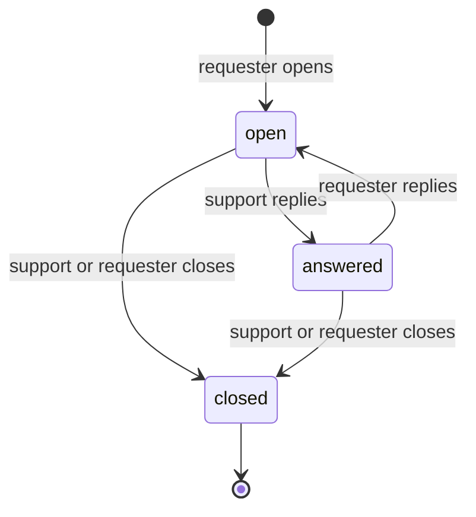

# Sprint 10 contract, part 1: Help center and support requests

Status: v0.1 · Phase 3 of the [M1 completion plan](../../superpowers/plans/2026-10-31-m1-completion-master-plan.md) · Agreed before code ([contracts README](README.md)) · Conventions: [API conventions](../02-api-conventions.md) · Data: [database design §5.13](../04-database-design.md#513-disputes-and-support) · Requirements: [analysis 10](../../analysis/10-disputes-complaints-and-support.md) §5 · Format: [Sprint 9 contract](sprint-09-notifications.md)

**Sprint goal:** patients and staff find answers in a help center (platform-managed articles in Kinyarwanda, English and French, searchable, per audience) and, when that is not enough, open a support request, follow it and reply. Platform support (super admins) triages, replies and closes; a facility admin sees the requests opened by their facility's staff. Support never needs clinical data: clinical questions are sent back to the facility. Part 2 of S10 (disputes, reports, exports, audit viewer) gets its own contract ([roadmap](../../roadmap/README.md#waves-sprints-built-in-parallel)).

Reserved names: backend app `medilink.support`; staff-web feature `help`; patient-web feature `help`; api-client module `help`; translation namespace `help` in both apps.

## 1. Goal, scope, requirements

### 1.1 In scope

- **Backend:** help articles (draft → published, rw/en/fr, audience `patient` or `staff`, category, search); support requests with a message thread, a light state machine, triage (priority, topic, assignee), limits, a clinical-words guard; notifications through S9 `notify()`; audit; permission `support.view_facility`.
- **Frontend:** patient-web Help tab (`/support`): search, categories, articles, "Contact support", my requests, request thread; staff-web Help and support (`/support`): staff articles, my requests, the facility's staff requests for facility admins; platform console: support queue, request triage, help article editor.

### 1.2 Deferred (and what part 1 ships instead)

| Deferred item | Where and when | Part 1 instead |
|---|---|---|
| `POST /public/support-requests/` ("I can't log in" without an account, [catalogue](../../api/catalogue.md#s10--disputes-help-and-reports)) | S10 part 2 or S11, with a bot check (Sprint 0 has no CAPTCHA and the endpoint would be an open spam and phishing relay) | A published patient article "I can't sign in" (password reset, ask at reception); the public article endpoints work without login |
| Screenshots and attachments | Later (S1 uploads exist, but a screenshot of the app can show clinical data) | Text only; the form asks for steps, not screenshots |
| Canned answers, a dedicated support agent role (analysis 10 §5, P2+) | P2 | Platform admins handle requests; `assigned_to` is any platform admin |
| Internal notes on a request | S10 part 2 (disputes need the same mechanism) | — |
| Article revision history and rollback | Later | `version` (optimistic locking) and audit entries naming the changed fields (S10-D3) |
| "Was this helpful?" ratings on articles | P2 (FR-DSP-12 family) | — |
| Public help center pages outside the patient app (`/help` info page) | Later, with the public site refresh | Logged-in Help tab; article links work for the public API |
| Delivery-log access for `disputes.handle` (S9 §1.2) | S10 part 2 | — |
| Retention job for closed requests (R-DSP) | S11 retention jobs (FR-SEC-13) | Retention class recorded (§2.1) |

### 1.3 Requirement coverage

**Delivered:** FR-DSP-11 (help center and support requests). **Also:** analysis 10 §1 ("all four go through one Help entry point": part 1 builds that entry point), analysis 10 §5 (no clinical data, clinical issues redirected), [security 04](../../security/04-authorization-and-tenant-isolation.md) (function-level and object-level checks), [security 06](../../security/06-application-and-api-security.md) (input limits, rate limits, no HTML), NFR-UX-01/03 (a11y, three languages).

## 2. Domain model (`medilink.support`)

### 2.1 Tables

Common columns (`id` UUIDv7, `created_at`, `updated_at`) are not repeated. `version` on mutable tables.

| Table | Key columns | RLS | Class | Mutability | Retention |
|---|---|---|---|---|---|
| `support_help_article` | `slug varchar(80)` **unique** (`^[a-z0-9]+(-[a-z0-9]+)*$`), `audience` (`patient`, `staff`), `category` (§2.2), `title_i18n jsonb` (≤ 120 chars each), `summary_i18n jsonb` (≤ 300), `body_i18n jsonb` (≤ 8,000; plain text, §2.4), `status` (`draft`, `published`), `sort_order smallint` (0–999, default 100), `published_at NULL`, `created_by_id`, `updated_by_id`, `version`. CHECK `status = 'published'` ⇒ `published_at` set. Index (`audience`, `status`, `category`, `sort_order`). | — (platform content) | C0 | Mutable (`version`) (S10-D3) | R-MD |
| `support_request` | `reference varchar(12)` **unique** (`SR-` + 6 characters of `23456789ABCDEFGHJKMNPQRSTUVWXYZ`, read out on the phone), `requester_id` (user, protect), `requester_audience` (`patient`, `staff`), `facility_id NULL`, `topic` (§2.2), `subject varchar(120)`, `status` (`open`, `answered`, `closed`), `priority` (`normal`, `high`), `assigned_to_id NULL` (a platform admin), `language` (requester's language when opened), `client_label varchar(60)` (e.g. "Chrome on Android", from the user agent, as S9), `client_path varchar(200)` (in-app path the form was opened from, `^/[A-Za-z0-9/_-]*$`), `last_message_at`, `closed_at NULL`, `closed_by_id NULL`, `close_reason NULL` (§2.3), `version`. CHECKs: `requester_audience = 'staff'` ⇔ `facility_id` set; `status = 'closed'` ⇔ (`closed_at` and `close_reason` set). Indexes (`status`, `priority`, `last_message_at`); (`requester_id`, `created_at`); (`facility_id`, `created_at`) where `facility_id` is set; (`assigned_to_id`, `status`). | — (platform queue, §2.5) | C2 | State machine (light) | R-DSP (5 years after closure) |
| `support_message` | `request_id`, `author_id` (user, protect), `author_kind` (`requester`, `support`), `body text` (1–4,000). Index (`request_id`, `created_at`). | — (reached through the request) | C2 | Append-only (no update or delete endpoint; `save()` refuses updates) | R-DSP |

Changes to [database design §5.13](../04-database-design.md#513-disputes-and-support) made here (own app and table names, `facility_id`, triage columns, `summary_i18n`, `audience`, `category`) are written back to that section in the S10 pull request (S10-D1).

### 2.2 Categories and topics

| Field | Values | Notes |
|---|---|---|
| Article `category` | `getting_started`, `account_security`, `booking_visits`, `family_profile`, `notifications`, `privacy`, `facility_work`, `other` | `facility_work` is used by staff articles; labels come from the frontend namespace |
| Request `topic` | `account_access`, `booking_visits`, `family_profile`, `notifications`, `privacy`, `facility_setup`, `technical`, `other` | The patient form offers all but `facility_setup`; the staff form all but `family_profile`. The server accepts any value (triage may correct it). There is **no** clinical topic: the form's "My health or treatment" choice shows the facility redirect card and never posts (§6). |

### 2.3 States



- Support reply on `open` or `answered` → `answered`. Requester message on `open` or `answered` → `open`. Any message on `closed` → `422 business_rule_violation` ("This request is closed. Open a new one if you still need help.").
- Close: `close_reason` is `resolved`, `no_response`, `duplicate` or `redirected_to_facility` when support closes, always `withdrawn` when the requester closes. Support may add a closing message in the same call. Closing a closed request → `409 conflict`. A closed request is final; the requester opens a new one.
- Triage (`priority`, `topic`, `assigned_to_id`) is allowed in any state except `closed` (`422`).
- Help articles: `draft` → `published` (publish) → `draft` (unpublish). Content can be edited in either state; editing a published article changes the live text (audited). Publishing needs `title`, `summary` and `body` in **all three** languages (`422` naming the missing ones).

### 2.4 Content rules

- **No clinical data in support requests** (analysis 10 §5): `subject` and every message `body` from a requester are checked with S9's `content_policy.clinical_terms()` (word-boundary, accent-insensitive, every language). A hit → `400 validation_error` on that field with "Please don't include health details here. For questions about your care, contact your facility." The terms found are not echoed or logged. Support replies are checked too (support must not ask for health details).
- **Limits:** at most **5** open (`open` + `answered`) requests per account (`422` "You already have 5 open requests…"; counted under a row lock on the account, so two parallel posts can't make a sixth); `subject` 3–120, `body` 10–4,000 characters on create, 1–4,000 on replies; control characters other than newline and tab are refused.
- **Help article body** is plain text: a blank line separates paragraphs, a line starting with `- ` is a list item. The API never returns HTML and the clients render text nodes only (no `dangerouslySetInnerHTML`, no Markdown links), so an article can't carry script or a phishing link that looks clickable. `title_i18n`, `summary_i18n`, `body_i18n` accept only the keys `rw`, `en`, `fr`.
- **Search** (`?q=`, 2–100 characters): case-insensitive substring match on title, summary and body in every language of published articles of the caller's audience; title matches first, then `sort_order`, then title. The table stays small (hundreds of rows), so no search index (S10-D4).

### 2.5 Row-level security and access rules

| Table | Decision |
|---|---|
| `support_request` | **No facility RLS**, listed in `RLS_EXCEPTIONS` of `tests/test_rls_coverage.py` ("sprint-10 §2.5"). [Database design §3.5](../04-database-design.md#35-tables-without-facility-rls) already lists support requests as platform-wide: the platform queue reads across facilities and patients' requests have no facility. `facility_id` exists only so a facility admin can see their staff's requests. Protected by the policy layer and three scoped querysets, each covered by cross-account and cross-facility tests (S10-B2): `for_requester(user, audience)` (own rows of that audience), `for_facility(facility_id)` (`requester_audience = staff` and that facility), `for_platform()` (all, platform views only). |
| `support_message` | Reached only through a request from one of those querysets. Requester-facing serializers show support authors as "MediLink support" (no staff name). |
| `support_help_article` | Platform C0 content, no `facility_id`. Public and staff endpoints read only `published` rows of their audience; drafts are visible to platform admins only. |

### 2.6 Audit events

| Action | When | Metadata (IDs and codes only) |
|---|---|---|
| `help.article.created` / `help.article.updated` | Draft created; content changed | `article_id`, `audience`, `fields` (changed field names) |
| `help.article.published` / `help.article.unpublished` | State change | `article_id`, `audience` |
| `support.request.created` | Requester opens a request | `request_id`, `audience`, `topic` |
| `support.request.message_added` | Requester replies | `request_id`, `message_id` |
| `support.request.replied` | Support replies | `request_id`, `message_id` |
| `support.request.triaged` | Priority, topic or assignee changed | `request_id`, `fields` |
| `support.request.closed` | Closed by either side | `request_id`, `close_reason`, `by` (`requester`, `support`) |

Subjects and message bodies are never in audit metadata.

## 3. Interfaces

### 3.1 Notifications (S9 `notify()`)

Events live in `medilink/support/notification_events.py` (autodiscovered by S9). No placeholders: request subjects and bodies are free text from users and never go into a notification; the title says what happened and `action_path` opens the request.

| Event | Recipients | Priority · channels | `action_path` · dedupe |
|---|---|---|---|
| `support.request.created` | `Recipients.platform_admins()` | routine · in_app | `/platform/support/{request_id}` · `{type}:{request_id}` |
| `support.request.followed_up` | The assignee, else every platform admin | routine · in_app | `/platform/support/{request_id}` · `{type}:{message_id}` |
| `support.request.answered` | The requester, in their audience (`Recipients.users(id, audience=requester_audience)`) | important · in_app, web_push, email | `/support/requests/{request_id}` · `{type}:{message_id}` |
| `support.request.closed` | The requester | routine · in_app | `/support/requests/{request_id}` · `{type}:{request_id}` |

`notify()` runs inside the request transaction, so a rolled-back reply notifies no one. Staff notifications carry the request's `facility_id`, so the staff inbox shows them in that facility. Both apps use `/support/requests/:id`, so one event serves patients and staff. Templates (rw/en/fr, `self` variant) are version 1 defaults; Kinyarwanda texts are marked for native review.

### 3.2 REST endpoints

All follow [API conventions](../02-api-conventions.md): error envelope, pagination (25, max 100), `snake_case`, UTC timestamps. `Idempotency-Key` is not used: a repeated create makes a second request (bounded by the open limit and the rate limit), every other action is idempotent by state.

```jsonc
// HelpArticleSummary (lists); i18n objects carry the languages that exist
{ "id": "uuid", "slug": "add-a-child", "audience": "patient", "category": "family_profile",
  "title_i18n": { "rw": "…", "en": "Add your child", "fr": "…" }, "summary_i18n": { … },
  "sort_order": 100, "updated_at": "2026-11-01T08:00:00Z" }
// HelpArticle = summary + "body_i18n"; PlatformHelpArticle adds
//   "status", "published_at", "missing_languages": ["fr"], "created_by", "updated_by", "version", "created_at"
// SupportRequest (requester view)
{ "id": "uuid", "reference": "SR-7K3QXM", "topic": "booking_visits", "subject": "I can't cancel my booking",
  "status": "answered", "close_reason": null, "facility": { "id": "uuid", "name": "Kigali Clinic" } | null,
  "requester": { "id": "uuid", "full_name": "…" },             // staff facility view and platform only
  "last_message_at": "…", "closed_at": null, "created_at": "…", "version": 3,
  "messages": [ { "id": "uuid", "author_kind": "support", "author_name": "MediLink support", "body": "…", "created_at": "…" } ] }
// List rows omit "messages" and add "message_count".
// PlatformSupportRequest adds "requester_audience", "priority", "assigned_to": {id, full_name} | null,
//   "language", "client_label", "client_path", "closed_by"; message "author_name" is the real name.
// SupportRequestCreate
{ "topic": "booking_visits", "subject": "…", "body": "…", "client_path": "/visits" }
// MessageCreate { "body": "…" }   Close { "reason": "resolved", "body": "" }   (requester: {} → withdrawn)
// Triage { "priority": "high", "topic": "technical", "assigned_to_id": "uuid" | null, "version": 3 }
// HelpArticleWrite { "slug", "audience", "category", "title_i18n", "summary_i18n", "body_i18n", "sort_order", "version" (PATCH) }
```

**Public** (`PublicEndpoint`; paths under `/api/v1/public/`)

| Method & path | Request → success | Errors | Notes |
|---|---|---|---|
| `GET help-articles/` | `?q`, `?category` → page of `HelpArticleSummary` (published, audience `patient`) | 400 (`q` too short or long, unknown category) | FR-DSP-11; S0 `burst` rate limit |
| `GET help-articles/{slug}/` | → `HelpArticle` | 404 (draft, staff article, unknown) | |

**Patient** (`IsPatientAuthenticated`; paths under `/api/v1/patient/`)

| Method & path | Request → success | Errors | Notes |
|---|---|---|---|
| `GET support-requests/` | `?status` (`active` = open + answered, `closed`) → page of own requests, newest activity first | 401 | FR-DSP-11 |
| `POST support-requests/` | `SupportRequestCreate` → `201 SupportRequest` | 400 (lengths, clinical words, unknown topic), 422 (5 open), 429 | Audit; notify `support.request.created`; RL `support_write` |
| `GET support-requests/{id}/` | → `SupportRequest` with messages | 404 (not own) | |
| `POST support-requests/{id}/messages/` | `MessageCreate` → `201 SupportRequest` (status `open`) | 400, 404, 422 (closed), 429 | Audit; notify `support.request.followed_up` |
| `POST support-requests/{id}/close/` | `{}` → `200` (`withdrawn`) | 404, 409 (already closed) | Audit |

**Staff** (`IsStaffAuthenticated`, MFA complete, an active facility; paths under `/api/v1/staff/`)

| Method & path | Request → success | Permission | Errors | Notes |
|---|---|---|---|---|
| `GET help-articles/`, `GET help-articles/{slug}/` | As public, audience `staff` | Any member | 400, 404 | |
| `GET support-requests/` | `?scope=mine` (default: own staff requests, any facility) or `?scope=facility` (the active facility's staff requests), `?status` | Member; `facility` needs `support.view_facility` | 400 (scope), 403 | |
| `POST support-requests/` | `SupportRequestCreate` → `201` with `facility_id` = active facility | Any member | 400, 422, 429 | The form says the facility admin can see it |
| `GET support-requests/{id}/` | → `SupportRequest` | Own, or `support.view_facility` for the active facility's rows | 404 | |
| `POST support-requests/{id}/messages/`, `POST …/close/` | As for patients | Own only | 403 (facility admin on a colleague's request: read-only), 404, 409, 422 | |

**Platform** (`PlatformAdmin`: platform admin flag + `PLATFORM_ALLOWED_NETWORKS`; paths under `/api/v1/platform/`)

| Method & path | Request → success | Errors | Notes |
|---|---|---|---|
| `GET support-requests/` | `?status` (`open`, `answered`, `closed`, `active` = open + answered), `?topic`, `?audience`, `?priority`, `?facility_id`, `?assigned` (`me`, `none`), `?q` (reference or subject) → page of `PlatformSupportRequest` (no messages), `high` first, then oldest `last_message_at` | 400 | FR-DSP-11 support queue |
| `GET support-requests/{id}/` | → `PlatformSupportRequest` with messages | 404 | |
| `PATCH support-requests/{id}/` | `Triage` (partial + `version`) → `200` | 400 (assignee not a platform admin), 409 (stale), 422 (closed) | Audit `triaged` |
| `POST support-requests/{id}/replies/` | `MessageCreate` → `201` (status `answered`) | 400, 404, 422 (closed) | Audit; notify `support.request.answered` |
| `POST support-requests/{id}/close/` | `{"reason", "body"?}` → `200` | 400 (reason `withdrawn` or unknown), 404, 409 | Audit; notify `support.request.closed` |
| `GET help-articles/` | `?audience`, `?status`, `?category`, `?q` → page of `PlatformHelpArticle` (no body) | 400 | |
| `POST help-articles/` | `HelpArticleWrite` → `201` draft | 400 (slug format or taken, unknown language key, too long) | Audit |
| `GET help-articles/{id}/` | → `PlatformHelpArticle` with body | 404 | |
| `PATCH help-articles/{id}/` | Partial + `version` → `200` | 400, 409 (stale) | Audit `updated` with field names |
| `POST help-articles/{id}/publish/` | → `200` (`published`) | 403 `step_up_required` (step-up older than 5 minutes), 409 (already published), 422 (missing languages) | Audit; step-up because the text becomes public |
| `POST help-articles/{id}/unpublish/` | → `200` (`draft`) | 409 (already a draft) | Audit |

**Totals:** 21 endpoints (public 2, patient 5, staff 7, platform 11). Compared with the [catalogue](../../api/catalogue.md#s10--disputes-help-and-reports), part 1 adds the staff endpoints, patient detail/messages/close, platform detail and triage, and publish/unpublish; it defers the public support request (§1.2). The builder updates the catalogue's S10 rows in the same pull request.

**Rate limits:** `support_write` 20 per hour per account for creates and requester messages (`THROTTLE_RATE_SUPPORT_WRITE`, an `EnvRateThrottle` like S1/S9, so `DEFAULT_THROTTLE_RATES` stays unchanged); platform replies use the S0 `burst` class.

## 4. Permissions

| Code | Meaning | Granted to | Used by |
|---|---|---|---|
| `support.view_facility` (new) | See support requests opened by the facility's staff (read-only) | `facility_admin` | `GET /staff/support-requests/?scope=facility`, detail; staff nav tab |
| Platform admin flag (existing) | Support queue, triage, replies, help articles | Super admins | `PlatformAdmin` |
| Audience session only | Help articles, own requests | Every patient / every staff member | `IsPatientAuthenticated`, `IsStaffAuthenticated` + active facility |

`medilink/support/permissions.py` exports `PERMISSIONS` and `ROLE_GRANTS`; a data migration in `support` seeds them and `extend()` registers them in the `[S10]` block of `authz/catalogue.py` (`tests/test_roles_seed.py` checks they agree).

### 4.1 Authorisation matrix (tested for every endpoint, S10-B2)

| Caller | Public articles | Staff articles | Patient requests | Staff requests (own) | Staff requests (facility scope) | Platform endpoints |
|---|---|---|---|---|---|---|
| Anonymous | ✓ | 401/403 | 401/403 | 401/403 | 401/403 | 401/403 |
| Patient | ✓ | 403 | own only (others 404) | 403 | 403 | 403 |
| Staff (receptionist, doctor, pharmacist) | ✓ | ✓ | 403 | own only (others 404) | 403 | 403 |
| Facility admin | ✓ | ✓ | 403 | own; colleagues' read-only (write 403) | own facility only (other facility 404) | 403 |
| Platform admin (no facility) | ✓ | 403 (no active facility) | 403 | 403 | 403 | ✓ (outside the allowed networks 403) |

## 5. Background jobs

None. Notifications are sent by S9's tasks; retention of closed requests (R-DSP) joins the S11 retention jobs.

## 6. Frontend

Design references: [design 07](../../design/research/07-patient-app-pages.md) §2 (four destinations; Help is one), §3.5 (help page), §4 (states); [design 04](../../design/research/04-dashboards.md) §2 (staff nav, no greyed-out items); [design 08](../../design/research/08-tables.md) (queue table); [design 10](../../design/research/10-accessibility-and-localization.md) (targets, live regions, three languages). Every screen has empty, loading (skeleton), error-with-retry states; dates through `dateFormat()` from `@medilink/ui/i18n`.

### 6.1 patient-web (`src/features/help/`)

| Route / mount | Screen | Rules |
|---|---|---|
| `/support` (the Help tab; Sprint 0 `SupportPage` gets an `[S10]` block, S10-D5) | Emergency notice first (unchanged); search field; category chips; article list (title + summary cards); "Still need help?" card with **Contact support** and **My requests** (count of open ones); "Ask at reception" card; legal links | Article text in the UI language, falling back rw → en → fr with a "Shown in English" note |
| `/support/articles/:slug` | Article: title, paragraphs and lists as text, "Still need help? Contact support" | 404 → not-found card with a link back |
| `/support/requests` | My requests: cards with reference, subject, status badge ("Waiting for MediLink", "Reply from MediLink", "Closed"), last activity | Empty state with Contact support |
| `/support/requests/new` | Step 1: "What do you need help with?" as large radio cards (topics + **My health or treatment**). Health → card "We can't help with health questions here" + "Contact your facility" + "Find care" link; never posts. Step 2: subject, description (counter), hint "Don't include health details", Send | Server field errors inline (clinical words, lengths); 422 open-limit message; success → the request page with a polite live-region message |
| `/support/requests/:id` | Thread (requester right, "MediLink support" left), reply box, "Close request" with inline confirm; closed → banner "Closed" + "Open a new request" | 18 px body, ≥ 48 px targets |

### 6.2 staff-web (`src/features/help/`)

| Route | Screen | Rules |
|---|---|---|
| `/support` | Tabs: **Guides** (staff articles: search, category filter), **My requests**, **Facility requests** (only with `support.view_facility`) | Nav item `help` (facility group, every member) |
| `/support/articles/:slug` | Staff article | |
| `/support/requests/new` | Topic select, subject, description; notice "Your facility admin can see this request" and "Don't include patient health details" | |
| `/support/requests/:id` | Thread; reply and close for the requester; read-only notice for a facility admin viewing a colleague's request | |
| `/platform/support` | Support queue: `DataTable` (reference, subject, requester type, facility, topic, priority, status, assignee, last activity), filters (status tabs Active/Open/Answered/Closed, topic, audience, "Assigned to me", "Unassigned"), search by reference or subject | Nav item `platformSupport` (platform group) |
| `/platform/support/:id` | Request: details panel (requester, audience, facility, language, device, path), triage (priority, topic, Assign to me / Unassign; `409` → reload message), thread, reply, close with reason | |
| `/platform/help-articles` (+ `/new`, `/:id`) | Article list (audience, category, status, missing languages); editor with rw/en/fr tabs, character counters, a missing-language warning, plain-text preview; Save, Publish (step-up via S1 `StepUp` when `403 step_up_required`), Unpublish | Nav item `platformHelpArticles` (platform group) |

### 6.3 Shared packages

- **api-client** `src/features/help.ts`: paths, types for §3.2, `createHelpApi(client)` → `{ public, patient, staff, platform }`; `PermissionCodes` augmented with `support.view_facility`; mock grants via `extendMockRoleGrants()` (facility admin).
- **MSW** `src/mocks/features/help.ts` (factory receiving `MockContext`): seeded articles for both audiences in rw/en/fr (one with a missing French text), seeded requests for the mock patient and mock staff; every §3.2 endpoint with the same rules (sessions, CSRF, permission, open limit, clinical-words check with a short word list, state rules, `409` on stale `version`, step-up on publish via the existing mock step-up state); `reset()`.
- **i18n:** namespace `help` in both apps (`locales/{rw,en,fr}.json`), nav labels at `help.nav.*`; Kinyarwanda strings marked for native review.
- No new `packages/ui` components: `Card`, `Badge`, `Tabs`, `DataTable`, `TextField`, `TextareaField`, `SelectField`, `Alert`, `EmptyState`, `Skeleton` are reused.

## 7. Integration points

**Existing `[S10]` blocks** ([shared-file protocol](README.md#shared-file-protocol-parallel-sprints)):

| File | What goes between the `[S10]` markers |
|---|---|
| `backend/config/settings/base.py` (`INSTALLED_APPS`) | `"medilink.support",` |
| `backend/config/settings/base.py` (`ENUM_NAME_OVERRIDES`) | Enum names for status, topic, category, audience, priority, close reason |
| `backend/config/urls.py` | `path("public/", include("medilink.support.urls.public"))` and the same for `patient/`, `staff/`, `platform/` |
| `backend/medilink/authz/catalogue.py` | `from medilink.support import permissions as _s10` + `extend(...)` |
| `backend/medilink/audit/actions.py` | `from medilink.support import audit_actions as _s10` + `extend_actions(...)` |
| `backend/.env.example` | `THROTTLE_RATE_SUPPORT_WRITE` |
| `backend/CHANGELOG.md`, `frontend/CHANGELOG.md` | Bullets under an S10 heading |
| staff-web `src/app/features.ts`, `src/layout/navigation.ts`, `src/i18n/features.ts` | `helpFeature`; nav items `help`, `platformSupport`, `platformHelpArticles`; `help: { rw, en, fr }` |
| patient-web `src/app/features.ts`, `src/i18n/features.ts` | `helpFeature` (patient routes); `help: { rw, en, fr }` |
| api-client `src/index.ts` · `src/endpoints.ts` · `src/mocks/features.ts` | `export * from "./features/help";` · `help: createHelpApi(client),` · `helpMocks` |
| `.github/workflows/ci-backend.yml` (coverage loop) | `support:90` |
| `backend/tests/test_rls_coverage.py` (`RLS_EXCEPTIONS`) | `support_request` with this contract's reference |

**New block this contract needs:** patient-web `src/pages/SupportPage.tsx` (Sprint 0 page, whose own comment hands "Report a problem" to S10): the static FAQ and the "coming soon" card are replaced by an `[S10]` block that mounts the help center sections (S10-D5).

## 8. Dependencies and stubs

| Sprint | What part 1 needs | Status |
|---|---|---|
| S9 | `notify()`, `Recipients`, event registry, content policy | Merged |
| S1 | `PlatformAdmin`, step-up (`RecentAuthRequired`, staff-web `StepUp`), `DataTable` | Merged |
| S9 frontend (bell, inbox) | Opening `action_path` from a notification | In progress; the routes exist, so the links work when the inbox lands |
| S10 part 2 | Disputes reuse the Help entry point ("Report a problem") | Later; `SupportPage`'s `[S10]` block is where it mounts |

## 9. Acceptance checks

### Backend

| # | Check | Source |
|---|---|---|
| S10-B1 | Every endpoint in §3.2 exists with the documented schema, errors and permission and is in the regenerated OpenAPI schema (`spectacular --validate --fail-on-warn`) | architecture 02 |
| S10-B2 | Authorisation matrix §4.1 for every endpoint; nobody reads another account's request (404); a facility admin sees only their facility's staff requests, never patients' or another facility's, and can't write on them (403); platform endpoints refuse non-admins and addresses outside the allowed networks | security 04, FR-DSP-11 |
| S10-B3 | Public and staff article endpoints return only published articles of their audience; drafts and the other audience → 404; search matches title, summary and body in every language, title matches first; `q` of 1 or 101 characters → 400 | FR-DSP-11 |
| S10-B4 | Article rules: slug format and uniqueness, only `rw`/`en`/`fr` keys, length limits, stale `version` → 409, publish with a missing language → 422 naming it, publish without recent step-up → 403 `step_up_required`, publish twice → 409, unpublish a draft → 409 | FR-DSP-11, security 06 |
| S10-B5 | Request state machine §2.3: requester message → `open`, support reply → `answered`, messages on a closed request → 422, close twice → 409, requester close → `withdrawn`, support close needs a support reason, triage on closed → 422, stale triage `version` → 409, assignee must be a platform admin | FR-DSP-11 |
| S10-B6 | No clinical data: subject or body with a denylisted term (e.g. "HIV", "VIH", "igituntu") → 400 with the redirect message and nothing stored; the terms are not echoed in the response | analysis 10 §5, security 06 |
| S10-B7 | Limits: the sixth open request → 422; closed requests don't count; `support_write` throttle → 429; control characters refused | analysis 10 §5, security 06 |
| S10-B8 | Notifications: create → platform admins get `support.request.created`; support reply → the requester gets `support.request.answered` in their own audience inbox (staff: in that facility); requester reply → the assignee (or all platform admins) gets `followed_up`; close by support → `closed`; a rolled-back action creates no notification; every event has templates for each channel and language (S9 checks clean) | FR-NOT-07, FR-DSP-11 |
| S10-B9 | Requester serializers never show support staff names, priority, assignee or client details; platform serializers do | security 04 |
| S10-B10 | Audit actions of §2.6 written with IDs and codes only (no subject or body); `support.view_facility` seeded and registered (`test_roles_seed`); `support_request` in `RLS_EXCEPTIONS` and the RLS coverage test green; migrations reverse (`check_migrations_reversible.py`); `medilink.support` coverage ≥ 90%; ruff and mypy clean | security 08, security 09 |

### Frontend

| # | Check | Source |
|---|---|---|
| S10-F1 | Patient Help tab: emergency notice first, search, category filter, articles in the UI language with fallback note, "Contact support" and "My requests" | design 07 §3.5, FR-DSP-11 |
| S10-F2 | Patient article page renders paragraphs and lists as text (no HTML) | security 06 |
| S10-F3 | Patient new request: topic cards; "My health or treatment" shows the facility redirect and sends nothing; server field errors inline; open-limit message; success opens the request | analysis 10 §5 |
| S10-F4 | Patient request list and thread: status badges, reply, close with confirm, closed banner with "Open a new request" | FR-DSP-11 |
| S10-F5 | Staff Help and support: Guides, My requests, Facility requests tab only with `support.view_facility`; new request with the "facility admin can see this" notice; read-only colleague view | FR-DSP-11, design 04 §2 |
| S10-F6 | Platform support queue with filters and search; request page with triage (409 → reload message), reply and close with reason | FR-DSP-11, design 08 |
| S10-F7 | Platform help article editor: rw/en/fr tabs with counters, missing-language warning, preview, save, publish with step-up, unpublish | FR-DSP-11 |
| S10-F8 | MSW mocks implement every §3.2 endpoint with `MockContext` rules; all S10 screens work with `VITE_USE_MOCKS=true` | contracts README |
| S10-F9 | `help` namespace in rw/en/fr with parity, Kinyarwanda default, no hard-coded strings, dates via `dateFormat()`; vitest-axe clean on every S10 screen; keyboard reachable; both themes | NFR-UX-01, NFR-UX-03, design 10 |

### Integration

| # | Check | Source |
|---|---|---|
| S10-I1 | Against the real API on staging: a patient and a receptionist each open a request, a super admin triages and replies, the requester sees the reply (and the S9 notification once the inbox lands), replies, and support closes it | FR-DSP-11 |
| S10-I2 | A facility admin sees the receptionist's request read-only; the admin of another facility does not | security 04 |
| S10-I3 | A super admin writes an article in three languages, publishes it with step-up, and patients (or staff) find it by search in each language | FR-DSP-11 |
| S10-I4 | Only `medilink.support`, the `help` features and `[S10]` blocks changed (plus the `SupportPage` block, S10-D5); OpenAPI regenerated; full suites green; catalogue S10 rows and database design §5.13 updated | contracts README |

## 10. Decisions and deviations

| # | Decision | Contract or design text it changes | Why |
|---|---|---|---|
| S10-D1 | Own app `medilink.support` with tables `support_help_article`, `support_request`, `support_message` instead of `disputes_*`; `facility_id`, triage columns, `audience`, `category`, `summary_i18n` added | Database design §5.13 | Part 1 ships before disputes; separate ownership, migrations and coverage gate; the facility admin view needs `facility_id` |
| S10-D2 | The public support request is deferred | Catalogue `POST /public/support-requests/` | An anonymous form without a bot check is a spam and phishing relay; Sprint 0 has none |
| S10-D3 | Articles are mutable with `version`, not versioned rows | Database design §5.13 "Versioned" | C0 content, low risk; audit records who changed which fields; revisions can come later without an API change |
| S10-D4 | Search is a substring match, no full-text index | — | Hundreds of rows; Kinyarwanda has no PostgreSQL dictionary; boring by default |
| S10-D5 | Patient-web `SupportPage.tsx` (Sprint 0) gets an `[S10]` block replacing the static FAQ and the "coming soon" card | Shared-file protocol (new block) | The Help tab route is `/support` in the core route table and can't be overridden by a feature route; the page's own comment hands it to S10 |
| S10-D6 | Staff help and requests need an active facility | — | Staff requests carry the facility so its admin can see them; platform admins without a facility use the platform console |
