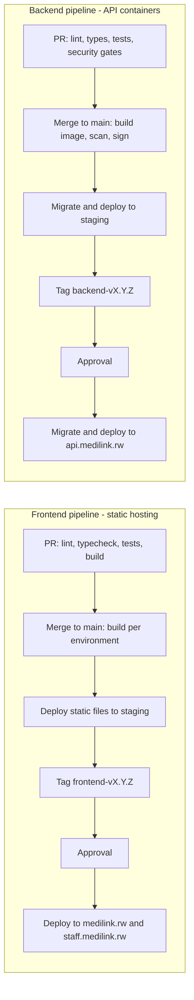

# Environments and deployment

Status: v0.1 · Sources: [architecture 01](../architecture/01-system-architecture.md) §5, [ADR 0006](../decisions/0006-separate-frontend-and-backend-hosting.md), [security 02](../security/02-security-architecture.md), [security 07](../security/07-infrastructure-and-operations-security.md). The hosting provider in Rwanda is still open (question Q11), so this page describes the target process, not provider-specific steps.

## 1. Environments

| Environment | Backend | Frontend | Data | Who has access | Deployed when |
|---|---|---|---|---|---|
| Local | `runserver` / Docker at `localhost:8000` | Vite dev servers on 5173 and 5174 | Synthetic seed (`seed_dev`) | Each developer | — |
| CI | pytest with a PostgreSQL service | Unit, component and e2e tests with MSW | Fixtures | Pipeline | Every pull request |
| Staging | `api.staging.medilink.rw` | `staging.medilink.rw`, `staff.staging.medilink.rw` | **Synthetic only**, never a copy of production | Team and testers | Every merge to `main` |
| Production | `api.medilink.rw` | `medilink.rw`, `staff.medilink.rw` | Real (Rwanda) | Two named engineers for infrastructure; everyone else only through the product | Tagged release + approval |

Downloads are served from `files.medilink.rw` (production) through short-lived signed URLs ([security 02](../security/02-security-architecture.md) §3). Production data is **never** copied to another environment ([security 07](../security/07-infrastructure-and-operations-security.md) §7).

## 2. Two pipelines

Frontend and backend are built, versioned and deployed separately ([ADR 0006](../decisions/0006-separate-frontend-and-backend-hosting.md)).

### 2.1 Frontend (static hosting)

- **Build:** `pnpm build` produces static files (`dist/`) for each app (check F10). Settings such as `VITE_API_BASE_URL` are fixed **at build time**, so CI builds once per environment from the same commit.
- **Public pages** of patient-web are pre-rendered at build time so search engines can index them (FR-SCH-03).
- **Hosting:** a static host in Rwanda. Hashed assets are cached long-term (`immutable`); `index.html` and the service worker are `no-cache`, so a deploy takes effect at the next load.
- **Headers** at the static host: strict CSP (no `unsafe-inline` or `unsafe-eval`), HSTS, `X-Content-Type-Options`, `Referrer-Policy`, `Permissions-Policy` ([security 06](../security/06-application-and-api-security.md) §2). staff-web gets the stricter policy.
- **Service worker:** a new version activates on the next navigation and never serves a stale app shell against a newer, incompatible API.
- **Rollback:** redeploy the previous build artefact (keep at least the last five per environment).

### 2.2 Backend (API containers)

- **Build:** one Docker image from `backend/Dockerfile` for the API (ASGI), Celery workers and Celery beat, plus the PDF worker run with **no network egress**. Base images pinned by digest.
- **Supply chain:** scan the image with Trivy (fail on fixable critical/high), generate an SBOM, sign with cosign, push to a private registry. Hosts pull **by digest**.
- **Run:** Docker Compose on hardened hosts to start with ([security 07](../security/07-infrastructure-and-operations-security.md) §3): non-root, read-only root filesystem, no added capabilities, CPU and memory limits per service, secrets injected at runtime.
- **Deploy steps:**
  1. Record the current image digest and the database recovery point.
  2. Run migrations as a one-off job with the `medilink_migrator` role.
  3. Restart workers and beat, then roll the API instances one by one behind the reverse proxy.
  4. Check `GET /api/v1/health/` reports the new version; run smoke tests (login, check-in on a test facility in staging, document verification).
- **Rollback:** redeploy the previous image digest. Migrations are written so the previous release still works with the new schema (§3).

### 2.3 Order and compatibility

- `/api/v1` stays backward compatible, so the backend can always be deployed first.
- A frontend release that needs new endpoints declares the minimum API version and is deployed after that backend version is live.
- Feature flags per facility (NFR-OPS-07) let a feature ship dark and be switched on for a pilot facility.

## 3. Database migrations

| Rule | Detail |
|---|---|
| Reviewed and reversible | Every migration has a working reverse, and CI runs it (NFR-OPS-08) |
| Expand, then contract | Add new columns/tables first (nullable or with defaults), deploy code that writes both, backfill, and only remove old columns in a **later** release. A release never depends on a schema change it also removes. |
| Large tables | `CREATE INDEX CONCURRENTLY` in non-atomic migrations; backfills as batched background jobs, not in the migration |
| RLS | A new facility table's migration enables and forces RLS with its policies; the RLS schema test must pass |
| Rehearsed | Every production migration runs first on staging with a production-sized **synthetic** dataset, timed |
| Who runs it | The pipeline, with the migrator role. Never by hand from a laptop. |
| When | Outside facility hours (06:00–20:00 Kigali) unless it is a trivial additive change |
| Never | Edit a migration that already ran on staging or production; disable RLS to make a migration pass |

## 4. Rollback

| What failed | Action |
|---|---|
| Frontend release | Redeploy the previous build; users get it on the next load |
| Backend code | Redeploy the previous image digest (compatible with the expanded schema) |
| Migration | Prefer a forward fix. Reverse the migration only if it was tested in staging and no data written since depends on it |
| Data corruption | Point-in-time recovery to a new instance, compare, then repair (RPO ≤ 15 min, RTO ≤ 4 h; NFR-REL-02) under the incident process ([security 10](../security/10-incident-response-and-continuity.md)) |
| A feature misbehaves for one facility | Switch its feature flag off |

Every production deployment has a named person on watch for one hour afterwards, with alerts on 5xx rate and queue API latency ([security 08](../security/08-logging-monitoring-and-detection.md) §3).

## 5. Configuration and secrets per environment

Configuration comes from environment variables (12-factor, `django-environ`); `backend/.env.example` and each app's `.env.example` list every variable with placeholders.

| Setting | Local | Staging | Production |
|---|---|---|---|
| `DJANGO_SETTINGS_MODULE` | `config.settings.dev` | `config.settings.prod` (staging values) | `config.settings.prod` |
| `ALLOWED_HOSTS` | `localhost` | `api.staging.medilink.rw` | `api.medilink.rw` |
| CORS allowed origins / `CSRF_TRUSTED_ORIGINS` | `http://localhost:5173`, `http://localhost:5174` | the two staging frontend origins | `https://medilink.rw`, `https://staff.medilink.rw` |
| WebSocket allowed origins | as CORS | as CORS | as CORS |
| Database / Redis / object storage | Docker Compose | Private network, TLS | Private network, TLS (`sslmode=verify-full`) |
| Email | Mailpit | Test relay, internal recipients only | Production relay (no clinical content) |
| `VITE_API_BASE_URL` | `http://localhost:8000` | `https://api.staging.medilink.rw` | `https://api.medilink.rw` |
| `VITE_USE_MOCKS` | optional `true` | `false` | `false` |
| Error tracking | off or local | self-hosted, Rwanda | self-hosted, Rwanda, personal data scrubbed |

**Secrets** (Django secret key, database and Redis passwords, storage keys, field-encryption and blind-index keys, VAPID and DKIM keys):

- Live in the key store (OpenBao/Vault; SOPS + age at first, with keys held by two named people) and are injected at runtime ([security 05](../security/05-data-protection-and-cryptography.md) §5).
- Are never in the repository, images, Compose files, CI logs or frontend builds (frontend builds contain no secrets at all).
- Differ per environment; a staging secret never works in production.
- CI has no production secrets except in the deploy job, which uses short-lived credentials (OIDC) and a protected GitHub environment with required reviewers ([security 09](../security/09-secure-development-lifecycle.md) §2).

Cross-origin settings (CORS, CSRF trusted origins, WebSocket origins) are tested on staging after every change ([ADR 0006](../decisions/0006-separate-frontend-and-backend-hosting.md)).

## 6. Data residency

| Item | Rule |
|---|---|
| Production hosting, database, files, backups, logs, monitoring, error tracking | **In Rwanda**, at two separate sites (primary and backup) ([security 02](../security/02-security-architecture.md) §4) |
| Staging | Synthetic data only; hosted like production (in Rwanda) so the setup is rehearsed |
| Static frontend files | Served from Rwanda. A CDN may serve only assets with no personal data, after the legal review in security 02 §4. |
| GitHub, CI runners | Outside Rwanda: never real patient data, secrets or production dumps in code, issues, logs or artefacts |
| Third-party services (email, push) | Receive no clinical content; web push payloads are end-to-end encrypted |

## 7. Open decisions

| # | Decision | Needed by |
|---|---|---|
| E1 | Hosting provider in Rwanda, static host and container registry (Q11) | Before staging |
| E2 | Deployment tooling (Compose + Ansible, or another orchestrator) and how the pipeline reaches the private network | Before staging |
| E3 | Pre-rendering tool for public pages | S1 ([ADR 0007](../decisions/0007-frontend-toolchain.md)) |
| E4 | Staging data generator size (production-sized synthetic dataset) | S4 |
