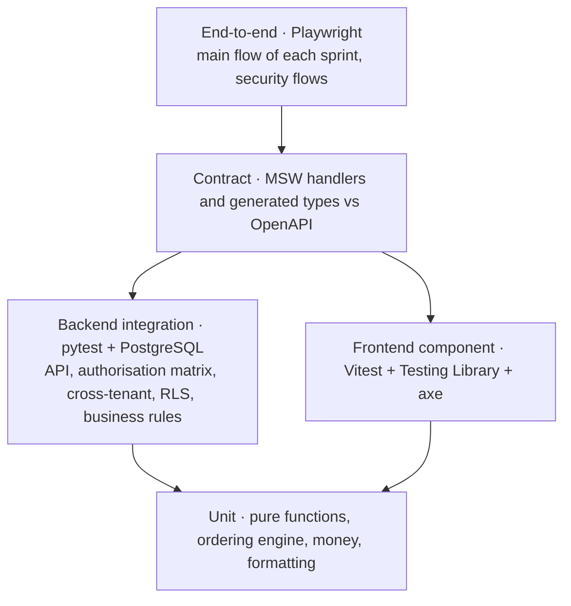

# Testing strategy

Status: v0.1 · Sources: [NFR-OPS-01/02](../analysis/14-non-functional-requirements.md), [security 04](../security/04-authorization-and-tenant-isolation.md) §5, [security 09](../security/09-secure-development-lifecycle.md) §3, the [Definition of Done](../roadmap/README.md) and the sprint contracts.

## 1. Principles

1. **Test what can hurt people first:** access to patient data, queue fairness, money, clinical record integrity, availability at the 06:00–10:00 peak.
2. **Tests are acceptance evidence.** A sprint's acceptance checks are ticked with test names, CI runs and screenshots ([QA](../qa/README.md)).
3. **Real PostgreSQL, always.** Row-level security, constraints, locks and `SKIP LOCKED` behave differently elsewhere; no SQLite.
4. **Synthetic data only**, in every environment below production.
5. A bug fix starts with a failing test. A security fix also gets a Semgrep or lint rule where possible ([security 09](../security/09-secure-development-lifecycle.md) §4).

## 2. Test pyramid

| Layer | Tools | Runs | Volume |
|---|---|---|---|
| Unit | pytest; Vitest | Every push | Many, fast |
| Backend integration | pytest, pytest-django, factory-boy, PostgreSQL 17 service | Every pull request | Most backend tests |
| Frontend component | Vitest, Testing Library (`user-event`), vitest-axe | Every pull request | Every page and shared component |
| Contract | `openapi-typescript` drift check; schema validation of MSW responses | Every pull request | One per endpoint |
| End-to-end | Playwright (with MSW in CI; against the real API on staging) | Pull request (smoke), nightly and staging (full) | Few, per main flow |
| Performance | k6 or Locust (chosen in S4); Lighthouse with 3G throttling | Nightly on staging from S4; S11 at 3× peak | Scenario-based |
| Security | CI gates, OWASP ZAP, Playwright security flows, pen test | Pull request, staging, before go-live | See §8 |
| Accessibility and usability | axe (automated), manual keyboard and screen reader, sessions with real users | Every sprint for new screens; full audit in S11 | — |

## 3. Backend tests

### 3.1 Coverage targets

| Code | Target | Source |
|---|---|---|
| `accounts`, `authz`, `tenancy`, `audit` | ≥ 90 % (from S0) | [Sprint 0 contract](../architecture/03-sprint-0-contract.md) B17 |
| `authz` | ≥ 95 % (CI gate) | [security 09](../security/09-secure-development-lifecycle.md) §3 |
| Domain rules (queue ordering, billing, permissions) | High, branch coverage on rule functions | NFR-OPS-01 |

Coverage is a floor, not the goal: every rule in the analysis tables should map to at least one named test.

### 3.2 Authorisation test matrix

Generated from the permission matrix ([analysis 02](../analysis/02-users-roles-and-permissions.md) §3) and the endpoint registry. For **each endpoint × actor × object scope**, one test expects allow, deny or 404. CI fails when an endpoint has no matrix entry, or when a view has no explicit permission class (check B3).

| Actor | Object scopes tested |
|---|---|
| Anonymous; patient; patient's guardian; patient's delegate | Own, dependent, delegated (restricted record hidden), other patient |
| Super admin (with and without step-up) | Platform object; facility object (only through dispute or break-glass) |
| Facility admin, receptionist, doctor, pharmacist; user with two roles | Own facility; **other facility** (→ 404); another facility where the user is also a member (wrong active facility → 404) |
| Deactivated member; staff session on a patient endpoint and vice versa | Everything → 401/403/404 |

Expected results: `200/201/204` allowed; `403 permission_denied` when the object's existence may be known; **`404 not_found` for anything outside the active facility or the patient's links**. Property-level checks compare each role's serializer output with an allowlist snapshot, so a new sensitive field can't leak silently (e.g. a receptionist never receives diagnosis fields).

### 3.3 Cross-tenant and RLS tests

- **Fixture:** two facilities (A, B) with the same shape of data, plus a patient known at both.
- **Cross-tenant:** every list and detail endpoint is called with IDs from facility B while active in A → 404; lists never contain B's rows.
- **RLS (as the `medilink_app` role, not the owner):**
  - no context → zero rows;
  - context A never returns B's rows;
  - `WITH CHECK` blocks inserting or moving a row into B;
  - audience `patient` sees only linked patients' rows;
  - a schema test lists every table with a `facility_id` column and asserts RLS is **enabled and forced** (`pg_class.relrowsecurity` and `relforcerowsecurity`) with the expected policies.
- **Audit:** each sensitive action writes the expected audit event; `verify_audit_chain` passes; an altered row breaks the chain (check B11).

### 3.4 Business-rule tests

Table-driven tests built from the rules in the analysis documents:

| Area | Examples | Requirements |
|---|---|---|
| Queue ordering | Emergency first; return priority; priority flag with reason; booked/walk-in ratio 1:2; FIFO within groups; grace window early/inside/late; remote pass-over K places, max 2 | FR-QUE-05..07 |
| Concurrency | Two doctors press Call next at once → different patients; double check-in → one ticket; stale `version` → `409` | FR-QUE-03, FR-QUE-08 |
| Ticket lifecycle | Every transition writes an event with actor and reason; end-of-day closes waiting tickets as left without service | FR-QUE-09, FR-QUE-15 |
| Booking | Atomic slot hold; caps (3 active, 1 per service per day); cancellation cut-off; no-show after the grace window; strikes; facility disruption never counts as a patient cancellation | FR-SCH-07..14 |
| Clinical | Draft autosave; signing locks content and stores the hash; addendum keeps the original; entered-in-error hides but never deletes; visit can't complete unsigned; private notes never in patient output | FR-CLN-01..05 |
| Pharmacy | Dispensed ≤ prescribed; substitution needs a reason; no dispensing when payment is required and missing | FR-PHA-01..03 |
| Money | Server-side totals and splits; no negative amounts; gapless receipts under concurrent payments; voids and refunds need approval; requester ≠ approver (one-person clinic flagged); cash-up differences | FR-BIL-06..11 |
| Disputes | Deadlines and auto-escalation (time travel); conflict of interest; max 5 open; duplicate detection | FR-DSP-03, 08, 10 |
| Notifications | Quiet hours, priorities, fallback; no clinical content in bodies; de-duplication | FR-NOT-05, 09 |
| Retention | Jobs delete only what the retention table allows, and log it | FR-SEC-13 |

Use time control (`time-machine` or similar) instead of sleeping. Concurrency tests use separate database connections or threads, not mocks.

### 3.5 Migrations

CI runs `migrate` from an empty database, then the latest migrations backwards and forwards again (NFR-OPS-08), and `makemigrations --check` to catch missing migrations.

## 4. Frontend tests

| Kind | What | Rules |
|---|---|---|
| Unit | api-client (credentials, CSRF bootstrap, `Accept-Language`, error parsing), formatting, hooks | Check F9 |
| Component | Every page-level component and shared component with Testing Library; interactions with `user-event` | Test behaviour, not implementation |
| Accessibility | `vitest-axe` on every page and key component in **both themes** | No violations (check F5) |
| i18n | No missing keys in `rw`, `en`, `fr`; no hard-coded strings (lint rule); language switch updates `lang` | Check F3 |
| End-to-end | Playwright: the sprint's main flow (e.g. S4 "walk-in → called → completed"), in CI against MSW and on staging against the real API | One spec per main flow |
| Security e2e | Logout really ends the session; the idle lock hides data; the display token can't call other APIs; a patient can't open another patient's document URL | [security 09](../security/09-secure-development-lifecycle.md) §3 |

## 5. Contract tests (MSW vs OpenAPI)

The frontend is built against MSW mocks before the endpoint exists, so drift is the main integration risk ([ADR 0007](../decisions/0007-frontend-toolchain.md)).

1. The backend publishes its OpenAPI schema in CI; the frontend generates types from it with `openapi-typescript`. **CI fails if the committed types differ from the schema.**
2. MSW handlers are typed with the generated types, so a renamed field breaks the build.
3. Each handler's example responses (success and every documented error) are validated against the schema in a unit test.
4. During the sprint's integration step, the e2e suite runs on staging against the real API with mocks off.

## 6. Performance tests

Scenarios use synthetic facilities and patients sized to the requirements:

| Scenario | Target | Requirement | First run |
|---|---|---|---|
| Morning peak per facility: 50 check-ins per 15 min, 20 concurrent staff users, Call next, payments | No slowdown; staff actions p95 < 500 ms on the server | NFR-PERF-01, NFR-PERF-03 | S4 |
| Queue change → boards, trackers, display | < 2 s | NFR-PERF-04, FR-QUE-12 | S4 |
| Launch capacity: 50 facilities, 5,000 visits/day, 2,000 concurrent trackers | Within the targets above | NFR-PERF-02 | S11 |
| Patient history with 200 visits | < 2 s | NFR-PERF-05 | S6 |
| PDF generation | < 5 s | NFR-PERF-07 | S7 |
| Patient app first load on 3G, low-end Android | < 3 s (Lighthouse, throttled) | NFR-PERF-06 | S11 (budget checked from S0) |
| **3× the expected peak** before go-live, with graceful degradation (reports and PDFs queue; check-in, Call next and payments keep priority) | Pass | [security 07](../security/07-infrastructure-and-operations-security.md) §6 | S11 |

Results (tool output, p50/p95/p99, errors) are attached to the sprint's acceptance record.

## 7. Security tests in CI and staging

| Stage | Tools | Fails when |
|---|---|---|
| Lint and SAST | ruff (bandit rules), Semgrep (Django, Python, OWASP rules + our own), ESLint (`react/no-danger`), TypeScript strict | Any high finding or error |
| Dependencies | `pip-audit`, `osv-scanner`, `npm audit --omit=dev` (pnpm equivalent); Dependabot weekly | Fixable high or critical |
| Secrets | gitleaks (`.github/workflows/security.yml`), GitHub push protection | Any finding |
| Configuration | `manage.py check --deploy --fail-level WARNING` on production settings | Any warning |
| Containers and IaC | Trivy (filesystem, image, config), hadolint | Fixable high or critical; high misconfiguration |
| Tests | Authorisation matrix, cross-tenant, RLS, business rules | Any failure; `authz` coverage < 95 % |
| Staging | OWASP ZAP baseline + authenticated scan per role; Playwright security flows; CSP report review | High findings |
| Before go-live, then yearly | Independent penetration test (access control, multi-tenancy, business logic, files) | Critical/high not fixed and retested |

The full list and deadlines are in [security 09](../security/09-secure-development-lifecycle.md). The repository-wide secret and Trivy scans run in `security.yml`; the backend and frontend workflows add their own gates.

## 8. Accessibility and usability

- Automated: axe in component tests and Playwright.
- Manual, every sprint, for new screens: keyboard only, NVDA (Windows) and TalkBack (Android), 200 % zoom, both themes.
- Usability sessions (S11 and the pilot): walk-in registration + ticket under 60 s and booked check-in under 15 s with reception staff (NFR-UX-04); booking in ≤ 5 steps with elderly patients (NFR-UX-02).

## 9. Test data

- `factory-boy` factories (backend) and MSW fixtures (frontend) generate realistic **synthetic** Rwandan names, dates, phone numbers and IDs that can't belong to a real person (e.g. reserved number ranges).
- `seed_dev` for local work; a larger synthetic generator for performance and staging.
- Never copy production data to any other environment ([security 07](../security/07-infrastructure-and-operations-security.md) §7). Screenshots used as evidence show synthetic data only.

## 10. Evidence for acceptance checks

Each acceptance check of a sprint contract (B1–B17 and F1–F12 for Sprint 0) is ticked in the sprint's acceptance record with:

| Evidence type | Example |
|---|---|
| Test reference | `backend/tests/authz/test_matrix.py::test_cross_facility_returns_404` |
| CI run | Link to the green workflow run on the merge commit |
| Command output | `python manage.py check --deploy` output, coverage summary |
| Screenshot or recording | Keyboard focus order, both themes (synthetic data only) |
| Report | Load test summary, ZAP report, axe report |

How records are kept and how the [traceability matrix](../qa/traceability-matrix.md) is updated: [QA README](../qa/README.md).

## 11. When tests run

| Moment | What runs |
|---|---|
| Before commit (optional hooks) | ruff, ESLint/Prettier on changed files, gitleaks |
| Every pull request | Lint, types, unit, integration, component, contract, smoke e2e, security gates |
| Merge to `main` | Everything above + deploy to staging |
| Nightly | Full e2e on staging, performance scenarios, dependency audit |
| Before a release | Sprint acceptance checks with evidence, ZAP on staging, release checklist ([git workflow](git-workflow-and-releases.md) §6) |
