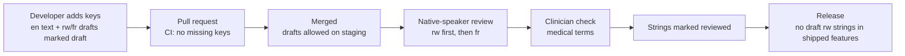

# Translations

Status: v0.1 · Requirements: NFR-UX-01 (Kinyarwanda first, English, French; no hard-coded text), FR-NOT-09 (trilingual templates), FR-ONB-10 (translated master data). Rules: [design research 10](../design/research/10-accessibility-and-localization.md) §3.

## 1. Principles

- **Kinyarwanda (`rw`) is the default language** for patients and staff. English (`en`) and French (`fr`) are complete alternatives.
- **No hard-coded user-facing text**, in the frontend or the backend. Every string has a key.
- **Native-speaker writing for Kinyarwanda.** Machine translation may help draft, but **no raw machine translation reaches production**. Medical terms are validated with a clinician.
- Plain language: short sentences, no jargon, one idea per sentence. Many patients are elderly or have low literacy.
- Design for about 30 % text expansion: buttons and tabs wrap, no text in images.

## 2. Where text lives

| Text | Where | Mechanism |
|---|---|---|
| Frontend UI | Resource files per language and namespace in the frontend workspace (location fixed in `frontend/README.md`) | i18next + react-i18next with ICU messages ([ADR 0007](../decisions/0007-frontend-toolchain.md)) |
| API error messages, emails | `backend/locale/<lang>/LC_MESSAGES/django.po` | Django gettext; language from `Accept-Language` |
| Notification templates | Database (`notifications_template`), versioned per language | Managed by super admins (FR-NOT-09) |
| Generated PDFs | Django templates + gettext, rendered in the patient's chosen language | FR-DOC-01 |
| Master data (services, symptoms, diagnoses' plain-language names, reasons) | `*_i18n` JSON columns | Managed by super admins (FR-ONB-10) |
| Facility content (service names, announcements) | `*_i18n` JSON columns | Entered by the facility in the languages it supports |

API error **codes** are never translated; only `message` is. The frontend maps codes to its own messages where it needs different wording.

Django ships no Kinyarwanda locale data, so the backend registers `rw` itself (`LANGUAGES` plus extra locale info); `backend/README.md` documents how.

## 3. Key naming

- Format: `<namespace>:<area>.<element>[.<variant>]`, with namespaces per feature and dot-separated camelCase keys.
- Keys describe **meaning, not the English text**, so English edits don't rename keys.

| Namespace | Examples |
|---|---|
| `common` | `common:actions.save`, `common:actions.cancel`, `common:status.loading` |
| `auth` | `auth:login.title`, `auth:mfa.codeLabel`, `auth:mfa.useRecoveryCode` |
| `queue` | `queue:todayBoard.title`, `queue:actions.callNext`, `queue:tracker.peopleAhead` |
| `errors` | `errors:code.permission_denied`, `errors:code.rate_limited` (mirrors API codes) |
| `validation` | `validation:required`, `validation:email.invalid` |

Writing rules:

- Never build sentences by concatenation. Use named interpolation: `"Room {room}"`, not `"Room " + room`.
- Use ICU plurals for counts: `{count, plural, one {# person ahead} other {# people ahead}}`.
- No HTML in strings; use the `<Trans>` component for links and emphasis.
- Dates, times, numbers and money go through the formatting helpers (Africa/Kigali, 24-hour time, RWF without decimals), never pre-formatted inside strings.
- Names: one "Names" field plus an optional preferred name; don't assume first/last order.

## 4. Workflow

1. **Add keys** in the same pull request as the feature: English text, plus Kinyarwanda and French drafts. Mark the drafts as `draft` in the review-status file next to the resources (for example `locales/rw/_review.json`, mapping key → `draft` or `reviewed` with reviewer and date). The frontend team fixes the exact mechanism in Sprint 0 (check F3).
2. **CI** fails when any key is missing in any language, or when a component contains a hard-coded string (lint rule).
3. **Review** happens every sprint before the staging demo: the Kinyarwanda reviewer goes through all `draft` keys in context (screenshots from staging), fixes the text, and marks them `reviewed`. French follows the same path.
4. **Clinical wording** (symptoms, diagnoses in plain language, medicine instructions, emergency guidance) is checked by the clinical lead.
5. **Release gate:** a production release can't contain `draft` Kinyarwanda strings in shipped screens ([release checklist](git-workflow-and-releases.md) §6).

## 5. Native-speaker review checklist

- [ ] Natural, everyday Kinyarwanda; no literal word-for-word translation
- [ ] Short sentences; no medical or technical jargon (or explained in plain words)
- [ ] Consistent terms with the term list (below) and across screens
- [ ] Correct plural forms and number agreement
- [ ] Fits the layout on a small phone and at large text size; no truncation
- [ ] Tone: respectful and calm; instructions say what to do next
- [ ] Emergency and safety texts checked by the clinical lead

Keep a **term list** (Kinyarwanda, English, French, notes) for recurring words such as ticket, queue, visit, booking, insurance, prescription, dispensing, receipt, dispute. Store it with the translation resources and update it when a term is agreed.

## 6. Testing

- Missing-key check for every language in CI.
- Pseudo-localisation in development (accented, about 30 % longer text) to find hard-coded strings and layouts that break with long text.
- Component tests render in `rw` by default; snapshots use keys, not English text.
- Check that `Intl` date and number formatting supports `rw` on the target browsers (NFR-NET-04); fall back to the formatting helpers where it doesn't.
- Manual pass in each language on the main flow of the sprint.

## 7. Adding a language

1. Agree the language code (BCP 47, e.g. `sw` for Kiswahili) and the reviewers.
2. **Backend:** add it to `LANGUAGES` (and locale info if Django lacks it), create the `.po` file, translate API messages and email texts, add notification templates and PDF texts for the language, and check that the PDF fonts cover its characters.
3. **Frontend:** add it to i18next `supportedLngs`, create the resource files from the English keys, add it to the language switcher, and add its date and number formatting.
4. **Master data and facility content:** add the language key to `*_i18n` values; until translated, show the default language.
5. Translate and review with native speakers (§4); run the missing-key check.
6. Update the docs that list the languages (requirements NFR-UX-01, design research 10, this guide) in the same pull request.
