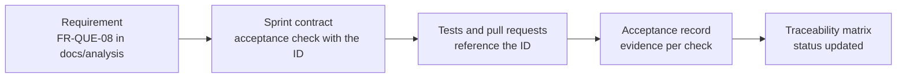

# Quality assurance and acceptance

Status: v0.1 · How we prove that what is built matches what is documented. Process: [roadmap README](../roadmap/README.md) (contract-first sprints, Definition of Done) · Methods: [testing strategy](../development/testing-strategy.md).

## 1. Documents

| Document | Purpose |
|---|---|
| [traceability-matrix.md](traceability-matrix.md) | Every `FR-*` and `NFR-*` requirement with its sprint, side, verification method and status |
| [sprint-0-acceptance.md](sprint-0-acceptance.md) | Acceptance record of Sprint 0: checks B1–B17 and F1–F12 with evidence |
| [sprint-1-acceptance.md](sprint-1-acceptance.md) | Sprint 1 (platform and onboarding): 40 checks with evidence; open for independent verification |
| [sprint-2-acceptance.md](sprint-2-acceptance.md) | Sprint 2 (facility setup and staff): backend and frontend evidence; real-API checks wait for staging |
| [sprint-3-acceptance.md](sprint-3-acceptance.md) | Sprint 3 (patients and identity): backend and frontend (#59) evidence and known gaps |
| [sprint-4-acceptance.md](sprint-4-acceptance.md) | Sprint 4 (visits and the live queue): evidence per check and known gaps |
| [sprint-5-acceptance.md](sprint-5-acceptance.md) | Sprint 5a (booking core): evidence per check; S5b checks open |
| `sprint-N-acceptance.md` | One record per sprint, created from the template in §5 when the sprint contract is agreed |

## 2. The chain from requirement to evidence



- Requirements are the source of scope. A sprint contract turns the sprint's requirements into numbered **acceptance checks** (B… for the backend, F… for the frontend).
- Pull requests and test names reference the requirement IDs (`test_call_next_is_atomic  # FR-QUE-08`).
- The sprint's **acceptance record** holds one row per check, with evidence.
- The **traceability matrix** is updated from the record at the end of the sprint.

## 3. Status values

| Status | Meaning | Set when |
|---|---|---|
| **Not started** | No sprint has started work on it | Default |
| **In progress** | The sprint that builds it has started | Sprint start (Sprint 0 items are In progress now) |
| **Implemented** | Merged to `main` with its tests, deployed to staging | The implementing pull requests are merged |
| **Verified** | Every acceptance check that covers it has evidence, checked by someone other than the author | Sprint verification step |
| **Accepted** | Shown at the sprint demo and accepted by the product owner; for go-live, also covered by the P1 exit criteria | Sprint review |

A requirement spread over several sprints (for example `S0, S2`) stays **In progress** until its last sprint verifies it. Add the sprint and version in the Status cell when it changes, e.g. `Verified (S4, backend-v0.5.0)`.

## 4. How evidence is recorded each sprint

1. **At sprint start**, copy the template (§5) to `sprint-N-acceptance.md`, list every acceptance check from the contract with its requirement IDs, and set those requirements to **In progress** in the matrix.
2. **During the sprint**, each pull request names the checks and requirements it covers and links its tests.
3. **Verification** (before the sprint demo): a verifier who did not write the code fills the Evidence, Verified by, Date and Result columns. Evidence is one or more of:

| Evidence | Example | Rule |
|---|---|---|
| Test reference | `backend/tests/authz/test_matrix.py::test_other_facility_returns_404` | Must be in the suite that runs in CI |
| CI run | Link to the green run on the merge commit | CI logs expire (90 days by default): copy the key numbers (tests passed, coverage, scan summary) into the record |
| Command output | `manage.py check --deploy` output, coverage summary | Paste the relevant lines, not whole logs |
| Screenshot or recording | Focus order, both themes, mobile width | Synthetic data only; store under `docs/qa/evidence/sprint-N/` or attach to the GitHub Release |
| Report | Load test summary, ZAP report, axe report | Attach to the GitHub Release of the sprint; link it |

4. **Result** is `Pass`, `Fail` (with an issue link) or `Waived` (with the reason and who accepted the risk). A failed check blocks the sprint release unless it is waived in writing.
5. **Update the matrix**: requirements whose checks all pass become **Verified**; after the demo, **Accepted**.
6. **Freeze the record** when the sprint is released. Later corrections are added as new rows with a date, never by rewriting old evidence.

Never put real patient data, secrets or production screenshots in evidence ([SECURITY.md](../../SECURITY.md)).

## 5. Template for a sprint acceptance record

```markdown
# Sprint N acceptance record: <theme>

Contract: docs/architecture/0X-sprint-N-contract.md · Releases: backend-vX.Y.Z, frontend-vX.Y.Z
Status: Open | Verified | Accepted on YYYY-MM-DD by <product owner>

## Backend checks

| # | Check | Requirements | Evidence | Verified by | Date | Result |
|---|---|---|---|---|---|---|
| B1 | … | FR-… | … | … | … | Pending |

## Frontend checks

| # | Check | Requirements | Evidence | Verified by | Date | Result |
|---|---|---|---|---|---|---|
| F1 | … | NFR-… | … | … | … | Pending |

## Definition of Done

- [ ] All acceptance checks verified with evidence
- [ ] Traceability matrix statuses updated
- [ ] CHANGELOGs and API catalogue updated
- [ ] Deployed to staging and demoed

## Notes, waivers and follow-ups
```

## 6. Automated checks

Run from the repository root (Python 3, no dependencies):

| Command | Checks |
|---|---|
| `python scripts/check-traceability.py` | Every requirement ID in `docs/analysis/` appears exactly once in the matrix, with a valid status |
| `python scripts/check-docs-links.py` | Every relative link and heading anchor in the repository's Markdown files resolves |

Run both before merging documentation changes. They can be added to CI as a docs job.

## 7. Go-live

Phase 1 is accepted when all P1 requirements are **Accepted** on staging, the penetration test has passed, facility staff have run a full day in a simulated clinic ([analysis 16](../analysis/16-roadmap-and-phasing.md) exit criteria), and the [go-live security checklist](../security/14-go-live-security-checklist.md) is complete or risk-accepted in writing.
