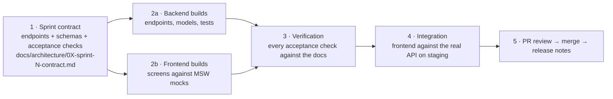

# Delivery roadmap

Status: v0.1 · Backend and frontend are developed in parallel and hosted separately ([ADR 0006](../decisions/0006-separate-frontend-and-backend-hosting.md)).

- [Backend roadmap](backend.md)
- [Frontend roadmap](frontend.md)

## How a sprint works (contract-first)

1. **Contract:** before coding, the sprint's endpoints, schemas, errors and acceptance checks are written and agreed (like [Sprint 0](../architecture/03-sprint-0-contract.md)).
2. **Parallel build:** the backend implements the contract. The frontend builds the screens against MSW mocks of the same contract.
3. **Verification:** every acceptance check is ticked with evidence (test name, screenshot, command output), traced to requirement IDs (`FR-*`, `NFR-*`), security controls and design rules.
4. **Integration:** mocks are switched off and the frontend runs against the real backend on staging. Contract drift is fixed.
5. **Release:** squash-merged PRs, changelog entries, version tags (`backend-vX.Y.Z`, `frontend-vX.Y.Z`).

## Waves: sprints built in parallel

Sprints whose dependencies are done are built **at the same time**, one backend builder and one frontend builder per sprint, each in its own branch. Shared files use marked blocks so parallel work merges cleanly ([shared-file protocol](../architecture/contracts/README.md#shared-file-protocol-parallel-sprints)).

| Wave | Sprints | Depends on |
|---|---|---|
| 0 | S0 Foundations | — (done) |
| 1 | S1 platform and onboarding · S3 patients and identity · S9 notification engine | S0 |
| 2 | S2 facility setup · S10 help center and support | S1 |
| 3 | S4 visits and the live queue | S2, S3 |
| 4 | S5 booking and calendars · S6 clinical record | S4 |
| 5 | S7 pharmacy and documents · S8 billing | S6 (S8 also S2, S4) |
| 6 | S10 disputes and reports · S9 event wiring across modules | most modules |
| 7 | S11 hardening and pilot readiness | all |

Per wave: contracts first (merged), then parallel builders, then the orchestrator verifies each sprint against its contract and merges them one at a time (rebase, regenerate the OpenAPI schema, full suites, green CI).

## Definition of Done (every sprint, both sides)

- [ ] All acceptance checks of the sprint contract verified with evidence
- [ ] Requirement IDs referenced in PRs, and the docs updated if behaviour changed
- [ ] Tests: unit + authorisation matrix (backend), component + axe (frontend), e2e for the sprint's main flow
- [ ] Security checklist of the PR template satisfied; no new high findings in CI scans
- [ ] Accessibility: keyboard, labels, contrast, both themes (frontend)
- [ ] All user-facing text in translation files (rw/en/fr)
- [ ] CHANGELOG updated (`backend/` or `frontend/`); API catalogue updated
- [ ] CI green; deployed to staging; demoed

## Milestone M1 (Web MVP) at a glance

| Sprint | Theme | Backend | Frontend |
|---|---|---|---|
| S0 | Foundations | Project, auth + MFA, roles, facility scoping + RLS, audit log, CI | Workspace, design tokens + UI kit, API client, login/MFA/shell, landing skeleton |
| S1 | Platform & onboarding | Facility applications, verification, master data | Application wizard, super admin console |
| S2 | Facility setup | Services, service points, schedules, tariffs, insurers, queue rules, staff invites | Setup checklist and settings screens, invite acceptance |
| S3 | Patients | Patients, dependents, walk-in registration, duplicates, insurance profiles, health profile | Patient profile/family/insurance, reception quick-register |
| S4 | Queue core | Visits, check-in, tickets, ordering, call next, real-time, display | Reception Today board, doctor My queue, display screen, patient tracker |
| S5 | Booking & calendars | Slots, booking, remote join, reminders, disruptions, no-shows | Discovery + booking flow, calendars |
| S6 | Clinical record | Consultation, signing, addenda, history, results inbox, legacy import | Consultation screen, history timeline, import tools |
| S7 | Pharmacy & documents | Prescriptions, dispensing, PDFs, QR verification, uploads | Prescription UI, pharmacy queue, documents, verify page |
| S8 | Billing | Bills, payments, receipts, approvals, cash-up | Payments desk, approvals, receipts |
| S9 | Notifications | Notification service, in-app, web push, email, preferences, announcements | Inbox, push opt-in, preferences, announcements |
| S10 | Disputes, help, reports | Disputes, support, reports, exports | Dispute flows, help center, report dashboards |
| S11 | Hardening & pilot readiness | Load tests, pen-test fixes, backups/restore, monitoring | Offline/PWA polish, a11y audit, usability fixes, training mode |

Each sprint is about 2 weeks. M1 is about 24 weeks for a small team (the estimate gets refined after S0–S1). P2–P4 are summarised at the end of each roadmap.
