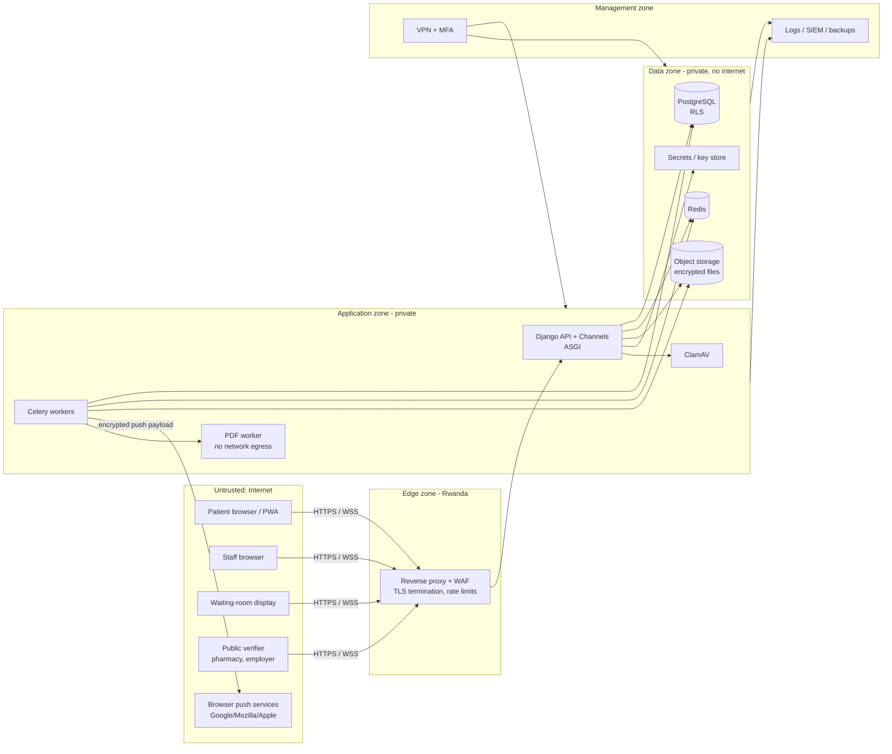

# 01 · Threat model

Status: v0.1 · Method: **STRIDE** for security, **LINDDUN** for privacy, plus MediLink-specific **abuse cases**. Revisit at every milestone and for every new feature that touches patient data.

## 1. What we protect (assets)

| Asset | Sensitivity | Why it matters |
|---|---|---|
| Clinical records (diagnoses, notes, prescriptions, results, restricted records) | **Critical** | Sensitive personal data (Law 058/2021); stigma (HIV, mental health); patient safety if altered |
| Patient identity (names, national ID, phone, date of birth, insurance numbers) | High | Identity theft, insurance fraud, enumeration |
| Documents (prescriptions, sick notes, receipts, referral letters) | High | Forgery and fraud; contain clinical data |
| Money records (bills, payments, receipts, cash-ups, refunds) | High | Cashier fraud, disputes, tax |
| Queue state and bookings | Medium–High | Fairness, bribery, availability at peak; patient safety (missed calls) |
| Audit log | Critical (integrity) | Evidence for disputes, investigations and the law |
| Credentials, sessions, 2FA secrets, API keys, encryption keys | Critical | Keys to everything |
| Facility configuration (tariffs, insurer rules, staff roles) | High | Fraud by changing prices or roles |
| AI training data and models (P2+) | High | Re-identification; poisoning leads to unsafe advice |
| Availability of the service (06:00–10:00 peak) | High | Reception stops; patients miss turns |

## 2. Who might attack (actors)

| Actor | Motivation | Capability |
|---|---|---|
| **Curious or malicious insider** (staff viewing neighbours', colleagues' or celebrities' records) | Curiosity, gossip, blackmail, sale | Valid login and role |
| **Fraudulent insider** (cashier, receptionist, pharmacist) | Money: skimming, fake refunds, selling drugs, selling queue places | Valid login, knows the process |
| **Opportunistic external attacker** | Ransomware, data theft for sale | Automated scans, phishing, credential stuffing, known CVEs. Healthcare saw ransomware roughly every 10 hours in 2025–26 (see [Sources](15-sources.md)). |
| **Fraudulent patient / outsider** | Forged sick notes or prescriptions, insurance fraud, booking hoarding, queue jumping | Public web app, a phone, document editing tools |
| **Fake facility or fake clinician** | Harvest patient data; legitimacy for fraud | Forged registration documents |
| **Former staff** | Revenge, continued access | Old credentials and knowledge |
| **Compromised supplier / dependency** | Supply chain attack | Malicious package or image |
| **Relative / abusive partner** | Control, surveillance of a patient | Access to the patient's phone; social engineering at reception |

## 3. System and trust boundaries

**Trust boundaries:**
1. Internet → edge
2. Edge → application
3. Application → data
4. Admin access through the VPN
5. Outbound calls to third parties (push services, email relay)
6. Browser storage on patient and shared devices

## 4. STRIDE per component

| Component | Spoofing | Tampering | Repudiation | Information disclosure | Denial of service | Elevation of privilege |
|---|---|---|---|---|---|---|
| Login / sessions | Credential stuffing, phishing, session theft | Session fixation | "It wasn't me" | Account enumeration | Lockout abuse | Staff role confusion across facilities |
| REST API | Forged requests (CSRF) | Mass assignment, negative amounts | Missing logs | **BOLA/IDOR**: reading another facility's or patient's object | Expensive queries, no pagination | **BFLA**: patient calling staff endpoints |
| WebSockets | Cross-site WebSocket hijacking | Fake queue events | — | Subscribing to another facility's channel | Connection floods | Display token used to act |
| Queue engine | — | Reordering without reason; race conditions | Unattributed changes | — | Peak-hour overload | Receptionist doing doctor actions |
| Clinical records | Signing as another doctor | Editing signed records | Denying authorship | Snooping; over-broad history view | — | Pharmacist seeing notes |
| Billing | — | Voiding receipts, fake refunds, price edits | Denying a void | — | — | Self-approval |
| File uploads | — | Malicious files (malware, polyglots, decompression bombs) | — | EXIF GPS leaks | Huge files | Stored XSS via SVG/HTML |
| PDF generation | — | Template injection | — | **SSRF / local file read through the renderer** | Rendering bombs | — |
| Document verification page | Forged documents | — | — | Enumeration of codes → data | Scraping | — |
| Notifications | Spoofed emails ("MediLink" phishing) | — | — | Clinical details in push or email | Spam | **SSRF through push endpoint URLs** |
| Admin tools | — | Config tampering | — | Bulk export | — | Django admin exposed to the internet |
| Infrastructure | — | Malicious image or dependency | — | Exposed DB, Redis or object store; leaked backups | Ransomware, DDoS | Container escape, SSH compromise |

## 5. Abuse cases specific to MediLink

| # | Abuse case | Controls (detailed in later docs) |
|---|---|---|
| AB-01 | Staff member reads a neighbour's or colleague's record | Treatment-relationship rule; reason prompt outside own queue; staff-as-patient flag with mandatory review; patient-visible access history; snooping alerts ([04](04-authorization-and-tenant-isolation.md), [08](08-logging-monitoring-and-detection.md)) |
| AB-02 | Receptionist sells queue places | Reorder needs reason, is logged, reviewed and reported per staff member; patients see their position change and can dispute |
| AB-03 | Cashier pockets cash and voids receipts | Gapless receipt numbers; voids need admin approval; no self-approval; shift cash-up; void and discount reports per staff member ([06](06-application-and-api-security.md) §7) |
| AB-04 | Forged sick note or prescription | QR + code verification page; document hash; status (cancelled / superseded); watermark |
| AB-05 | Fake facility registers to harvest data | Document verification, call or visit, licence expiry tracking, suspension; patients only see live facilities |
| AB-06 | Fake doctor added by a facility | Licence number required, admin attestation, later council check; audit of who added whom |
| AB-07 | Attacker claims a walk-in's record | Claim requires a code to the registered contact or in-person ID check by reception; claim events alert the patient |
| AB-08 | Booking bots hoard slots | Active booking cap, slot hold timeout, rate limits, account age checks |
| AB-09 | Pharmacist marks dispensed but diverts drugs | Dispensing record signed; patient sees status and can dispute; dispensing vs stock reports (P2) |
| AB-10 | Abusive partner monitors a patient | Restricted records hidden from delegates; patient controls delegates; access history; no clinical content in notifications |
| AB-11 | Caller pretends to be a relative to get results | Policy: no clinical info by phone; results only in-app or in person with ID |
| AB-12 | Former staff keeps using an account | Deactivation ends sessions instantly; periodic access reviews; no shared accounts |
| AB-13 | Patient forges an insurance card | Card photo stored; verification by receptionist logged; patterns reported (same number, many patients) |
| AB-14 | Malicious upload targets staff who open it | Type allowlist, AV scan, image re-encoding, served as attachment from an isolated domain |
| AB-15 | Data poisoning of AI training (fake diagnoses) | Training only on signed records; outlier detection; clinician review of the training set ([13](13-ai-security.md)) |

## 6. Privacy threats (LINDDUN)

| Category | Threat in MediLink | Mitigation |
|---|---|---|
| **L**inking | Combining visits across facilities to profile a person | Facility-scoped data; cross-facility only with consent; de-identified analytics with minimum group sizes |
| **I**dentifying | Re-identifying people from "anonymous" reports or AI data | De-identification pipeline, k-anonymity thresholds, no free text in exports |
| **N**on-repudiation (patient's side) | A patient can't deny having visited a sensitive service | Restricted records; neutral service names on receipts and notifications; minimal documents |
| **D**etecting | Inferring health status from notifications ("Your HIV clinic visit…") or display screens | Neutral notification text; ticket numbers only on displays; neutral facility-service labels |
| **D**ata disclosure | Over-sharing to staff, insurers, employers | Least privilege, field-level filtering, sick notes without diagnosis by default |
| **U**nawareness | Patients don't know who sees what | Plain-language privacy notice, access history, consent screens, delegate controls |
| **N**on-compliance | Breaching Law 058/2021 (residency, consent, retention, breach notification) | [12 · Compliance mapping](12-compliance-mapping.md) |

## 7. Top risks (initial ranking)

| Rank | Risk | Likelihood | Impact |
|---|---|---|---|
| 1 | Broken access control between facilities or patients (BOLA) | Medium | Very high |
| 2 | Insider snooping on clinical records | High | High |
| 3 | Ransomware / destructive attack on servers or backups | Medium | Very high |
| 4 | Staff account takeover by phishing or credential reuse | Medium | High |
| 5 | Cashier and queue fraud | High | Medium |
| 6 | Document forgery (sick notes, prescriptions) | High | Medium |
| 7 | Vulnerable dependency or misconfiguration (OWASP A02/A03 2025) | Medium | High |
| 8 | Data leaving Rwanda through third-party services (CDN, email, error tracking, AI) | Medium | High (legal) |
| 9 | Peak-hour outage or DDoS | Medium | High |
| 10 | Malicious file upload | Low–Medium | High |
