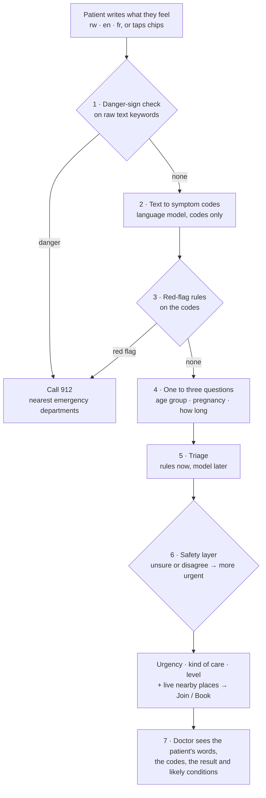

# 07 · Symptom checker and AI

Status: Draft v0.1 · 2026-11-02 · Part of the [system upgrade](README.md) · Keeps [ADR 0005](../decisions/0005-symptom-checker-ml-with-safety-rules.md) and [analysis 11](../analysis/11-ai-symptom-checker.md); changes the input and the timing

## 1. What we want

A person who feels unwell but does not know what they have should be able to describe it **in their own words**, learn **how urgently** they need care and **what kind of care**, and be shown **nearby places that accept their insurance**, with Join or Book. A doctor should receive the same information before the consultation, including a list of **likely conditions** to consider.

## 2. Flow

| Step | Rule |
|---|---|
| 1 Danger-sign check | Runs before anything else on the raw text, with a keyword list per language reviewed by the clinical lead and a native speaker (for example bleeding, cannot breathe, convulsions, unconscious, chest pain). A match shows Call 912 at once. |
| 2 Text to codes | A language model turns the text into symptom codes from the master list, plus duration and severity when stated. It never decides urgency and has no tools. Its output is validated against the symptom list; unknown output is dropped. |
| 3 Red-flag rules | The signed rule set runs on the codes. The model can never override it. |
| 4 Questions | At most three, one per screen, only those the rules need. |
| 5 Triage | P1: the rules engine (version `2026.11-p1`, awaiting clinical sign-off, [#93](https://github.com/B-Pine/medilink-rwanda/issues/93)). Later: the trained model, first in shadow mode for doctors only. |
| 6 Safety layer | Infants and people 65+ never get self-care; low confidence or disagreement raises urgency. |
| 7 Doctor view | The consultation shows the patient's words, the codes, the urgency and, **for doctors only**, a ranked list of likely conditions marked "suggestion". |

## 3. What each person sees

| Output | Patient | Doctor |
|---|---|---|
| Urgency (emergency, today, soon, self-care) | Yes | Yes |
| Kind of care and level of care | Yes | Yes |
| Nearby places with live waits and insurance | Yes | — |
| The patient's own words and extracted symptoms | Yes (their own) | Yes |
| Likely conditions | **No** (see §5) | Yes, as suggestions |
| "Guidance, not a diagnosis" | Yes, once, small | — |

## 4. Data and model

| Stage | What | Who sees output | Phase |
|---|---|---|---|
| Rules triage + free-text parsing | Rules on codes; language model for parsing only | Patients and doctors | P1 |
| First model | Trained on DDXPlus and a Rwanda-adjusted knowledge base (clinician tables, HMIS frequencies by district and season) | Doctors only (shadow mode) | P1 build, shadow in pilot |
| Real-data model | Retrained on consented, de-identified pairs of "what the patient reported" and "the doctor's signed ICD-10 diagnosis" | Doctors, then patients after release gates | P3–P4 |

Every prediction is logged with the rules or model version, the input codes and the output, never the account, IP or device (`triage_log`). The patient's free text is stored only with the visit, encrypted, as part of the reason for visit.

## 5. Showing likely diseases to patients: open decision OD-1

The product owner would like patients to see likely conditions. These conditions must be met first, and they are recorded here so the decision is made knowingly:

| Condition | Why |
|---|---|
| Legal opinion on medical-device status from Rwanda FDA | Software that names diseases for patients is likely a regulated medical device; a disclaimer does not change that |
| Clinical lead sign-off and an under-triage release gate on a Rwandan vignette set | Commercial symptom checkers give the right triage advice about 57 % of the time; the worst error is telling a seriously ill person they are fine |
| Shadow-mode period with doctors comparing suggestions and their own diagnoses | Proves the model on real Rwandan patients |
| Wording that leads with urgency and places, with conditions second and "possible", never "you have" | Patients act on the first thing they read |

Until then, patients see urgency, the kind of care and places; doctors see likely conditions.

## 6. Where the language model runs: open decision OD-2

| Option | Data residency | Notes |
|---|---|---|
| Hosted NVIDIA API (build.nvidia.com) or another foreign API | Health data leaves Rwanda: a cross-border transfer under Law 058/2021 that needs authorisation | Fastest to start; not allowed in production without authorisation |
| **Self-hosted model in Rwanda** (NVIDIA NIM container or an open model) | Stays in Rwanda | Recommended; needs a GPU or a small CPU model; Kinyarwanda quality must be measured |
| No language model (chips and a keyword parser only) | Stays in Rwanda | Fallback; weaker on free text |

Before production: measure parsing accuracy on a set of real Kinyarwanda, English and French sentences written by native speakers and checked by a clinician; target at least 90 % of symptoms extracted correctly and 100 % of danger signs caught by step 1 or step 3.

## 7. Also needed

- **Research consent** (separate, unticked) before any patient text is used for training; ethics approval from the Rwanda National Ethics Committee.
- **Rate limit** on the public endpoint (already 20 per minute per IP).
- **Prompt-injection safety:** the model output is codes only and validated; the raw text never becomes an instruction.
- **Monitoring:** weekly review of missed red flags and of cases where the doctor's urgency was higher than the checker's.

## 8. Proposed API changes

| Change | Endpoint |
|---|---|
| Accept `text` (≤ 500 characters) alongside `symptoms`; return the extracted `symptoms` | `POST /public/triage/` |
| Return `danger_check` result separately so the screen can stop early | `POST /public/triage/` |
| Staff-only `likely_conditions` with model version | Consultation detail (C2) |
