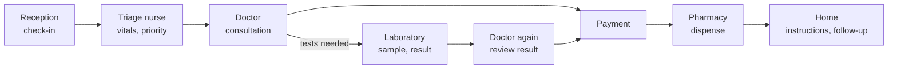
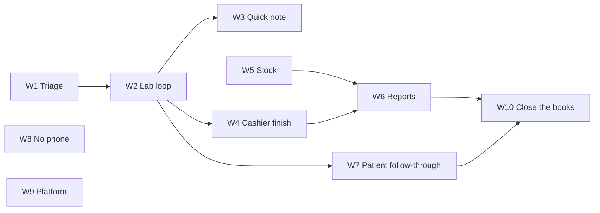

# 13 · Full visit plan: every role, end to end

Status: Draft v0.1 · 2026-11-04 · Part of the [system upgrade](README.md) · Tracking: milestone **U8 · Full visit**

## 1. Why

A walk through each person's day (2026-11-04) showed that the parts of a visit work, but **one full visit does not**. A real outpatient visit in Rwanda runs:

Reception, the doctor's note, payment and pharmacy exist. **Triage and the laboratory loop do not**, so the doctor fills both roles, urgent patients wait in the normal line, and a patient sent for a test leaves the system and comes back as a new ticket.

This plan closes the gaps by role, in the order that makes one visit work end to end first. It applies [06 · New roles](06-new-roles.md) and finishes the open parts of [10 · Implementation plan](10-implementation-plan.md) U4–U7.

## 2. Where each role stands (2026-11-04)

| Role                  | Works today                                                                                                                                                                                                                                         | Missing                                                                                                                  | Ready |
| --------------------- | --------------------------------------------------------------------------------------------------------------------------------------------------------------------------------------------------------------------------------------------------- | ------------------------------------------------------------------------------------------------------------------------ | ----- |
| Patient               | Find care, book or join the queue, live ticket, medicines, documents, AI assistant, emergency page                                                                                                                                                  | Results released by the doctor, reminders (follow-up, vaccination, antenatal), "almost your turn" alert                  | ~80%  |
| Receptionist          | Front desk, code check-in, expected list, insurance card photo, contact person, printed slip, board, raise emergency                                                                                                                                | Insurance eligibility is a photo, not a check (blocked by decision #40)                                                  | ~85%  |
| Triage nurse          | —                                                                                                                                                                                                                                                   | Role, triage stage, vitals station, priority                                                                             | 0%    |
| Doctor                | Today, my queue, consultation (vitals, history, exam, ICD-10, plan, instructions, private notes, addenda), prescriptions, signing, results inbox, pharmacy questions, follow-ups, templates, referral, lab request document, sick note, break-glass | Lab orders that create work for the lab; "waiting for result" and return to the same doctor; quick note for common cases | ~65%  |
| Laboratory technician | —                                                                                                                                                                                                                                                   | Role, lab queue, sample, result entry, result back to the doctor                                                         | 0%    |
| Pharmacist            | Counter, dispensing, history, QR verification, availability, questions to the doctor, labels                                                                                                                                                        | Stock levels (out of stock is a manual flag); controlled-medicine rules (decision #41)                                   | ~70%  |
| Cashier               | Cash desk, bills with insurer and patient shares, payments (cash, MoMo, Airtel, card as recorded methods), exemptions, receipts, voids and refunds through approvals, cash shifts                                                                   | Lab items on the bill; monthly insurer claim list; live mobile-money collection (needs a provider contract)              | ~70%  |
| Facility admin        | Setup, staff, roles, schedules, service points, licence checks, announcements                                                                                                                                                                       | **Reports**: the menu item has no page                                                                                   | ~75%  |
| Super admin           | Command centre, applications, facilities, users (#199), logs, break-glass reviews, master data, flags, support                                                                                                                                      | National aggregate report; email change and grant platform admin (decisions)                                             | ~85%  |

## 3. Workstreams

Each workstream is one issue and one or two pull requests, contract first: API and mocks, then screens, then tests and docs. Estimates are focused engineering days including tests and docs.

### W1 · Triage nurse and the triage stage (proposed FR-QUE-22) · 2 days

**Outcome:** after check-in, patients of a service with triage on go to the triage queue; the nurse calls them, records vitals, sets priority or emergency, and sends them to consultation.

| Layer     | Change                                                                                                                                                                                                                                                                                                        |
| --------- | ------------------------------------------------------------------------------------------------------------------------------------------------------------------------------------------------------------------------------------------------------------------------------------------------------------- |
| Roles     | Seed role `triage_nurse` through `extend_roles` with `triage.operate`, `vitals.record`, `visit.reason.view`, `queue.call` (triage stage). Never diagnoses, notes, prescriptions or bills.                                                                                                                     |
| Visits    | `Stage.TRIAGE`; service setting `triage_enabled` (off by default, so nothing changes for facilities that don't use it). Check-in creates the triage ticket when on; finishing triage moves the ticket to consultation with the priority set.                                                                  |
| Clinical  | Reuse `Vitals`; recorded by the nurse with the visit, shown to the doctor at the top of the consultation.                                                                                                                                                                                                     |
| API       | `GET /staff/triage/queue/`, `POST /staff/tickets/{id}/triage/` (vitals, priority class, emergency flag with reason, short note), existing call and no-response actions for the stage.                                                                                                                         |
| staff-web | Nurse home: triage queue with the patient's words, age, sex, allergies and red-flag marker; one vitals form (temperature, blood pressure, pulse, SpO₂, weight, MUAC) with out-of-range warnings; "Send to doctor". Doctor's consultation shows "Triage" vitals and note. Settings: triage switch per service. |
| Tests     | Authorisation matrix column for the role (sees only what the table above allows); stage flow; queue order with priority.                                                                                                                                                                                      |

### W2 · Laboratory loop (proposed FR-CLN-11) · 3 days

**Outcome:** the doctor orders tests in the consultation; the lab sees them, records the sample and enters results; the result reaches the doctor's results inbox; the patient returns to the same doctor with return priority; the doctor reviews and releases the result to the patient.

| Layer       | Change                                                                                                                                                                                                                                                                                                                                                           |
| ----------- | ---------------------------------------------------------------------------------------------------------------------------------------------------------------------------------------------------------------------------------------------------------------------------------------------------------------------------------------------------------------- |
| Roles       | Seed `lab_technician` with `lab.operate`, `lab.result.enter`. Sees test names, request reason, identity and payment state; never diagnoses, notes or other visits.                                                                                                                                                                                               |
| Data        | Lab test catalogue in master data (code, name, specimen, result kind: number with unit and range, choice such as positive or negative, or file). `LabOrder` per requested test, linked to the existing `LabRequest` document and the visit: states `ordered → sample_taken → resulted → reviewed → released`. Results stored encrypted like other clinical text. |
| Visits      | `Stage.LAB`; the doctor's "Send to lab" moves the ticket to the lab stage and marks the consultation **waiting for results**; when every test is resulted, a return ticket goes to the ordering doctor's queue with return priority.                                                                                                                             |
| Billing     | Each ordered test adds a bill line from the tariff; the lab sees "Paid" or "Not paid" (facility setting decides whether unpaid tests may start).                                                                                                                                                                                                                 |
| API         | `POST /staff/consultations/{id}/lab-orders/`, `GET /staff/lab/queue/`, `POST /staff/lab-orders/{id}/sample/`, `POST /staff/lab-orders/{id}/result/`, doctor `POST /staff/lab-orders/{id}/review/` and `release/`; patient `GET /patient/results/` shows released results only.                                                                                   |
| staff-web   | Doctor: "Order tests" panel in the consultation (search the catalogue, favourites), "Send to lab", results inline when they come back. Lab home: requests waiting, in progress, done today; sample label print; result entry with ranges flagged.                                                                                                                |
| patient-web | Results in the record once released, with the doctor's note.                                                                                                                                                                                                                                                                                                     |
| Tests       | Authorisation matrix; full loop doctor → lab → doctor; nothing reaches the patient before release.                                                                                                                                                                                                                                                               |

### W3 · Doctor's quick note · 1 day

**Outcome:** a common visit (for example uncomplicated malaria) takes one minute to document.

- **Order sets** built on templates: a diagnosis, a plan, patient instructions, a prescription and optional lab tests applied in one click, then edited.
- The doctor's favourites at the top of the diagnosis picker and the medicine search.
- The note keeps every section; nothing is skipped silently, and the doctor still signs.

### W4 · Cashier and insurance finish · 1.5 days

**Outcome:** the bill covers everything in the visit and the facility can send each insurer its monthly list.

- Lab tests (W2) and procedures arrive on the bill automatically.
- **Monthly claim list per insurer** (CSV and PDF): member number, visit date, ICD-10 codes, services, amounts, patient share. Marking claims paid or rejected with a reason. Electronic submission to RAMA or MMI waits for their interface and decision #40.
- End-of-shift summary by payment method on the cash desk.
- Live mobile-money collection (MTN MoMo, Airtel Money API) stays out until a provider contract exists; the cashier records the reference as today.

### W5 · Pharmacy stock (lite) · 1.5 days

**Outcome:** the pharmacist knows what is in stock without counting by hand.

- Stock per medicine and batch with expiry: receive stock, dispensing deducts it, manual adjustment with a reason (audited).
- Low-stock threshold per medicine; "out of stock" on availability set automatically, so the doctor sees it when prescribing.
- Expiring-soon list. A full stores and procurement system stays out of scope.

### W6 · Facility reports · 1.5 days

**Outcome:** the facility director sees how the facility runs.

`/reports` for `reports.view`, by day, week or month, each table exportable as CSV:

- Patients seen by service and source (walk-in, booking, referral, emergency); no-shows.
- Waiting time by stage (median and 90th percentile), from ticket events.
- Top diagnoses (ICD-10), referrals out.
- Revenue by payment method and insurer; exemptions; voids.
- Lab tests done and turnaround (W2); stock-outs and expiring stock (W5).

Data come from existing tables; no patient names in the reports.

### W7 · Patient follow-through · 1.5 days

**Outcome:** the patient knows what happens next without calling.

- Released results (W2) in the record.
- Reminders through the notification engine (S9): follow-up dates the doctor set, vaccination and antenatal schedules entered by staff, 24 hours and 2 hours before booked visits.
- "Almost your turn" when 3 people are ahead, and when called, by web push where allowed; the ticket page keeps the live view.
- SMS for patients without a smartphone stays in M3 (needs an SMS provider).

### W8 · Patients without a phone: the rest of U4 · 1 day

- **Spoken call** on the waiting-room display: ticket number and room in Kinyarwanda, English or French (browser speech, pre-recorded Kinyarwanda clips where browser voices are poor).
- **Pictograms** on medicine labels: morning, noon, evening, night; with or after food.
- The appointment card print from reception (already the slip) gets the next date when the doctor sets a follow-up.

### W9 · Platform completion · 1 day

- **National aggregate report** for the super admin: load by facility and district, wait trends, top diagnoses by district, stock-outs; groups smaller than 10 hidden.
- **Decisions needed, then built if approved:** change a person's email (with notice to both addresses and re-confirmation) and grant or remove platform admin (two admins must approve).

### W10 · Close the books · 1 day

- Verify and close the sprint issues whose work is built (#31, #61, #71, #77, #78, #33, #123, #140, #137) or list what is truly left in each.
- Refresh the [traceability matrix](../qa/traceability-matrix.md) summary from the rows; add FR-QUE-22 and FR-CLN-11 to the analysis documents.
- One end-to-end Playwright test of the full visit: reception → triage → doctor → lab → doctor → payment → pharmacy → patient sees instructions and result.

## 4. Order

| Wave | Workstreams | Days | Result                                                                       |
| ---- | ----------- | ---- | ---------------------------------------------------------------------------- |
| 1    | W1, W2      | 5    | One full visit works with triage and lab                                     |
| 2    | W3, W4, W5  | 4    | The doctor is fast; the bill and stock are complete                          |
| 3    | W6, W7, W8  | 4    | The director has reports; patients are followed up; no-phone patients served |
| 4    | W9, W10     | 2    | Platform complete; tracking and the full-visit test prove it                 |

About **15 focused days** in total. W8 and W9 do not depend on the others and can run in parallel.

Issues: W1 #200 · W2 #201 · W3 #202 · W4 #203 · W5 #204 · W6 #205 · W7 #206 · W8 #207 · W9 #208 · W10 #209.

## 5. Out of scope for this plan

| Item                                                                     | Why                                                                              | Where it goes  |
| ------------------------------------------------------------------------ | -------------------------------------------------------------------------------- | -------------- |
| Inpatient care (admission, beds, ward rounds)                            | A different product area; clinics and health centres don't need it for the pilot | M2 analysis    |
| Full laboratory information system (analysers, quality control)          | W2 is the lite loop from [06](06-new-roles.md) §3                                | Later          |
| Electronic insurance claims and live eligibility                         | Needs RAMA and MMI interfaces and decision #40                                   | When available |
| Live mobile-money collection                                             | Needs a provider contract                                                        | When signed    |
| SMS                                                                      | Needs a provider; M3                                                             | M3             |
| Community health worker, external pharmacy, insurer and ministry portals | P2 and P4 roles in [06](06-new-roles.md)                                         | M2+            |

## 6. Not code: still needed before a pilot

These block real patients regardless of the code: legal go-live items (#94), clinical sign-off of the red-flag list (#93), the open business questions (#35–#41), Kinyarwanda review (#11), staging in Rwanda (#17), a private repository with a protected `main` (#18), runbooks (#42) and the base-image vulnerabilities (#106).

## 7. Definition of done (each workstream)

- Contract written first: endpoints in the [API catalogue](../api/catalogue.md), types and MSW mocks in `@medilink/api-client`.
- New roles appear in the authorisation matrix tests for every endpoint they touch.
- Screens follow [02](02-design-system.md) and pass axe; English, French and draft Kinyarwanda strings.
- Changelogs, traceability matrix and analysis documents updated in the same pull request.
- CI green; squash-merged through a pull request that names its issue.
