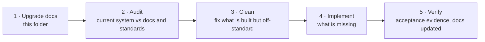

# System upgrade (v1.0 target)

Status: Draft v0.1 · 2026-11-02 · Owner: product + engineering

This folder describes the **upgrade of MediLink Rwanda** agreed on 2026-11-02: what the product should look and behave like, why each change was made, how we check the current build against it, and the order in which we change the code. It is the target specification for the next round of work. When an older document disagrees with this folder, this folder records the decision and the older document is updated in the same pull request that implements the change.

## Why an upgrade

Sprints S0–S10 delivered most of the M1 scope, but three things came out of a full review of the documents and the product:

1. **Some product choices do not match how care works in Rwanda.** For example, discovery showed an estimated price per facility, but the real cost depends on the illness, the tests and the medicines, so a number shown before the visit is wrong most of the time and creates disputes.
2. **Some users were not served well enough.** Patients without a phone, triage nurses, laboratory staff and separate cashiers are common in real facilities but had no proper place in the design.
3. **The interface must look and feel like a professional product.** Long explanatory text, decorative sections and generic layouts make software look unfinished or machine-generated. The upgrade sets one clean, data-first design language for every screen.

## How to read this folder

| # | Document | Read it for |
|---|---|---|
| 01 | [Product direction](01-product-direction.md) | The decisions, the reasons behind them, and which older requirements they change |
| 02 | [Design system](02-design-system.md) | The visual and interaction rules every screen follows |
| 03 | [Public site](03-public-site.md) | Home with list and map, find care, facility and doctor pages, booking, symptom checker, verification, sign-in |
| 04 | [Patient app](04-patient-app.md) | What a signed-in patient sees: the same public site plus a personal layer |
| 05 | [Staff workspaces](05-staff-workspaces.md) | Receptionist, doctor, pharmacist, facility admin, super admin and the waiting-room display |
| 06 | [New roles](06-new-roles.md) | Triage nurse, laboratory technician, cashier, community health worker and later roles |
| 07 | [Symptom checker and AI](07-symptom-checker-and-ai.md) | Free-text symptoms, the safety pipeline, what the model may show to whom, and the open legal questions |
| 08 | [Patients without a phone](08-patients-without-phone.md) | How every step of a visit works for someone with no phone, no account and possibly no reading |
| 09 | [Audit method](09-audit-method.md) | How the current system is checked against this folder and against professional standards |
| 10 | [Implementation plan](10-implementation-plan.md) | Phases, order of work, the older documents to update, and the definition of done |
| 11 | [Public website](11-public-website.md) | The product owner's brief for every public page (2026-11-02); supersedes 03 where they differ |
| — | [audit/](audit/) | Audit reports, one file per audit run |

## Order of work

1. **Write the upgrade documents** (this folder).
2. **Audit** the whole built system, screen by screen and module by module, using the method in [09](09-audit-method.md). The result is a report in [audit/](audit/). *Skipped for this round; see "Status of the upgrade".*
3. **Clean first.** Fix what already exists but is not at the standard: copy, layout, components, accessibility, security gaps, inconsistent code. A clean base comes before new features. *This round: done per screen inside each implementation change.*
4. **Implement** what is missing, in the order of [10](10-implementation-plan.md).
5. **Verify** each change with evidence, as the [QA process](../qa/README.md) describes, and update the older documents it touches.

## Rules for this work

- The existing engineering rules still apply: contract-first sprints, the [shared-file protocol](../architecture/contracts/README.md), Conventional Commits, one pull request per reviewable change, and the security rules in [docs/security](../security/README.md).
- A change that alters a requirement updates the requirement in `docs/analysis/`, the [traceability matrix](../qa/traceability-matrix.md), the [API catalogue](../api/catalogue.md) and the changelog in the same pull request.
- Proposed new requirement IDs in this folder are marked **proposed**. They become real when they are added to the analysis document of their module.
- Nothing in this folder overrides the law, the security baseline or the clinical-safety rules. Where the product wish and those rules conflict, the conflict is written down as an open decision, not resolved silently.

## Status of the upgrade

| Step | Status |
|---|---|
| Upgrade documents | Draft written 2026-11-02 |
| Audit | Skipped for this round (decision 2026-11-02, see below) |
| Cleaning | Done inside each implementation change |
| Implementation | Public site (U2) **completed** 2026-11-02 to [11](11-public-website.md) (#149–#153); open backend items in 11 §13; staff dashboards next |

**Decision 2026-11-02 — no up-front audit.** The full audit of [09](09-audit-method.md) costs more time than it saves at this stage. Instead, each implementation change cleans the screens and code it touches against [02](02-design-system.md) and updates the older documents it makes outdated, in the same pull request. Tests for the upgraded screens are written in a follow-up pass once the screens are settled; CI stays the gate for merging. The audit method stays for release checks.
